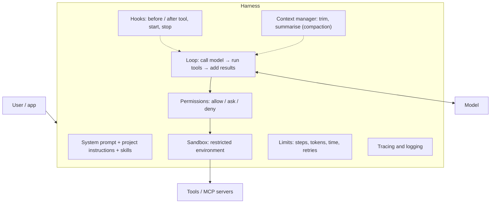

# Agent Harness

> The harness is all the code around the model that turns it into a working agent: the loop, the prompts, the tools, the permissions, the sandbox, the limits and the context management. Model + harness = agent.

Roadmap topic 11 · Stage 3: Tools & Agents (New)

**Go deeper:** `8` Tool Use · `9` MCP · `10` Agents · `12` Building an Agent · `13` Memory & Context · `14` Multi-Agent Systems · `16` Safety · `18` Observability.

**Marks:** 🟢 must know · 🟡 good to know · (New) still changing

---

#### 1. What Is It?

*Everything except the model.*

| 🟢 Must know | 🟡 Good to know |
|---|---|
| harness = the code around the model | hooks |
| what it does each turn | skills |
| what it supplies: system prompt, tools, loop rules | project instruction files |
| context management and compaction | subagents |
| permissions: allow, ask, deny | sessions, checkpoints, resuming |
| sandboxing | permission modes |
| limits and errors | same model, different harness, different results |
| | examples of harnesses |

1. **Each turn:** build the prompt → call the model → run the tools it asks for → add the results → repeat.
2. **It supplies:** the system prompt, tool definitions, and the rules of the loop.
3. **It enforces:** permissions, sandboxing, limits, retries, cancellation.
4. **It manages the context:** what stays, what is trimmed, what is summarised.

**Signals in an interview:** "what is an agent harness?", "how do you control what an agent can do?", "how do you handle long tasks?", "why do two agents on the same model behave differently?".

---

#### 2. How It Works

**The harness around the model.**



**What the harness does every turn.**

1. Assemble the prompt: system prompt, project instructions, relevant skills, tool definitions, history (trimmed), the new input.
2. Call the model (streaming), handle errors and retries.
3. If the model asks for tools: check permissions → run in the sandbox → shorten big results → add them to the history.
4. Check limits and stop conditions; compact the context if needed.
5. Save the session and the trace.

**Permissions.** For each tool call decide **allow** (run), **ask** (confirm with the user), or **deny**. Use rules by tool and arguments (for example allow `read_file`, ask for `bash`, deny `bash(rm *)`). Deny beats ask beats allow. Default to ask for anything unknown. Permissions limit what the *harness* will run no matter what the model wants.

**Sandboxing.** Run tools where mistakes are contained: a restricted directory, no network or an allow-list of hosts, no secrets in the environment, CPU/memory/time limits, a container or VM, and a snapshot to roll back. The model's output is untrusted input.

**Context management and compaction.** The history grows with every tool result. The harness keeps recent turns verbatim, shortens or drops large old tool results, and when a threshold is passed it **compacts**: summarises older turns into a short note (goal, decisions, files touched, open tasks) and continues from that. Stable prefixes (system prompt, tool definitions) stay first so prompt caching works.

**Limits and errors.** Max turns, max tokens, timeouts per tool, retries with backoff for model errors, cancellation (the user presses stop: cancel the model call and running tools), and a clean final message that says why it stopped.

🟡 **Hooks.** Your code that runs at fixed points: before a tool call (block or modify it), after a tool call (format files, run lint, log), when the session starts, when the agent stops (check that tests pass before finishing). Hooks enforce rules deterministically, which prompts cannot.

🟡 **Skills.** Packaged instructions, scripts and resources for a task (for example "create a release note", "review a PR"). Only a short description is always loaded; the full skill is loaded when relevant. This keeps the context small.

🟡 **Project instruction files.** Standing rules the harness loads automatically (for example a `CLAUDE.md` or `AGENTS.md` in a repo): build commands, code style, architecture notes, "never edit generated files". Keep them short, specific and current.

🟡 **Subagents.** A helper with its own context for one subtask; returns a short result (topic 14).

🟡 **Sessions, checkpoints, resume.** Save the history and state so a task can continue after a crash or tomorrow; checkpoint file states to undo changes.

🟡 **Permission modes.** For example *plan only* (read-only, propose a plan), *ask for edits*, *auto-approve edits in a workspace*, *fully autonomous in a sandbox*.

🟡 **Same model, different harness.** Prompt design, tool quality, context handling, limits and verification steps change results as much as the model does. When an agent underperforms, inspect the harness before blaming the model.

🟡 **Examples.** Coding CLIs and IDE agents, agent SDKs and frameworks, and the loop you write yourself in topic 12.

---

#### 3. Naive vs Better Design

| Naive | Better |
|---|---|
| the model's output is run directly | permission rules between the model and the tools |
| tools run on the host with your credentials | sandbox, scoped credentials |
| history grows until the request fails | trim, shorten, compact |
| rules only in the prompt ("please don't...") | enforced by permissions and hooks |
| no max turns/timeouts | explicit limits and cancellation |
| one huge system prompt | short prompt + project file + skills loaded on demand |
| no trace | every step logged and replayable |
| lose everything on a crash | sessions and checkpoints |

```kotlin
// Naive: a prompt that says "never delete files" is the only protection
agent.run(goal, tools = listOf(shell))        // the shell tool can still run rm -rf
```

---

#### 4. Code

A permission engine (deny > ask > allow, with simple wildcards):

```kotlin
enum class Decision { ALLOW, ASK, DENY }
data class Rule(val tool: String, val pattern: String?, val decision: Decision)       // pattern null = any argument

private fun glob(p: String) = Regex("^" + p.split("*").joinToString(".*") { Regex.escape(it) } + "$")

fun decide(rules: List<Rule>, tool: String, argument: String): Decision {
    val matching = rules.filter { it.tool == tool && (it.pattern == null || glob(it.pattern).matches(argument)) }
    return when {
        matching.any { it.decision == Decision.DENY } -> Decision.DENY
        matching.any { it.decision == Decision.ASK } -> Decision.ASK
        matching.any { it.decision == Decision.ALLOW } -> Decision.ALLOW
        else -> Decision.ASK                                                          // unknown → ask
    }
}
```

Checks with rules `read_file → ALLOW`, `bash → ASK`, `bash("rm *") → DENY`, `bash("git status") → ALLOW`: `decide(read_file, "notes.txt")` → `ALLOW`; `decide(bash, "ls")` → `ASK`; `decide(bash, "rm -rf /")` → `DENY` (deny wins even though `bash` also has an ask rule); `decide(bash, "git status")` → `ASK` (an ask rule on the whole tool still matches; ask beats allow), so list narrower allows only when there is no broader ask. `decide(send_email, "x")` → `ASK` (unknown tool).

Keep the path inside the workspace (a basic sandbox check):

```kotlin
fun isInside(root: String, path: String): Boolean {
    val base = java.nio.file.Paths.get(root).normalize()
    val target = base.resolve(path).normalize()
    return target.startsWith(base)
}
```

Checks: `isInside("/work", "src/a.kt")` → `true`; `isInside("/work", "../etc/passwd")` → `false`; `isInside("/work", "/etc/passwd")` → `false` (an absolute path replaces the base on resolve, so it is outside). Also resolve symlinks (`toRealPath`) in real code.

Hooks around a tool call:

```kotlin
sealed interface HookResult { data object Continue : HookResult; data class Block(val reason: String) : HookResult }

class Hooks(
    val before: List<(ToolCall) -> HookResult> = emptyList(),
    val after: List<(ToolCall, ToolResult) -> Unit> = emptyList()
)

fun runWithHooks(call: ToolCall, hooks: Hooks, run: (ToolCall) -> ToolResult): ToolResult {
    hooks.before.map { it(call) }.filterIsInstance<HookResult.Block>().firstOrNull()?.let {
        return ToolResult(call.id, "blocked by policy: ${it.reason}", isError = true)
    }
    return run(call).also { r -> hooks.after.forEach { it(call, r) } }              // e.g. audit log, lint
}
```

Checks: a `before` hook that blocks writes to `.env` returns `blocked by policy: …` and the tool is never run; an `after` hook that appends to an audit list records every executed call.

Compaction when the history is large:

```kotlin
fun compactIfNeeded(
    messages: List<Msg>, windowTokens: Int, threshold: Double = 0.8, keepLast: Int = 6,
    summarize: (List<Msg>) -> String
): List<Msg> {
    val used = messages.sumOf { approxTokens(it.text) }
    if (used < windowTokens * threshold || messages.size <= keepLast) return messages
    val old = messages.dropLast(keepLast)
    val summary = Msg("system", "Summary of earlier work:\n" + summarize(old))
    return listOf(summary) + messages.takeLast(keepLast)
}
```

Checks: 20 messages of 400 tokens (8,000 total) with `windowTokens = 8,000` (80% = 6,400 exceeded) and `keepLast = 6` → result has `1 + 6 = 7` messages: the summary followed by the last six. With `windowTokens = 100,000` → the list is returned unchanged.

A project instruction file (kept short and specific):

```text
# AGENTS.md
Build: ./gradlew assembleDebug     Test: ./gradlew testDebugUnitTest (run before finishing)
Style: Kotlin official style; no !!; ViewModels expose StateFlow.
Never edit files under build/ or generated/. Ask before changing the database schema.
```

---

#### 5. Numbers & Limits

| Item | Rule of thumb |
|---|---|
| Compaction trigger | at 70 to 85% of the context window |
| Keep verbatim | the last 5 to 10 turns, the system prompt, the current plan |
| Tool result cap | a few thousand tokens; summarise or paginate beyond that |
| Per-tool timeout | seconds to a few minutes; shorter for reads |
| Max turns | 20 to 100 for coding-style agents with checkpoints; far fewer for simple tasks |
| Project instruction file | under about 100 to 200 lines; every line costs tokens every turn |
| Skills | descriptions always loaded (tens of tokens); bodies on demand |
| Sandbox | no secrets in env, no network unless needed, resource limits |

---

#### 6. Common Mistakes & Edge Cases

1. Relying on the prompt for safety instead of permissions and sandboxing.
2. Running tools with the developer's full credentials.
3. No compaction, so long tasks fail near the end.
4. Compacting away the goal or constraints.
5. A huge instruction file full of stale rules.
6. No cancellation: the model keeps running after the user leaves.
7. Hooks that are slow or flaky.
8. Judging the model when the harness is the problem.

Edge cases: a tool call approved, then the world changes before it runs; two tools writing to the same file; a summary that loses a key decision; a crash mid-tool (idempotent steps and checkpoints); conflicting rules between the user, the project file and a document; permission fatigue (too many prompts, so users approve everything).

---

#### 7. Say This in the Interview

1. "Model plus harness equals agent. The harness builds the prompt, runs the loop and the tools, enforces permissions and limits, and manages the context."
2. "Safety lives in the harness: allow/ask/deny rules, a sandbox, least-privilege credentials, and hooks. A prompt can't enforce anything."
3. "For long tasks the harness compacts older turns into a summary and keeps recent turns and the plan."
4. "Hooks run my code deterministically at set points, such as blocking a write or running the tests before the agent can stop."
5. "Same model, different harness, different results, so I improve tool descriptions, context handling and verification before blaming the model."

---

#### 8. Quick Check

1. What are the three permission outcomes?
2. Why use hooks instead of a prompt rule?
3. When does the harness compact?
4. What belongs in a project instruction file?

<details>
<summary>Answers</summary>

1. Allow, ask, deny.
2. Hooks run for sure, every time; a prompt rule is only a request the model may ignore.
3. When the context passes a threshold (for example 80% of the window).
4. Short, specific standing rules: build and test commands, style, areas not to touch.

</details>

---

#### 9. Practice

**Interview questions**

1. What is an agent harness?
2. What does the harness do each turn?
3. How do you control what an agent may do?
4. How do you handle a task longer than the context window?
5. What are hooks and skills?
6. Why can the same model perform differently in different agents?

**Hands-on**

1. Add a permission engine and path sandbox to the agent from topic 12; test allow, ask, deny and path escape.
2. Add a `before` hook that blocks edits to certain files and an `after` hook that logs.
3. Implement compaction and test that the goal survives it.

**Coding warm-ups (LeetCode)**

| # | Question | Link to this topic |
|---|---|---|
| 146 | [LRU Cache](https://leetcode.com/problems/lru-cache/) (Medium) | evicting old context |
| 71 | [Simplify Path](https://leetcode.com/problems/simplify-path/) (Medium) | normalising paths for the sandbox check |
| 588 | [Design In-Memory File System](https://leetcode.com/problems/design-in-memory-file-system/) (Hard, premium) | a file tree for the workspace |
| 1188 | [Design Bounded Blocking Queue](https://leetcode.com/problems/design-bounded-blocking-queue/) (Medium, premium) | back-pressure for tool output |

**Remember:** model + harness = agent · permissions and sandbox, not prompts, enforce safety · hooks are deterministic · compact before the window fills · keep prefixes stable · limits and cancellation · inspect the harness first.
