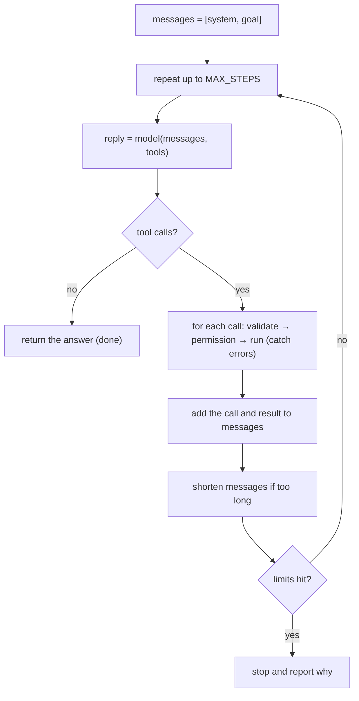

# Building an Agent

> Build the smallest loop that works, then add limits, permissions, context control and tests. This note takes you from the goal to a running agent in a fixed order.

Roadmap topic 12 · Stage 3: Tools & Agents

**Go deeper:** `4` Prompting · `8` Tool Use · `10` Agents · `11` Agent Harness · `13` Memory & Context · `15` Evaluation · `16` Safety · `17` Cost · `18` Observability.

**Marks:** 🟢 must know · 🟡 good to know

---

#### 1. What Is It?

*A recipe: thirteen steps, in order.*

| 🟢 Must know | 🟡 Good to know |
|---|---|
| steps 1 to 10: job, need check, model, prompt, tools, loop, limits, permissions, context, tests | treat tool results as untrusted; sandbox risky tools |
| the agent runs on your backend, not in the app | logging, tracing, cost tracking |
| | improve in order: tool descriptions → prompt → tools |
| | build from scratch once, then use an SDK |
| | common first mistakes |

**Signals in an interview:** "walk me through building an agent", "what would you build first?", "how do you test it?", "how do you keep it from doing damage?".

---

#### 2. How It Works

**The steps, in order.**

| # | Step | Output |
|---|---|---|
| 1 | **Define the job:** one goal, who it is for, what "done" means, what it must never do | a one-paragraph spec |
| 2 | **Check that you need an agent:** one prompt, then a fixed workflow, then an agent (topic 10) | a decision with a reason |
| 3 | **Pick a model:** a strong one to get it working; a cheaper one after tests pass (topic 3) | model + effort setting |
| 4 | **Write the system prompt:** role, goal, rules, when to stop, when to ask the user (topic 4) | versioned prompt |
| 5 | **Define a few tools:** clear names, descriptions, schemas; start read-only (topic 8) | tool specs + implementations |
| 6 | **Write the loop:** call the model, run requested tools, add results, repeat | working agent |
| 7 | **Add limits:** max steps, timeout, max cost; return tool errors to the model | no runaway runs |
| 8 | **Add permissions:** ask before anything that changes something (send, delete, pay) | approval flow |
| 9 | **Manage context:** shorten big outputs; stay inside the window (topic 13) | trimming / compaction |
| 10 | **Test with an eval set** of real tasks; read the traces (topics 15, 18) | pass rate + failure list |
| 11 | **Treat tool results as untrusted;** sandbox risky tools (topic 16) | injection defences |
| 12 | **Add logging, tracing, cost tracking** (topic 18) | dashboards |
| 13 | **Improve in order:** tool descriptions → prompt → add/remove tools | measured gains |

**The loop.**



**Also know.**

1. The agent runs on **your backend**; the mobile app only talks to your backend (topic 20 and `MOB 20`).
2. Build the loop from scratch once to understand it; later use an SDK or framework.
3. Common first mistakes: too many tools, vague descriptions, no step limit, no evals, write access too early.

---

#### 3. Naive vs Better Design

| Naive | Better |
|---|---|
| start with a multi-agent framework | start with a 50-line loop |
| 20 tools on day one | 2 or 3 read-only tools |
| tools that write immediately | read-only first; writes need approval |
| "it seems to work" | 20+ eval tasks with expected outcomes |
| tune the prompt first | fix tool descriptions first |
| no cap on steps or tokens | limits and a clear stop reason |
| swallow tool errors | return them to the model |
| unit-test only the code | also test the agent's behaviour on tasks |

---

#### 4. Code

A complete, testable agent loop (Kotlin). The model is an interface, so tests use a scripted fake. It reuses `Dispatcher`, `ToolCall` and `ToolResult` from topic 8.

```kotlin
sealed interface Reply {
    val tokens: Int
    data class Text(val text: String, override val tokens: Int = 0) : Reply
    data class ToolCalls(val calls: List<ToolCall>, override val tokens: Int = 0) : Reply
}

sealed interface AMsg {
    data class User(val text: String) : AMsg
    data class Assistant(val reply: Reply) : AMsg
    data class ToolResults(val results: List<ToolResult>) : AMsg
}

fun interface Model { suspend fun next(messages: List<AMsg>): Reply }

enum class Stop { DONE, MAX_STEPS, TOKEN_BUDGET, TIMEOUT }
data class Limits(val maxSteps: Int = 10, val maxTokens: Int = 50_000, val timeoutMs: Long = 60_000, val maxResultChars: Int = 2_000)
data class AgentResult(val answer: String?, val steps: Int, val stop: Stop, val trace: List<String>)

fun shorten(r: ToolResult, max: Int) =
    if (r.content.length <= max) r else r.copy(content = r.content.take(max) + "… [truncated, ${r.content.length - max} more characters]")

suspend fun runAgent(goal: String, model: Model, dispatcher: Dispatcher, limits: Limits = Limits()): AgentResult {
    val messages = mutableListOf<AMsg>(AMsg.User(goal))
    val trace = mutableListOf<String>()
    var tokens = 0
    var steps = 0
    return try {
        withTimeout(limits.timeoutMs) {
            while (steps < limits.maxSteps) {
                steps++
                val reply = model.next(messages)
                tokens += reply.tokens
                when (reply) {
                    is Reply.Text -> return@withTimeout AgentResult(reply.text, steps, Stop.DONE, trace)
                    is Reply.ToolCalls -> {
                        messages += AMsg.Assistant(reply)
                        val results = reply.calls.map { dispatcher.run(it) }              // errors come back as results
                        results.forEach { trace += "${it.callId}${if (it.isError) " ERROR" else ""}: ${it.content.take(60)}" }
                        messages += AMsg.ToolResults(results.map { shorten(it, limits.maxResultChars) })
                    }
                }
                if (tokens > limits.maxTokens) return@withTimeout AgentResult(null, steps, Stop.TOKEN_BUDGET, trace)
            }
            AgentResult(null, steps, Stop.MAX_STEPS, trace)
        }
    } catch (e: TimeoutCancellationException) {
        AgentResult(null, steps, Stop.TIMEOUT, trace)
    }
}
```

A scripted fake model for tests:

```kotlin
class ScriptedModel(private val script: List<Reply>) : Model {
    private var i = 0
    override suspend fun next(messages: List<AMsg>) = script[minOf(i++, script.lastIndex)]       // repeats the last reply if asked again
}
```

Checks (with a dispatcher that has a read-only `search_notes` tool returning `"2 notes found"`):

| Script | Result |
|---|---|
| `ToolCalls(search_notes)`, then `Text("Found 2 notes")` | answer `"Found 2 notes"`, `steps = 2`, `Stop.DONE` |
| `Text("Hello")` immediately | `steps = 1`, `Stop.DONE` (no tools needed) |
| `ToolCalls(search_notes)` forever, `maxSteps = 3` | `answer = null`, `steps = 3`, `Stop.MAX_STEPS` |
| each reply uses `400` tokens, `maxTokens = 1000` | stops at `steps = 3` (1,200 > 1,000), `Stop.TOKEN_BUDGET` |
| `ToolCalls(unknown_tool)`, then `Text("Sorry, I can't")` | trace contains `ERROR: unknown tool`, loop continues, `Stop.DONE` |
| a model that `delay`s past `timeoutMs` | `Stop.TIMEOUT` |

A tool result of 5,000 characters with `maxResultChars = 2,000` reaches the model as 2,000 characters plus `… [truncated, 3000 more characters]`.

The system prompt for a notes assistant:

```text
You are an assistant that helps a user manage their notes.
Goal: answer the user's request using the tools. Use search_notes before you update or delete anything.
Rules: act only on the current user's notes. Never delete without the user's confirmation. If a tool returns an error, read it and try a different approach once; if it fails again, tell the user.
When you are finished, reply with a short summary of what you did. If the request is ambiguous, ask one clarifying question instead of guessing.
```

An eval for the agent (the outcome, not the text):

```kotlin
data class AgentCase(val goal: String, val check: (AgentResult, NotesStore) -> Boolean, val label: String)

suspend fun evalAgent(cases: List<AgentCase>, makeAgent: () -> Triple<Model, Dispatcher, NotesStore>): Map<String, Boolean> =
    cases.associate { c ->
        val (model, dispatcher, store) = makeAgent()                // fresh store per case
        val result = runAgent(c.goal, model, dispatcher)
        c.label to c.check(result, store)
    }
// e.g. "Delete my 'old' note" → check: the note still exists unless the confirmation was approved
```

Improving in order: (1) read three failing traces; (2) fix the tool description that caused the wrong call; (3) change the prompt rule; (4) only then add or remove tools; (5) re-run the eval after each change and keep a score table.

---

#### 5. Numbers & Limits

| Item | Rule of thumb |
|---|---|
| First version | under about 100 lines, 2 or 3 read-only tools |
| Max steps | start at 10; raise only if evals show tasks need more |
| Token budget per run | set from your cost target: for example 50,000 tokens |
| Tool result cap | 1,000 to 3,000 tokens |
| Eval set | 20 to 50 real tasks to start; add every production failure |
| Pass-rate target | agree it before building (for example 90% task success at under 8 steps) |
| Cost | multiply tokens per run by price, then by runs per day |
| Model downgrade | only after the eval passes with the strong model |

---

#### 6. Common Mistakes & Edge Cases

1. A framework before understanding the loop.
2. Too many tools; vague descriptions.
3. No step, token or time limits.
4. Giving write tools before the read-only version works.
5. No eval set; judging by a few demos.
6. Tuning the prompt when the tool description is the problem.
7. Swallowing tool errors.
8. Running the agent inside the mobile app.
9. Trusting tool results as instructions.

Edge cases: the model asks for a tool that does not exist; two tool calls in one reply that depend on each other; a tool result larger than the window; the user cancels mid-run; the model finishes without calling a verification tool; an approval that never arrives (timeout and report).

---

#### 7. Say This in the Interview

1. "I start with the job: one goal, what done means and what it must never do. Then I check a single prompt and a workflow first."
2. "I build the smallest loop with two or three read-only tools, then add limits, permissions, context shortening and tests, in that order."
3. "Tool errors go back to the model as results so it can recover; limits give a clear stop reason."
4. "I test with an eval set of real tasks and read the traces; I fix tool descriptions first, then the prompt."
5. "It runs on my backend with the user's permissions, behind approval for any action that changes data."

---

#### 8. Quick Check

1. What are the first two steps?
2. Why start with read-only tools?
3. What do you do with a failing tool call?
4. What do you improve first when the agent picks the wrong tool?

<details>
<summary>Answers</summary>

1. Define the job (goal, done, never), then check whether you need an agent at all.
2. They are safe to run and retry; you can add writes once reads work and tests pass.
3. Return the error as a result to the model, so it can fix its arguments or choose another approach.
4. The tool descriptions (name, when to use, arguments).

</details>

---

#### 9. Practice

**Interview questions**

1. Walk me through building an agent.
2. How do you keep it from running forever or costing too much?
3. How do you test an agent?
4. What tools would you give a notes assistant, and in what order?
5. How do you make it safe to take actions?
6. What do you improve first when it fails?

**Hands-on**

1. Implement `runAgent` and the scripted tests in the table.
2. Add `create_note` with approval and an idempotency key; test decline and approve.
3. Build an eval of 20 tasks for the notes assistant and record the pass rate after each change.

**Coding warm-ups (LeetCode)**

| # | Question | Link to this topic |
|---|---|---|
| 1472 | [Design Browser History](https://leetcode.com/problems/design-browser-history/) (Medium) | state across steps |
| 621 | [Task Scheduler](https://leetcode.com/problems/task-scheduler/) (Medium) | scheduling tool calls with cool-downs |
| 207 | [Course Schedule](https://leetcode.com/problems/course-schedule/) (Medium) | dependency order of subtasks |

**Remember:** job → need check → model → prompt → tools (read-only first) → loop → limits → permissions → context → evals · return tool errors to the model · fix descriptions before prompts · backend, not the app.
