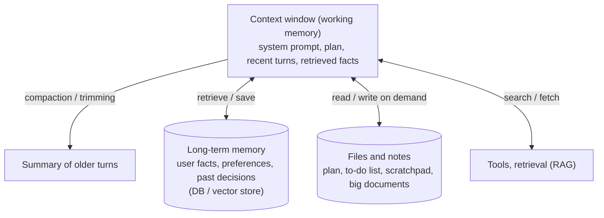

# Memory & Context Management

> The context window is an agent's working memory, and it fills up. Good agents keep what matters in context, move the rest outside, and bring it back only when needed.

Roadmap topic 13 · Stage 3: Tools & Agents

**Go deeper:** `2` How LLMs Work (context window) · `4` Prompting · `6` Embeddings · `7` RAG · `11` Agent Harness (compaction) · `16` Safety (data leakage) · `17` Cost (prompt caching) · `05-system-design/15-Caching`.

**Marks:** 🟢 must know · 🟡 good to know

---

#### 1. What Is It?

*What the model can see now, and what it can recall later.*

| 🟢 Must know | 🟡 Good to know |
|---|---|
| the context window is working memory, and it fills | notes files and to-do lists |
| short-term vs long-term memory | memory stores: what to save, forget, user control |
| compaction: summarise older turns | context pollution |
| keep big data outside; load what is needed | prompt caching |

1. **Short-term memory:** the conversation and tool results currently in the context.
2. **Long-term memory:** facts and notes stored outside (database, files, vector store) and retrieved when relevant.
3. **Compaction:** replacing old turns with a short summary.
4. **Context pollution:** stale, wrong or irrelevant text that degrades answers.

**Signals in an interview:** "how does the assistant remember my preferences?", "what happens in a very long conversation?", "how does an agent work on a task for hours?", "how do you delete a user's memories?".

---

#### 2. How It Works

**Layers of memory.**



**What stays in context.** The system prompt and tool definitions, the goal and current plan, the last few turns, and the facts needed for the next step. Everything else is a candidate to move out.

**Strategies for long conversations.**

| Strategy | How | Trade-off |
|---|---|---|
| Sliding window | keep the last N turns | simple; forgets early facts |
| Summarise (compaction) | replace old turns with a summary of goal, decisions, open items | keeps the gist; the summary can lose detail |
| Selective retention | keep pinned items (goal, constraints) + recent turns | needs rules for "important" |
| Retrieve on demand | store everything; fetch only what is relevant | extra retrieval; depends on search quality |
| Shorten tool results | keep the top lines, add "N more available" | cheap; may hide detail |

**Keep big data outside.** Don't paste files, logs or documents. Give the agent tools to search or read parts (`read_file(path, lines)`, `search(query)`), and let it keep notes.

🟡 **Notes files and to-do lists.** For long tasks the agent writes a plan and progress notes to a file or note store, updates them, and re-reads them after compaction or on resume. Notes survive when the context does not.

🟡 **Memory stores (long-term).** Decide:

| Question | Good practice |
|---|---|
| What to save? | stable, useful facts (preferences, corrections, goals), not every message; not secrets or sensitive data unless needed |
| How? | short, self-contained statements ("prefers metric units") with a source and date |
| When to retrieve? | at the start of a session, or by relevance to the current request |
| When to forget? | expiry, user deletion, superseded facts, privacy rules |
| User control | let the user see, edit and delete their memories; say what is remembered |
| Isolation | memories are per user; never leak across users (topic 16) |

🟡 **Context pollution.** Old tool outputs, contradicted facts, failed attempts and irrelevant retrievals mislead the model. Remove or summarise them, correct wrong notes, and avoid stuffing "just in case". More context is not better context.

🟡 **Prompt caching.** Keep the stable part (system prompt, tool definitions, project rules) at the *start* and in a fixed order so repeated requests reuse it at a lower price. Appending new turns at the end preserves the cache; editing earlier text breaks it (topic 5). Compaction rewrites history and resets the cache once, so do it deliberately.

---

#### 3. Naive vs Better Design

| Naive | Better |
|---|---|
| send the full history forever | trim, summarise, retrieve |
| paste the whole file into the chat | tools to read parts |
| remember everything the user says | save useful, stable facts only |
| memory the user cannot see or delete | view, edit, delete, expiry |
| one memory pool for all users | per-user isolation |
| a summary that drops the goal | pin the goal and constraints |
| rewrite old messages at will | append-only; compact at planned points |

```kotlin
// Naive: unbounded growth, then the request fails or gets expensive
val history = mutableListOf<Msg>()
fun ask(q: String): String { history += Msg("user", q); val a = llm(history); history += Msg("assistant", a); return a }
```

---

#### 4. Code

A per-user memory store with expiry, pinning, deletion and de-duplication:

```kotlin
data class Memory(val id: Long, val userId: String, val text: String, val createdAt: Long, val pinned: Boolean = false)

class MemoryStore(private val clock: () -> Long, private val ttlMs: Long = 90L * 24 * 3600 * 1000) {
    private val items = mutableListOf<Memory>()
    private var nextId = 1L

    fun add(userId: String, text: String, pinned: Boolean = false): Memory {
        items.firstOrNull { it.userId == userId && it.text.equals(text, ignoreCase = true) }?.let { return it }      // no duplicates
        return Memory(nextId++, userId, text.trim(), clock(), pinned).also { items += it }
    }
    fun list(userId: String) = items.filter { it.userId == userId && (it.pinned || clock() - it.createdAt < ttlMs) }
    fun delete(userId: String, id: Long) = items.removeAll { it.userId == userId && it.id == id }           // only your own
    fun deleteAll(userId: String) = items.removeAll { it.userId == userId }
}
```

Checks (clock in ms): adding `"prefers dark mode"` twice returns the same memory (one stored). After 91 days an unpinned memory no longer appears in `list`; a pinned one still does. `delete("bob", id)` of Ann's memory returns `false` (not removed); `deleteAll("ann")` leaves Bob's memories untouched.

Pick relevant memories for the current request (word overlap; use embeddings in real systems, topic 6):

```kotlin
private val stop = setOf("the", "a", "an", "is", "are", "does", "do", "of", "to", "which", "what", "user")
private fun words(s: String) = Regex("[a-z]+").findAll(s.lowercase()).map { it.value }.filter { it !in stop }.toSet()

fun relevant(memories: List<Memory>, request: String, k: Int = 3): List<Memory> {
    val q = words(request)
    return memories.map { it to words(it.text).intersect(q).size }.filter { it.second > 0 }.sortedByDescending { it.second }.take(k).map { it.first }
}
```

Checks: memories `prefers dark mode`, `lives in Berlin`, `allergic to peanuts` and the request `"Which mode should the app use?"` → only `prefers dark mode` is returned (shared word `mode`); an unrelated request returns `[]`.

Put memories into the prompt as data, with a label:

```kotlin
fun memoryBlock(memories: List<Memory>) =
    if (memories.isEmpty()) "" else "<user_memories>\n" + memories.joinToString("\n") { "- ${it.text}" } + "\n</user_memories>\n(These are notes about the user. Use them if relevant; do not mention them unless asked.)"
```

Keep the goal through compaction (pinned items + summary + recent turns):

```kotlin
fun compact(messages: List<Msg>, pinned: List<Msg>, keepLast: Int, summarize: (List<Msg>) -> String): List<Msg> {
    val body = messages - pinned.toSet()
    if (body.size <= keepLast) return pinned + body
    val summary = Msg("system", "Summary so far: " + summarize(body.dropLast(keepLast)))
    return pinned + summary + body.takeLast(keepLast)
}
```

Checks: 20 messages of 400 tokens (8,000 tokens) with 1 pinned goal, `keepLast = 6` and a 150-token summary → about `400 + 150 + 6 × 400 = 2,950` tokens instead of 8,000 (roughly 63% smaller), and the goal is still the first message.

A scratchpad file the agent keeps up to date:

```text
PLAN.md
- Goal: migrate 40 notes screens to the new API
- Done: list screen, detail screen
- Next: editor screen (needs the new ViewModel)
- Decisions: keep the old API behind a flag until step 5
- Open questions: how to handle offline drafts?
```

After a compaction or a restart the harness re-reads `PLAN.md` first.

---

#### 5. Numbers & Limits

| Item | Rule of thumb |
|---|---|
| Compaction trigger | around 70 to 85% of the window |
| Verbatim recent turns | the last 5 to 10 |
| Summary size | 100 to 500 tokens |
| Memory item | one short sentence, tens of tokens |
| Memories injected | the top 3 to 10 relevant ones, not all |
| Expiry | 30 to 365 days by default; pinned items by choice |
| Tool result size | a few thousand tokens at most |
| Cache | stable prefix first; appending keeps it, editing early text breaks it |

---

#### 6. Common Mistakes & Edge Cases

1. Sending the entire history until it fails.
2. Compacting away the goal or constraints.
3. Saving everything, including sensitive details.
4. Memory the user cannot inspect or delete.
5. Leaking memories across users or sessions.
6. Injecting all memories, even irrelevant ones.
7. Letting stale facts override new ones.
8. Treating memory content as instructions (it can contain injected text).

Edge cases: a user corrects a fact (replace the old memory); two memories conflict; a summary introduces an error that is then repeated; resuming a task a week later; legal deletion requests (delete memories, summaries and embeddings, and backups per policy); shared devices or shared accounts.

---

#### 7. Say This in the Interview

1. "The context window is working memory. I keep the goal, plan, recent turns and the facts needed now, and move the rest outside."
2. "For long conversations I trim and summarise older turns, but I pin the goal and constraints so compaction can't drop them."
3. "Long-term memory is a per-user store of short facts with timestamps; I retrieve the relevant ones, and users can see, edit and delete them."
4. "For long tasks the agent keeps a plan and notes file and re-reads it after compaction."
5. "I keep a stable prefix for prompt caching and avoid rewriting old messages."

---

#### 8. Quick Check

1. What is compaction?
2. What should survive it?
3. What makes a memory store privacy-friendly?
4. Why is more context not always better?

<details>
<summary>Answers</summary>

1. Replacing older turns with a short summary to free space.
2. The goal, constraints, the plan, and recent turns.
3. Saving only useful facts, per-user isolation, expiry, and user view/edit/delete.
4. Irrelevant or stale text dilutes attention and raises cost and latency.

</details>

---

#### 9. Practice

**Interview questions**

1. How does a chatbot remember a user's preferences across sessions?
2. What do you do when the conversation gets too long?
3. How does an agent work on a task longer than its context?
4. What would you store in long-term memory, and what not?
5. How do you let users control their memory?
6. What is context pollution?

**Hands-on**

1. Build the memory store with expiry and deletion, and write the four checks as tests.
2. Add compaction with a pinned goal to your agent and verify the goal survives.
3. Add a `PLAN.md` the agent updates, and resume a task from it after restart.

**Coding warm-ups (LeetCode)**

| # | Question | Link to this topic |
|---|---|---|
| 146 | [LRU Cache](https://leetcode.com/problems/lru-cache/) (Medium) | evicting old context |
| 460 | [LFU Cache](https://leetcode.com/problems/lfu-cache/) (Hard) | keeping the most-used memories |
| 981 | [Time Based Key-Value Store](https://leetcode.com/problems/time-based-key-value-store/) (Medium) | facts valid at a point in time |
| 380 | [Insert Delete GetRandom O(1)](https://leetcode.com/problems/insert-delete-getrandom-o1/) (Medium) | fast store with deletion |

**Remember:** context = working memory · move big data out, load on demand · compact but pin the goal · save short stable facts per user · user can view and delete · keep the prefix stable · more context is not better context.
