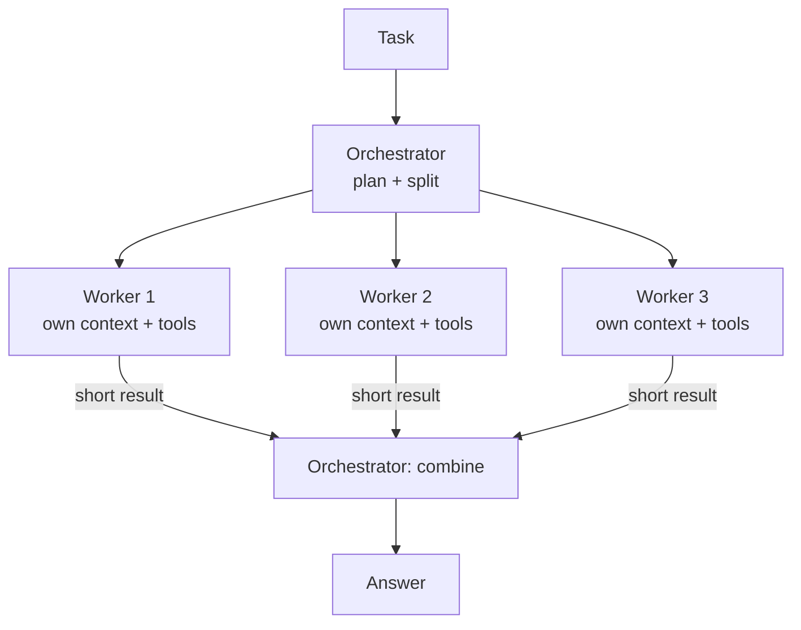

# Multi-Agent Systems

> One agent is usually enough. Split into several only when there is a clear reason: work that can run in parallel, context that would otherwise overflow, or roles that need different tools and permissions.

Roadmap topic 14 · Stage 3: Tools & Agents (New)

**Go deeper:** `10` Agents · `11` Agent Harness (subagents) · `12` Building an Agent · `13` Memory & Context · `15` Evaluation · `17` Cost, Latency & Reliability · `05-system-design/21-Queues-Events-and-Background-Jobs`.

**Marks:** 🟢 must know · 🟡 good to know · (New) still changing

---

#### 1. What Is It?

*A lead agent (or code) that delegates parts of a job to other agents.*

| 🟢 Must know | 🟡 Good to know |
|---|---|
| one agent is usually enough; split only for a clear reason | parallel agents for independent tasks (more tokens) |
| orchestrator–worker pattern | handoffs and routers |
| a subagent has its own context and returns a short result | shared state; conflicts |
| | when a worker fails: retry, skip, report |
| | agent-to-agent protocols (A2A) |

1. **Orchestrator:** plans, splits the task, assigns subtasks, combines results.
2. **Worker / subagent:** does one subtask in its own fresh context and returns a short result.
3. **Handoff:** one agent passes the conversation to a specialist.
4. **Router:** picks which agent handles a request.

**Signals in an interview:** "would you use multiple agents?", "how do agents share information?", "what if one fails?", "how does cost change?".

---

#### 2. How It Works

**Orchestrator–worker.**



**Why split.**

| Reason | Example |
|---|---|
| Parallel speed | research five sources at once |
| Context isolation | a worker reads 50 files and returns a 10-line finding; the main context stays clean |
| Different tools or permissions | a read-only researcher and a separate writer with approval |
| Specialisation | different prompts/models for different roles (router, coder, reviewer) |

**Why not.** More agents mean more tokens (often 2 to 15× a single agent), more latency in coordination, more failure modes, harder debugging and testing, and cascading errors. A single agent with good tools and context management beats a badly designed team.

**Subagents keep the main context clean.** The worker receives a **specific, self-contained task** (it cannot see the parent's history), does the heavy reading, and returns a **short structured result**. The orchestrator never sees the raw material.

🟡 **Parallel agents.** Independent subtasks run concurrently. Limit the number (cost, rate limits), give each a budget and timeout, and combine results deterministically.

🟡 **Handoffs and routers.** A router (a small model or rules) classifies the request and sends it to a specialist (billing, technical, sales). A handoff passes the conversation state to another agent. Keep the number of specialists small and the boundaries clear.

🟡 **Shared state and coordination.** Agents that change the same thing (a file, a record) conflict. Options: give each worker its own area; have only the orchestrator write; use versions/locks (compare-and-set); or merge results in code. Prefer sharing *files and structured results*, not free-form chat between agents.

🟡 **When a worker fails.** Decide per task: retry with a limit, skip and note the gap, use a fallback worker, or fail the whole job. The final answer should state what is missing.

🟡 **A2A.** A protocol for agents (possibly from different vendors) to discover and talk to each other. Name only. Inside one system, plain function calls or a queue are simpler.

---

#### 3. Naive vs Better Design

| Naive | Better |
|---|---|
| five agents chatting with each other | one agent with tools, or an orchestrator with workers |
| workers share the full parent history | workers get a focused task and return a short result |
| unlimited workers | a cap, budgets and timeouts |
| a failed worker ignored silently | explicit failure handling and a note in the answer |
| two agents editing the same file | one writer, or versioned writes |
| free-form text handed between agents | structured results |
| no cost comparison | measure tokens and success against a single agent |

```kotlin
// Naive: every worker gets the entire conversation and unbounded time
workers.map { async { it.run(entireHistory) } }.awaitAll()
```

---

#### 4. Code

An orchestrator with capped parallel workers, timeouts, truncated results and failure handling:

```kotlin
data class WorkerOutcome(val task: String, val result: String?, val error: String?)

suspend fun orchestrate(
    task: String,
    planner: suspend (String) -> List<String>,                    // splits the task
    worker: suspend (String) -> String,                           // runs ONE subtask in its own context
    synthesize: suspend (String, List<String>) -> String,
    maxWorkers: Int = 4, timeoutMs: Long = 30_000, maxResultChars: Int = 500
): String {
    val subtasks = planner(task).take(maxWorkers)                  // cap the fan-out
    val outcomes = coroutineScope {
        subtasks.map { t ->
            async {
                try { WorkerOutcome(t, withTimeout(timeoutMs) { worker(t) }.take(maxResultChars), null) }
                catch (e: TimeoutCancellationException) { WorkerOutcome(t, null, "timed out") }
                catch (e: CancellationException) { throw e }
                catch (e: Exception) { WorkerOutcome(t, null, e.message ?: "failed") }
            }
        }.awaitAll()
    }
    val notes = outcomes.map { if (it.result != null) "${it.task}: ${it.result}" else "${it.task}: (failed: ${it.error})" }
    return synthesize(task, notes)
}
```

Checks (fakes): a planner returning 6 subtasks → only `4` workers run. One worker throwing `IOException("boom")` → the synthesis input contains `"<task>: (failed: boom)"` and the other three results; the job still completes. A worker returning 2,000 characters → only `500` reach the synthesiser. A worker that delays past `timeoutMs` → `(failed: timed out)`.

Cost of splitting (tokens): a single agent doing everything in one context uses `30,000` tokens. An orchestrator (`10,000`) plus three workers (`20,000` each) uses `70,000` tokens: about `2.3×`. The split pays off only if it is faster, more accurate, or the single context would overflow, so measure it.

Shared state with compare-and-set (two agents cannot overwrite each other silently):

```kotlin
class VersionedDoc(text: String) {
    var text = text; private set
    var version = 0; private set
    @Synchronized fun update(expectedVersion: Int, newText: String): Boolean {
        if (expectedVersion != version) return false              // someone else changed it: re-read and merge
        text = newText; version++; return true
    }
}
```

Checks: two agents both read version `0`. Agent A `update(0, "A")` → `true`, version `1`. Agent B `update(0, "B")` → `false`: B must re-read, merge, and retry with version `1`.

A router with a safe default:

```kotlin
suspend fun routeToAgent(classify: suspend (String) -> String, agents: Map<String, suspend (String) -> String>, request: String): String {
    val label = classify(request).trim().lowercase()
    return (agents[label] ?: agents.getValue("general"))(request)
}
```

Checks: label `"billing"` → billing agent; label `"weather"` (not a known agent) → the `general` agent.

Structured handoff between agents (rather than free text):

```kotlin
@Serializable data class Finding(val question: String, val answer: String, val sources: List<String>, val confidence: String)
```

---

#### 5. Numbers & Limits

| Item | Rule of thumb |
|---|---|
| Token cost | multi-agent runs often use 2 to 15× the tokens of one agent |
| Workers | 2 to 5 in parallel; cap and budget each |
| Worker result | 100 to 500 tokens; structured |
| Worker timeout | per subtask; the orchestrator keeps a global timeout |
| Coordination overhead | every handoff adds a model call and latency |
| Reliability | more agents, more steps, more compounding errors; test end to end |
| Rate limits | parallel workers can hit provider limits; queue and back off |
| When it helps | independent, read-heavy, parallel tasks (research, search across many files) |

---

#### 6. Common Mistakes & Edge Cases

1. Using multiple agents for a simple task.
2. Letting agents talk freely with no structure.
3. Workers sharing the parent's whole history.
4. No cap on workers, tokens or time.
5. Ignoring failed workers and returning a confident answer.
6. Several writers on the same resource.
7. Splitting tightly dependent steps (they can't run in parallel).
8. No evaluation comparing against a single agent.

Edge cases: two workers return contradictory findings (the orchestrator must flag or verify); a worker needs information from another (dependency, serialise); the plan has too many subtasks; one worker succeeds partially; the orchestrator's summary hides a worker's caveat; provider rate limits throttling parallel runs.

---

#### 7. Say This in the Interview

1. "I'd start with one agent. I split only when subtasks are independent and can run in parallel, when a worker's reading would flood the main context, or when different roles need different permissions."
2. "A subagent gets a focused task in a fresh context and returns a short structured result, so the lead's context stays small."
3. "I cap workers and give each a budget and timeout; failures are explicit: retry, skip, or report the gap."
4. "Shared state is the risky part: I give each worker its own area, let one agent write, or use versioned writes."
5. "Multi-agent runs cost several times more tokens, so I measure success and cost against a single agent."

---

#### 8. Quick Check

1. Name two good reasons to use subagents.
2. Why does a subagent return a short result?
3. What if a worker fails?
4. How do you avoid two agents overwriting each other?

<details>
<summary>Answers</summary>

1. Parallel independent work, and keeping heavy reading out of the main context (also different permissions or roles).
2. So the orchestrator's context stays small and focused.
3. Retry with a limit, skip and note the gap, use a fallback, or fail the job; state what is missing.
4. Separate areas, a single writer, or versioned compare-and-set writes.

</details>

---

#### 9. Practice

**Interview questions**

1. When would you use multiple agents instead of one?
2. Describe the orchestrator–worker pattern.
3. How do subagents keep the context clean?
4. How do you handle a failing worker?
5. How do you prevent conflicts over shared state?
6. What does multi-agent cost compared with one agent?

**Hands-on**

1. Build the orchestrator with fakes and test the four checks.
2. Compare a single agent and an orchestrator on 10 research questions: success, tokens, time.
3. Add a compare-and-set document and simulate two concurrent writers.

**Coding warm-ups (LeetCode)**

| # | Question | Link to this topic |
|---|---|---|
| 1242 | [Web Crawler Multithreaded](https://leetcode.com/problems/web-crawler-multithreaded/) (Medium, premium) | parallel workers over a frontier |
| 1117 | [Building H2O](https://leetcode.com/problems/building-h2o/) (Medium) | coordinating workers |
| 56 | [Merge Intervals](https://leetcode.com/problems/merge-intervals/) (Medium) | merging overlapping results |
| 23 | [Merge k Sorted Lists](https://leetcode.com/problems/merge-k-sorted-lists/) (Hard) | combining many workers' output |

**Remember:** one agent first · split for parallelism, context isolation or permissions · focused task in, short structured result out · cap, budget, time out · handle failures explicitly · protect shared state · measure against a single agent.
