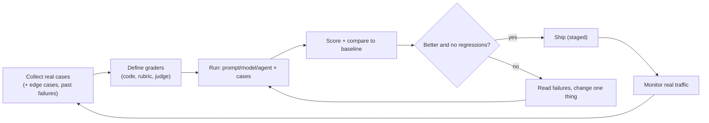

# Evaluation & Quality

> You cannot improve what you cannot measure. AI output is variable, so ordinary unit tests are not enough: build an eval set of real examples, score it automatically, and re-run it on every change.

Roadmap topic 15 · Stage 4: AI in Production

**Go deeper:** `4` Prompting (regression cases) · `7` RAG (retrieval vs answer quality) · `10` Agents · `12` Building an Agent · `17` Cost & Reliability · `18` Observability (turn failures into cases) · `06-mobile-engineering/12-Testing`.

**Marks:** 🟢 must know · 🟡 good to know

---

#### 1. What Is It?

*Tests and scores for non-deterministic output.*

| 🟢 Must know | 🟡 Good to know |
|---|---|
| why unit tests are not enough | LLM-as-judge and its limits |
| build an eval set | user feedback |
| re-run on every prompt or model change | A/B testing prompts and models |
| what to measure | retrieval quality vs answer quality |
| agent evals | public benchmarks vs your evals |

1. **Eval set:** inputs with expected outcomes or scoring rules, taken from real use.
2. **Grader:** code or a model that scores each output.
3. **Regression:** re-running the eval to see whether a change made things worse.
4. **Metric:** a number (pass rate, groundedness, cost) you track.

**Signals in an interview:** "how do you test an LLM feature?", "how do you know the new prompt is better?", "can an LLM grade another LLM?", "how do you evaluate an agent?".

---

#### 2. How It Works

**Why ordinary tests fall short.** The same input can produce different valid wordings; "correct" is often a judgement (helpful, faithful, safe); failures are subtle (a confident wrong fact); and a change that fixes one case can break ten others. Exact-match assertions only work for narrow outputs.

**The eval loop.**



**Building the eval set.** Start with 30 to 100 cases from real or realistic inputs: typical, hard, edge, adversarial (injection, off-topic, empty), and every production failure you find later. For each: the input, the expected result or the criteria, and tags (category, difficulty). Keep a **held-out** part you don't tune on.

**What to measure.**

| Area | Metrics |
|---|---|
| Correctness | exact/contains match, numeric match, test pass |
| Format | valid JSON/schema, length limits, language |
| Groundedness (RAG) | every claim supported by the sources; citations valid |
| Task success | the user's goal achieved |
| Safety | refuses harmful requests, resists injection, no data leak |
| Behaviour | says "I don't know" when it should |
| Cost and speed | tokens, latency p50/p95 |

**Graders.**

| Grader | Use for | Notes |
|---|---|---|
| Code check | format, schema, exact values, tests | cheap, objective, preferred |
| Reference compare | closed answers | exact, fuzzy, or semantic match |
| LLM-as-judge | open-ended quality (helpfulness, tone, faithfulness) | needs a rubric; validate against human labels |
| Human review | calibration, subtle quality, final decisions | slow and costly; use on samples |

**Agent evals.** Score the **outcome** (did the task succeed: the file changed, the booking exists, tests pass) and the **path** (right tools, few steps, within budget, no forbidden actions). Run each case several times, because agents are variable: report the pass rate and how often it passes *every* time. Read the traces of failures.

🟡 **LLM-as-judge and its limits.** A model grades another model's output against a rubric. It scales, but has biases: it prefers longer answers, the first option in a pair, and its own style; it can be fooled by confident wrong text. Mitigate: specific rubrics with scores and reasons, randomise order, compare with human labels (check agreement), use a different or stronger model, and keep code checks for anything checkable.

🟡 **User feedback.** Thumbs up/down, edits, regenerations, copy actions, escalations. Noisy but real; sample the negatives into new eval cases.

🟡 **A/B testing.** Serve variants to different users and compare product metrics (task completion, retention, cost). Offline evals first; A/B for the final call. Watch sample sizes.

🟡 **Retrieval vs answer quality.** Evaluate retrieval separately (recall@k, MRR; topic 7) and the answer separately. This tells you which half to fix.

🟡 **Public benchmarks vs your evals.** Benchmarks show general ability and may not reflect your task; they can leak into training data. Use them to shortlist, your eval to decide.

---

#### 3. Naive vs Better Design

| Naive | Better |
|---|---|
| "looks good in the demo" | an eval set with a score |
| tune on the same cases you report | hold out a test split |
| exact-match on free text | code checks + rubric judge |
| trust the judge blindly | validate against human labels |
| single run per case | multiple runs for variable systems |
| change prompt, model and tools together | one change at a time |
| only offline tests | monitor production and feed failures back |
| ignore cost | track cost and latency as metrics |

```kotlin
// Naive: a unit test that fails whenever the wording changes
assertEquals("Refunds take 5 days.", answer)
```

---

#### 4. Code

A small eval runner with several kinds of check:

```kotlin
data class EvalCase(val id: String, val input: String, val tags: Set<String> = emptySet(), val check: (String) -> Boolean)

data class EvalReport(val total: Int, val passed: Int, val failedIds: List<String>) {
    val passRate get() = if (total == 0) 0.0 else passed.toDouble() / total
}

suspend fun runEval(cases: List<EvalCase>, system: suspend (String) -> String): EvalReport {
    val failed = cases.filterNot { it.check(system(it.input)) }.map { it.id }
    return EvalReport(cases.size, cases.size - failed.size, failed)
}

// graders you can compose
fun contains(vararg words: String) = { out: String -> words.all { out.contains(it, ignoreCase = true) } }
fun refuses() = { out: String -> Regex("(?i)i don't know|can't help|cannot help").containsMatchIn(out) }
fun validJsonWithKeys(vararg keys: String) = { out: String ->
    runCatching { Json.parseToJsonElement(out).jsonObject }.getOrNull()?.let { o -> keys.all { it in o } } ?: false
}
```

Checks: with a fake system answering `"Refunds take 5 days."` for a refund question, `"I don't know."` for an unknown question, and `{"title":"x"}` for an extraction, cases `contains("5 days")`, `refuses()` and `validJsonWithKeys("title")` all pass: `EvalReport(3, 3, [])`, `passRate = 1.0`. If the system returns `"Maybe 3 days"` for the first, `failedIds = ["refund"]` and `passRate = 0.667`.

A confidence interval, so you don't over-read small differences:

```kotlin
fun wilson(passes: Int, n: Int, z: Double = 1.96): Pair<Double, Double> {
    if (n == 0) return 0.0 to 1.0
    val p = passes.toDouble() / n
    val denom = 1 + z * z / n
    val centre = (p + z * z / (2 * n)) / denom
    val half = z * Math.sqrt(p * (1 - p) / n + z * z / (4.0 * n * n)) / denom
    return (centre - half) to (centre + half)
}
```

Checks: 45 passes of 50 (90%) → interval about `[0.786, 0.957]`; 40 of 50 (80%) → `[0.670, 0.888]`. The two intervals overlap, so on 50 cases a 10-point gain may be noise. With 180 of 200 (90%) → `[0.851, 0.934]` and 160 of 200 (80%) → `[0.739, 0.850]`: the intervals no longer overlap, so the gain is credible. More cases or paired comparisons give firmer answers.

A regression gate for CI:

```kotlin
fun gate(baseline: EvalReport, candidate: EvalReport, criticalIds: Set<String>, maxDrop: Double = 0.02): Boolean =
    candidate.passRate >= baseline.passRate - maxDrop && candidate.failedIds.none { it in criticalIds }
```

Checks: baseline `0.90`, candidate `0.89`, no critical failure → `true`; candidate `0.85` → `false`; candidate `0.95` but a critical case (`injection-1`) failing → `false`.

Reliability across repeated runs (agents and variable outputs):

```kotlin
suspend fun passAtAndAll(n: Int, run: suspend () -> Boolean): Pair<Double, Boolean> {
    val results = (1..n).map { run() }
    return results.count { it }.toDouble() / n to results.all { it }
}
```

Checks: with a per-run success probability of `0.9`, passing all 3 runs happens about `0.9³ = 0.73` of the time: a "90% agent" fails at least once in three tries about 27% of the time, which matters for tasks users repeat.

A judge prompt with a rubric, scored and explained:

```text
You are grading an answer to a customer question. Use ONLY the provided sources.
Score 1-5 for FAITHFULNESS (every claim is supported by the sources) and 1-5 for HELPFULNESS.
Give a one-sentence reason for each score. Reply as JSON: {"faithfulness":n,"helpfulness":n,"reason":"..."}.
```

Judge agreement with humans:

```kotlin
fun agreement(judge: List<Boolean>, human: List<Boolean>) = judge.zip(human).count { (a, b) -> a == b }.toDouble() / judge.size
```

Checks: judge vs human on 10 cases agreeing on 8 → `0.8`. Aim for high agreement (for example above 0.85) before trusting the judge to gate releases.

---

#### 5. Numbers & Limits

| Item | Rule of thumb |
|---|---|
| Eval set size | start with 30 to 100; grow to hundreds |
| Held-out split | 20 to 30% never used for tuning |
| Detecting a 5-point change | needs hundreds of cases per variant |
| Runs per case | 3 to 5 for agents or high-temperature outputs |
| Judge validation | compare with 50+ human-labelled cases |
| CI gate | no drop of more than 1 to 2 points; no critical failures |
| Cost of evals | tokens × cases × variants: budget it; cache and sample |
| Cadence | every prompt/model/tool change; weekly on production samples |

---

#### 6. Common Mistakes & Edge Cases

1. No eval set; judging by a few demos.
2. Tuning on the test cases.
3. Exact-match checks on free text.
4. Trusting an LLM judge without validating it.
5. Changing several things at once.
6. Eval cases that don't resemble real traffic.
7. Ignoring cost, latency and safety metrics.
8. Never turning production failures into new cases.

Edge cases: flaky cases (multiple runs, check variance); the judge model and the system model are the same (self-preference); the eval leaks into the prompt (few-shot examples that are also test cases); a model update silently changes behaviour (re-run the eval); evaluating multi-turn conversations (script the user turns); subjective quality needing human review.

---

#### 7. Say This in the Interview

1. "Unit tests assume deterministic output. For LLM features I build an eval set of real cases with graders, and I re-run it on every prompt, model or tool change."
2. "I prefer code checks for anything checkable (format, schema, tests); for open-ended quality I use a rubric-based judge validated against human labels."
3. "For RAG I measure retrieval (recall@k) and answer groundedness separately; for agents I score task success, steps, tools and cost over several runs."
4. "I keep a held-out set, look at confidence intervals so I don't over-read small differences, and gate releases on no critical regressions."
5. "Production failures and negative feedback become new eval cases."

---

#### 8. Quick Check

1. Why not use exact-match assertions on free text?
2. What are two biases of LLM judges?
3. What does the Wilson interval warn you about?
4. How do you evaluate an agent?

<details>
<summary>Answers</summary>

1. Valid answers can be worded many ways; tests fail for the wrong reason.
2. Preference for longer answers, for the first option, or for its own style.
3. That a small sample's pass rate is uncertain; two close scores may not be truly different.
4. Score outcome (task success) and path (tools, steps, cost), over multiple runs, and read the traces.

</details>

---

#### 9. Practice

**Interview questions**

1. How do you test an LLM-powered feature?
2. How do you build an eval set?
3. What are the strengths and weaknesses of LLM-as-judge?
4. How do you evaluate a RAG system? An agent?
5. How do you know a new prompt is better?
6. How do you keep quality from regressing?

**Hands-on**

1. Build 30 cases for your notes assistant and run them against two prompt versions.
2. Hand-label 30 outputs and measure your judge's agreement.
3. Add a CI gate that blocks a pull request if pass rate drops more than 2 points.

**Coding warm-ups (LeetCode)**

| # | Question | Link to this topic |
|---|---|---|
| 295 | [Find Median from Data Stream](https://leetcode.com/problems/find-median-from-data-stream/) (Hard) | latency percentiles |
| 692 | [Top K Frequent Words](https://leetcode.com/problems/top-k-frequent-words/) (Medium) | most frequent failure categories |
| 1396 | [Design Underground System](https://leetcode.com/problems/design-underground-system/) (Medium) | averages from start/end events |

**Remember:** eval set from real cases · code checks first, rubric judge second, humans to calibrate · re-run on every change · held-out split · mind the noise · agents: outcome + path, several runs · feed failures back.
