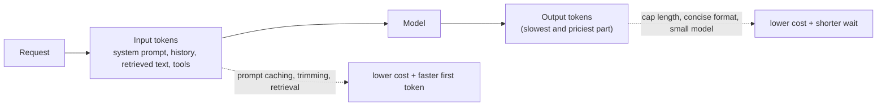

# Cost, Latency & Reliability

> Tokens drive both cost and latency. Keep prompts short, cache what repeats, route easy work to small models, stream for perceived speed, and plan for timeouts, rate limits and outages.

Roadmap topic 17 · Stage 4: AI in Production

**Go deeper:** `3` Model Choice · `5` Calling an LLM API (caching, batch, retries) · `13` Memory & Context · `18` Observability · `05-system-design/22-Reliable-Requests-and-External-Services` and `25-Overload-and-Failure-Handling` · `05-system-design/15-Caching`.

**Marks:** 🟢 must know · 🟡 good to know

---

#### 1. What Is It?

*Making AI features affordable, fast enough and dependable.*

| 🟢 Must know | 🟡 Good to know |
|---|---|
| tokens (input and output) drive cost and latency | smaller models, routing, shorter prompts, capped output |
| time to first token vs total time; streaming | budgets and cost alerts |
| caching: repeated answers and prompt caching | batch processing |
| timeouts, retries, fallbacks | provider outages: multi-provider or degraded mode |
| queue non-urgent work | |

1. **Cost** = input tokens × input price + output tokens × output price (output usually costs several times more per token).
2. **Latency** = time to first token (TTFT) + generation time (output tokens ÷ tokens per second).
3. **Reliability** = it works when the provider is slow, rate-limited or down.

**Signals in an interview:** "the bill is too high", "answers are slow", "what if the provider is down?", "how do you budget per user?", "how would you cut cost by half?".

---

#### 2. How It Works

**Where the money and the time go.**



**Latency.** *Time to first token* grows with input size and model size. *Total time* grows with output length. Streaming does not make the model faster, but the user sees the answer start in a fraction of a second, so it **feels** much faster (`SD 24`). Reduce latency: shorter prompts, a smaller/faster model, lower reasoning effort for easy tasks, parallel independent calls, caching, and starting work early (prefetch).

**Cost levers, in a sensible order.**

| Lever | What it does | Typical effect |
|---|---|---|
| Don't call the model | cache exact repeats; rules for trivial cases | 100% saved on hits |
| Prompt caching | reuse the stable prefix at a fraction of the input price | up to ~90% off that part |
| Trim the input | shorter system prompt, retrieve instead of paste, drop old history | proportional to tokens removed |
| Cap output | max tokens, concise formats | direct saving; also faster |
| Model routing | small model for easy requests, large for hard | often 50%+ overall |
| Lower effort / thinking | less reasoning on routine tasks | fewer output tokens |
| Batch | non-urgent jobs processed asynchronously at a discount | about 50% |
| Budgets | per-user and global limits | prevents surprises |

Measure per request class, not on average; check that quality holds on your eval after each change (topic 15).

**Reliability.**

| Problem | Defence |
|---|---|
| slow response | timeout, stream, show progress |
| `429` rate limit | backoff + jitter, respect `Retry-After`, queue, lower concurrency |
| provider error / outage | retry, fallback model/provider, degraded mode |
| invalid output | validate, retry once, fall back |
| runaway agent | max steps, token budget (topic 12) |
| duplicates from retries | idempotency keys on your side |

**Fallbacks (in order).** Another model from the same provider → another provider → a cached or simpler answer ("here are your recent notes") → a clear error. Say what you are doing. Keep the fallback prompts tested, because prompts that work on one model may need adjusting on another.

**Queue non-urgent work (`SD 21`).** Summaries, tagging, embeddings and reports go through a queue and workers with rate control, retries and a dead-letter queue; push a notification when done (`MOB 20`).

🟡 **Budgets.** A daily token or dollar limit per user and plan, a global cap, and alerts at 50/80/100%. When a user hits the limit, degrade (smaller model, shorter answers) or ask them to wait/upgrade.

🟡 **Provider outages.** Multi-provider support behind one interface, health checks and circuit breakers (`SD 25`), a degraded mode (read-only, cached answers), and a status page for your users.

---

#### 3. Naive vs Better Design

| Naive | Better |
|---|---|
| the largest model for everything | route by difficulty; smallest passing model |
| resend all history and documents | trim; retrieve; cache the prefix |
| no output cap | explicit max tokens, concise format |
| wait for the full answer | stream |
| retry immediately and forever | backoff + jitter, limits, circuit breaker |
| one provider, no fallback | fallback chain + degraded mode |
| no per-user limit | budgets and alerts |
| synchronous long jobs | queue + notify |
| cost known at month end | cost per request logged and dashboarded |

---

#### 4. Code

Cost per request and monthly cost (example prices per 1M tokens: mid `$2 in / $10 out`, small `$0.10 / $0.50`; cached input reads at 10% of the input price):

```kotlin
data class Price(val inPerM: Double, val outPerM: Double, val cachedReadFraction: Double = 0.1)

fun requestCost(inputTokens: Int, cachedTokens: Int, outputTokens: Int, p: Price): Double {
    val fresh = inputTokens - cachedTokens
    return (fresh * p.inPerM + cachedTokens * p.inPerM * p.cachedReadFraction + outputTokens * p.outPerM) / 1_000_000
}

fun monthlyCost(perRequest: Double, requestsPerDay: Int, days: Int = 30) = perRequest * requestsPerDay * days
```

Checks (input 1,500 tokens, output 300, 100,000 requests a day):

| Design | Cost per request | Per month | Saving |
|---|---|---|---|
| mid model, no caching | `$0.0060` | `$18,000` | |
| + cache 1,000 of the 1,500 input tokens | `$0.0042` | `$12,600` | 30% |
| + route 40% of traffic to the small model (`$0.0003` each) | `$0.00264` | `$7,920` | 56% vs the start |

(If quality drops on the routed traffic, the saving is not real: check with your eval.)

Latency model:

```kotlin
fun totalSeconds(ttftSeconds: Double, outputTokens: Int, tokensPerSecond: Double) = ttftSeconds + outputTokens / tokensPerSecond
```

Checks: TTFT `0.8` s, `400` output tokens at `80` tokens/s → `5.8` s total. Non-streaming, the user waits `5.8` s; streaming, the first words appear at `0.8` s. Capping output at 200 tokens → `3.3` s.

An exact-match response cache (for repeated questions with no personal data):

```kotlin
class ResponseCache(private val ttlMs: Long, private val clock: () -> Long) {
    private data class Entry(val value: String, val at: Long)
    private val map = HashMap<String, Entry>()
    private fun key(prompt: String, model: String) = (model + "|" + prompt.trim().lowercase().replace(Regex("\\s+"), " ")).hashCode().toString()

    suspend fun getOrCompute(prompt: String, model: String, compute: suspend () -> String): String {
        val k = key(prompt, model)
        map[k]?.takeIf { clock() - it.at < ttlMs }?.let { return it.value }
        return compute().also { map[k] = Entry(it, clock()) }
    }
}
```

Checks: two calls with `"What is your refund policy?"` and `"what is  your refund policy? "` within the TTL run `compute` **once** (normalised key); after the TTL, it runs again. Never cache answers that depend on a user's private data without including the user in the key.

A fallback chain with timeouts:

```kotlin
suspend fun <T> firstSuccess(vararg attempts: Pair<String, suspend () -> T>, timeoutMs: Long = 8_000): Pair<String, T>? {
    for ((name, call) in attempts) {
        try { return name to withTimeout(timeoutMs) { call() } }
        catch (e: TimeoutCancellationException) { /* try the next one */ }
        catch (e: CancellationException) { throw e }
        catch (e: Exception) { /* try the next one */ }
    }
    return null                                                      // caller shows a degraded answer
}
```

Checks: `firstSuccess("primary" to { throw IOException() }, "backup" to { "ok" })` → `("backup", "ok")`; if all fail → `null` and you show the cached or simple answer.

A circuit breaker (stop hammering a failing provider):

```kotlin
class Breaker(private val failureLimit: Int = 5, private val openMs: Long = 30_000, private val clock: () -> Long) {
    private var failures = 0; private var openedAt = 0L
    fun allow() = failures < failureLimit || clock() - openedAt >= openMs
    fun success() { failures = 0 }
    fun failure() { failures++; if (failures >= failureLimit) openedAt = clock() }
}
```

Checks: after 5 failures `allow()` → `false` for 30 seconds, then `true` again (a trial request); one success resets the count.

A model-routing rule you can test:

```kotlin
fun pickModel(promptTokens: Int, needsReasoning: Boolean, userPlan: String) = when {
    needsReasoning -> "large"
    promptTokens > 20_000 -> "large"
    userPlan == "free" -> "small"
    else -> "mid"
}
```

---

#### 5. Numbers & Limits

| Item | Rule of thumb |
|---|---|
| Price gap | small models are often 10 to 50× cheaper per token than large ones |
| Output vs input price | output tokens typically cost 3 to 5× more |
| Prompt cache | reads at roughly 10% of the normal input price; needs an identical prefix |
| Batch | about half price, results within hours |
| TTFT | 0.3 to 2 s typical; grows with input size |
| Output speed | tens to hundreds of tokens per second |
| Timeouts | streaming: 30 to 120 s overall plus an idle timeout; non-streaming: shorter |
| Retries | 3 to 5 with backoff and jitter |
| Budget alerts | 50%, 80%, 100% of the monthly budget |
| Availability | provider SLAs are not 100%: plan for a fallback |

---

#### 6. Common Mistakes & Edge Cases

1. Optimising cost with no quality measurement.
2. A changing prompt prefix that defeats caching.
3. Caching answers that contain private data across users.
4. No max output tokens.
5. Retry storms that make a rate limit worse.
6. No fallback; the feature dies with the provider.
7. Long synchronous requests that time out in the app.
8. Averaging latency instead of tracking p95.
9. Ignoring the cost of agents (many steps).

Edge cases: a burst of traffic hitting provider limits; a fallback model that behaves differently (re-test prompts); streaming cut off mid-answer; budget exhausted mid-conversation; a very long input that is rejected (trim first); a cached answer that became stale after a policy change.

---

#### 7. Say This in the Interview

1. "Tokens drive cost and latency, so I measure both per request class and log tokens for every call."
2. "Cost levers in order: avoid calls with caching, use prompt caching for the stable prefix, trim the input, cap the output, route easy work to a small model, and batch offline jobs. I check quality on my eval after each change."
3. "Streaming lowers perceived latency because the first token arrives fast; total time still depends on output length."
4. "For reliability I use timeouts, backoff with jitter, a circuit breaker, a fallback chain ending in a degraded answer, and a queue for non-urgent work."
5. "Per-user and global budgets with alerts stop surprise bills, and agents have step and token caps."

---

#### 8. Quick Check

1. Which costs more per token, input or output?
2. What does streaming improve?
3. What must stay identical for prompt caching?
4. What is a degraded mode?

<details>
<summary>Answers</summary>

1. Output, typically by 3 to 5×.
2. Perceived latency: the first words appear much sooner. Total generation time is unchanged.
3. The prompt prefix (system prompt, tools, stable documents), byte for byte.
4. A simpler fallback (cached or rule-based answer, read-only mode) when the model is unavailable.

</details>

---

#### 9. Practice

**Interview questions**

1. Your LLM bill doubled. What do you do?
2. How do you make an AI feature feel fast?
3. How do you handle rate limits and provider outages?
4. How do you budget per user?
5. When would you use batch processing?
6. How do you decide which model handles a request?

**Hands-on**

1. Log input, output and cached tokens for every call and build a cost-per-feature table.
2. Add a response cache and a prompt-cache-friendly prompt layout; measure the savings.
3. Simulate a provider outage with a fake client and verify the fallback and the breaker.

**Coding warm-ups (LeetCode)**

| # | Question | Link to this topic |
|---|---|---|
| 146 | [LRU Cache](https://leetcode.com/problems/lru-cache/) (Medium) | response cache |
| 362 | [Design Hit Counter](https://leetcode.com/problems/design-hit-counter/) (Medium, premium) | rate and budget counters |
| 1834 | [Single-Threaded CPU](https://leetcode.com/problems/single-threaded-cpu/) (Medium) | a job queue ordered by cost |
| 295 | [Find Median from Data Stream](https://leetcode.com/problems/find-median-from-data-stream/) (Hard) | latency percentiles |

**Remember:** tokens = cost + time · avoid calls → cache the prefix → trim → cap output → route → batch · stream for perceived speed · timeouts, backoff + jitter, breaker, fallback, queue · budgets and alerts · re-check quality after each saving.
