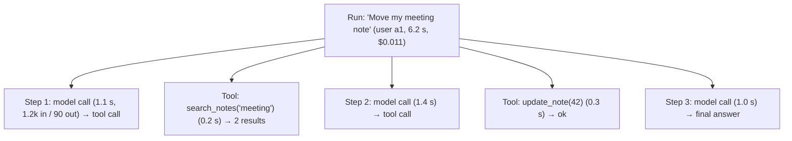

# Observability & LLMOps

> LLM features fail in quiet ways: the answer is wrong, slow, expensive, or unsafe, and no exception is thrown. Log every call, trace every agent step, version everything that changes behaviour, and turn real failures into tests.

Roadmap topic 18 · Stage 4: AI in Production

**Go deeper:** `4` Prompting (versions) · `12` Building an Agent · `15` Evaluation · `16` Safety (redaction) · `17` Cost & Latency · `05-system-design/27-Observability` and `28-Deployment-and-Release` · `06-mobile-engineering/15-Build-Release-and-Monitoring`.

**Marks:** 🟢 must know · 🟡 good to know

---

#### 1. What Is It?

*Seeing what the AI feature does in production, and operating it safely.*

| 🟢 Must know | 🟡 Good to know |
|---|---|
| log each call: prompt version, model, tokens, latency, errors | dashboards: cost per user and feature, errors, p95 latency |
| tracing: every step of an agent run | the feedback loop: failures become eval cases |
| version prompts, models, tool definitions | gradual rollout and feature flags |
| model upgrades: re-run evals; models get retired | |

1. **Log:** one structured record per model call.
2. **Trace:** the tree of steps in one run (model calls, tool calls, retrievals).
3. **LLMOps:** the practices for running LLM apps: versioning, evals, rollout, monitoring, cost control.

**Signals in an interview:** "how do you debug a bad answer?", "how do you know the new model is safe to switch to?", "what do you monitor?", "how do you roll out a prompt change?".

---

#### 2. How It Works

**What to record for each call.**

| Field | Why |
|---|---|
| request id, user id (hashed), session id | trace one user's issue |
| feature name, prompt id + version | which behaviour produced this |
| model + parameters (effort, max tokens) | compare models |
| input / output / cached tokens | cost and caching |
| latency: time to first token, total | speed |
| stop reason, error type, retry count | reliability |
| tool calls and results (sizes, errors) | agent behaviour |
| retrieval: document ids, scores | RAG debugging |
| user feedback (thumbs, edits) | quality signal |
| the prompt and output (redacted, sampled, with retention) | reproduce and review |

Mind privacy: redact personal data, sample full prompts, set a short retention, restrict access (topic 16).

**Tracing an agent run.**



A trace shows where time and money went, which tool failed, and why the agent did what it did. Use an OpenTelemetry-style span tree (run → step → tool/model) or an LLM-tracing tool.

**Versioning.** Give every prompt, tool definition, model choice, retrieval setting and eval set a version; store them in code or a registry; record the versions on every call. Then "the answers got worse on Tuesday" becomes "prompt v7 → v8 on Tuesday".

**Model upgrades.** Providers release new models and **retire** old ones. Before switching: run your eval on the new model, compare quality, cost and latency, check the format and refusal behaviour, update prompts if needed, roll out gradually, and keep a rollback. Don't pin to a model that will be retired without a plan.

🟡 **Dashboards and alerts.** Requests, error rate, p50/p95 latency, time to first token, tokens and cost per feature/user/plan, cache hit rate, stop-reason mix (cut-offs and refusals), tool error rate, thumbs-down rate, guardrail triggers. Alert on error spikes, cost per hour, and latency (`SD 27`).

🟡 **Feedback loop.** Collect failures (thumbs-down, escalations, support tickets, low judge scores), review a sample weekly, add them to the eval set with the expected behaviour, fix, and re-run. This is how quality compounds.

🟡 **Gradual rollout and flags (`SD 28`).** Ship prompt/model changes behind a flag to 1%, 10%, 50%, 100% of users, compare metrics between groups (A/B), and have a kill switch to turn the feature off or fall back to the previous version in minutes. On mobile, server-side prompts and flags let you change AI behaviour without an app release (`MOB 15`).

---

#### 3. Naive vs Better Design

| Naive | Better |
|---|---|
| log nothing, debug from complaints | structured record per call |
| string prompts scattered in code | versioned prompt registry; version logged |
| "the agent was weird" | a trace with every step |
| switch to the newest model because it is newer | eval, canary, rollback |
| log raw prompts forever | redact, sample, short retention |
| look at averages | p95/p99, per-feature, per-version |
| fix issues ad hoc | failures → eval cases |
| edit the prompt in production | change → eval → staged rollout |

```kotlin
// Naive: one debug line, no versions, no tokens, no way to compare
log.info("LLM answered")
```

---

#### 4. Code

A structured record per call, with redaction and sampling:

```kotlin
@Serializable
data class LlmCallLog(
    val requestId: String, val userHash: String, val feature: String,
    val promptVersion: String, val model: String,
    val inputTokens: Int, val cachedTokens: Int, val outputTokens: Int,
    val ttftMs: Long, val totalMs: Long, val stopReason: String, val error: String? = null,
    val retries: Int = 0, val costUsd: Double, val sampledPrompt: String? = null
)

fun hashUser(id: String, salt: String) = java.security.MessageDigest.getInstance("SHA-256").digest((salt + id).toByteArray()).take(6).joinToString("") { "%02x".format(it) }

fun maybeSample(prompt: String, rate: Double, random: () -> Double = Math::random): String? =
    if (random() < rate) redact(prompt).take(2_000) else null
```

Checks: `hashUser("ann", "s")` always gives the same 12 hex characters for the same input and a different value for `"bob"` (stable pseudonym, not reversible without the salt). `maybeSample("Mail ann@x.com", 1.0)` → `"Mail [EMAIL]"`; with rate `0.0` → `null`; a 5,000-character prompt is cut to 2,000.

A tiny tracer (run → step → tool/model spans):

```kotlin
class Span(val name: String, val startMs: Long) {
    var endMs: Long = startMs; val children = mutableListOf<Span>(); val attrs = mutableMapOf<String, Any>()
    val durationMs get() = endMs - startMs
}

class Tracer(private val clock: () -> Long) {
    val root = Span("run", clock()); private val stack = ArrayDeque(listOf(root))
    fun <T> span(name: String, block: (Span) -> T): T {
        val s = Span(name, clock()); stack.last().children += s; stack.addLast(s)
        try { return block(s) } finally { s.endMs = clock(); stack.removeLast() }
    }
}

fun summary(s: Span, indent: String = ""): String =
    "$indent${s.name} ${s.durationMs} ms" + s.children.joinToString("") { "\n" + summary(it, "$indent  ") }
```

Checks (fake clock): a run with `model_call` (1,100 ms), `tool:search_notes` (200 ms), `model_call` (1,400 ms) prints each span with its duration; the root's duration is at least the sum of the children's. Per-step cost: add `attrs["tokens"]` and sum the tree to get the cost of the run.

Percentiles and cost per feature:

```kotlin
fun percentile(values: List<Long>, p: Double): Long {
    val sorted = values.sorted()
    val rank = Math.ceil(p / 100.0 * sorted.size).toInt().coerceIn(1, sorted.size)
    return sorted[rank - 1]
}

fun costByFeature(logs: List<LlmCallLog>) = logs.groupBy { it.feature }.mapValues { (_, v) -> v.sumOf { it.costUsd } }
```

Checks: latencies `[100, 200, 300, 400, 5000]` → p50 `300`, p95 `5000` (the average, 1,200, hides the slow tail). Logs for `chat` ($0.004 + $0.006) and `summary` ($0.002) → `{chat=0.01, summary=0.002}`.

A staged rollout by stable bucket, with a kill switch:

```kotlin
fun bucket(userId: String, experiment: String) = Math.floorMod((userId + ":" + experiment).hashCode(), 100)

fun useNewPrompt(userId: String, percent: Int, killSwitch: Boolean) = !killSwitch && bucket(userId, "prompt-v8") < percent
```

Checks: the same user always lands in the same bucket (no flipping between versions); `percent = 0` → nobody; `100` → everybody; `killSwitch = true` → nobody, instantly.

Shadow-compare a new model on live traffic without showing its answers:

```kotlin
fun shadow(scope: CoroutineScope, request: LlmRequest, candidate: Model, record: (id: String, answer: String, ms: Long) -> Unit) {
    scope.launch(Dispatchers.IO) {                                    // runs beside the real request, never blocks it
        runCatching {
            val t = System.currentTimeMillis()
            val answer = candidate.answer(request)
            record(request.id, answer, System.currentTimeMillis() - t)
        }
    }
}
// in the request path:  shadow(appScope, request, candidateModel, ::saveShadowResult);  return currentModel.answer(request)   // the user only sees the current model
```

Review a sample of shadow pairs with your judge and humans before switching.

---

#### 5. Numbers & Limits

| Item | Rule of thumb |
|---|---|
| Logged fields | tokens, latency, versions, errors, cost on 100% of calls |
| Full prompt logging | sample 1 to 10%; redacted; retention of days to weeks |
| Trace retention | weeks; aggregate metrics longer |
| Weekly review | 20 to 50 failed or low-rated runs |
| Rollout steps | 1% → 10% → 50% → 100% |
| Model upgrade | eval + canary before 100% |
| Alerts | error rate, cost per hour, p95 latency, refusal rate |
| Retirement | track provider deprecation dates; migrate before the deadline |

---

#### 6. Common Mistakes & Edge Cases

1. Logging nothing about tokens or versions.
2. Logging raw personal data forever.
3. Averages instead of percentiles.
4. Switching models on release notes alone.
5. No trace for agent runs.
6. Editing prompts live.
7. Collecting feedback but never using it.
8. No kill switch.

Edge cases: the provider silently changes a model behind an alias (pin versions where possible, run a daily canary eval); streaming responses with partial logs; a tool failing only for some users; a trace with parallel branches; cost spikes from one user or loop; logs that contain secrets pasted by users.

---

#### 7. Say This in the Interview

1. "I log one structured record per call: prompt version, model, tokens, cached tokens, latency, stop reason, errors and cost, with personal data redacted and prompts sampled."
2. "For agents I trace each run as a tree of model and tool spans, so I can see where time and money went and why a step happened."
3. "Prompts, tools, models and eval sets are versioned and recorded on every call."
4. "Before a model upgrade I run the eval, compare quality, cost and latency, canary at a small percentage, and keep a rollback."
5. "Failures from feedback and support become eval cases, so quality improves release by release."

---

#### 8. Quick Check

1. Why track p95 rather than the average?
2. What goes in a trace?
3. How do you roll back a bad prompt?
4. Why version tool definitions?

<details>
<summary>Answers</summary>

1. The average hides slow outliers that real users feel.
2. Every model call, tool call and retrieval in the run with durations, tokens and results.
3. Flip the flag or version back; the old version is still available and its id is logged.
4. A changed description or schema changes the agent's behaviour as much as a prompt change.

</details>

---

#### 9. Practice

**Interview questions**

1. How do you debug a bad AI answer in production?
2. What do you log for each call?
3. How do you trace an agent run?
4. How do you safely upgrade to a new model?
5. How do you roll out a prompt change?
6. How do you keep logs privacy-safe?

**Hands-on**

1. Add the structured log to your chat route and build a cost-per-feature query.
2. Add a tracer to your agent and print the tree for three runs.
3. Do a shadow run of a second model on 100 saved requests and compare with your eval.

**Coding warm-ups (LeetCode)**

| # | Question | Link to this topic |
|---|---|---|
| 295 | [Find Median from Data Stream](https://leetcode.com/problems/find-median-from-data-stream/) (Hard) | percentiles from a stream |
| 1396 | [Design Underground System](https://leetcode.com/problems/design-underground-system/) (Medium) | start/end spans and averages |
| 359 | [Logger Rate Limiter](https://leetcode.com/problems/logger-rate-limiter/) (Easy, premium) | deduplicating noisy logs |
| 981 | [Time Based Key-Value Store](https://leetcode.com/problems/time-based-key-value-store/) (Medium) | prompt/version lookup by time |

**Remember:** log every call with versions, tokens, latency, cost · trace agent runs as spans · version prompts, tools, models · eval before upgrading, canary, rollback · percentiles not averages · failures → eval cases · redact and sample.
