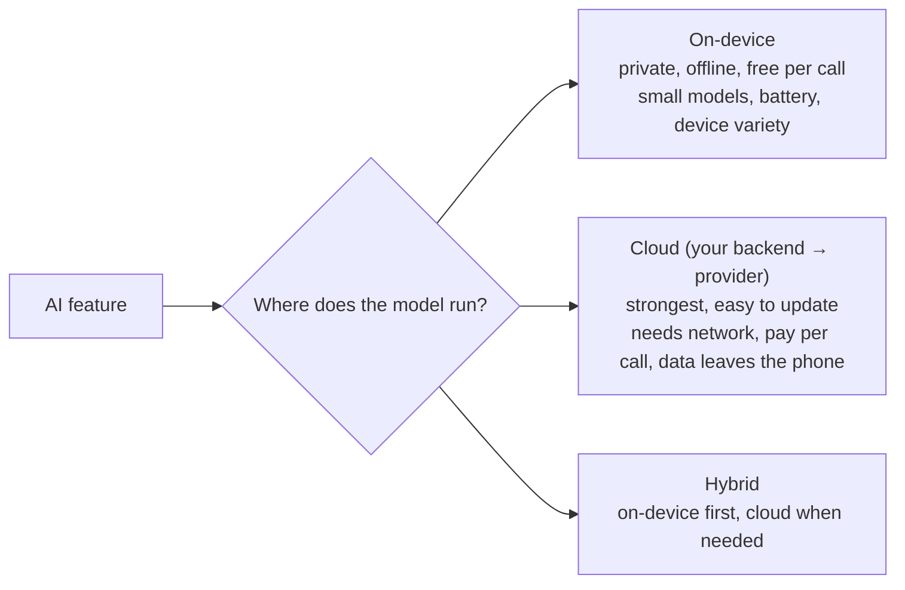

# On-Device vs Cloud AI

> On a phone you can run a model on the device or call a bigger one in the cloud. On-device is private, fast and works offline, but the models are small and phones have limits. Many products use both. This is where a mobile engineer stands out.

Roadmap topic 19 · Stage 5: AI on Mobile

**Go deeper:** `3` Model Choice (quantization, small models) · `5` Calling an LLM API · `17` Cost & Reliability · `20` AI Features in the App · `06-mobile-engineering/20-AI-in-Mobile-Apps`, `11-Performance-and-Memory`, `19-Device-Capabilities-and-Permissions` · `05-system-design/30-Mobile-Specific-Topics`.

**Marks:** 🟢 must know · 🟡 good to know · (New) still changing

---

#### 1. What Is It?

*Choosing where the model runs.*

| 🟢 Must know | 🟡 Good to know |
|---|---|
| three choices: on-device, cloud, hybrid | platform options (names) |
| on-device strengths: private, offline, low latency, no per-call cost | model download size, updates, versioning |
| on-device limits: size, battery, heat, memory, older phones | quantization for on-device models |
| cloud: stronger, easy to update, needs network, costs per call | |
| hybrid: on-device first, cloud as fallback | |

1. **On-device AI:** the model runs on the phone or tablet. No network needed.
2. **Edge AI:** AI close to where data is produced (a phone, a camera, a sensor) instead of a data centre. On-device is one kind.
3. **SLM (small language model):** a smaller model, fast and cheap, often small enough for a device.
4. **Hybrid:** use on-device when it can do the job, and the cloud when it cannot.

**Signals in an interview:** "can this run offline?", "what about privacy?", "what if the phone is old?", "how do you ship a 2 GB model?", "when would you call the cloud?".

---

#### 2. How It Works

**The three choices.**



**Strengths and limits of on-device.**

| Strengths | Limits |
|---|---|
| private: data stays on the phone | model size: large models don't fit in memory or storage |
| works offline | battery and heat under heavy inference |
| low latency: no round trip | memory competes with your app and the OS |
| no per-call cost | device variety: older or cheaper phones are slow or unsupported |
| good for classification, smart replies, short summaries, translation, image labelling, speech-to-text, camera features | smaller models are weaker at reasoning and long tasks |
| | updates need a model download or an app update |

**Cloud.** Stronger models, long context, tools, easy updates and A/B tests without a release, but it needs the network, costs per call, adds latency and sends data off the device (privacy, regulation). The provider key lives on your backend (topic 20).

**Hybrid patterns.**

| Pattern | Example |
|---|---|
| On-device first, cloud fallback | smart reply on-device; use the cloud if the model is missing or the input is too long |
| Cloud first, on-device fallback | cloud chat; offline mode uses a small local model |
| Split by task | on-device for OCR, wake word, language detection; cloud for reasoning |
| Split by privacy | sensitive fields processed on-device; only a redacted summary goes to the cloud |
| Pre-filter | a tiny on-device model decides whether a cloud call is needed at all |

🟡 **Platform options (names, check the current status).** Android: **ML Kit** (ready-made APIs such as text recognition, translation, barcode scanning), **Gemini Nano** through the system's AI service on supported devices, **LiteRT** (formerly TensorFlow Lite) to run your own model. iOS: **Core ML** and Apple's on-device foundation models on supported devices. Cross-platform runtimes also exist. Availability varies by device and OS version, so always detect support at runtime.

🟡 **Model download, updates and versioning.** Don't bundle large models in the app package. Download on demand (Wi-Fi by default for large files), verify a checksum, store in app storage, version it, keep the old model until the new one is verified, let the user delete it, and fall back to the cloud when the model is absent. Expect hundreds of MB to a few GB for language models.

🟡 **Quantization.** Weights stored at 8 or 4 bits make models 2 to 4× smaller and faster with a small quality loss; it is what makes on-device language models possible (topic 3).

**Decision factors.**

| Factor | Points to on-device | Points to cloud |
|---|---|---|
| Privacy / regulation | sensitive data must stay local | acceptable with consent and redaction |
| Connectivity | offline use matters | always online |
| Latency | instant response needed | a second or two is fine |
| Task difficulty | simple, narrow | complex reasoning, long context, tools |
| Cost at scale | millions of calls | low volume or high value per call |
| Device base | modern devices only | must work on every device |
| Update speed | model rarely changes | frequent model/prompt changes |

---

#### 3. Naive vs Better Design

| Naive | Better |
|---|---|
| everything in the cloud, even OCR | on-device for simple, private or offline tasks |
| everything on-device, even hard reasoning | cloud for hard tasks |
| bundle a 2 GB model in the APK | on-demand, verified, versioned download |
| assume every phone can run it | detect support; fall back to the cloud |
| run inference on the main thread | background thread; cancel on leaving the screen |
| inference while hot or on low battery | check thermal/battery state; defer or use the cloud |
| silent switch between local and cloud | tell the user when data leaves the device |

```kotlin
// Naive: always loads the big model on the main thread
val answer = bigLocalModel.generate(prompt)
```

---

#### 4. Code

Choose where to run (a pure, testable policy):

```kotlin
enum class Runtime { ON_DEVICE, CLOUD }

data class Situation(
    val localModelReady: Boolean, val online: Boolean, val inputTokens: Int, val needsReasoning: Boolean,
    val sensitive: Boolean, val batteryPercent: Int, val thermalOk: Boolean, val userAllowsCloud: Boolean = true
)

fun chooseRuntime(s: Situation, localMaxTokens: Int = 2_000): Runtime? = when {
    s.sensitive && s.localModelReady -> Runtime.ON_DEVICE                               // keep sensitive data local
    s.needsReasoning || s.inputTokens > localMaxTokens ->
        if (s.online && s.userAllowsCloud) Runtime.CLOUD else if (s.localModelReady) Runtime.ON_DEVICE else null
    s.localModelReady && s.thermalOk && s.batteryPercent >= 15 -> Runtime.ON_DEVICE
    s.online && s.userAllowsCloud -> Runtime.CLOUD
    s.localModelReady -> Runtime.ON_DEVICE
    else -> null                                                                         // nothing available: show offline state
}
```

Checks (`Situation(localModelReady, online, inputTokens, needsReasoning, sensitive, battery, thermalOk)`):

| Case | Result |
|---|---|
| short smart reply, model ready, battery 80%, cool | `ON_DEVICE` |
| hard reasoning question, online | `CLOUD` |
| hard question, offline, model ready | `ON_DEVICE` (best effort, tell the user) |
| sensitive text, model ready, online | `ON_DEVICE` |
| model not downloaded, online | `CLOUD` |
| model not downloaded, offline | `null` (offline state) |
| model ready but battery 8% | `CLOUD` if online, else `ON_DEVICE` |

Check the device before loading a model:

```kotlin
fun canRunLocally(context: Context, modelBytes: Long, minFreeMemoryMb: Long = 1_500): Boolean {
    val am = context.getSystemService(ActivityManager::class.java)
    val info = ActivityManager.MemoryInfo().also { am.getMemoryInfo(it) }
    val enoughRam = info.availMem / (1024 * 1024) >= minFreeMemoryMb && !info.lowMemory
    val thermal = context.getSystemService(PowerManager::class.java).currentThermalStatus      // API 29+
    return enoughRam && thermal < PowerManager.THERMAL_STATUS_SEVERE
}
```

Download a model safely (verified, resumable at the file level, Wi-Fi first):

```kotlin
suspend fun ensureModel(info: ModelInfo, dir: File, onWifi: Boolean, download: suspend (String, File) -> Unit): File? {
    val target = File(dir, "${info.name}-${info.version}.bin")
    if (target.exists() && sha256(target) == info.sha256) return target
    if (info.sizeMb > 100 && !onWifi) return null                                       // ask first on mobile data
    val tmp = File(dir, target.name + ".part")
    download(info.url, tmp)
    check(sha256(tmp) == info.sha256) { "checksum mismatch" }
    tmp.renameTo(target)
    dir.listFiles { f -> f.name.startsWith(info.name) && f != target }?.forEach { it.delete() }   // remove old versions after success
    return target
}
```

Run inference off the main thread and make it cancellable:

```kotlin
suspend fun generateLocal(model: LocalModel, prompt: String): String = withContext(Dispatchers.Default) {
    model.generate(prompt) { ensureActive() }                                           // check cancellation between tokens
}
```

Sizes (see topic 3): `modelGigabytes(params, bits) = params × bits ÷ 8`. A 3-billion-parameter model at 4 bits ≈ `1.5` GB; at 16 bits ≈ `6` GB. Add working memory for the context: a phone with 6 GB RAM cannot comfortably run the 16-bit version alongside your app.

Hybrid fallback with an honest message:

```kotlin
sealed interface AiAnswer { data class Local(val text: String) : AiAnswer; data class Remote(val text: String) : AiAnswer; data object Unavailable : AiAnswer }

suspend fun answer(s: Situation, local: suspend () -> String, cloud: suspend () -> String): AiAnswer =
    when (chooseRuntime(s)) {
        Runtime.ON_DEVICE -> runCatching { AiAnswer.Local(local()) }.getOrElse { if (s.online) AiAnswer.Remote(cloud()) else AiAnswer.Unavailable }
        Runtime.CLOUD -> runCatching { AiAnswer.Remote(cloud()) }.getOrElse { if (s.localModelReady) AiAnswer.Local(local()) else AiAnswer.Unavailable }
        null -> AiAnswer.Unavailable
    }
```

Checks: local failure while online → the cloud answer; cloud failure with a ready local model → the local answer; neither → `Unavailable`. The UI shows a small "answered on this device" or "answered online" label.

---

#### 5. Numbers & Limits

| Item | Rule of thumb |
|---|---|
| Model size | classification: 1 to 50 MB; small language models: 0.5 to 4 GB (4-bit) |
| Weights memory | parameters (billions) × bits ÷ 8 = GB |
| Phone RAM | 4 to 16 GB shared with the OS; keep your model well under half |
| Speed | small on-device LLMs: roughly 5 to 30 tokens/s; classification: milliseconds |
| Battery | long generation is noticeable; batch work and avoid inference while charging is not required |
| Download | Wi-Fi by default above ~100 MB; show progress and allow cancel |
| Support | detect at runtime; feature available only on some devices/OS versions |
| Cloud latency | 0.3 to 2 s to first token plus the network |
| Cost | on-device: no per-call fee; cloud: per token |

---

#### 6. Common Mistakes & Edge Cases

1. Choosing a side by fashion instead of by task, privacy, latency and cost.
2. Assuming all devices support the feature.
3. Bundling large models in the app package.
4. Unverified model downloads.
5. Running inference on the main thread, or never cancelling it.
6. Ignoring battery and heat.
7. Sending sensitive data to the cloud without telling the user.
8. No fallback when the local model or the network is missing.

Edge cases: the model is downloaded but the OS version is later updated and breaks it; the user is on a metered connection; storage is nearly full; low-memory kills during inference; a device that supports the model only when charging; on-device answers that differ in quality from cloud answers (tell the user); app updates that change the expected model version.

---

#### 7. Say This in the Interview

1. "I decide per feature: on-device for private, offline, low-latency and simple tasks; cloud for hard reasoning, long context, tools and fast iteration; hybrid when I need both."
2. "On-device is limited by model size, memory, battery, heat and device variety, so I detect support at runtime and always have a fallback."
3. "Models are downloaded on demand with a checksum, versioned, on Wi-Fi first, and removable by the user."
4. "Quantization (8 or 4 bits) makes local models 2 to 4× smaller with a small quality loss."
5. "I keep sensitive data on the device where I can, tell users when data leaves it, and keep the provider key on my backend."

---

#### 8. Quick Check

1. Name three advantages of on-device AI.
2. Name three limits.
3. What is a hybrid design?
4. Why not bundle a 2 GB model in the app?

<details>
<summary>Answers</summary>

1. Private, works offline, low latency, no per-call cost.
2. Model size, battery/heat, memory, device variety, weaker quality, update friction.
3. Use on-device when it can do the job and the cloud when it cannot (or the reverse, as a fallback).
4. It bloats the install, slows updates and fails on small-storage devices; download on demand instead.

</details>

---

#### 9. Practice

**Interview questions**

1. On-device vs cloud AI: how do you choose?
2. How would you design a smart-reply feature that works offline?
3. How do you ship and update an on-device model?
4. What are the limits of running a language model on a phone?
5. What is a hybrid approach?
6. How do you protect privacy?

**Hands-on**

1. Implement `chooseRuntime` and unit-test the seven cases in the table.
2. Add an on-device text classifier (ML Kit or LiteRT) and a cloud fallback, and measure latency for both.
3. Build the model downloader with checksum and Wi-Fi gating.

**Coding warm-ups (LeetCode)**

| # | Question | Link to this topic |
|---|---|---|
| 322 | [Coin Change](https://leetcode.com/problems/coin-change/) (Medium) | fitting a budget exactly |
| 1235 | [Maximum Profit in Job Scheduling](https://leetcode.com/problems/maximum-profit-in-job-scheduling/) (Hard) | choosing work under constraints |
| 146 | [LRU Cache](https://leetcode.com/problems/lru-cache/) (Medium) | cache of recent answers on the device |

**Remember:** on-device = private, offline, fast, free per call, but small and device-dependent · cloud = strong and updatable, needs network and costs per call · hybrid with an honest fallback · detect support · verified on-demand downloads · cancel inference · keep the key on the backend.
