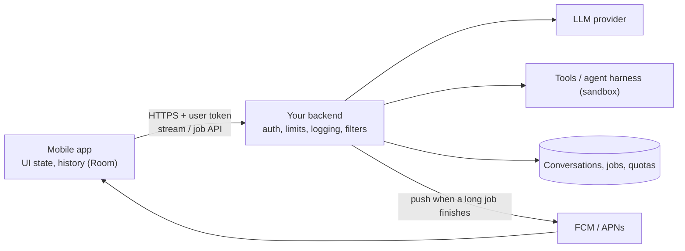
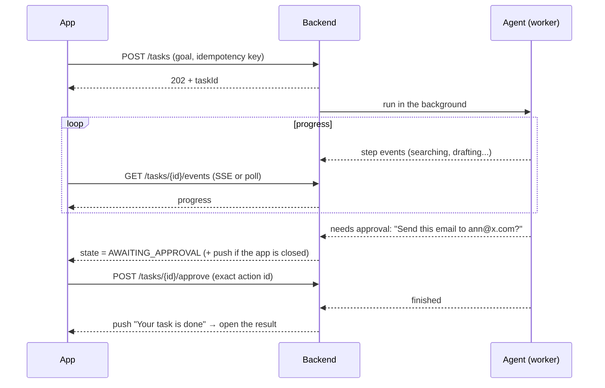

# AI Features in the App

> The model lives behind your backend. The app's job is to send the request, show the answer as it arrives, handle slow and broken networks, ask before risky actions, and be honest that the answer may be wrong.

Roadmap topic 20 · Stage 5: AI on Mobile

**Go deeper:** `06-mobile-engineering/20-AI-in-Mobile-Apps` (streaming UI states and the reducer) · `5` Calling an LLM API · `10` Agents · `11` Agent Harness · `16` Safety · `17` Cost · `05-system-design/24-Real-Time-Communication-and-Push` and `30-Mobile-Specific-Topics` · `06-mobile-engineering/10-Background-Work-and-Notifications`.

**Marks:** 🟢 must know · 🟡 good to know

---

#### 1. What Is It?

*The mobile half of every AI design.*

| 🟢 Must know | 🟡 Good to know |
|---|---|
| the app calls your backend, which calls the model; no key in the app | push notification when a background task finishes |
| streaming chat UI with cancel and retry | keep history locally and sync it |
| clear states: loading, partial, error, offline | voice and camera input |
| long agent tasks: progress, cancel, approval before actions | battery and data use of long AI features |
| tell users the answer may be wrong; let them correct or report | |
| per-user limits and quotas, enforced on the server | |

**Signals in an interview:** "add an AI assistant to the app", "an agent that books things for the user", "what if the user closes the app mid-task?", "how do you stop a user from running up the bill?".

---

#### 2. How It Works

**Architecture.**



1. **App → backend:** the user's normal login token (`BE 5`). The backend adds the provider key, applies quotas, calls the model and tools, filters, logs and streams back.
2. **Why:** no key in the app, per-user limits, one place to change models, prompts and safety rules without an app release.

**Streaming chat UI** (details and the state reducer are in `MOB 20`): append tokens as they arrive; show a typing indicator until the first token; a stop button that cancels the request **and** the upstream model call; retry on failure with the partial text kept; update the screen in small batches, not once per token; render Markdown safely (no auto-opening links, no external images, topic 16).

**Clear states.**

| State | What the user sees |
|---|---|
| Idle | input box, suggestions |
| Sending / waiting | typing indicator, stop button |
| Streaming | growing answer, stop button |
| Done | answer, copy, regenerate, feedback |
| Error | message + retry; partial text kept |
| Offline | input disabled or queued, explanation |
| Limit reached | quota message with the reset time or upgrade option |
| Blocked / refused | a polite, specific message |

**Long agent tasks** (minutes, many steps) do not fit in one HTTP request. Use a **job**:



Show **progress** (what it is doing now), allow **cancel**, ask **approval before actions** with the exact content (recipient, amount, text), and keep the result when the user returns. The task survives the app being closed because it runs on the backend.

**Be honest about quality.** Label AI content, show sources where possible, allow thumbs up/down and "report a problem", let users edit before sending, and never present a guess as a fact. For health, legal or money topics add clear limits and human help.

**Per-user limits and quotas** are enforced **on the server** (requests per minute, tokens per day, concurrent tasks). The app shows the remaining quota and handles `429` gracefully.

🟡 **Push when a background task finishes.** FCM data message → open the task result by id (`SD 24`, `MOB 10`). Push is best effort, so also refresh on app open.

🟡 **History locally and synced.** Store the conversation in Room (source of truth for the UI), sync with the backend (`SD 30`, `MOB 9`); conflict-free because messages are append-only with client ids; let users delete conversations (and delete server-side copies).

🟡 **Voice and camera input.** Microphone: speech-to-text (system, on-device or backend), a clear recording indicator, permissions in context. Camera: downsample images before upload, tell the user what is sent, handle sensitive scenes.

🟡 **Battery and data.** Streaming keeps a radio connection open: close it when the screen is gone; batch background syncs; compress images; ask before big uploads on mobile data; prefer push to polling for long tasks.

---

#### 3. Naive vs Better Design

| Naive | Better |
|---|---|
| provider key in the app | backend proxy |
| one blocking request for a 5-minute task | job + progress + push |
| the agent sends the email by itself | approval screen with exact content |
| lost partial text on error | keep it, offer retry |
| render model Markdown with links and images | sanitise, allow-list |
| quotas only in the UI | server-side enforcement |
| history only on the server | local history, synced |
| no label that it is AI | clear label, feedback, sources |
| polling every second | SSE or push |

---

#### 4. Code

Job status model and the transitions the app must handle (pure Kotlin, easy to test):

```kotlin
enum class TaskState { QUEUED, RUNNING, AWAITING_APPROVAL, DONE, FAILED, CANCELLED }

val allowed: Map<TaskState, Set<TaskState>> = mapOf(
    TaskState.QUEUED to setOf(TaskState.RUNNING, TaskState.CANCELLED),
    TaskState.RUNNING to setOf(TaskState.AWAITING_APPROVAL, TaskState.DONE, TaskState.FAILED, TaskState.CANCELLED),
    TaskState.AWAITING_APPROVAL to setOf(TaskState.RUNNING, TaskState.CANCELLED, TaskState.FAILED),
)

fun transition(from: TaskState, to: TaskState): TaskState =
    if (to in allowed[from].orEmpty()) to else error("illegal transition $from → $to")

fun canCancel(s: TaskState) = s == TaskState.QUEUED || s == TaskState.RUNNING || s == TaskState.AWAITING_APPROVAL
```

Checks: `QUEUED → RUNNING` ok; `RUNNING → AWAITING_APPROVAL → RUNNING → DONE` ok; `DONE → RUNNING` throws; `canCancel(DONE)` → `false`. The server rejects illegal transitions, so a double-tap on "approve" cannot run the action twice.

Approval is bound to the exact action (so the model cannot swap content after approval):

```kotlin
@Serializable data class PendingAction(val id: String, val type: String, val summary: String, val payloadHash: String)

fun approve(pending: PendingAction, approvedActionId: String, currentPayload: String): Boolean =
    pending.id == approvedActionId && sha256(currentPayload) == pending.payloadHash
```

Checks: approving `act-7` with the original payload → `true`; the same id after the payload text changed → `false` (hash mismatch); a different id → `false`.

Compose: show streamed text efficiently (batch tokens, restart-safe):

```kotlin
class ChatViewModel(private val repo: ChatRepository) : ViewModel() {
    private val _text = MutableStateFlow("")
    val text: StateFlow<String> = _text.asStateFlow()
    private var job: Job? = null

    fun send(message: String) {
        job?.cancel()
        _text.value = ""
        job = viewModelScope.launch {
            val buffer = StringBuilder()
            repo.stream(message)
                .onEach { buffer.append(it) }
                .sample(50)                                         // redraw at most ~20 times per second
                .collect { _text.value = buffer.toString() }
            _text.value = buffer.toString()                         // make sure the last tokens are shown
        }
    }
    fun stop() { job?.cancel() }                                    // closing the stream also cancels the model call on the server
}
```

Safe link handling in model text:

```kotlin
fun openLinkIfSafe(context: Context, url: String, allowedHosts: Set<String>): Boolean {
    val uri = runCatching { java.net.URI(url) }.getOrNull() ?: return false
    if (uri.scheme != "https" || uri.host !in allowedHosts) return false
    context.startActivity(Intent(Intent.ACTION_VIEW, Uri.parse(url)))
    return true
}
```

Quota-aware error handling:

```kotlin
sealed interface AiError {
    data object Offline : AiError
    data class LimitReached(val retryAfterSeconds: Int?) : AiError
    data object Blocked : AiError
    data object Server : AiError
}

fun mapError(code: Int?, retryAfter: Int?, ioFailure: Boolean): AiError = when {
    ioFailure -> AiError.Offline
    code == 429 -> AiError.LimitReached(retryAfter)
    code == 451 || code == 422 -> AiError.Blocked
    else -> AiError.Server
}
```

Checks: `mapError(null, null, true)` → `Offline`; `mapError(429, 3600, false)` → `LimitReached(3600)` (the UI shows "try again in 1 hour"); `mapError(500, null, false)` → `Server`.

Server side: a per-user quota with a daily reset (shown to the app in a response header or field):

```kotlin
class Quota(private val limit: Int, private val clock: () -> Long) {
    private val used = HashMap<String, Pair<Long, Int>>()                     // user → (day, count)
    private fun day() = clock() / 86_400_000
    fun tryTake(user: String, n: Int = 1): Boolean {
        val (d, c) = used[user] ?: (day() to 0)
        val count = if (d == day()) c else 0
        if (count + n > limit) return false
        used[user] = day() to count + n; return true
    }
    fun remaining(user: String) = limit - (used[user]?.takeIf { it.first == day() }?.second ?: 0)
}
```

Checks: `Quota(3)`: three `tryTake` calls → `true`, the fourth → `false`, `remaining` → `0`; after the clock moves a day forward → `remaining` → `3`.

Local history entity (Room) with append-only messages:

```kotlin
@Entity(tableName = "ai_messages", indices = [Index("conversationId")])
data class AiMessageEntity(@PrimaryKey val id: String, val conversationId: String, val role: String, val text: String,
                           val createdAt: Long, val synced: Boolean = false, val feedback: Int = 0)
```

---

#### 5. Numbers & Limits

| Item | Rule of thumb |
|---|---|
| UI redraw while streaming | at most about 20 per second |
| Job duration | seconds → stream; minutes → job + progress + push |
| Event stream | SSE with reconnect and `Last-Event-ID`; poll every 2 to 5 s as a fallback |
| Quotas | per user per day (tokens/requests) and concurrent tasks; enforced on the server |
| Approval timeout | minutes to hours; then the task pauses or fails with a clear state |
| History retention | user-controlled; delete means delete everywhere |
| Image upload | downsample to about 1,000 to 2,000 px before sending |
| Streaming battery | close the connection when the screen is gone |

---

#### 6. Common Mistakes & Edge Cases

1. A provider key in the app.
2. A long task in a single request that dies when the app is backgrounded.
3. Actions without approval, or approval of a vague summary.
4. Losing partial answers on errors.
5. Rendering untrusted Markdown links and images.
6. Quotas enforced only on the client.
7. No indication that it is AI, no feedback path.
8. Polling aggressively; keeping streams open in the background.

Edge cases: the user rotates the screen mid-stream (the `ViewModel` keeps the job); the app is killed during a task (the task continues on the server; reattach by task id); the same approval tapped twice; a push arrives before the data is synced; the model produces a very long answer; the user deletes the conversation during a running task; two devices on the same account.

---

#### 7. Say This in the Interview

1. "The app talks to my backend with the user's token. The backend holds the provider key, enforces quotas, filters, logs and calls the model and tools."
2. "Chat streams over SSE; the UI redraws in batches, shows a stop button that cancels the upstream call, keeps partial text on errors and has explicit offline, error and limit states."
3. "A long agent task is a backend job: the app gets a task id, follows progress, can cancel, and approves risky actions on a screen that shows the exact content, bound to a hash so it can't change after approval. A push tells the user when it is done."
4. "Quotas live on the server, and the app shows the remaining amount and handles 429."
5. "AI output is labelled, with feedback and sources; history is stored locally and synced."

---

#### 8. Quick Check

1. Why run the agent on the backend?
2. How does the user cancel a streamed answer so that cost stops?
3. How do you make approval safe?
4. Where do quotas live?

<details>
<summary>Answers</summary>

1. It survives the app closing, keeps keys and tools secure, and lets you control limits and logging.
2. Close the connection; the backend cancels the model call.
3. Show the exact action and bind the approval to its id and a hash of the payload.
4. On the server; the app only displays them.

</details>

---

#### 9. Practice

**Interview questions**

1. How do you add an AI assistant to a mobile app?
2. How do you design the UI for streaming, errors and offline?
3. How do you handle a task that takes five minutes?
4. How do you ask for approval before an agent acts?
5. How do you limit cost per user?
6. How do you communicate that the answer may be wrong?

**Hands-on**

1. Build the streaming chat screen with stop, retry and a fake SSE server.
2. Implement the task state machine and a simple approval screen.
3. Add a quota endpoint and show "N requests left today" in the UI.

**Coding warm-ups (LeetCode)**

| # | Question | Link to this topic |
|---|---|---|
| 1472 | [Design Browser History](https://leetcode.com/problems/design-browser-history/) (Medium) | conversation history navigation |
| 362 | [Design Hit Counter](https://leetcode.com/problems/design-hit-counter/) (Medium, premium) | quota counters |
| 641 | [Design Circular Deque](https://leetcode.com/problems/design-circular-deque/) (Medium) | a bounded buffer for streamed tokens |

**Remember:** app → your backend → model · stream, cancel, retry, keep partial text · explicit states (offline, error, limit, refused) · long tasks are backend jobs with progress, cancel and bound approvals · push when done · quotas on the server · label AI, collect feedback.
