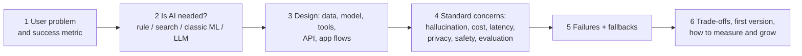

# AI Interview Answer Points

> In an AI interview, start with the user problem, then decide whether AI is needed at all. Cover the standard concerns every time: hallucination, cost, latency, privacy, safety and evaluation. Say it simply, name the trade-offs, and say how you would measure success.

Roadmap topic 21 · Stage 6: Interview (New)

**Go deeper:** every note `1`–`20` · `05-system-design/31-Interview-Answer-Structure` (the steps) · `06-mobile-engineering/21-Mobile-Interview-Answer-Points` · `03-leetcode-patterns/21-Coding-Interview-Answer-Points`.

**Marks:** 🟢 must know · 🟡 good to know · (New) added beyond the original roadmaps

---

#### 1. What Is It?

*A way to answer any AI question or design prompt in an organised, honest way.*

| 🟢 Must know | 🟡 Good to know |
|---|---|
| start with the user problem; decide if AI is needed | 30-second explanations of LLM, RAG, tool use, MCP, agent, harness |
| standard concerns: hallucination, cost, latency, privacy, safety, evaluation | what you would build first and how you would measure it |
| ready answers: reduce hallucination, control cost, test it, stop prompt injection | common trade-offs |
| ready answers: RAG vs fine-tuning, workflow vs agent, one agent vs many | |
| fit AI into the normal design steps (`SD 31`) | |

**Signals in an interview:** "design an AI assistant for…", "how would you add AI to our app?", "how do you stop it from making things up?", "how would you test it?", "what would it cost?".

---

#### 2. How It Works

**The answer path for an AI design question.**



**Fit AI into the normal design steps (`SD 31`).**

| Step | AI-specific content |
|---|---|
| Clarify | who is the user, what is the job, what is the cost of a wrong answer, which data, languages, platforms, offline? |
| Estimate | requests per day, tokens per request (input and output), cost per request, latency target, data volume to index |
| API and data | chat/job endpoints, streaming, conversations, documents, embeddings, feedback, usage logs |
| High-level design | app → backend → retrieval / tools / model; queue for long jobs; cache; safety layers |
| Deep dive | the hard part: grounding, access control, agent safety, evaluation, cost |
| Failures | provider down, hallucination, injection, rate limits, cut-off answers |
| Trade-offs | quality vs cost, latency, autonomy vs control, on-device vs cloud |

**The standard concerns: one-line answers.**

| Concern | Answer |
|---|---|
| Hallucination | ground the answer in retrieved sources, cite them, allow "I don't know", validate outputs, use tools for exact facts, lower temperature for facts |
| Cost | tokens × price: cache prefixes and answers, trim input, cap output, route easy work to small models, batch offline jobs, set budgets |
| Latency | stream for perceived speed, smaller models, shorter prompts, parallel calls, prefetch, queue long jobs |
| Privacy | send the minimum, redact, per-user isolation, provider retention terms, deletion support |
| Safety | treat model output and retrieved text as untrusted, least privilege, approvals for irreversible actions, guardrails |
| Evaluation | eval set from real cases, code checks plus a validated judge, regression on every change, production monitoring |

**Ready answers.**

| Question | Core answer |
|---|---|
| How do you reduce hallucination? | RAG with citations; answer-only-from-sources instruction; "I don't know" path; tools for calculations and lookups; output validation; evaluate groundedness |
| How do you control cost? | measure tokens per feature; prompt caching; trim context; cap output; model routing; batch; per-user budgets and alerts; re-check quality after each saving |
| How do you test an LLM feature? | eval set with real and adversarial cases; code graders first, rubric judge second; regression gate in CI; online metrics and feedback |
| How do you stop prompt injection? | you can't rely on the prompt: untrusted-content labelling, least-privilege tools, no outbound channel plus private data, schema validation, approvals, sandbox, red-team tests |
| RAG vs fine-tuning? | RAG for changing or private facts with citations; fine-tuning for style, format or narrow behaviour; try prompting first |
| Workflow vs agent? | workflow when steps are known (cheaper, predictable); agent when steps depend on what is found; always with limits and approvals |
| One agent vs many? | one by default; split for parallelism, context isolation or permissions; multi-agent costs several times more tokens |
| Why a backend for the model? | keys, quotas, filters, logging, model changes without an app release |

**Explain each in 30 seconds.**

| Term | 30-second answer |
|---|---|
| LLM | A model trained to predict the next token. It reads a context window and writes text one token at a time. It is stateless and can be wrong. |
| RAG | Retrieve relevant chunks of your data first, put them in the prompt, and answer from them with citations. It adds private, fresh knowledge and reduces hallucination. |
| Tool use | The model asks your code to run a function with arguments; your code validates, runs it and returns the result. The model never executes anything. |
| MCP | An open protocol that lets AI apps discover and call tools and read data from servers, so a tool is built once and used by many apps. |
| Agent | A model with tools in a loop (think, act, observe) that works toward a goal, with limits, permissions and a stop condition. |
| Harness | Everything around the model that makes it an agent: loop, prompts, tools, permissions, sandbox, context management and limits. Model + harness = agent. |

🟡 **Say what you would build first and how you would measure it.** "A read-only RAG assistant over the help centre with citations, measured by answer correctness, groundedness, deflection rate and thumbs-up rate on 100 real questions; then add one write action behind approval."

🟡 **Common trade-offs.**

| Trade-off | How to talk about it |
|---|---|
| Quality vs cost | bigger model or more context raises quality and cost; route by difficulty, measure on the eval |
| Quality vs latency | reasoning and long context are slower; stream, cache, use effort levels |
| On-device vs cloud | privacy/offline vs capability/updates |
| Autonomy vs control | more autonomy is faster and riskier; start at "ask first" |
| Fresh vs cached | cached answers are cheap but can be stale |
| Generality vs reliability | open chat vs a constrained workflow |

---

#### 3. Naive vs Better Design

| Naive | Better |
|---|---|
| "I'd use GPT-whatever" | the user problem, then the simplest approach that meets it |
| a demo, no metrics | success metric, eval set, monitoring |
| ignores cost until asked | a token and cost estimate early |
| "the prompt says don't leak" | permissions, validation, approvals |
| "we fine-tune it on our docs" | RAG for facts, fine-tuning for style |
| an agent for everything | workflow first |
| only the happy path | failures: outage, injection, hallucination, rate limit |
| buzzwords | plain 30-second explanations with trade-offs |

---

#### 4. Code

There is no code to write in the interview, but you should be able to do the arithmetic aloud. A cost estimate for a worked example, **a customer-support chatbot**:

```kotlin
data class Plan(val chatsPerDay: Int, val callsPerChat: Int, val inputTokens: Int, val outputTokens: Int)

fun costPerCall(inTokens: Int, cachedTokens: Int, outTokens: Int, inPerM: Double, outPerM: Double, cachedFraction: Double = 0.1) =
    ((inTokens - cachedTokens) * inPerM + cachedTokens * inPerM * cachedFraction + outTokens * outPerM) / 1_000_000

fun monthly(plan: Plan, perCall: Double, days: Int = 30) = plan.chatsPerDay * plan.callsPerChat * perCall * days
```

Checks (example prices per 1M tokens: mid `$2 in / $10 out`, small `$0.10 / $0.50`; 200,000 daily users, 20% use the bot = `40,000` chats a day; 4 model calls per chat; 1,500 input and 250 output tokens per call):

| Design | Per call | Per month |
|---|---|---|
| mid model, no optimisation | `$0.0055` | `$26,400` |
| + cache 1,000 input tokens of 1,500 | `$0.0037` | about `$17,800` |
| + route half the calls to the small model (`$0.000275` per call) | `$0.00199` average | about `$9,540` |

So the optimised design is about `64%` cheaper, if the routed traffic still passes the eval. Say the assumptions out loud; the interviewer cares about the reasoning, not the exact dollars.

The worked design in the 45-minute structure:

```text
1. Clarify (5 min): users = customers; job = answer account and product questions, hand off to a human when unsure;
   a wrong answer on billing is costly → ground in help articles, escalate sensitive cases; channels: in-app chat; offline: not needed.
2. Estimate (4 min): 40k chats/day, 4 calls each; ≈ $0.02 per chat unoptimised → $26k/month; target < $10k.
3. API + data (6 min): POST /chat (stream), GET /conversations, POST /feedback; tables: conversations, messages, usage;
   index: help-centre chunks with embeddings + keyword index; per-tenant filter.
4. High-level (10 min): app → backend → retrieval (hybrid + rerank) → prompt → model (small first, large for hard) → output checks → stream.
   Escalation tool creates a ticket (approval for refunds). Queue for analytics and evals.
5. Deep dive (15 min): grounding with citations and "I don't know"; eval set of 200 real questions (recall@5, groundedness, resolution);
   injection and PII handling; cost levers; monitoring and feedback loop.
6. Trade-offs (5 min): quality vs cost (routing), autonomy (read-only first), staged rollout behind a flag; what I'd build first.
```

A checklist you can run through at the end of any AI design (and test yourself with):

```kotlin
val concerns = setOf("user problem", "need for AI", "success metric", "hallucination", "cost", "latency", "privacy", "safety", "evaluation", "failures", "rollout")

fun missing(covered: Set<String>) = (concerns - covered).sorted()
```

Checks: `missing(setOf("user problem", "cost", "latency"))` → `[evaluation, failures, hallucination, need for AI, privacy, rollout, safety, success metric]`. Use it after a mock interview to see what you forgot.

---

#### 5. Numbers & Limits

| Item | Rule of thumb |
|---|---|
| Tokens | 1 token ≈ 4 characters ≈ 0.75 words |
| Cost per call | input tokens × input price + output tokens × output price (output ≈ 3 to 5× input per token) |
| Prompt cache | reads at about 10% of the normal input price |
| Price gap | small models 10 to 50× cheaper than large ones |
| Latency | time to first token 0.3 to 2 s; output tens to hundreds of tokens/s |
| Retrieval | retrieve 20 to 50, rerank to 3 to 8 |
| Eval set | 30 to 100 to start; hundreds to detect small changes |
| Agent reliability | 95% per step over 20 steps ≈ 36% end to end |
| Agent steps | 10 to 25 maximum, plus token and time limits |

---

#### 6. Common Mistakes & Edge Cases

1. Jumping to a model or a framework before the problem.
2. Never asking whether AI is needed.
3. Ignoring cost, latency, privacy and evaluation until prompted.
4. Believing the prompt is a security control.
5. Only the happy path; no fallback.
6. Overclaiming ("it never hallucinates").
7. Buzzwords with no explanation.
8. A giant first version: agents, many tools, multi-agent.

Edge cases: an interviewer who asks you to build with a specific vendor (say you would keep it behind an interface and name trade-offs); "no budget" (small model, caching, rules); "must work offline" (on-device, topic 19); "no cloud allowed" (open-weight models in your environment); regulated data (redaction, regions, retention, human review).

---

#### 7. Say This in the Interview

1. "First, what's the user problem and how will we know it's solved? Then, does it need an LLM, or would a rule, search or a classic model do?"
2. "For hallucination I ground answers in retrieved sources with citations, allow 'I don't know', and measure groundedness."
3. "I'd estimate tokens and cost per request early, and cut cost with caching, trimming, capped output and routing, checking quality on the eval each time."
4. "Safety lives in code: least-privilege tools, validation, approvals, sandboxing; the prompt is not a control."
5. "I'd build a read-only version first, measure it on 100 real questions, then add write actions behind approval."
6. "The trade-off here is X for Y; at ten times the load I'd change Z."

---

#### 8. Quick Check

1. What do you ask first in an AI design question?
2. Name the six standard concerns.
3. RAG or fine-tuning for changing company policies?
4. What would you build first?

<details>
<summary>Answers</summary>

1. The user problem and the success metric; then whether AI is needed.
2. Hallucination, cost, latency, privacy, safety, evaluation.
3. RAG: facts change, so update the index instead of retraining; add citations.
4. The simplest read-only, grounded version, with an eval to measure it.

</details>

---

#### 9. Practice

**Interview questions**

1. Design an AI support chatbot for our app.
2. How do you reduce hallucinations?
3. How do you control the cost of an LLM feature?
4. How do you test and monitor it?
5. How do you stop prompt injection?
6. RAG vs fine-tuning vs long context?
7. Workflow vs agent; one agent vs many?
8. Explain RAG, tool use, MCP, agent and harness in 30 seconds each.

**Hands-on**

1. Run the support-chatbot design aloud in 45 minutes with a timer; use `missing(...)` to find gaps.
2. Write your own 30-second explanation of each term and record it.
3. Estimate the monthly cost of a feature you know, under two designs.

**Coding warm-ups (LeetCode)**

| # | Question | Link to this topic |
|---|---|---|
| 146 | [LRU Cache](https://leetcode.com/problems/lru-cache/) (Medium) | answer and prompt caching |
| 642 | [Design Search Autocomplete System](https://leetcode.com/problems/design-search-autocomplete-system/) (Hard, premium) | search features |
| 355 | [Design Twitter](https://leetcode.com/problems/design-twitter/) (Medium) | feed-style system design basics |
| 362 | [Design Hit Counter](https://leetcode.com/problems/design-hit-counter/) (Medium, premium) | usage limits |

**Remember:** user problem first · is AI needed? · cover hallucination, cost, latency, privacy, safety, evaluation · safety in code, not prompts · estimate tokens and cost aloud · read-only first, measure, then add actions · plain 30-second explanations.
