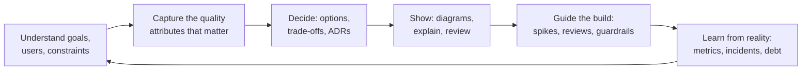

# What an Architect Does

> Architecture is the set of important decisions that are costly to change. An architect makes those decisions with the team, keeps them consistent, writes them down, and helps everyone follow them, while staying close to the code.

Roadmap topic 1 · Stage 1: Role & Mindset

**Go deeper:** `2` Requirements & Quality Attributes · `3` Trade-Offs & Decisions · `15` Communicating & Influencing · `17` Governance · `07-behavioral-leadership/12-Leadership-Without-Authority`.

**Marks:** 🟢 must know · 🟡 good to know

---

#### 1. What Is It?

*The role, and what counts as an "architectural" decision.*

| 🟢 Must know | 🟡 Good to know |
|---|---|
| architecture = important decisions costly to change | types of architect: solution, software, enterprise, cloud, mobile |
| the job: make key decisions, keep them consistent, help the team follow them | the "ivory tower" failure |
| architect vs tech lead vs senior engineer | |
| stay hands-on | |
| breadth over depth, deep where the risk is | |

1. **Architecture:** the structure of a system (parts, relationships, rules) and the decisions behind it that are hard to reverse.
2. **Architect:** the person (or people) accountable for those decisions and their consistency. It is a *responsibility* more than a title.
3. **Significant decision:** one that is costly to change, affects many people, or strongly affects a quality such as scale, security or maintainability.

**Signals in an interview:** "what does an architect do?", "how is that different from a tech lead?", "do architects write code?", "how do you decide what is architectural?".

---

#### 2. How It Works

**The architect's loop.**



**What counts as architectural?**

| Architectural (costly to change) | Not architectural (cheap to change) |
|---|---|
| monolith vs services; the main data store | a variable or function name |
| how the app syncs offline data | the colour of a button |
| authentication model; where secrets live | one screen's layout |
| module boundaries and the public API of a module | the body of a private function |
| how releases and rollbacks work | which lint rule formats imports |

A good test: *how much would it cost, in people and time, to reverse this a year from now?*

**Roles compared.**

| | Senior engineer | Tech lead | Architect |
|---|---|---|---|
| Scope | a feature or component | one team's delivery | a system, or several teams' systems |
| Focus | quality of the code | getting the team to ship well | the shape of the system, key trade-offs, consistency across teams |
| Closeness to code | very close | close | close enough to know the truth |
| Output | working software | working team and plan | decisions, diagrams, guardrails, aligned teams |
| Success measured by | their code | team's delivery | long-term health of the system and how well teams can change it |

Roles overlap and differ by company. In small teams one person does all three.

**Responsibilities.**

1. **Decide and record:** make the key decisions, write ADRs (topic 3).
2. **Keep consistent:** shared principles, a few standards, a paved road (topic 17).
3. **Communicate:** diagrams and explanations for each audience (topics 14, 15).
4. **Reduce risk:** spikes and prototypes for the biggest unknowns.
5. **Enable teams:** remove obstacles; don't be a bottleneck for every decision.
6. **Evolve:** track debt, drift and change (topic 16).

**Stay hands-on.** Read the code, review pull requests, build spikes, join incidents. An architect who stops coding loses touch with the truth, and designs that nobody has tried tend to fail. Aim for a regular share of time in code (for example 20 to 40%), mostly spikes, reviews, tooling and fitness functions rather than the critical path.

**Breadth over depth.** Know a little about many areas (data, security, networking, mobile, operations, cost) and go deep where the risk is. A "T-shaped" profile: broad across the system, deep in one or two areas.

🟡 **Types of architect.** *Enterprise* (across the organisation), *solution* (one business solution across systems), *software* (the structure of one system), *cloud/infrastructure*, *data*, *security*, *mobile*. Names and scopes vary by company; ask what the role means there.

🟡 **The ivory-tower failure.** An architect who draws diagrams but doesn't build, listen or measure. Signs: designs that ignore team skills, rules without reasons, no prototypes, teams working around the architect. Avoid it with spikes, shared ownership of decisions, short feedback loops and humility.

---

#### 3. Naive vs Better Design

| Naive | Better |
|---|---|
| the architect decides everything alone | the team shares decisions; the architect owns the consistency |
| diagrams only; never in the code | spikes, reviews and fitness functions in the codebase |
| choose a technology first | start from goals and quality attributes |
| a 100-page document | short ADRs and C4 diagrams, kept current |
| review every pull request | guardrails and automation; review the risky ones |
| "it depends" with no follow-up | "it depends on X; given our numbers I recommend Y" |
| design for the next five years | design the thinnest slice that proves it; keep options open |

```kotlin
// Naive: architecture by accident — everything depends on everything
class CheckoutScreen { val api = Retrofit.Builder().build(); val db = Room.databaseBuilder(...).build() /* UI knows network and storage */ }
```

---

#### 4. Templates & Examples

A one-page **architect's charter** for a project:

```text
SYSTEM:                    GOAL (one sentence):                 SUCCESS METRIC:
STAKEHOLDERS: product, design, backend, security, ops, support
TOP QUALITY ATTRIBUTES (with numbers): …
KEY CONSTRAINTS: …
BIGGEST RISKS (ranked): …
DECISIONS TO MAKE THIS MONTH (owner, date): …
HOW I WILL STAY CLOSE TO THE CODE: spikes, 2 reviews/week, fitness functions
```

A rough test for "is this decision architectural?":

```kotlin
data class Decision(val daysToReverse: Int, val teamsAffected: Int, val touchesQualityAttribute: Boolean)

fun isArchitectural(d: Decision) =
    d.daysToReverse >= 20 || d.teamsAffected >= 2 || (d.touchesQualityAttribute && d.daysToReverse >= 5)
```

Checks: renaming a private function `Decision(0, 1, false)` → `false`; choosing the sync strategy `Decision(60, 3, true)` → `true`; changing a retry policy `Decision(6, 1, true)` → `true` (touches reliability); adding a screen `Decision(3, 1, false)` → `false`. The numbers are a conversation starter, not a rule.

An architect's weekly rhythm (example):

| Time | Activity |
|---|---|
| 30% | hands-on: spikes, reviews, tooling, incident follow-ups |
| 25% | decisions and design: ADRs, options, diagrams |
| 25% | communication: stakeholders, design reviews, mentoring |
| 20% | looking ahead: risks, debt, roadmap, learning |

A decision log (the simplest governance):

```text
| # | Decision | Date | Owner | Status | Link |
| 1 | Offline-first with Room as source of truth | 2025-02-03 | A. Rao | accepted | adr/001.md |
| 2 | Modular monolith for the backend | 2025-02-10 | S. Kim | accepted | adr/002.md |
```

---

#### 5. Numbers & Rules of Thumb

| Item | Guide |
|---|---|
| Hands-on time | 20 to 40% in code or prototypes |
| Decisions to document | the ones costing 20+ person-days to reverse, or affecting 2+ teams |
| ADR length | one page |
| Design review | 30 to 60 minutes, documents sent 2 days before |
| Architect-to-team ratio | one architect can guide about 3 to 6 teams if decisions are shared and automated |
| Time to answer a team's question | hours to a day; slow answers push teams to decide alone |
| Diagrams | 3 to 5 key ones, not 50 |

---

#### 6. Common Mistakes & Edge Cases

1. The ivory-tower architect.
2. Becoming the bottleneck for every decision.
3. Over-designing before knowing the risks.
4. Technology-first thinking.
5. Not writing decisions down.
6. Ignoring the team's skills and the organisation.
7. Never measuring whether the architecture works.
8. Claiming credit instead of building shared ownership.

Edge cases: no one has the title (the responsibility still exists; make it explicit); a team disagrees with you (use data and a spike, then commit to the decision); a decision made before you arrived (assess it honestly, record why it exists, change it only for reasons); small teams (the "architect" is the senior engineer who writes the ADRs).

---

#### 7. Say This in the Interview

1. "Architecture is the set of important decisions that are costly to change. My job is to make them well with the team, record them, keep them consistent, and help people follow them."
2. "A tech lead focuses on one team's delivery; an architect on the shape and trade-offs of the system across teams. I stay hands-on with spikes, reviews and fitness functions, so I know the truth."
3. "I go deep where the risk is: I find the biggest unknown and build a spike before committing."
4. "I try not to be a bottleneck: principles, ADRs and automated checks let teams decide within guardrails."

---

#### 8. Quick Check

1. What makes a decision architectural?
2. Name two differences between an architect and a tech lead.
3. Why should an architect stay hands-on?
4. What is the ivory-tower failure?

<details>
<summary>Answers</summary>

1. It is costly to reverse, affects many people or teams, or strongly affects a quality attribute.
2. Scope (system vs one team) and focus (shape and trade-offs vs delivery).
3. To stay in touch with reality, validate designs with spikes, and keep credibility.
4. Drawing and deciding without building, listening or measuring.

</details>

---

#### 9. Practice

**Interview questions**

1. What does an architect do?
2. Architect vs tech lead vs senior engineer?
3. How do you decide whether something is an architectural decision?
4. How do you stay hands-on?
5. How do you avoid becoming a bottleneck?
6. What is the ivory-tower architect?

**Exercises**

1. List ten decisions from your current app and mark which are architectural; estimate the cost to reverse each.
2. Write an architect's charter for a project you know.
3. Start a decision log with three entries.
4. Describe how your role splits time between code, design, communication and looking ahead.

**Remember:** architecture = decisions costly to change · decide, record, keep consistent, enable · stay hands-on · deep where the risk is · don't be a bottleneck · avoid the ivory tower.
