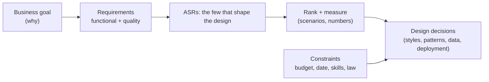

# Requirements, Constraints & Quality Attributes

> Functional requirements say what the system does. Quality attributes say how well. A few of them, the architecturally significant ones, shape the whole design. Make them measurable, rank them, and respect the constraints.

Roadmap topic 2 · Stage 1: Role & Mindset

**Go deeper:** `1` What an Architect Does · `3` Trade-Offs · `5` Architectural Styles · `12` Scalability & Resilience · `05-system-design/13-Requirements-and-Estimation`.

**Marks:** 🟢 must know · 🟡 good to know

---

#### 1. What Is It?

*What must the system do, how well, and within what limits.*

| 🟢 Must know | 🟡 Good to know |
|---|---|
| functional requirements vs quality attributes | quality attribute scenarios |
| key attributes: performance, scalability, availability, reliability, security, maintainability, testability, observability, usability, cost | business drivers and stakeholder needs |
| architecturally significant requirements (ASRs) | quality-model standards (names only) |
| make them measurable | |
| constraints: budget, deadline, skills, existing systems, regulation, vendor rules | |
| rank them: you cannot maximise all | |

1. **Functional requirement (FR):** a behaviour ("a user can share a note").
2. **Quality attribute (NFR, "-ility"):** a property of how it works ("sharing appears on the other device in under 2 seconds, 99% of the time").
3. **ASR:** a requirement (usually a quality attribute) that strongly shapes the architecture.
4. **Constraint:** a fixed limit you accept (budget, date, team skills, law, existing systems).

**Signals in an interview:** "what would you ask first?", "what are the non-functional requirements?", "how would you design for 10M users?", "what are the top three quality attributes here?".

---

#### 2. How It Works

**From the business goal to design drivers.**



**Key quality attributes.**

| Attribute | The question | Example measure |
|---|---|---|
| Performance | how fast? | p95 API latency under 300 ms; cold start under 2 s |
| Scalability | can it handle growth? | 10× users with 2× cost |
| Availability | is it up? | 99.9% monthly |
| Reliability | does it work correctly over time? | no lost writes; crash-free users 99.5% |
| Security | is data safe? | all personal data encrypted; least privilege |
| Maintainability | can we change it? | a typical feature in 2 weeks; build under 3 minutes |
| Testability | can we verify it? | 80% of business logic covered by fast tests |
| Observability | can we see what's happening? | any request traceable end to end |
| Usability / accessibility | is it easy for everyone? | task success rate; screen reader support |
| Cost | what does it cost to run? | under $0.02 per active user per month |
| Portability, interoperability | can it run/talk elsewhere? | Android + iOS share logic |

**Make them measurable.** "Fast" is not a requirement; "p95 under 300 ms at 2,000 requests per second" is. A measurable statement has a **metric**, a **target**, a **load/condition** and a **percentile or time window**.

**Quality attribute scenario** (a precise way to write one):

| Part | Example (availability) |
|---|---|
| Source | a data centre zone fails |
| Stimulus | the primary database is unreachable |
| Artifact | the notes service |
| Environment | normal peak traffic |
| Response | traffic fails over to the replica; users keep reading and writing |
| Response measure | recovery within 60 seconds; no more than 1 minute of data lost |

**ASRs.** Out of 40 requirements, usually 5 to 8 drive the design: the ones that are hard, costly, risky or contradictory. For a mobile notes app they might be: works offline (reliability), sync within seconds (performance), no data loss (reliability), secure sharing (security), ship weekly with a small team (maintainability/cost).

**Rank them.** You cannot maximise everything: performance may cost money; security may cost usability; availability may cost complexity. Ask stakeholders to put the attributes in priority order and to say what they would give up. Keep a short ranked list; it will settle later arguments.

**Constraints.**

| Constraint | Example effect |
|---|---|
| Budget | managed services over self-hosting |
| Deadline | simpler architecture; fewer moving parts |
| Team skills | choose what the team can run and debug |
| Existing systems | integrate, don't replace; anti-corruption layers |
| Regulation | data residency, audit trails, retention (GDPR-style) |
| Vendor rules | store policies, API limits |

🟡 **Business drivers and stakeholders.** Different people care about different things: product (time to market), operations (stability), security (risk), finance (cost), users (speed, trust). Capture each driver, who owns it, and how it is measured.

🟡 **Standards.** Quality models such as ISO 25010 list attributes and sub-attributes. Know the names; use your own measurable list.

---

#### 3. Naive vs Better Design

| Naive | Better |
|---|---|
| "it must be fast and secure and scalable" | five ranked attributes with numbers |
| design for "millions of users" with no data | estimate load; design for 10× the next milestone |
| requirements collected once | revisited as risks and numbers change |
| ignoring constraints | constraints written down and used in choices |
| all attributes equally important | explicit priorities and trade-offs |
| NFRs left to the end | NFRs drive the first design decisions |

---

#### 4. Templates & Examples

**ASR table (the one page you keep updated).**

| # | Attribute | Requirement (measurable) | Priority | Why it matters | How we will check |
|---|---|---|---|---|---|
| 1 | Reliability | no acknowledged note is ever lost | 1 | trust | chaos test; sync tests |
| 2 | Performance | edit visible on another device within 2 s (p95) | 2 | collaboration | synthetic probe |
| 3 | Availability | 99.9% monthly for read/write API | 3 | users rely on it | SLO dashboard |
| 4 | Security | all data encrypted; sharing requires explicit grant | 2 | privacy | threat model; pen test |
| 5 | Maintainability | one team ships weekly; build under 3 min | 4 | small team | CI metrics |

**Downtime allowed by availability** (use these numbers aloud):

```kotlin
fun downtimeMinutes(availabilityPercent: Double, days: Int = 30) = (100 - availabilityPercent) / 100 * days * 24 * 60
```

Checks: `99.0` → `432.0` minutes a month (7.2 hours); `99.9` → `43.2` minutes; `99.95` → `21.6`; `99.99` → `4.3` minutes. Each extra nine costs far more; ask whether the business really needs it.

**A latency budget** splits the target across the path so each part has an owner:

```kotlin
data class Part(val name: String, val ms: Int)

fun budgetOk(targetMs: Int, parts: List<Part>) = parts.sumOf { it.ms } <= targetMs
```

Checks: target `300` ms with client `50`, network `80`, API `70`, database `60` and margin `40` → `300` ≤ `300` → `true`. Raise the database to `90` and the sum is `330` → `false`: something must give (cache, index, less work).

**Capacity numbers first** (`SD 13`): requests per second = users per day × requests per user ÷ 86,400; peak ≈ 3 to 10× the average. Example: 500,000 daily users × 20 requests = 10 M/day ≈ 116 requests/second average, ~600 at peak (5×).

**Questions to ask in the first meeting.**

```text
Who are the users and how many? Growth over 1–3 years?        What must never fail? What can be degraded?
How fast must it feel (numbers)? Offline? Platforms?           Data: how much, how sensitive, how long kept?
Who runs it, with what skills and budget? Deadline?            Existing systems and contracts we must use?
Regulations (privacy, finance, health)? Audit?                 How will we know it is a success?
```

**Prioritising attributes (a forced ranking).**

```kotlin
fun rank(scores: Map<String, Int>) = scores.entries.sortedByDescending { it.value }.map { it.key }
```

Checks: stakeholders give 1 to 10 points: `{reliability: 9, performance: 7, cost: 5, security: 8}` → `[reliability, security, performance, cost]`. Force a single ordering, with ties broken by discussion.

---

#### 5. Numbers & Rules of Thumb

| Item | Guide |
|---|---|
| ASRs | 5 to 8 per system |
| Availability | 99.9% ≈ 8.8 h/year; 99.99% ≈ 53 min/year |
| Percentiles | use p95/p99, not averages |
| Peak vs average | peak traffic is commonly 3 to 10× the average |
| Growth planning | design for 10× the current need; plan to re-architect at 100× |
| Cost target | express as cost per user, request or feature |
| Review | revisit the ASR table every quarter or at major changes |

---

#### 6. Common Mistakes & Edge Cases

1. "The system must be fast/secure/scalable" with no numbers.
2. Treating all attributes as equally important.
3. Ignoring constraints, especially team skills and deadlines.
4. Over-building for imaginary scale.
5. Discovering NFRs late.
6. Only listening to one stakeholder.
7. Mixing requirements with solutions ("use Kafka").

Edge cases: conflicting requirements (rank and negotiate); unknown numbers (estimate, state assumptions, plan to measure); requirements that change with success; regulation arriving later; different attributes per feature (checkout needs strong consistency; the feed does not).

---

#### 7. Say This in the Interview

1. "I'd start with the goal and users, then pull out the few quality attributes that shape the design and make each measurable."
2. "I'd rank them. For a notes app: reliability first (no lost notes), then sync latency and security."
3. "I'd write constraints down: budget, deadline, team skills, existing systems, regulation. They narrow the options."
4. "I'd estimate load: requests per second, peak factor, data size, so I design for the next 10×, not for a guess of a million."
5. "I'd use a quality attribute scenario for the hardest ones, so the response and measure are testable."

---

#### 8. Quick Check

1. Functional requirement vs quality attribute?
2. What is an ASR?
3. How much downtime does 99.9% allow per month?
4. Why rank attributes?

<details>
<summary>Answers</summary>

1. What the system does vs how well it does it.
2. A requirement that strongly shapes the architecture (usually a hard quality attribute).
3. About 43 minutes.
4. You cannot maximise all; ranking guides trade-offs and settles arguments.

</details>

---

#### 9. Practice

**Interview questions**

1. What are non-functional requirements, and why do they matter?
2. How do you make "fast" measurable?
3. What is an architecturally significant requirement?
4. How do you handle conflicting quality attributes?
5. What constraints influence an architecture?
6. What would you ask before designing a chat app?

**Exercises**

1. Write the top 5 ranked quality attributes, with numbers, for three apps (notes, chat, payments).
2. Write a quality attribute scenario for availability and one for performance.
3. Build a latency budget for the slowest screen in an app you know.
4. Estimate the peak requests per second for 1 million daily users.

**Remember:** FRs say what, quality attributes say how well · a few ASRs shape the design · measurable (metric, target, load, percentile) · rank them · constraints count · estimate with numbers.
