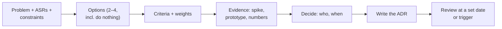

# Trade-Offs & Decision Making

> There is no best architecture, only trade-offs for a given context. Good decisions name the options, the criteria and the cost of the choice, are recorded in a short note, and spend the most effort on what is hardest to reverse.

Roadmap topic 3 · Stage 1: Role & Mindset

**Go deeper:** `1` What an Architect Does · `2` Requirements & Quality Attributes · `14` Documentation (ADRs) · `15` Communicating · `07-behavioral-leadership/05-Technical-Decisions` and `06-Architecture-Decisions`.

**Marks:** 🟢 must know · 🟡 good to know

---

#### 1. What Is It?

*Choosing among options, with reasons, and writing the choice down.*

| 🟢 Must know | 🟡 Good to know |
|---|---|
| no best architecture, only trade-offs | last responsible moment |
| ADR: context, options, decision, consequences | avoid resume-driven and hype-driven choices |
| one-way vs two-way decisions | cost of delay and cost of change |
| risk-driven design: spikes, proofs of concept, prototypes | |
| build vs buy vs open source | |
| technology selection criteria | |

1. **Trade-off:** improving one quality costs another (speed vs cost, flexibility vs simplicity).
2. **ADR:** a one-page note of one decision.
3. **Two-way decision:** easy to undo, so decide fast. **One-way:** hard to undo, so decide carefully.
4. **Spike:** a short experiment to answer one risky question.

**Signals in an interview:** "why did you choose X?", "what are the trade-offs?", "build or buy?", "how do you decide with incomplete information?", "monolith or microservices?".

---

#### 2. How It Works

**The decision process.**



**Say "it depends", then say on what.** A strong answer states the trade-off: "I choose X because Y matters most here; the cost is Z; if W changes I would revisit."

**ADR (architecture decision record).**

| Section | Content |
|---|---|
| Title / status | short noun phrase; proposed, accepted, superseded |
| Context | the problem, ASRs, constraints, forces |
| Options | 2 to 4, with pros and cons |
| Decision | the choice, in one paragraph |
| Consequences | good, bad, and what we now must do |
| Review | date or trigger for reconsidering |

Keep ADRs next to the code (a `docs/adr` folder), numbered, immutable once accepted (a new ADR supersedes an old one).

**One-way vs two-way decisions.**

| | Two-way | One-way |
|---|---|---|
| Reversal | cheap, quick | expensive or impossible |
| Examples | a library behind an interface; a feature flag; an internal API version | the primary database engine; a public API shape; data formats on user devices; the sharding key |
| Approach | decide fast, learn, adjust | gather evidence, spike, review, document |

**Risk-driven design.** List the risks (unknown technology, hard requirements, performance doubts, integrations). Attack the biggest first with a spike (hours to days), a proof of concept (does it work?), or a prototype (does it feel right?). Decide with data, then throw away or keep the spike code deliberately.

**Build vs buy vs open source.**

| | Build | Buy (SaaS/product) | Open source |
|---|---|---|---|
| Control | full | limited | high (if you can maintain it) |
| Speed to start | slow | fast | medium |
| Cost | people, upkeep | fees, per-use growth | people, hosting, support |
| Lock-in | none | high | low to medium |
| Differentiation | yes, for the core | no | no |
| Rule | build what differentiates you; buy or reuse the rest | | |

Compare total cost of ownership over 3 years, including maintenance, on-call, security updates and exit costs.

**Technology selection criteria.** Fit to the requirements, team skills, maturity and community, operational cost, security and licensing, integration, cost, and an **exit path** (how hard to leave?). Prefer boring technology where it's good enough; spend "innovation tokens" only where they give an advantage.

🟡 **Last responsible moment.** Delay a decision until waiting costs more than deciding, so you know more, but don't block the team. Keep options open with interfaces and abstractions where change is likely, not everywhere.

🟡 **Avoid resume-driven and hype-driven choices.** "It's popular" or "I want to learn it" is not a reason. Ask: what problem does it solve here, and what will it cost us in a year?

🟡 **Cost of delay and cost of change.** Deciding too late costs time and lost opportunity; changing later costs rework. Weigh them: cheap-to-change decisions can be made early and revised; expensive ones deserve more care.

---

#### 3. Naive vs Better Design

| Naive | Better |
|---|---|
| "we use X because everyone does" | criteria and evidence |
| one option presented | 2 to 4, including doing nothing |
| decisions in chat threads | ADRs in the repo |
| debate for weeks | spike for a day or two |
| treat every decision as final | label one-way vs two-way |
| build everything | build the core, buy the rest |
| decide by seniority | decide by evidence, with a clear owner |
| no review date | a trigger to revisit |

```kotlin
// Naive: hard-wired to one vendor; changing it later touches every screen
class Checkout { fun pay() = StripeSdk.charge(amount) }
```

---

#### 4. Templates & Examples

**ADR template.**

```text
# ADR-007: Use Room as the single source of truth for notes
Status: accepted (2025-03-04)         Owner: A. Rao
Context: The app must work offline (ASR 1) and sync within 2 s (ASR 2). Team knows Kotlin; two engineers.
Options: (A) network-first with an in-memory cache  (B) Room as source of truth + sync worker  (C) a third-party sync SDK
Decision: B. The UI observes Room; a WorkManager job syncs with the API (outbox + cursor).
Consequences: + works offline, simple UI state  − conflict handling and migrations to maintain; we accept last-write-wins per field.
Review: after 3 months, or if conflict-related support tickets exceed 1% of volume.
```

**Weighted decision matrix** (scores 1 to 5; weights add up to 1; argue the weights, not the arithmetic):

```kotlin
data class Option(val name: String, val scores: Map<String, Int>)

fun weighted(o: Option, weights: Map<String, Double>) = weights.entries.sumOf { (k, w) -> w * (o.scores[k] ?: 0) }
```

Checks: weights `fit 0.30, skills 0.20, maturity 0.20, cost 0.15, exit 0.15`. Option A (`4, 5, 5, 3, 4`) → `4.25`; option B (`5, 2, 3, 4, 3`) → `3.55`. A wins, mainly because the team already knows it. If B's `fit` is critical, raise that weight and see whether the answer changes (a sensitivity check).

**Build vs buy over three years** (example numbers):

```kotlin
fun buildCost(initialPersonMonths: Double, upkeepFte: Double, years: Int, monthlyCostPerPerson: Double = 12_000.0) =
    initialPersonMonths * monthlyCostPerPerson + upkeepFte * monthlyCostPerPerson * 12 * years

fun buyCost(monthlyFee: Double, years: Int, integrationPersonMonths: Double, monthlyCostPerPerson: Double = 12_000.0) =
    monthlyFee * 12 * years + integrationPersonMonths * monthlyCostPerPerson
```

Checks: build = 6 person-months initially + 0.3 FTE upkeep for 3 years → `$201,600`; buy = `$4,000` a month for 3 years + 1 person-month to integrate → `$156,000`. Buying is cheaper by `$45,600`, *unless* usage grows (fees scale) or the feature is a differentiator. Include exit cost and risk in the comparison.

**A spike plan.**

```text
Question: Can the sync worker upload 500 queued edits in under 10 s on a mid-range phone on 4G?
Time box: 2 days.     Success: p95 under 10 s over 20 runs.     Failure: switch to batching (ADR-007 option change).
Output: a short note and a throwaway branch.
```

**One-way / two-way check.**

```kotlin
fun decisionType(daysToReverse: Int, publicContract: Boolean, dataOnUserDevices: Boolean) =
    if (daysToReverse > 30 || publicContract || dataOnUserDevices) "one-way: take time, spike, review" else "two-way: decide fast, learn"
```

Checks: swapping an internal library `(5, false, false)` → two-way; changing the public API shape `(10, true, false)` → one-way; a local database schema `(20, false, true)` → one-way (old app versions keep their data).

---

#### 5. Numbers & Rules of Thumb

| Item | Guide |
|---|---|
| Options | 2 to 4 per decision |
| ADR | one page; decided within days for two-way, weeks for one-way |
| Spike | 1 to 3 days; one question |
| Criteria | 4 to 6 weighted |
| Build vs buy horizon | 3 years of total cost, including upkeep and exit |
| Review | a date (3 to 6 months) or a measurable trigger |
| Reversible decisions | decide in hours; most decisions are two-way |

---

#### 6. Common Mistakes & Edge Cases

1. Choosing the technology before the problem.
2. One option, or a straw-man alternative.
3. Hype-driven and resume-driven choices.
4. Analysis paralysis on two-way decisions.
5. Deciding one-way decisions casually.
6. No written record, so the same debate repeats.
7. Ignoring team skills and operations cost.
8. No exit plan for a vendor.

Edge cases: a decision made under time pressure (record that it was provisional and when to revisit); stakeholders who want the opposite (put both options with costs and ask the decision owner); incomplete data (state assumptions, pick the reversible option); an old ADR that no longer fits (supersede it, don't delete it).

---

#### 7. Say This in the Interview

1. "There's no best architecture, only trade-offs for the context. I choose X because Y matters most; the cost is Z; if W changes I'd revisit."
2. "I label decisions one-way or two-way and spend my effort on the one-way ones. I record them in short ADRs next to the code."
3. "For the riskiest unknown I run a time-boxed spike and decide with data."
4. "Build what differentiates us; buy or reuse the rest. I compare three-year total cost including upkeep and exit."
5. "I avoid hype-driven choices: what problem does it solve here, and what will it cost in a year?"

---

#### 8. Quick Check

1. What goes in an ADR?
2. Give an example of a one-way decision.
3. What is a spike for?
4. When do you build rather than buy?

<details>
<summary>Answers</summary>

1. Context, options, decision, consequences (and status, owner, review date).
2. The primary database engine, a public API shape, or the data format stored on user devices.
3. To answer one risky question quickly with evidence before committing.
4. When it differentiates the product or no product fits; otherwise buy or reuse.

</details>

---

#### 9. Practice

**Interview questions**

1. How do you make an architectural decision?
2. What is an ADR, and why use it?
3. One-way vs two-way decisions?
4. Build vs buy: how do you decide?
5. How do you choose a technology?
6. How do you decide with incomplete information?

**Exercises**

1. Write three ADRs for real decisions (one made, one pending, one you would make differently).
2. Build a weighted matrix for two options and run a sensitivity check on the highest weight.
3. Compute build vs buy three-year costs for a feature in your product.
4. Write a spike plan for your riskiest assumption.

**Remember:** trade-offs, not best · 2–4 options with criteria and evidence · ADRs in the repo · one-way vs two-way · spike the risk · build the core, buy the rest · plan the exit · revisit on a date or trigger.
