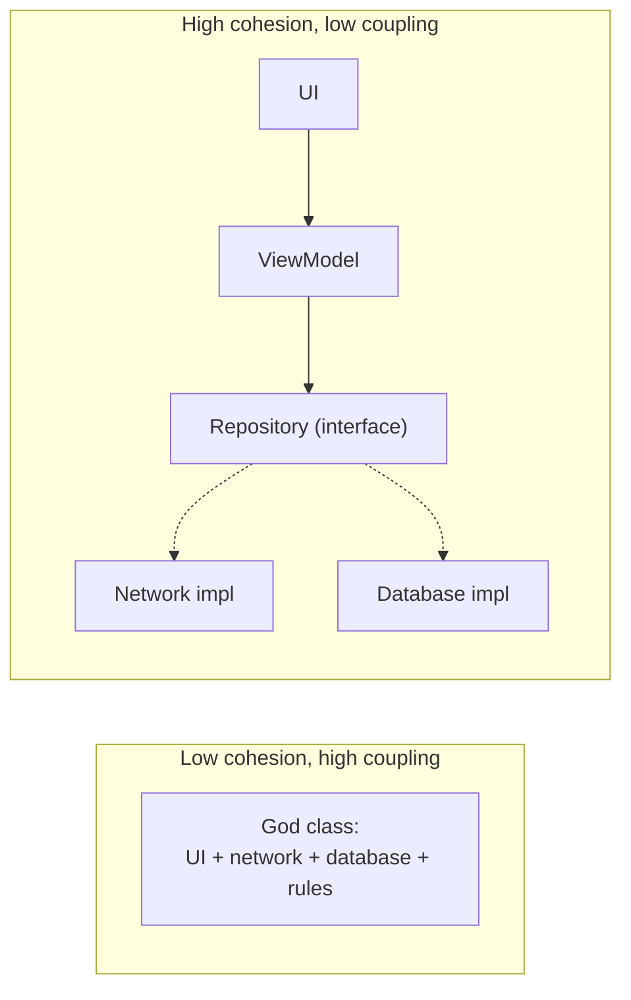

# Design Principles

> Principles are short rules that keep code and systems easy to change: separate concerns, keep modules focused and loosely tied, hide details, keep things simple, and assume parts will fail.

Roadmap topic 4 · Stage 2: Design Foundations

**Go deeper:** `5` Architectural Styles · `6` Patterns · `8` Modularity & Boundaries · `06-mobile-engineering/06-App-Architecture` and `07-Dependency-Injection-and-Modularization`.

**Marks:** 🟢 must know · 🟡 good to know

---

#### 1. What Is It?

*Rules of thumb that make change cheap.*

| 🟢 Must know | 🟡 Good to know |
|---|---|
| separation of concerns | composition over inheritance |
| high cohesion, low coupling | Law of Demeter |
| SOLID | single source of truth |
| abstraction and information hiding | principle of least astonishment |
| KISS, YAGNI, DRY (and when DRY hurts) | |
| design for failure | |

1. **Cohesion:** how focused a module is on one job. **Coupling:** how much modules depend on each other. Aim for high cohesion and low coupling.
2. **Abstraction:** a simple interface that hides details.
3. **Principles are guidance, not laws.** Apply them where change is likely or costly.

**Signals in an interview:** "explain SOLID", "what is coupling?", "DRY vs duplication?", "how do you design for failure?".

---

#### 2. How It Works

**Separation of concerns.** Each part deals with one concern: UI shows, domain decides, data stores, networking talks. A change to one concern (a new API field) should not force changes everywhere.

**Cohesion and coupling.**



**SOLID, in plain words.**

| Letter | Principle | Meaning | Mobile example |
|---|---|---|---|
| S | Single responsibility | a class has one reason to change | `NoteMapper` maps; `NoteRepository` stores; `NoteViewModel` holds UI state |
| O | Open–closed | open to extension, closed to modification | add a new payment method by adding a class, not editing a `when` in ten places |
| L | Liskov substitution | a subtype must work wherever its parent is expected | a `ReadOnlyNotesRepository` that throws on `save()` breaks callers of `NotesRepository` |
| I | Interface segregation | small, focused interfaces | `Searchable` and `Syncable`, not one `DoEverything` interface |
| D | Dependency inversion | depend on abstractions; details depend on them too | `NotesViewModel(repo: NotesRepository)`, not `Retrofit` directly |

**Abstraction and information hiding.** Expose what callers need (a small API), hide how it works (data structures, libraries). Then you can change the inside without breaking callers (`internal` in Kotlin, small module APIs).

**KISS, YAGNI, DRY.**

| | Meaning | Caution |
|---|---|---|
| KISS | keep it simple | simple for the reader, not shortest |
| YAGNI | don't build it until you need it | doesn't mean ignore known future needs on one-way decisions |
| DRY | one place for each piece of knowledge | duplicated *code* that represents different concepts should stay separate; a wrong abstraction costs more than duplication ("rule of three": abstract after the third use) |

**Design for failure.** Assume networks, disks, services, and users misbehave: timeouts, retries with backoff, idempotency, fallbacks, validation, and graceful degradation (topic 12).

🟡 **Composition over inheritance.** Build behaviour by combining small objects (a `Syncer` that has a `Clock` and a `Backoff`), not by deep class hierarchies. Inheritance couples subclass to superclass details.

🟡 **Law of Demeter (least knowledge).** An object talks to its direct collaborators, not to their internals: `order.total()` instead of `order.items.first().price.amount`.

🟡 **Single source of truth.** Each piece of data or rule lives in one place; others derive from it (the local database drives the UI, one validation function used everywhere).

🟡 **Least astonishment.** APIs and behaviours do what a reasonable user expects: consistent names, no hidden side effects.

---

#### 3. Naive vs Better Design

| Naive | Better |
|---|---|
| a screen that calls Retrofit and the database | UI → ViewModel → repository interface |
| `when (type)` repeated in many files | a polymorphic strategy or sealed type with one place per behaviour |
| copy-paste code with small differences | extract after the third use, if it is the same concept |
| a subclass that throws `UnsupportedOperationException` | separate interfaces |
| a big interface with 15 methods | small role interfaces |
| deep inheritance trees | composition |
| `a.b.c.d.value` chains | ask the owner of the data |
| optimistic "the network will work" | timeouts, retries, fallbacks |

```kotlin
// Naive: violates SRP, DIP and OCP at once
class NoteScreen {
    fun save(text: String, type: String) {
        val body = if (type == "md") render(text) else if (type == "plain") text else error("?")
        okHttp.newCall(Request.Builder().url("https://api/notes").post(body.toRequestBody()).build()).execute()
        db.execSQL("INSERT INTO notes VALUES (?)", arrayOf(body))
    }
}
```

---

#### 4. Templates & Examples

**Dependency inversion and the Open–closed principle together.**

```kotlin
interface Formatter { fun format(text: String): String }
class PlainFormatter : Formatter { override fun format(text: String) = text }
class MarkdownFormatter : Formatter { override fun format(text: String) = text.replace(Regex("""\*\*(.+?)\*\*"""), "<b>$1</b>") }

interface NotesRepository { fun save(body: String) }

class SaveNote(private val formatter: Formatter, private val repo: NotesRepository) {   // depends on abstractions
    operator fun invoke(text: String) = repo.save(formatter.format(text))
}
```

Checks: with a fake repository, `SaveNote(MarkdownFormatter(), fake)("**hi**")` saves `"<b>hi</b>"`; `SaveNote(PlainFormatter(), fake)("**hi**")` saves `"**hi**"`. Adding `HtmlFormatter` requires no change to `SaveNote` (open–closed), and tests use a fake `NotesRepository` (dependency inversion).

**Liskov violation and the fix.**

```kotlin
// Violation: callers of NotesRepository expect save() to work
class ReadOnlyRepo : NotesRepository { override fun save(body: String) = throw UnsupportedOperationException() }

// Fix: split the interface (ISP) so read-only code depends only on what it needs
interface NotesReader { fun all(): List<String> }
interface NotesWriter { fun save(body: String) }
```

**Composition over inheritance.**

```kotlin
class Syncer(private val api: Api, private val backoff: Backoff, private val clock: () -> Long) {
    suspend fun run() { /* uses api, backoff, clock; each can be replaced in tests */ }
}
```

**Law of Demeter.**

```kotlin
// Bad:  order.customer.address.city
// Good: order.shippingCity()          // Order knows how to find it; callers don't know the structure
```

**Design for failure checklist.**

```text
[ ] Every network call has a timeout        [ ] Retries are bounded, with backoff and jitter
[ ] Writes are idempotent                   [ ] There is a fallback or cached answer
[ ] Failures are visible (logs, metrics)    [ ] One failing part cannot take everything down (bulkhead, breaker)
```

**The rule of three (when DRY helps).**

```kotlin
fun shouldExtract(usesOfSameConcept: Int, sameReasonToChange: Boolean) = usesOfSameConcept >= 3 && sameReasonToChange
```

Checks: two similar snippets that change for different reasons `(2, false)` → `false`; three copies of the same validation rule `(3, true)` → `true`. Three similar-looking pieces that change for different reasons `(3, false)` → `false` (leave them).

---

#### 5. Numbers & Rules of Thumb

| Item | Guide |
|---|---|
| Class size | a screen's ViewModel under a few hundred lines; split when it has several reasons to change |
| Interface size | 1 to 5 methods |
| Parameters | 3 or fewer; use a data class beyond that |
| Duplication | extract at the third real repeat |
| Dependencies | depend on interfaces at boundaries; use concrete classes inside a module |
| Layers | 3 are often enough (UI, domain, data) |
| Inheritance depth | 1 to 2 levels |

---

#### 6. Common Mistakes & Edge Cases

1. Applying principles as dogma; abstractions with one implementation "just in case".
2. A wrong abstraction to remove duplication.
3. God classes and utility dumping grounds.
4. Interfaces for everything, so navigating the code is a maze.
5. Over-engineering for flexibility nobody needs (violating YAGNI).
6. Ignoring failure cases.
7. Deep inheritance.
8. Hidden global state.

Edge cases: performance-critical code that needs a concrete type; generated code (don't apply principles to it); a quick prototype (accept duplication, delete it later); a principle conflict (DRY vs decoupling: prefer decoupling across module boundaries).

---

#### 7. Say This in the Interview

1. "I aim for high cohesion and low coupling: each module has one job and depends on abstractions, so I can change one without breaking others."
2. "SOLID: one reason to change, extend rather than edit, substitutable subtypes, small interfaces, and depend on abstractions. In an app that means UI depends on a repository interface, not on Retrofit."
3. "I use DRY carefully: I abstract after the third real repeat, because a wrong abstraction is worse than duplication."
4. "I design for failure: timeouts, bounded retries, idempotent writes and fallbacks."
5. "I prefer composition to inheritance, and I apply principles where change is likely or costly, not everywhere."

---

#### 8. Quick Check

1. What does low coupling mean?
2. What is the dependency inversion principle?
3. When does DRY hurt?
4. Why composition over inheritance?

<details>
<summary>Answers</summary>

1. Modules depend on each other as little as possible, through small stable interfaces.
2. High-level code depends on abstractions, and low-level details implement them.
3. When it merges code that represents different concepts into a wrong shared abstraction.
4. It is more flexible and avoids tight coupling to a parent class.

</details>

---

#### 9. Practice

**Interview questions**

1. Explain SOLID with a mobile example.
2. Cohesion and coupling: what are they and why do they matter?
3. DRY, KISS, YAGNI: what are they and when do they conflict?
4. What is information hiding?
5. How do you design for failure?
6. Composition vs inheritance?

**Exercises**

1. Find a class in your app with more than one reason to change and split it.
2. Replace a repeated `when` on a type with a sealed type or strategy.
3. Find a duplication you removed that later hurt; describe the wrong abstraction.
4. Add a failure checklist to a design review template.

**Remember:** separate concerns · high cohesion, low coupling · SOLID · hide details behind small APIs · KISS/YAGNI/DRY with the rule of three · design for failure · prefer composition.
