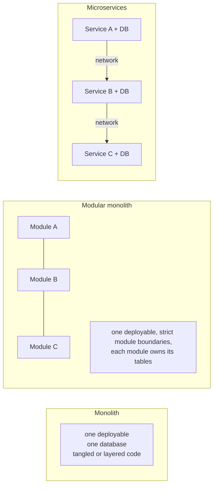
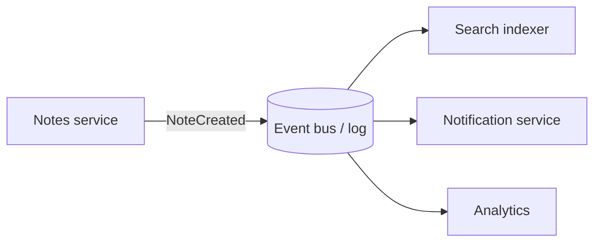
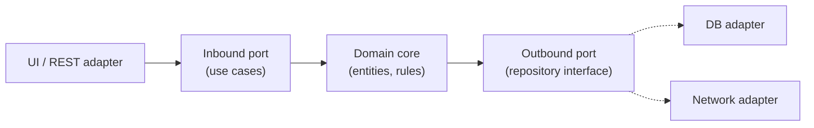

# Architectural Styles

> A style is a proven way to organise a system: layers, a monolith or services, events, or ports and adapters. Choose it from your ranked quality attributes and your team, not from fashion. "Monolith first" is often right.

Roadmap topic 5 · Stage 2: Design Foundations

**Go deeper:** `2` Quality Attributes · `3` Trade-Offs · `6` Patterns · `8` Modularity · `12` Scalability · `05-system-design/26-Service-Boundaries-and-Architecture` and `21-Queues-Events-and-Background-Jobs`.

**Marks:** 🟢 must know · 🟡 good to know

---

#### 1. What Is It?

*The overall shape of a system.*

| 🟢 Must know | 🟡 Good to know |
|---|---|
| layered architecture | serverless and functions |
| monolith, modular monolith, microservices | service-based architecture |
| client–server and API-first | microkernel (plugin), pipe-and-filter |
| event-driven architecture | space-based and others (names) |
| hexagonal / clean architecture | choosing a style from your quality attributes |

1. **Style:** a named pattern for the whole system (what the parts are, how they relate, the rules).
2. **Each style optimises some qualities and costs others.**

**Signals in an interview:** "monolith or microservices?", "how would you structure this app?", "what is clean architecture?", "when would you use events?".

---

#### 2. How It Works

**Layered.** Presentation → business logic → data access → database. Each layer uses the one below. Simple and familiar; risk: "pass-through" layers and a database-centric design; changes ripple through layers.

**Monolith, modular monolith, microservices.**



| | Monolith | Modular monolith | Microservices |
|---|---|---|---|
| Deploy | one unit | one unit | many independent units |
| Team independence | low | medium | high (if boundaries are right) |
| Complexity | low | low–medium | high: network, data consistency, operations |
| Performance | in-process calls | in-process calls | network calls, latency |
| Scaling | scale everything | scale everything | scale each service |
| Data consistency | one transaction | one transaction (per module rules) | eventual, sagas |
| Good start for | small teams, new products | most products | large orgs with clear domains and strong platform skills |

**"Monolith first."** Start as a well-modularised monolith; extract a service when there is a real reason (independent scaling, independent teams or deployment, different technology, fault isolation) and the boundary is well understood. The failure mode is the **distributed monolith**: services that must change and deploy together, with all the cost and none of the benefit.

**Client–server and API-first.** Clients (mobile, web) talk to a server through an API contract designed first (OpenAPI/GraphQL schema). Many clients can share one backend; versioning matters because old app versions never go away (`SD 30`).

**Event-driven architecture.** Components publish events ("NoteCreated") and others react, through a broker (queue, log). Loose coupling in time and knowledge, good for fan-out, auditing and integration; costs: eventual consistency, harder tracing, ordering and duplicate handling (`SD 21`).



**Hexagonal (ports and adapters) / clean architecture.** Business rules at the centre; outside details (UI, database, network, frameworks) plug in through interfaces (ports) implemented by adapters. Dependencies point inward, so the core is testable without the framework.



🟡 **Serverless / functions.** Code runs on demand and scales to zero; pay per use. Good for spiky or event-driven work; limits: cold starts, execution time, vendor lock-in, harder local testing.

🟡 **Service-based.** A few coarse-grained services (3 to 12) sharing a database or not; most of microservices' benefits with less operational cost.

🟡 **Microkernel (plugin).** A small core plus plugins (IDEs, browsers, some mobile SDK designs). **Pipe-and-filter:** data flows through steps (build pipelines, ETL, image processing). **Space-based**, **CQRS/event-sourced** and others: names, for extreme scale or specific needs.

**Choosing a style from your ranked quality attributes.**

| Top need | Leans toward |
|---|---|
| fast delivery, small team, unclear domain | modular monolith |
| independent deploys for many teams | microservices (with platform maturity) |
| spiky load, little ops capacity | serverless / managed services |
| audit, integration, loose coupling | event-driven |
| long-lived business rules, high testability | hexagonal / clean |
| extensibility by third parties | microkernel / plugins |
| high data throughput stages | pipe-and-filter |

---

#### 3. Naive vs Better Design

| Naive | Better |
|---|---|
| microservices on day one | modular monolith, extract later |
| "we're doing events" for a simple CRUD flow | synchronous call where simple works |
| services sharing one database tables | each service owns its data |
| a shared "common" library everything depends on | small, stable shared contracts only |
| business logic in controllers or composables | domain core behind ports |
| style chosen for the résumé | style chosen from ranked attributes and team skills |

---

#### 4. Templates & Examples

**Ports and adapters in Kotlin.**

```kotlin
// Domain core: no framework imports
data class Note(val id: String, val text: String)

interface NoteRepository {                         // outbound port
    suspend fun save(note: Note)
    suspend fun find(id: String): Note?
}

class CreateNote(private val repo: NoteRepository, private val newId: () -> String) {      // inbound use case
    suspend operator fun invoke(text: String): Note {
        require(text.isNotBlank()) { "text required" }
        return Note(newId(), text.trim()).also { repo.save(it) }
    }
}

// Adapters (outside)
class InMemoryNoteRepository : NoteRepository {
    private val m = HashMap<String, Note>()
    override suspend fun save(note: Note) { m[note.id] = note }
    override suspend fun find(id: String) = m[id]
}
```

Checks: `CreateNote(InMemoryNoteRepository(), { "n1" })("  hi ")` returns `Note("n1", "hi")` and `find("n1")` returns it; a blank text throws `IllegalArgumentException`. The same use case works with a Room or REST adapter, unchanged.

**A tiny in-process event bus (event-driven within a monolith).**

```kotlin
class EventBus {
    private val handlers = mutableMapOf<Class<*>, MutableList<(Any) -> Unit>>()
    fun <T : Any> on(type: Class<T>, h: (T) -> Unit) { @Suppress("UNCHECKED_CAST") handlers.getOrPut(type) { mutableListOf() } += h as (Any) -> Unit }
    fun publish(e: Any) { handlers[e.javaClass]?.forEach { it(e) } }
}
data class NoteCreated(val id: String)
```

Checks: two handlers subscribed to `NoteCreated`; `publish(NoteCreated("n1"))` calls both once; publishing an event nobody subscribed to does nothing. In a distributed system the same idea needs a broker plus idempotent consumers.

**Pipe-and-filter.**

```kotlin
fun <A, B, C> ((A) -> B).then(next: (B) -> C): (A) -> C = { next(this(it)) }
val pipeline = { s: String -> s.trim() }.then { it.lowercase() }.then { it.split(" ") }
```

Checks: `pipeline("  Hello World ")` → `["hello", "world"]`.

**Style decision record (short).**

```text
Style: modular monolith (backend), hexagonal inside each module, events between modules (in-process now, broker later).
Why: small team (6), unclear domain boundaries, need weekly releases (ASR: maintainability, cost).
Revisit when: a module needs independent scaling or a separate team owns it for 6+ months.
```

**Monolith vs microservices: a quick comparison of network cost.**

```kotlin
fun callsPerRequest(servicesInPath: Int, callsPerHop: Int = 1) = servicesInPath * callsPerHop
fun addedLatencyMs(servicesInPath: Int, msPerHop: Double = 2.0) = servicesInPath * msPerHop
fun availability(vararg parts: Double) = parts.fold(1.0) { acc, a -> acc * a }
```

Checks: five services in a request path at `99.9%` each → `0.999⁵ = 99.50%` overall availability (vs `99.9%` for one process), and about `10` ms of extra network time at 2 ms per hop. Splitting has a price: every hop adds latency and failure probability.

---

#### 5. Numbers & Rules of Thumb

| Item | Guide |
|---|---|
| Microservices | consider when you have many teams (10+ engineers per domain split) and a platform team |
| Team per service | one team can own a few services; avoid one engineer per service |
| Service size | something a team can rewrite in weeks, not "as small as possible" |
| Network | each hop adds ~1–5 ms in a data centre and a failure mode |
| Availability | serial dependencies multiply (0.999⁵ ≈ 0.995) |
| Modular monolith | strict module APIs and per-module tables from day one |
| Migration | extract one service at a time with the strangler pattern |

---

#### 6. Common Mistakes & Edge Cases

1. Microservices because they are fashionable.
2. A distributed monolith.
3. A shared database across services.
4. Events for everything, with no way to trace or replay.
5. Layers that only forward calls.
6. Framework code inside the domain core.
7. Choosing the style before the quality attributes.
8. Ignoring the operations cost of the style.

Edge cases: a legacy monolith with a hot module (extract that one); regulation requiring isolation (separate deployables for that part); a small team with a serverless-friendly workload; mobile apps (clean/hexagonal layers inside the app, topic 19); a style mix is normal (modular monolith + serverless jobs + events).

---

#### 7. Say This in the Interview

1. "I choose a style from the ranked quality attributes and the team's skills. For most new products I start with a modular monolith, with strict module boundaries and per-module data."
2. "I'd move to microservices only when independent scaling or independent team deployment is a real need and the boundary is clear; otherwise you get a distributed monolith."
3. "Hexagonal keeps business rules in the core and plugs UI, database and network in through interfaces, so the core is testable and the details replaceable."
4. "Events give loose coupling and fan-out, at the price of eventual consistency and harder debugging."
5. "Each hop in a distributed system adds latency and multiplies failure probability, so splitting must buy something."

---

#### 8. Quick Check

1. What is a modular monolith?
2. What is a distributed monolith?
3. What does hexagonal architecture protect?
4. When is serverless a good fit?

<details>
<summary>Answers</summary>

1. One deployable with strict module boundaries, each module owning its data.
2. Services that must still be changed and deployed together, with microservice costs and no benefit.
3. The domain core from frameworks and details, through ports and adapters.
4. Spiky or event-driven work, small teams without ops capacity, tolerating limits and lock-in.

</details>

---

#### 9. Practice

**Interview questions**

1. Monolith vs modular monolith vs microservices: how do you choose?
2. What is clean/hexagonal architecture?
3. When would you use event-driven architecture?
4. What are the costs of microservices?
5. How would you structure a mobile app and its backend?
6. How do you choose a style from quality attributes?

**Exercises**

1. Compare the three styles for one system (notes, chat or checkout) with a recommendation and a "revisit when" trigger.
2. Draw the ports and adapters for one use case in your app.
3. Compute the availability of a request path through four services at 99.9% each.
4. Identify a distributed-monolith smell in a system you know.

**Remember:** style from ranked attributes and team · monolith first, modular · microservices only for real needs · hexagonal protects the core · events trade coupling for eventual consistency · hops add latency and failure.
