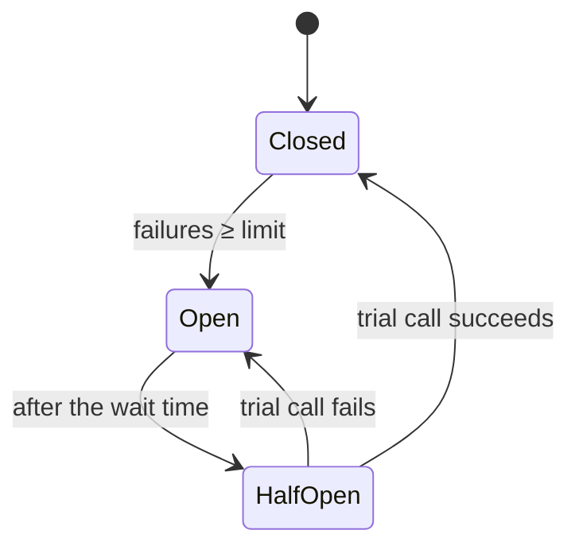

# Architecture & Design Patterns

> Patterns are named, proven solutions to recurring problems. Know the small design patterns, the UI patterns, the resilience and integration patterns, and the anti-patterns, and use a pattern only when the problem it solves is really present.

Roadmap topic 6 · Stage 2: Design Foundations

**Go deeper:** `4` Design Principles · `5` Styles · `10` Integration · `12` Resilience · `16` Evolutionary Architecture · `05-system-design/25-Overload-and-Failure-Handling` and `26-Service-Boundaries-and-Architecture` · `06-mobile-engineering/06-App-Architecture`.

**Marks:** 🟢 must know · 🟡 good to know

---

#### 1. What Is It?

*A shared vocabulary of solutions.*

| 🟢 Must know | 🟡 Good to know |
|---|---|
| creational and structural: factory, builder, adapter, facade, decorator | CQRS and event sourcing |
| behavioural: strategy, observer | saga and transactional outbox |
| dependency injection, inversion of control | strangler fig, anti-corruption layer, sidecar |
| repository, data access layer | anti-patterns |
| UI patterns: MVC, MVP, MVVM, MVI | |
| resilience: timeout, retry, circuit breaker, bulkhead | |
| API gateway and BFF | |

1. **Design pattern:** a small-scale solution inside code.
2. **Architectural pattern:** a larger-scale solution across components or services.
3. **Anti-pattern:** a common bad solution.

**Signals in an interview:** "which patterns do you use?", "MVVM vs MVI?", "what is a circuit breaker?", "how do you do a transaction across services?", "what is a BFF?".

---

#### 2. How It Works

**Design patterns (basics).**

| Pattern | Problem | Idea | Mobile example |
|---|---|---|---|
| Factory | create objects without hard-coding the class | a function or class decides which to build | `HttpClientFactory.create(env)` |
| Builder | many optional parameters | step by step construction | `OkHttpClient.Builder()`, `NotificationCompat.Builder` |
| Adapter | two interfaces don't match | translate one into the other | wrap a vendor SDK in your `Analytics` interface |
| Facade | a complex subsystem | one simple entry point | `PaymentFacade.pay(cart)` over several SDK calls |
| Decorator | add behaviour without changing a class | wrap with the same interface | logging or retrying repository around a real one |
| Strategy | choose an algorithm at runtime | interchangeable implementations | sort order, pricing rule, backoff policy |
| Observer | notify many dependents of change | subscribe and publish | `StateFlow`, `LiveData`, event listeners |

**Dependency injection / inversion of control.** A class receives its dependencies from outside (constructor), so they can be replaced and tested (`MOB 7`).

**Repository.** A collection-like interface over data access: `NotesRepository.find(id)`. Hides whether data comes from the network, a database or a cache.

**UI patterns.**

| Pattern | Idea |
|---|---|
| MVC | Model, View, Controller; the controller updates both |
| MVP | Presenter handles logic; View is passive |
| MVVM | ViewModel exposes observable state; View binds to it |
| MVI | one immutable state; intents/actions go through a reducer |

MVVM and MVI both give unidirectional data flow on mobile (`MOB 6`).

**Resilience patterns (`SD 25`).**

| Pattern | Idea |
|---|---|
| Timeout | never wait forever |
| Retry with backoff and jitter | try again for transient errors, only if safe |
| Circuit breaker | stop calling a failing dependency for a while |
| Bulkhead | separate resource pools so one failure doesn't drain all |
| Fallback / degradation | a simpler answer when the dependency is down |
| Rate limiting, load shedding | protect yourself |

**API gateway and BFF (`SD 26`).** An *API gateway* is one entry point for clients: auth, rate limits, routing. A *Backend for Frontend* is a backend shaped for one client (mobile BFF returns just what a screen needs, fewer round trips).

🟡 **CQRS and event sourcing.** *CQRS*: separate models for writing (commands) and reading (queries), often with a denormalised read model. *Event sourcing*: store the sequence of events and derive state by replaying them. Powerful for audit and history; costly in complexity. Use only with a clear need.

🟡 **Saga and transactional outbox.** A *saga* coordinates a multi-service process as local transactions with compensating actions on failure (book → charge → confirm; if the charge fails, release the booking). The *outbox* writes the data and the event to the same database transaction, and a relay publishes the event later, so you never save without publishing or the reverse (`SD 26`).

🟡 **Strangler fig, anti-corruption layer, sidecar.** *Strangler fig*: replace a legacy system piece by piece behind a common front. *Anti-corruption layer (ACL)*: translate between your model and an external system's. *Sidecar*: a helper process next to a service (logging, proxy).

🟡 **Anti-patterns.** *God class* (does everything), *big ball of mud* (no structure), *distributed monolith*, *golden hammer* (one tool for everything), *spaghetti code*, *shared database between services*, *premature abstraction*, *singleton abuse*.

---

#### 3. Naive vs Better Design

| Naive | Better |
|---|---|
| `if (type == A) ... else if (type == B) ...` everywhere | strategy / sealed type |
| a vendor SDK called from every screen | adapter behind your interface |
| copy-paste retry loops | one retry decorator with backoff |
| calls to a failing service pile up | circuit breaker + fallback |
| distributed transaction across services | saga with compensation |
| publish an event after the commit (and hope) | transactional outbox |
| a mobile app calling 6 endpoints per screen | BFF or aggregated endpoint |
| pattern for pattern's sake | use a pattern when its problem is present |

---

#### 4. Templates & Examples

**Strategy + factory.**

```kotlin
fun interface Pricing { fun price(base: Long): Long }

val pricingFor = mapOf<String, Pricing>(
    "regular" to Pricing { it },
    "student" to Pricing { it * 80 / 100 },
    "member"  to Pricing { it * 90 / 100 },
)

fun priceFor(plan: String, base: Long) = (pricingFor[plan] ?: pricingFor.getValue("regular")).price(base)
```

Checks: `priceFor("student", 1000)` → `800`; `priceFor("member", 1000)` → `900`; `priceFor("unknown", 1000)` → `1000`. Adding `"senior"` is one line (open–closed).

**Decorator: retry around any repository.**

```kotlin
interface NotesApi { suspend fun upload(id: String): Boolean }

class RetryingApi(private val inner: NotesApi, private val tries: Int = 3) : NotesApi {
    override suspend fun upload(id: String): Boolean {
        repeat(tries - 1) { if (runCatching { inner.upload(id) }.getOrDefault(false)) return true }
        return inner.upload(id)
    }
}
```

Checks: an API that fails twice then succeeds returns `true` through `RetryingApi(inner, 3)` and was called 3 times; one that always fails throws (or returns `false`) after exactly 3 calls.

**Adapter around a vendor SDK.**

```kotlin
interface Analytics { fun track(event: String, props: Map<String, String> = emptyMap()) }
class VendorAnalytics(private val sdk: VendorSdk) : Analytics {
    override fun track(event: String, props: Map<String, String>) = sdk.logEvent(event, Bundle().apply { props.forEach { (k, v) -> putString(k, v) } })
}
```

Switching vendor means one new adapter.

**Saga with compensation.**

```kotlin
class Step(val name: String, val action: () -> Unit, val undo: () -> Unit)

fun runSaga(steps: List<Step>, log: MutableList<String>): Boolean {
    val done = ArrayDeque<Step>()
    for (s in steps) {
        try { s.action(); done.addLast(s); log += "did ${s.name}" }
        catch (e: Exception) {
            log += "failed ${s.name}"
            while (done.isNotEmpty()) { val d = done.removeLast(); d.undo(); log += "undid ${d.name}" }     // compensate in reverse order
            return false
        }
    }
    return true
}
```

Checks: steps `reserve`, `charge`, `confirm` where `charge` throws → `runSaga` returns `false` and the log is `[did reserve, failed charge, undid reserve]`. All succeed → `true` and `[did reserve, did charge, did confirm]`. Compensations must be idempotent, because they can be retried.

**Event sourcing in miniature.**

```kotlin
sealed interface Event { data class Deposited(val amount: Long) : Event; data class Withdrawn(val amount: Long) : Event }
fun balance(events: List<Event>) = events.fold(0L) { b, e -> when (e) { is Event.Deposited -> b + e.amount; is Event.Withdrawn -> b - e.amount } }
```

Checks: `[Deposited(100), Withdrawn(30), Deposited(5)]` → `75`. The history is the truth; the balance is derived (and can be cached as a snapshot).

**Circuit breaker states.**



**Which UI pattern?** MVVM with one `StateFlow<UiState>` is the usual Android default; use MVI (reducer) when you want strict single-state reasoning and easy replay (`MOB 6`).

---

#### 5. Numbers & Rules of Thumb

| Item | Guide |
|---|---|
| Patterns per codebase | few; each justified by a real problem |
| Retry | 3 to 5 tries, backoff with jitter; only for idempotent calls |
| Circuit breaker | open after 5 consecutive failures or 50% error rate; wait 10 to 60 s |
| Timeouts | every outbound call; shorter than the caller's timeout |
| Saga steps | few; each with an idempotent compensation |
| Outbox | poll every 100 ms to 1 s, mark sent after publishing |
| CQRS/event sourcing | only when audit, history or very different read/write shapes need it |

---

#### 6. Common Mistakes & Edge Cases

1. Patterns for their own sake; abstractions with one use.
2. Singleton as a global variable.
3. Retrying non-idempotent operations.
4. A circuit breaker with no fallback.
5. Sagas without idempotent compensations.
6. CQRS/event sourcing in a simple CRUD app.
7. A BFF that duplicates business logic across clients.
8. Hiding failures inside decorators.

Edge cases: a compensation that itself fails (retry, alert, manual repair queue); events delivered twice (idempotent consumers); partial failure in the outbox relay; versioning events over years; a facade that grows into a god class.

---

#### 7. Say This in the Interview

1. "I use patterns when their problem is present: strategy instead of repeated `when`, an adapter around vendor SDKs, a decorator for cross-cutting behaviour like retries."
2. "On mobile I use MVVM or MVI with one UI state and a repository over the data sources."
3. "For resilience: timeouts, bounded retries with backoff, a circuit breaker with a fallback, bulkheads."
4. "Across services I avoid distributed transactions: a saga with compensations, and an outbox so events and data commit together."
5. "I'd use CQRS or event sourcing only for audit, history or very different read and write needs."
6. "I watch for anti-patterns: god classes, distributed monolith, shared databases, golden hammers."

---

#### 8. Quick Check

1. Strategy vs decorator?
2. What does a circuit breaker do?
3. What does a saga do on failure?
4. Why an outbox?

<details>
<summary>Answers</summary>

1. Strategy swaps an algorithm; decorator wraps an object to add behaviour while keeping its interface.
2. After repeated failures it stops calling the dependency for a while, then tries a trial call.
3. It runs compensating actions for the completed steps, in reverse order.
4. So the database change and the event are committed together; a relay publishes the event afterwards.

</details>

---

#### 9. Practice

**Interview questions**

1. Name five design patterns and when you used them.
2. MVC vs MVP vs MVVM vs MVI?
3. How do you make a call to an unreliable service safe?
4. How do you keep data consistent across services?
5. What are CQRS and event sourcing, and when are they worth it?
6. What is a BFF and why use one for mobile?
7. Name four anti-patterns.

**Exercises**

1. Replace a repeated `when` with a strategy map and test it.
2. Wrap a vendor SDK behind an adapter and swap it in a test.
3. Write the saga for "place order" (reserve stock, charge, confirm) with compensations and test failure at each step.
4. Draw a circuit breaker's three states for an API in your app.

**Remember:** patterns solve recurring problems, use them when the problem is present · adapter, decorator, strategy · MVVM/MVI on mobile · timeouts, retries, breakers, bulkheads · saga + outbox instead of distributed transactions · CQRS/event sourcing only with a need · know the anti-patterns.
