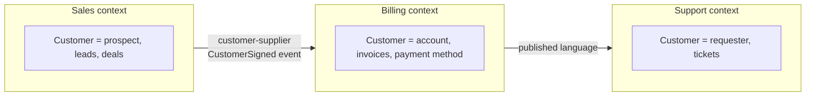

# Domain-Driven Design Essentials

> DDD is a way to model complex business domains: use the same words as the business, split the system into bounded contexts with one meaning each, and spend design effort where the business value is. Know the essentials, and know when it is overkill.

Roadmap topic 7 · Stage 2: Design Foundations

**Go deeper:** `5` Styles · `6` Patterns · `8` Modularity & Boundaries · `9` Data Architecture · `10` Integration · `05-system-design/26-Service-Boundaries-and-Architecture`.

**Marks:** 🟢 must know · 🟡 good to know

---

#### 1. What Is It?

*Modelling software around the business domain.*

| 🟢 Must know | 🟡 Good to know |
|---|---|
| ubiquitous language | domain events |
| bounded context | context map (shared kernel, customer–supplier, ACL) |
| entities, value objects, aggregates | when DDD is overkill |
| core, supporting, generic subdomains | |

1. **Domain:** the business area the software serves (payments, notes, shipping).
2. **Ubiquitous language:** the same terms used by business and developers, in code, docs and talk.
3. **Bounded context:** a boundary within which a model and its words have one meaning.
4. **Aggregate:** a cluster of objects changed together, with one entry point (the root) that protects the rules.

**Signals in an interview:** "what is a bounded context?", "entity vs value object?", "how do you find service boundaries?", "when is DDD worth it?".

---

#### 2. How It Works

**Ubiquitous language.** If the business says "booking", the code says `Booking`, not `Reservation` in one file and `Order` in another. Gaps in language are where bugs and misunderstandings start. Build a glossary together with domain experts and keep it in the repo.

**Bounded contexts.** The same word can mean different things: a "Customer" in Sales (a prospect with a pipeline) is not the "Customer" in Billing (an account with invoices). Don't force one giant model; give each context its own model and let them talk through explicit contracts.



Bounded contexts are the best starting point for module and service boundaries (topic 8): a context is a good candidate for a module, and sometimes a service.

**Building blocks.**

| Block | Meaning | Example |
|---|---|---|
| Entity | has an identity that persists as attributes change | `Note(id)`, `User(id)` |
| Value object | defined by its values; immutable; no identity | `Money(amount, currency)`, `EmailAddress`, `DateRange` |
| Aggregate | cluster treated as one unit for changes; the root enforces invariants; references other aggregates by id | `Order` (root) with its `OrderLine`s |
| Repository | loads and saves aggregates | `OrderRepository` |
| Domain service | rule that doesn't belong to one entity | `PricingService` |
| Domain event | a fact that happened | `OrderPlaced`, `NoteShared` |

Rules for aggregates: keep them small; change one aggregate per transaction; use ids to refer to other aggregates; protect invariants inside the root ("an order's total equals the sum of its lines").

**Subdomains.**

| Kind | Meaning | Approach |
|---|---|---|
| Core | what makes the business win | invest the best people and design; build in-house |
| Supporting | needed but not differentiating | simpler design; build or buy |
| Generic | solved problems (auth, payments, email) | buy or reuse |

Spend design effort on the core.

🟡 **Domain events.** Record important facts and publish them to other contexts. They make behaviour explicit and decouple contexts (`SD 21`).

🟡 **Context map.** How contexts relate:

| Relationship | Meaning |
|---|---|
| Shared kernel | two contexts share a small model (tight coupling; use sparingly) |
| Customer–supplier | downstream depends on upstream, and can ask for changes |
| Conformist | downstream accepts the upstream model as is |
| Anti-corruption layer | downstream translates the upstream's model into its own |
| Open host / published language | upstream offers a stable, documented API for many consumers |
| Separate ways | no integration |

🟡 **When DDD is overkill.** Simple CRUD with little business logic, small apps, short-lived tools. Use the ideas that cost nothing (shared language, clear boundaries) and skip the heavy tactical patterns.

---

#### 3. Naive vs Better Design

| Naive | Better |
|---|---|
| one `Customer` class used by every part | one model per bounded context |
| "data model first": tables drive everything | domain behaviour first, persistence second |
| anemic entities (just getters) and logic in services | rules live in the aggregate |
| aggregates that load half the database | small aggregates linked by ids |
| code words differ from the business words | ubiquitous language in the code |
| using an external system's model everywhere | an anti-corruption layer at the edge |
| DDD ceremony for a simple CRUD screen | keep it simple |

---

#### 4. Templates & Examples

**Value object.**

```kotlin
@JvmInline value class UserId(val value: String)

data class Money(val minorUnits: Long, val currency: String) {            // 1050 = 10.50
    init { require(currency.length == 3) { "currency code" } }
    operator fun plus(o: Money): Money { require(o.currency == currency) { "currency mismatch" }; return Money(minorUnits + o.minorUnits, currency) }
}
```

Checks: `Money(1050, "EUR") + Money(250, "EUR")` → `Money(1300, "EUR")`; adding `USD` to `EUR` throws `IllegalArgumentException("currency mismatch")`; `Money(1, "EURO")` throws at construction. Invalid states cannot exist.

**Aggregate with invariants.**

```kotlin
class Order(val id: String) {
    private val lines = mutableListOf<Pair<String, Money>>()
    var status = "draft"; private set

    fun addLine(sku: String, price: Money) {
        check(status == "draft") { "cannot change a $status order" }
        lines += sku to price
    }
    fun total(): Money = lines.map { it.second }.reduceOrNull { a, b -> a + b } ?: Money(0, "EUR")
    fun place(): OrderPlaced {
        check(lines.isNotEmpty()) { "an order needs at least one line" }
        status = "placed"; return OrderPlaced(id, total())
    }
}
data class OrderPlaced(val orderId: String, val total: Money)
```

Checks: an order with lines `(A, 10.00)` and `(B, 5.50)` → `total()` = `Money(1550, "EUR")`; `place()` returns `OrderPlaced(id, 1550)` and the status is `placed`; `addLine` after placing throws; `place()` on an empty order throws. The aggregate root enforces the rules, whatever the UI or API does.

**Anti-corruption layer.**

```kotlin
// External model (legacy CRM): cust_nm, stat_cd
data class LegacyCustomer(val cust_nm: String, val stat_cd: String)

// Our model
data class Customer(val name: String, val active: Boolean)

fun LegacyCustomer.toDomain() = Customer(cust_nm.trim(), stat_cd == "A")
```

Checks: `LegacyCustomer(" Ann ", "A").toDomain()` → `Customer("Ann", true)`; `stat_cd = "X"` → `active = false`. Only the ACL knows the legacy codes.

**Glossary and context sheet (keep in the repo).**

```text
CONTEXT: Billing
Terms: Invoice (a request for payment, immutable once issued), Account (who pays), Credit note (reverses part of an invoice)
Not in this context: Lead, Ticket
Upstream: Sales (CustomerSigned)   Downstream: Reporting (InvoiceIssued)   Integration: events + ACL for the payment provider
Owner: Billing team
```

**Finding boundaries (event storming in short).** List domain events on a wall in time order (`NoteCreated`, `NoteShared`, `SubscriptionStarted`), group them by the words and rules they use, and draw lines where the language changes; those lines are candidate contexts.

---

#### 5. Numbers & Rules of Thumb

| Item | Guide |
|---|---|
| Aggregate size | a handful of objects; if loading it is slow, it is too big |
| Transaction | change one aggregate per transaction; use events for the rest |
| Contexts per team | one team can own one or a few contexts |
| Glossary | 20 to 50 key terms, agreed with domain experts |
| Core domain | 10 to 20% of the system; the place for your best design |
| Event naming | past tense (`OrderPlaced`), business language |

---

#### 6. Common Mistakes & Edge Cases

1. One giant shared model (a "canonical" `Customer`).
2. Technical words in the domain (`DataManager`, `Helper`).
3. Big aggregates that cause contention and slow loads.
4. Ignoring domain experts.
5. Applying all tactical patterns to simple CRUD.
6. Sharing a database between contexts.
7. Letting an external system's model leak in.
8. Boundaries drawn by technical layers, not by the domain.

Edge cases: two contexts that really need the same data (share an id, copy what you need, update through events); an aggregate that needs data from another (read it by id before the command, or use a domain service); legacy systems (strangler + ACL); different teams naming the same concept differently (decide in a context map).

---

#### 7. Say This in the Interview

1. "DDD starts with a shared language with domain experts and splits the system into bounded contexts, each with its own model and meaning for words like 'customer'."
2. "Entities have identity; value objects are immutable and defined by their values; aggregates protect invariants and are changed one per transaction."
3. "I put the best design effort into the core domain, and buy or simplify the generic and supporting ones."
4. "Contexts are good candidates for module or service boundaries; between them I use events or APIs and an anti-corruption layer for external or legacy models."
5. "For a simple CRUD app I'd use the language and boundaries, and skip the heavy tactical patterns."

---

#### 8. Quick Check

1. What is a bounded context?
2. Entity vs value object?
3. What does an aggregate root do?
4. Core vs generic subdomain?

<details>
<summary>Answers</summary>

1. A boundary within which a model and its terms have one consistent meaning.
2. An entity has a lasting identity; a value object is immutable and equal when its values are equal.
3. It is the single entry point that enforces the aggregate's rules.
4. Core differentiates the business (invest, build); generic is a solved problem (buy or reuse).

</details>

---

#### 9. Practice

**Interview questions**

1. What is DDD, and when would you use it?
2. What is a bounded context? Give an example.
3. Entity vs value object vs aggregate?
4. How do you find service boundaries?
5. What is an anti-corruption layer?
6. What are the downsides of DDD?

**Exercises**

1. Write a glossary of 15 terms for a product you know, and mark words that mean different things in different parts.
2. Draw a context map for the Notes app (accounts, notes, sharing, billing, notifications).
3. Model a value object and an aggregate with invariants and test them.
4. Classify the subdomains of your product as core, supporting or generic.

**Remember:** ubiquitous language · bounded contexts with one meaning · entities, value objects, aggregates (small, one per transaction) · invest in the core · context map and ACL at the edges · skip the ceremony for simple CRUD.
