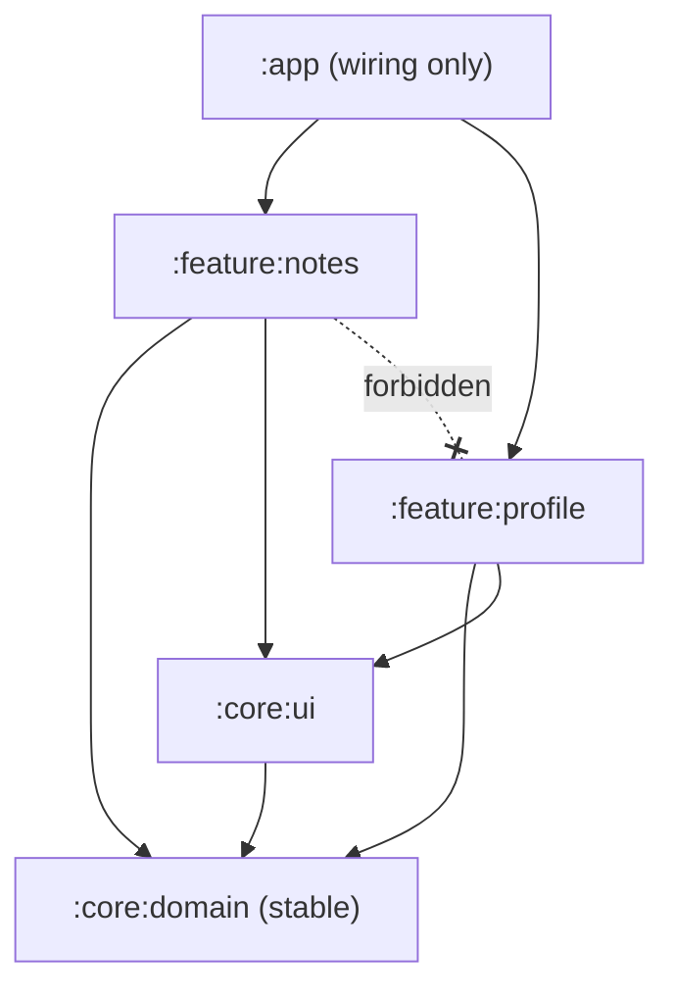

# Modularity, Coupling & Boundaries

> Good architecture has clear boundaries: small public APIs, hidden insides, dependencies pointing the right way, and teams that match the modules. You can measure coupling, and you can enforce boundaries with tests.

Roadmap topic 8 · Stage 2: Design Foundations

**Go deeper:** `4` Design Principles · `5` Styles · `7` DDD · `17` Governance · `18` Teams & Delivery · `06-mobile-engineering/07-Dependency-Injection-and-Modularization`.

**Marks:** 🟢 must know · 🟡 good to know

---

#### 1. What Is It?

*How the system is cut into parts, and how the parts depend on each other.*

| 🟢 Must know | 🟡 Good to know |
|---|---|
| module boundaries: small public API, hidden inside | monorepo vs polyrepo |
| dependency direction: depend on stable abstractions | shared code and libraries: the cost of sharing |
| package by feature vs by layer | measuring coupling: dependency graphs, cycles |
| Conway's law | boundaries inside a monolith |
| contracts between modules/services and how they change | |

1. **Module:** a unit with a clear purpose, a public API, and hidden internals.
2. **Boundary:** the line where the API sits; across it, only the API is used.
3. **Coupling:** how much one module depends on another (and on its details).
4. **Contract:** the agreed interface and behaviour across a boundary.

**Signals in an interview:** "how would you modularise this app?", "what is Conway's law?", "feature or layer packages?", "how do you find circular dependencies?", "monorepo or polyrepo?".

---

#### 2. How It Works

**Boundaries and dependency direction.**



Rules:

1. **Small public API, hidden inside.** Expose interfaces and models; keep implementations `internal`.
2. **Depend on stable abstractions.** Volatile details (UI, frameworks, vendors) depend on stable cores (domain), not the reverse.
3. **No cycles.** If A depends on B and B on A, they are really one module.
4. **Features don't depend on each other.** They meet in the app module or through a shared contract.

**Package by feature vs by layer.**

| By layer | By feature |
|---|---|
| `ui/`, `data/`, `domain/` at the top; every feature scattered across them | `notes/` (with its own ui, data, domain), `profile/`, … |
| easy to see "all screens" | easy to see "everything about notes"; deleting a feature is easy |
| changes touch many folders | a change usually stays in one folder |
| good for tiny apps | better as the app grows, and a natural path to modules |

**Conway's law.** "A system's design mirrors the communication structure of the organisation that builds it." Teams with a hard boundary produce a hard boundary in the code. Use it deliberately: the **inverse Conway manoeuvre** shapes teams to match the architecture you want (topic 18).

**Contracts and change.** A contract is an API (types, errors, behaviour, limits) plus rules for change: add-only changes, deprecation periods, versioning, contract tests, a changelog. For mobile, old app versions never go away (`SD 30`), so contracts live for years.

**Measuring coupling.**

| Metric | Meaning |
|---|---|
| Afferent coupling (Ca) | how many modules depend on this one |
| Efferent coupling (Ce) | how many modules this one depends on |
| Instability I = Ce ÷ (Ca + Ce) | 0 = stable (many depend on it, it depends on none); 1 = unstable (depends on many, nothing depends on it) |
| Cycles | strongly connected sets of modules |
| Change coupling | files that change together in commits (a hidden dependency) |

Healthy direction: **depend toward stability** (unstable modules depend on stable ones). Core/domain modules should be stable; app/UI modules unstable.

🟡 **Monorepo vs polyrepo.**

| | Monorepo | Polyrepo |
|---|---|---|
| Sharing and refactoring | easy, atomic changes | harder, versioned libraries |
| Tooling | needs good build tooling and ownership rules | simple per repo |
| Independence | lower by default | higher |
| Fit | one product, tight teams | independent products and teams |

🟡 **Shared code.** Sharing reduces duplication but creates coupling: a change affects every consumer. Share *stable, generic, small* things (types, contracts, design tokens); don't create a "common" dumping ground everyone depends on. Prefer copying small code over sharing the wrong abstraction.

🟡 **Boundaries inside a monolith.** A modular monolith enforces module APIs and data ownership (each module's tables are private) inside one deployable, with tests that fail on violations.

---

#### 3. Naive vs Better Design

| Naive | Better |
|---|---|
| `utils` and `common` modules everything imports | small, purpose-specific modules |
| features calling each other's internals | through a public API or the app module |
| layers as the top-level structure of a big app | package/module by feature |
| cyclic dependencies "just this once" | invert the dependency with an interface |
| a shared database table used by two modules | owner module exposes an API |
| a team structure that fights the architecture | align teams and modules |
| API changes that break old clients | add-only; deprecation plan |

---

#### 4. Templates & Examples

**Module graph analysis in Kotlin** — instability and cycles:

```kotlin
fun instability(deps: Map<String, List<String>>): Map<String, Double> {
    val ca = HashMap<String, Int>().withDefault { 0 }
    deps.values.flatten().forEach { ca[it] = ca.getValue(it) + 1 }
    return deps.keys.associateWith { m ->
        val ce = deps[m].orEmpty().size
        val a = ca.getValue(m)
        if (ce + a == 0) 0.0 else ce.toDouble() / (ce + a)
    }
}

fun findCycle(deps: Map<String, List<String>>): List<String>? {
    val state = HashMap<String, Int>()                    // 1 = on the current path, 2 = done
    val path = ArrayDeque<String>()
    fun dfs(m: String): List<String>? {
        when (state[m]) { 1 -> return path.dropWhile { it != m } + m; 2 -> return null }
        state[m] = 1; path.addLast(m)
        for (d in deps[m].orEmpty()) dfs(d)?.let { return it }
        path.removeLast(); state[m] = 2
        return null
    }
    return deps.keys.firstNotNullOfOrNull { dfs(it) }
}
```

Checks with `app → [featA, featB, core]`, `featA → [core]`, `featB → [core]`, `core → []`: instability `app = 1.0`, `featA = 0.5`, `featB = 0.5`, `core = 0.0` (stable at the bottom: correct). `findCycle` → `null`. Add `core → [featA]` (core now depends on a feature): `findCycle` → `[featA, core, featA]`, and `core`'s instability rises from `0.0` to `0.25` (it now depends on something), so the stable foundation depends on a feature: a design smell the build should reject.

**An architecture test (fitness function) in CI.**

```kotlin
fun violations(imports: Map<String, List<String>>, allowed: Map<String, Set<String>>): List<String> =
    imports.flatMap { (module, imported) ->
        imported.filter { it !in allowed[module].orEmpty() }.map { "$module must not depend on $it" }
    }
```

Checks: `allowed = { featA: {core}, featB: {core}, core: {} }`; `featA` importing `featB` → `["featA must not depend on featB"]`. Run it on every pull request. (Tools such as ArchUnit-style test libraries or Gradle dependency rules do this for real projects.)

**Contract rules for an API module.**

```text
Public API: interfaces + data classes only. Implementations are `internal`.
Change rules: add fields (nullable/default) — allowed; rename/remove — deprecate for 2 releases, then remove with an ADR.
Tests: contract tests run against every implementation and every consumer's fake.
```

**Conway's law check (a table).**

| Desired architecture | Team shape that makes it likely |
|---|---|
| independent feature modules | one stream-aligned team per feature area |
| a platform module (networking, design system) | a platform team that serves the others |
| strong domain boundary (billing) | a team that owns billing end to end |

**Package by feature layout.**

```text
com.example.notes/
  notes/       NotesScreen, NotesViewModel, NoteRepository (interface), data/…, domain/…
  sharing/     …
  core/        (stable contracts, design tokens)
  app/         navigation, wiring
```

---

#### 5. Numbers & Rules of Thumb

| Item | Guide |
|---|---|
| Module size | something one team understands fully (thousands to tens of thousands of lines) |
| Public API | as small as possible; count the symbols and keep the number from growing |
| Cycles | zero |
| Instability direction | dependencies point from high I to low I |
| Features depending on features | zero |
| Shared module | a small set of stable things; review any growth |
| API deprecation | at least two releases or the support window of old app versions |

---

#### 6. Common Mistakes & Edge Cases

1. A `common`/`utils` module that everything depends on.
2. Cycles between modules.
3. Public everything; no hidden internals.
4. Layer-first packaging in a large app.
5. Sharing a database between modules.
6. Ignoring Conway's law.
7. Over-modularising: dozens of tiny modules and slow builds.
8. Changing contracts in breaking ways.

Edge cases: a module that must be used by many (make it small and stable); build time versus boundaries (find the balance); a cross-cutting need (logging, analytics) provided as an interface in core; code generated across boundaries; monorepo with no ownership rules.

---

#### 7. Say This in the Interview

1. "I draw boundaries so each module has a small public API and hidden internals; dependencies point toward stable abstractions; there are no cycles, and features don't depend on each other."
2. "I package by feature, which keeps changes local and gives a path to modules or services."
3. "Conway's law says the system mirrors the team structure, so I align teams and modules, or reshape teams to get the architecture I want."
4. "I measure coupling with instability and cycles, and enforce rules with an automated architecture test in CI."
5. "Contracts change add-only, with deprecation and contract tests, because old app versions live for years."

---

#### 8. Quick Check

1. What does an instability of 0 mean?
2. Why package by feature?
3. What is Conway's law?
4. How do you stop dependency violations from creeping back?

<details>
<summary>Answers</summary>

1. The module depends on nothing but others depend on it: stable.
2. Related code stays together, changes stay local, and features can be removed or extracted.
3. A system's structure mirrors the communication structure of the organisation that builds it.
4. An automated architecture test (fitness function) in CI that fails on forbidden dependencies and cycles.

</details>

---

#### 9. Practice

**Interview questions**

1. How do you modularise a large app?
2. What makes a good module boundary?
3. What is Conway's law, and how do you use it?
4. Monorepo vs polyrepo?
5. How do you detect and prevent cyclic dependencies?
6. What are the costs of shared libraries?

**Exercises**

1. Draw the module graph of your app, compute instability for each module, and mark any dependency that points the wrong way.
2. Write the allowed-dependency table and a test that fails on violations.
3. Move one feature from layer packages to feature packages.
4. Write the contract rules for one public API.

**Remember:** small public API, hidden inside · depend toward stability · no cycles · features don't depend on features · package by feature · Conway's law · measure and enforce in CI · evolve contracts add-only.
