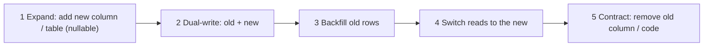
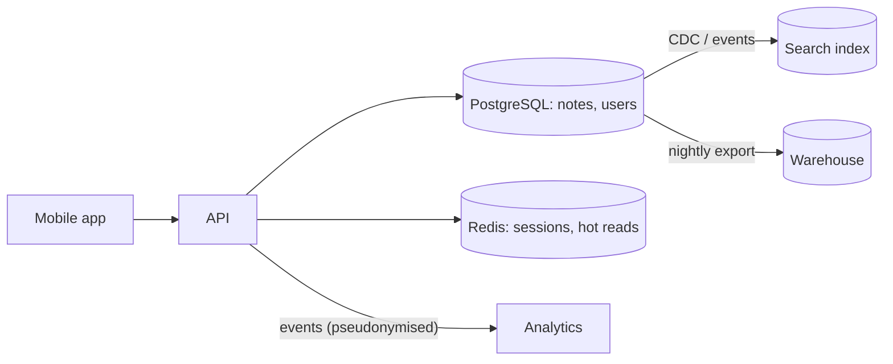

# Data Architecture

> Data outlives code. Decide who owns each piece of data, choose stores by shape and access pattern, choose consistency per feature, plan how the schema changes while apps are live, and treat retention, privacy and deletion as design requirements.

Roadmap topic 9 · Stage 3: Cross-Cutting Concerns

**Go deeper:** `10-database` (the full database roadmap) · `05-system-design/17-Choosing-a-Database`, `18-Replication`, `19-Partitioning-and-Sharding`, `23-Consistency-and-CAP`, `29-Backup-Recovery-Security-and-Cost` · `7` DDD · `10` Integration · `11` Security.

**Marks:** 🟢 must know · 🟡 good to know

---

#### 1. What Is It?

*How data is owned, stored, moved, changed and retired.*

| 🟢 Must know | 🟡 Good to know |
|---|---|
| data ownership and a single source of truth | OLTP vs OLAP, warehouse, lake (names) |
| choose the store by data shape and access pattern | data flow diagrams and lineage |
| consistency needs per feature | caching and read models as part of the design |
| schema evolution and migrations without downtime | data governance and master data (names) |
| data lifecycle: retention, archiving, deletion | |
| privacy and compliance shaping the design | |

1. **Single source of truth (SSOT):** each fact has one owner; copies are derived.
2. **Access pattern:** how the data is read and written (by key, by range, by search, aggregated).
3. **Data lifecycle:** create → use → archive → delete.

**Signals in an interview:** "which database would you use?", "who owns this data?", "how do you change the schema with old app versions?", "how do you handle GDPR deletion?", "strong or eventual consistency here?".

---

#### 2. How It Works

**Ownership and a single source of truth.** Each data set has one owning module/service that is the only writer; others read through its API or from copies fed by its events. Two owners of the same fact lead to conflicts and "which is right?" questions.

**Choose the store by data shape and access pattern (`SD 17`).**

| Need | Store |
|---|---|
| structured, relational, transactions | relational database (PostgreSQL) |
| simple key lookup, sessions, cache | key-value (Redis, DynamoDB) |
| flexible documents, per-document access | document database |
| huge write volume, time series | wide-column / time-series |
| full-text and ranking | search engine |
| relationships/graph traversals | graph database |
| files and media | object storage (+ metadata in a database) |
| analytics over history | warehouse / lake (OLAP) |
| on-device | SQLite/Room (`MOB 9`) |

Default to one relational database; add another store only for a clear, measured need.

**Consistency per feature (`SD 23`).** Not one global setting: payments and inventory need strong consistency; a feed, likes count or search index can be eventually consistent. Write the requirement per feature ("a purchase appears in history immediately; the 'followers' count may lag 10 s").

**Schema evolution without downtime.** Old app versions and old servers are live while you change data. Use **expand → migrate → contract**: add the new column/table (nullable), write both, backfill, switch reads, then drop the old (`SD 28`). Make changes backward compatible; version stored formats.



**Data lifecycle.**

| Stage | Question |
|---|---|
| Collect | do we need it? what is the legal basis? |
| Store | where, how protected, how long? |
| Use | who may access it, for what purpose? |
| Archive | cheaper, slower storage for old data |
| Delete | automatic expiry; user deletion requests; backups and copies |

**Privacy and compliance shape the design (GDPR-style rules).** Collect the minimum; classify data (public, internal, personal, sensitive); keep a data map (what, where, why, who); support access and deletion requests across all stores, caches, logs, backups and analytics; keep audit trails; respect data residency (EU data stays in the EU); pseudonymise where possible. These must be decided at design time because retrofitting deletion is hard.

🟡 **OLTP vs OLAP.** OLTP: many small transactions (the app database). OLAP: large analytical queries over history (warehouse). Don't run analytics on the production database; copy to a warehouse through a pipeline. A *data lake* stores raw files cheaply; a *warehouse* stores modelled tables.

🟡 **Data flow diagrams and lineage.** Draw where data enters, moves, is copied and leaves, with owners. Lineage answers "where did this number come from?".

🟡 **Caching and read models.** Caches and denormalised read models are derived data: define their owner, refresh rule, and what happens if they are stale or lost (`SD 15`).

🟡 **Governance and master data.** Policies for quality, ownership and access; master data (customers, products) has one authoritative system.

---

#### 3. Naive vs Better Design

| Naive | Better |
|---|---|
| two services write the same table | one owner; others use its API or events |
| one database technology for everything | the default relational store; others for a clear reason |
| strong consistency everywhere (slow, costly) or eventual everywhere (wrong) | chosen per feature |
| rename a column in one release | expand → migrate → contract |
| keep all data forever | retention rules and archiving |
| delete a user from the main table only | deletion across caches, search, analytics, logs, backups |
| analytics queries on production | pipeline to a warehouse |
| no data map | classification and a data map |

---

#### 4. Templates & Examples

**Data ownership table.**

| Data | Owner (writes) | Readers | Store | Consistency | Retention | Sensitivity |
|---|---|---|---|---|---|---|
| Notes | Notes service | Search, Sharing (API) | PostgreSQL | strong | until deleted by user | personal |
| Search index | Search service | App | OpenSearch | eventual (≤ 10 s) | derived, rebuildable | personal |
| Payments | Billing service | Reporting (events) | PostgreSQL | strong | 7 years | financial |
| Analytics events | Analytics pipeline | BI | warehouse | eventual | 13 months | pseudonymised |
| Sessions | Auth service | all | Redis | n/a | 30 days | internal |

**Retention policy in code.**

```kotlin
enum class Tier { HOT, ARCHIVE, DELETE }

fun tierFor(ageDays: Int, hotDays: Int = 90, keepDays: Int = 730) = when {
    ageDays <= hotDays -> Tier.HOT
    ageDays <= keepDays -> Tier.ARCHIVE
    else -> Tier.DELETE
}
```

Checks: `tierFor(30)` → `HOT`; `tierFor(200)` → `ARCHIVE`; `tierFor(800)` → `DELETE`. A scheduled job applies it; legal holds and user deletion override it.

**Storage cost of tiering** (example prices: hot `$0.023` per GB-month, archive `$0.004`): `10,000` GB hot → `$230` a month; archived → `$40`; saving `$190` a month, `$2,280` a year, for data that is rarely read.

**Deletion fan-out** (a user asks to delete their data):

```kotlin
interface DataHolder { val name: String; suspend fun deleteUser(userId: String): Boolean }

suspend fun deleteEverywhere(userId: String, holders: List<DataHolder>): Map<String, Boolean> =
    holders.associate { h -> h.name to runCatching { h.deleteUser(userId) }.getOrDefault(false) }
```

Checks: holders `postgres`, `search`, `analytics`, `cache`, `backups(scheduled)`; if `search` fails, the result map shows `search = false`, and the request stays open with a retry job and an alert; the user request is complete only when all are `true` (backups follow their expiry schedule, which you document).

**Expand → migrate → contract (SQL sketch).**

```sql
-- 1 expand
ALTER TABLE notes ADD COLUMN title_v2 TEXT;                         -- nullable, old code ignores it
-- 2 dual-write in code: write title and title_v2
-- 3 backfill (in batches)
UPDATE notes SET title_v2 = title WHERE title_v2 IS NULL AND id BETWEEN :from AND :to;
-- 4 switch reads to title_v2 (after all rows are filled)
-- 5 contract (one release later, when no old app/server version needs it)
ALTER TABLE notes DROP COLUMN title;
```

**Data classification.**

| Class | Examples | Rules |
|---|---|---|
| Public | marketing pages | no restrictions |
| Internal | usage metrics | staff only |
| Personal | email, name | encrypt, minimise, deletion support |
| Sensitive | health, payment, credentials | strict access, encryption, audit, short retention |

**Data flow (diagram).**



---

#### 5. Numbers & Rules of Thumb

| Item | Guide |
|---|---|
| Owners | exactly one writer per data set |
| Stores | start with one relational database; each extra store adds operational cost |
| Retention | define per data class (for example logs 30 days, analytics 13 months, financial 7 years) |
| Deletion request | complete within the legal period (often 30 days) |
| Schema change | three or more releases for a breaking change (expand, migrate, contract) |
| Backfill | batches of 1,000 to 10,000 rows with pauses to protect production |
| Replica lag | seconds; design reads that tolerate it (`SD 18`) |
| Data map | reviewed at least yearly |

---

#### 6. Common Mistakes & Edge Cases

1. Several writers for the same data.
2. A new database for every new feature.
3. Assuming strong consistency (or assuming eventual is always fine).
4. Breaking schema changes with old clients still active.
5. No retention or deletion plan.
6. Analytics on the production database.
7. Personal data copied into logs, caches and analytics without control.
8. Caches or read models with no owner or rebuild plan.

Edge cases: data subject requests when data is in backups (document the expiry, don't restore deleted users); cross-border users; migrations that take hours (online, batched, resumable); encryption keys lost; time zones and currencies stored wrongly (UTC; integer minor units); soft delete vs real delete for legal requirements.

---

#### 7. Say This in the Interview

1. "Each data set has one owner that is the only writer; others read through an API or from derived copies fed by events."
2. "I choose the store from the data shape and access pattern; by default one relational database, and another store only for a measured need."
3. "Consistency is per feature: strong for payments and inventory, eventual for feeds and counters."
4. "Schema changes use expand, migrate, contract, because old app versions and servers are live."
5. "I design retention, archiving and deletion up front, with a data map, so privacy requests cover caches, search, analytics and logs."

---

#### 8. Quick Check

1. What is a single source of truth?
2. What are the three phases of a safe schema change?
3. Why not run analytics on the production database?
4. What must a deletion request cover?

<details>
<summary>Answers</summary>

1. One owner per fact; other copies are derived from it.
2. Expand (add), migrate (dual-write and backfill, switch reads), contract (remove the old).
3. Heavy queries slow the transactional workload; use a warehouse fed by a pipeline.
4. Every store holding the user's data: databases, caches, search, analytics, logs, backups (by expiry).

</details>

---

#### 9. Practice

**Interview questions**

1. How do you decide which database to use?
2. How do you decide on consistency for each feature?
3. How do you change a schema without downtime?
4. How do you design for GDPR deletion?
5. Who owns the data in a multi-service system?
6. What is the difference between OLTP and OLAP?

**Exercises**

1. Fill in the ownership table for your product.
2. Write the expand → migrate → contract plan for renaming a column used by old app versions.
3. Draw the data flow for one feature, and mark where personal data is copied.
4. Write retention rules for each data class and implement `tierFor` for them.

**Remember:** one owner per data set · store by shape and access pattern · consistency per feature · expand → migrate → contract · retention, deletion and privacy designed up front · analytics off the production database.
