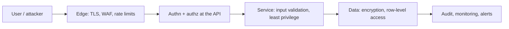
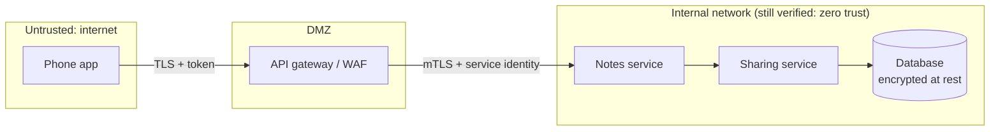

# Security Architecture

> Security is designed in, not added later. Use many layers, give every person and service the least access it needs, design authentication and authorisation deliberately, model threats, keep the attack surface small, and protect secrets and data.

Roadmap topic 11 · Stage 3: Cross-Cutting Concerns

**Go deeper:** `04-backend-engineering/05-Authentication-and-Authorization` and `06-Backend-Security-Essentials` · `05-system-design/29-Backup-Recovery-Security-and-Cost` · `06-mobile-engineering/13-Security` · `08-artificial-intelligence/16-Safety-Security-and-Privacy` · `9` Data Architecture.

**Marks:** 🟢 must know · 🟡 good to know

---

#### 1. What Is It?

*Protecting data and systems by design.*

| 🟢 Must know | 🟡 Good to know |
|---|---|
| defense in depth | zero trust |
| least privilege | secure development lifecycle |
| authentication and authorisation design | compliance and audit trails |
| threat modelling (STRIDE) | mobile-specific: tokens, pinning, attestation |
| attack surface | |
| secrets management and key rotation | |
| encryption in transit and at rest | |

1. **Authentication (authn):** who are you? **Authorisation (authz):** what may you do?
2. **Threat model:** a structured list of what can go wrong and where.
3. **Attack surface:** every way in (endpoints, ports, inputs, dependencies, people).

**Signals in an interview:** "how would you secure this system?", "walk me through a threat model of login", "where do you keep secrets?", "what is zero trust?", "how do you secure a mobile app's API?".

---

#### 2. How It Works

**Defense in depth.** No single wall. Layers so one failure doesn't expose everything:



**Least privilege.** Users, services, tokens and CI jobs get only the permissions they need, for only as long as needed: scoped tokens, short-lived credentials, separate read/write roles, separate environments, no shared admin accounts.

**Authentication and authorisation design.**

| Topic | Practice |
|---|---|
| Identity | use a proven identity provider (OIDC/OAuth 2.0), not custom password code |
| Sessions/tokens | short-lived access tokens, rotating refresh tokens, revocation |
| Passwords | slow hashes (bcrypt/argon2), MFA, rate limits |
| Authorisation | decide at the server; check ownership on every record (the user id from the token); roles/scopes; deny by default |
| Service-to-service | mutual TLS or signed tokens; no implicit trust |
| Mobile | tokens in Keystore/Keychain; the server is the authority (`MOB 13`) |

**Threat modelling with STRIDE.** For each component and data flow ask which of six threats apply:

| Letter | Threat | Property violated | Typical defence |
|---|---|---|---|
| S | Spoofing identity | authentication | strong auth, MFA, signed tokens |
| T | Tampering with data | integrity | signatures, HMAC, checks, TLS |
| R | Repudiation (denying an action) | non-repudiation | audit logs, signed events |
| I | Information disclosure | confidentiality | encryption, access control, minimal data |
| D | Denial of service | availability | rate limits, quotas, scaling, caching |
| E | Elevation of privilege | authorisation | least privilege, server-side checks, input validation |

Steps: draw a data-flow diagram with **trust boundaries** → list threats per element → rate (likelihood × impact) → choose mitigations → record residual risk.

**Attack surface.** Reduce it: fewer public endpoints, close unused ports, remove unused dependencies and features, validate all input, expose the minimum in APIs, disable debug modes in production, limit admin interfaces to private networks.

**Secrets management.** Never in code or Git or the app. Use a secrets manager/vault; inject at runtime; rotate regularly and after incidents; short-lived credentials; separate secrets per environment; audit access.

**Encryption.** In transit: TLS everywhere, including internal traffic where sensitive. At rest: disks, databases and backups encrypted; keys in a KMS; field-level encryption for the most sensitive fields. Know who holds the keys and how they rotate.

🟡 **Zero trust.** "Never trust, always verify": being inside the network gives no privileges. Every request is authenticated, authorised and encrypted, based on identity and context.

🟡 **Secure development lifecycle.** Threat model new features, code review with a security eye, dependency and secret scanning in CI, static analysis, pen tests, a vulnerability response process.

🟡 **Compliance and audit trails.** Know the regimes that apply (GDPR, PCI-DSS, HIPAA, SOC 2), keep immutable audit logs of sensitive actions (who, what, when), and show evidence.

🟡 **Mobile-specific.** Tokens in the Keystore, TLS only, pinning with a backup pin, attestation (Play Integrity/App Attest), no secrets in the app, validate deep links and intents (`SD 30`, `MOB 13`).

---

#### 3. Naive vs Better Design

| Naive | Better |
|---|---|
| a firewall and nothing else | layers: edge, API, service, data, monitoring |
| one admin credential shared by all | least privilege, individual identities, short-lived access |
| write your own login | a proven identity provider |
| check permissions in the UI | check on the server, on every request |
| secrets in the repo or app | vault, runtime injection, rotation |
| internal traffic trusted | zero trust: authenticate and encrypt service calls |
| security review at the end | threat model during design |
| logs with tokens and personal data | redaction; audit logs for sensitive actions |

---

#### 4. Templates & Examples

**Threat model for "share a note" (STRIDE).**

```text
Flow: Phone → API (TLS) → Sharing service → Database; also: Recipient phone → API
Trust boundaries: internet | API gateway | internal network | database
S: attacker uses someone else's token                → short-lived tokens, device binding, MFA for sensitive actions
T: share link modified to point to another note      → signed share tokens; server checks ownership
R: owner denies sharing a note                       → audit log (who shared, with whom, when)
I: a link leaks the note to anyone                   → unguessable ids, expiry, revoke, per-recipient grants
D: bulk share requests flood the service             → rate limits per user, quotas
E: a recipient with view access edits the note       → role check (viewer/editor) on every write, server-side
Residual risk: a recipient can copy content they can view (accepted; documented)
```

**RBAC check with deny by default.**

```kotlin
enum class Role { VIEWER, EDITOR, OWNER }
enum class Action { READ, WRITE, SHARE, DELETE }

private val allowed = mapOf(
    Role.VIEWER to setOf(Action.READ),
    Role.EDITOR to setOf(Action.READ, Action.WRITE),
    Role.OWNER to setOf(Action.READ, Action.WRITE, Action.SHARE, Action.DELETE),
)

fun may(role: Role?, action: Action) = role != null && action in allowed.getValue(role)
```

Checks: `may(VIEWER, WRITE)` → `false`; `may(EDITOR, WRITE)` → `true`; `may(OWNER, DELETE)` → `true`; `may(null, READ)` → `false` (no grant means no access: deny by default). The role is looked up from the database using the user id from the token, never from the request body.

**Secret rotation age check.**

```kotlin
fun needsRotation(ageDays: Int, maxAgeDays: Int = 90, compromised: Boolean = false) = compromised || ageDays > maxAgeDays
```

Checks: `needsRotation(30)` → `false`; `needsRotation(120)` → `true`; `needsRotation(5, compromised = true)` → `true`.

**Short-lived token claim check.**

```kotlin
fun tokenValid(issuedAt: Long, expiresAt: Long, now: Long, audience: String, expected: String, skewSec: Long = 60) =
    audience == expected && now + skewSec >= issuedAt && now <= expiresAt + skewSec
```

Checks: a token valid from `1000` to `1900` for audience `notes-api` at `now = 1500` → `true`; at `now = 2100` → `false` (expired); with audience `billing-api` → `false`.

**Trust boundaries (diagram).**



**Security checklist for a design review.**

```text
[ ] Threat model done for new flows              [ ] All traffic over TLS; internal calls authenticated
[ ] Authorisation on the server for every record [ ] Least-privilege roles for people, services, CI
[ ] Secrets in a vault, rotated                  [ ] Data classified; sensitive fields encrypted
[ ] Input validated; rate limits in place        [ ] Audit log for sensitive actions
[ ] Dependencies and secrets scanned in CI       [ ] Incident response and key revocation plan
```

---

#### 5. Numbers & Rules of Thumb

| Item | Guide |
|---|---|
| Access token lifetime | minutes (5 to 60); refresh tokens days to weeks, rotated |
| Secret rotation | at least every 90 days; immediately after exposure |
| Password hash | tuned to ~100–500 ms (bcrypt/argon2) |
| Rate limit login | for example 5 attempts per minute per account/IP |
| TLS | 1.2 or 1.3 only |
| Audit log retention | per regulation (often 1 to 7 years), tamper-evident |
| Dependency scan | on every build; critical fixes within days |
| Pen test | at least yearly and after major changes |

---

#### 6. Common Mistakes & Edge Cases

1. Security as a final-phase review.
2. A flat internal network trusted by default.
3. Authorisation only in the client.
4. Over-broad roles and long-lived keys.
5. Secrets in repositories, images and apps.
6. Custom cryptography or custom login.
7. Sensitive data in logs and error messages.
8. No plan for key compromise.

Edge cases: a leaked key (revoke, rotate, audit use); a compromised dependency (supply-chain scanning, pinning); insider threat (separation of duties, audit); multi-tenant data leakage (tenant id in every query/row-level security); legacy systems that cannot do modern auth (put a gateway in front); user-supplied content (sanitise, sandbox).

---

#### 7. Say This in the Interview

1. "I design in layers: edge, API, service, data and monitoring, so no single failure exposes everything."
2. "Least privilege everywhere: scoped, short-lived credentials for users, services and CI, and deny by default. Authorisation is on the server with the user id from the verified token."
3. "I threat-model with STRIDE on a data-flow diagram with trust boundaries, rate the threats, and record mitigations and residual risk."
4. "I keep the attack surface small, secrets in a vault with rotation, TLS everywhere and encryption at rest with managed keys."
5. "Zero trust: being inside the network grants nothing; services authenticate each other."
6. "On mobile: tokens in the Keystore, no secrets in the app, pinning with a backup pin, and the server decides."

---

#### 8. Quick Check

1. What does STRIDE stand for?
2. What is least privilege?
3. Why is authorisation on the client not enough?
4. What is zero trust?

<details>
<summary>Answers</summary>

1. Spoofing, Tampering, Repudiation, Information disclosure, Denial of service, Elevation of privilege.
2. Giving only the access needed, for only as long as needed.
3. A client can be modified or bypassed; the server must enforce every rule.
4. Never trust by network location; verify every request's identity and context.

</details>

---

#### 9. Practice

**Interview questions**

1. How would you secure a mobile app and its backend?
2. Walk me through a threat model of login (or sharing).
3. How do you manage secrets and keys?
4. Authentication vs authorisation; how do you design each?
5. What is defense in depth? Zero trust?
6. How do you handle a leaked credential?

**Exercises**

1. Threat-model one feature with STRIDE and write mitigations and residual risk.
2. List every secret in your system, where it lives, who can read it and when it was last rotated.
3. Write the RBAC table for a feature and a test that denies by default.
4. Draw the trust boundaries for your system.

**Remember:** layers, not a wall · least privilege · server-side authz, deny by default · STRIDE on a data-flow diagram · small attack surface · vault + rotation · TLS and encryption at rest · zero trust · design it in, don't bolt it on.
