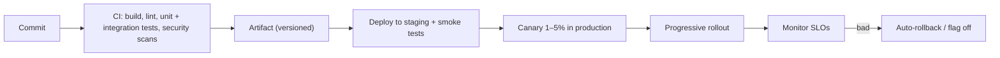

# Operations, Deployment & Cost

> A design is only as good as its ability to be released, observed and paid for. Automate delivery, make systems observable, define environments and infrastructure as code, and treat cost as a design constraint from the start.

Roadmap topic 13 · Stage 3: Cross-Cutting Concerns

**Go deeper:** `05-system-design/27-Observability`, `28-Deployment-and-Release`, `29-Backup-Recovery-Security-and-Cost` · `06-mobile-engineering/15-Build-Release-and-Monitoring` · `12` Scalability & Resilience · `18` Teams & Delivery.

**Marks:** 🟢 must know · 🟡 good to know

---

#### 1. What Is It?

*Running the system after it is built.*

| 🟢 Must know | 🟡 Good to know |
|---|---|
| CI/CD and safe release strategies | containers and orchestration (concepts) |
| observability: logs, metrics, traces | cloud service models: IaaS, PaaS, SaaS, managed services |
| environments and configuration | twelve-factor app principles |
| infrastructure as code | runbooks, on-call, incident review |
| cost as a design constraint | cloud well-architected frameworks (names) |
| | FinOps basics |

1. **CI/CD:** automatic build and test on each change (CI), and automatic delivery to environments (CD).
2. **Observability:** understanding the system from its outputs: logs, metrics, traces.
3. **IaC:** infrastructure described in version-controlled files.
4. **FinOps:** managing and reducing cloud cost with engineering practices.

**Signals in an interview:** "how do you release safely?", "how do you know it's healthy?", "how do you keep staging like production?", "how would you reduce the cloud bill?".

---

#### 2. How It Works

**CI/CD and safe releases (`SD 28`).**



Strategies: **rolling** (replace instances gradually), **blue-green** (switch traffic between two environments), **canary** (small share first), **feature flags** (decouple deploy from release). Database changes use expand → migrate → contract (topic 9). Mobile releases use staged rollout and server flags (`MOB 15`).

**Observability (`SD 27`).**

| Pillar | Answers | Examples |
|---|---|---|
| Logs | what happened | structured JSON with request id, no secrets |
| Metrics | how much, how often | rate, errors, duration (RED), saturation |
| Traces | where did the time go | one request across services |
| + | | health checks, alerts on SLO burn, dashboards per service |

**Environments and configuration.** Dev, staging, production (maybe preview environments per pull request). Staging should resemble production in shape. Configuration is **outside the code** (environment variables, config service, secrets manager), different per environment, never hard-coded, and changes are audited.

**Infrastructure as code.** Servers, networks, databases and permissions are defined in files (Terraform, Pulumi, CloudFormation), reviewed, versioned, and applied by a pipeline. Benefits: repeatable environments, review and history, disaster recovery by re-creating, no snowflake servers.

**Cost as a design constraint.** Cost is a quality attribute with a number: for example "under $0.04 per monthly active user". Drivers: compute, storage, data transfer (egress), managed services, observability data volume, idle resources. Build vs buy and managed vs self-hosted decisions include cost (topic 3). Design choices with big cost effects: caching, CDN, batch vs real-time, data retention and tiering, right-sizing, regional placement.

🟡 **Containers and orchestration.** A container packages the app and its dependencies; an orchestrator (Kubernetes) schedules containers, restarts them, scales them. Know the concepts (images, pods, deployments, services, health probes). Don't adopt orchestration until the number of services justifies it; managed platforms (PaaS, serverless) may be simpler.

🟡 **Cloud service models.** *IaaS* (virtual machines: you manage the most), *PaaS* (you deploy code; the platform runs it), *SaaS* (a finished product), plus *managed services* (databases, queues) that remove operational work. Prefer managed services for non-differentiating parts, mindful of lock-in and cost.

🟡 **Twelve-factor app.** Rules for cloud-friendly services: one codebase; explicit dependencies; config in the environment; backing services as attached resources; separate build/release/run; stateless processes; port binding; scale out via processes; fast startup and graceful shutdown; dev/prod parity; logs as streams; admin tasks as one-off processes.

🟡 **Runbooks, on-call, incident review.** A runbook is a step-by-step guide for a known alert. On-call is shared and sustainable (rotation, handover, compensation). After incidents, a blameless review leads to actions with owners (`07-behavioral-leadership/08-Production-Incidents`).

🟡 **Well-architected frameworks.** Cloud providers publish pillars (operational excellence, security, reliability, performance, cost, sustainability). Use them as review checklists (names only).

🟡 **FinOps basics.** Tag resources by team/feature, set budgets and alerts, review the biggest line items monthly, delete idle resources, right-size, buy commitments for steady load, attribute cost per feature and customer.

---

#### 3. Naive vs Better Design

| Naive | Better |
|---|---|
| manual deploys by one person | automated pipeline with approvals |
| big releases on Fridays | small changes, canary, flags |
| `console.log` and guessing | structured logs, metrics, traces, SLO alerts |
| config in code | environment-based config + secrets manager |
| servers set up by hand | infrastructure as code |
| cost found on the bill | cost estimated at design, tagged, budgeted |
| everything on Kubernetes | the simplest platform that meets the need |
| unwritten operations knowledge | runbooks and blameless reviews |

---

#### 4. Templates & Examples

**A CI pipeline (GitHub Actions style).**

```yaml
name: ci
on: [pull_request]
jobs:
  test:
    runs-on: ubuntu-latest
    steps:
      - uses: actions/checkout@v4
      - uses: actions/setup-java@v4
        with: { distribution: temurin, java-version: 17 }
      - uses: gradle/actions/setup-gradle@v4
      - run: ./gradlew build test            # build, unit and integration tests
      - run: ./gradlew dependencyCheckAnalyze # dependency vulnerabilities (illustrative)
```

**Infrastructure as code (illustrative Terraform).**

```hcl
resource "aws_db_instance" "notes" {
  identifier        = "notes-prod"
  engine            = "postgres"
  instance_class    = "db.t4g.large"
  allocated_storage = 100
  multi_az          = true
  storage_encrypted = true
  backup_retention_period = 14
  tags = { team = "notes", env = "prod", cost-center = "app" }
}
```

**A canary gate (when to continue the rollout).**

```kotlin
fun canContinue(errorRateBaseline: Double, errorRateCanary: Double, p95BaselineMs: Int, p95CanaryMs: Int,
                maxErrorIncrease: Double = 0.002, maxLatencyIncrease: Double = 0.15) =
    errorRateCanary <= errorRateBaseline + maxErrorIncrease && p95CanaryMs <= p95BaselineMs * (1 + maxLatencyIncrease)
```

Checks: baseline error `0.1%`, canary `0.2%`, baseline p95 `200 ms`, canary `210 ms` → `true`; canary error `0.5%` → `false`; canary p95 `260 ms` (30% higher) → `false`. A failing gate triggers an automatic rollback.

**Cost per user and per feature.**

```kotlin
fun costPerUser(monthlyCost: Double, monthlyActiveUsers: Long) = monthlyCost / monthlyActiveUsers
fun rightSizeSaving(currentMonthly: Double, avgUtilisation: Double, targetUtilisation: Double = 0.6) =
    currentMonthly * (1 - minOf(1.0, avgUtilisation / targetUtilisation))
```

Checks: `$12,000` a month for `300,000` active users → `$0.04` per user. A fleet costing `$10,000` a month at `30%` average utilisation with a `60%` target → saving about `$5,000` a month (half the capacity is idle). Storage tiering from topic 9 saves `$190` a month on 10 TB.

**Twelve-factor config in Kotlin.**

```kotlin
data class Config(val dbUrl: String, val port: Int) {
    companion object {
        fun fromEnv(env: Map<String, String> = System.getenv()) = Config(
            dbUrl = env["DB_URL"] ?: error("DB_URL missing"),
            port = env["PORT"]?.toIntOrNull() ?: 8080
        )
    }
}
```

Checks: `fromEnv(mapOf("DB_URL" to "jdbc:postgresql://db/notes"))` → port `8080`; missing `DB_URL` → fails at startup with a clear message (fail fast).

**Runbook template.**

```text
ALERT: Notes API error budget burn > 10× for 15 min
IMPACT: users cannot save notes
CHECK: dashboard link; recent deploys; database CPU/connections; downstream status
ACTIONS: 1) halt rollout / roll back 2) flag off new_sync 3) scale API ×2 4) fail over the database (command)
ESCALATE: on-call lead after 15 min; incident channel #inc-notes
AFTER: blameless review within 3 days; actions with owners
```

**Cost review checklist.**

```text
[ ] Top 5 cost items and their owners        [ ] Idle or oversized resources removed
[ ] Data transfer and CDN usage reviewed     [ ] Log/metric volume and retention reviewed
[ ] Storage tiering and lifecycle rules      [ ] Budgets and alerts at 50/80/100%
[ ] Cost per user / feature tracked          [ ] Commitments for steady-state workloads
```

---

#### 5. Numbers & Rules of Thumb

| Item | Guide |
|---|---|
| Pipeline time | CI under 10 minutes; deploy to production within an hour of merge |
| Deploy frequency | multiple per week or day for healthy teams (DORA) |
| Canary | 1 to 5% for 15 to 60 minutes, then widen |
| Rollback | under 10 minutes, rehearsed |
| Log retention | 7 to 30 days hot, longer archived |
| Alert quality | each page needs a human action; delete noisy alerts |
| Budget alerts | 50%, 80%, 100% |
| Utilisation | 50 to 70% average for steady workloads |
| Cost review | monthly; deep dive quarterly |

---

#### 6. Common Mistakes & Edge Cases

1. Manual, undocumented deployments.
2. No rollback plan.
3. Config and secrets in the code.
4. Staging unlike production.
5. Logs without structure; no tracing.
6. Alert fatigue.
7. No cost visibility until the invoice.
8. Adopting heavy platforms (Kubernetes, service mesh) too early.

Edge cases: a bad migration (expand/contract, backups); a rollback that needs a database rollback (design forward-compatible changes); cost explosion from logs or a loop; vendor outage (multi-region, status page, fallback); secrets leaked via CI logs; environment drift (IaC and drift detection).

---

#### 7. Say This in the Interview

1. "Delivery is automated: CI builds and tests every change; CD deploys through staging to a canary, with feature flags and automatic rollback on SLO regressions."
2. "Observability is structured logs with request ids, RED metrics, traces, and alerts on SLO burn, not noise."
3. "Config lives in the environment and a secrets manager; infrastructure is code, reviewed and reproducible."
4. "Cost is a quality attribute with a number, like cost per active user. I estimate it at design time, tag resources, set budgets and review monthly."
5. "I choose the simplest platform that meets the need; managed services for non-differentiating parts."

---

#### 8. Quick Check

1. Canary vs blue-green?
2. What are the three pillars of observability?
3. Why infrastructure as code?
4. Name two big cost drivers in the cloud.

<details>
<summary>Answers</summary>

1. Canary sends a small share of traffic to the new version first; blue-green switches all traffic between two full environments.
2. Logs, metrics, traces.
3. Repeatable, reviewable, versioned environments and easy recovery.
4. For example: compute (idle or oversized), data transfer, storage retention, observability data volume.

</details>

---

#### 9. Practice

**Interview questions**

1. How do you release safely?
2. What do you monitor, and how do you alert?
3. How do you manage configuration and secrets across environments?
4. Why infrastructure as code?
5. How would you cut our cloud bill by 30%?
6. When would you use Kubernetes? When not?

**Exercises**

1. Draw the pipeline from commit to production for a service you know, with gates.
2. Write the canary gate rules and the rollback trigger.
3. Estimate the monthly cost of a design and the cost per active user.
4. Write a runbook for your most common alert.

**Remember:** automate delivery · canary, flags, fast rollback · logs, metrics, traces, SLO alerts · config outside code · infrastructure as code · cost is a requirement with a number · simplest platform that fits · runbooks and blameless reviews.
