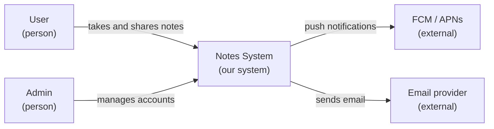
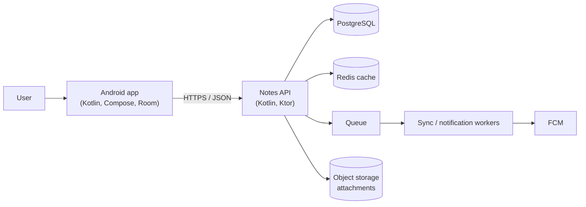
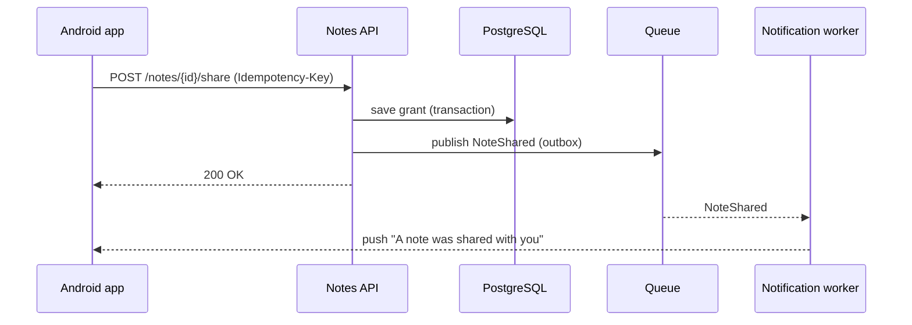
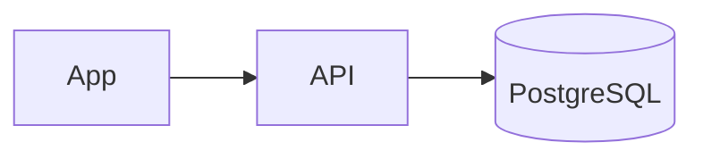

# Documentation & Diagrams

> A design nobody can see or understand does not exist. Use a few clear diagrams for each audience (the C4 model), write decisions as short ADRs, write proposals as design docs, keep it all in the repository, and delete what is stale.

Roadmap topic 14 · Stage 4: Documenting & Communicating

**Go deeper:** `3` Trade-Offs (ADRs) · `15` Communicating · `17` Governance · `18` Teams & Delivery (onboarding) · `07-behavioral-leadership/11-Communication-and-Stakeholder-Management`.

**Marks:** 🟢 must know · 🟡 good to know

---

#### 1. What Is It?

*Making the architecture visible, understandable and current.*

| 🟢 Must know | 🟡 Good to know |
|---|---|
| C4 model: context, containers, components (code rarely) | views: logical, process, deployment, data |
| draw for your audience | UML basics: sequence, component, class |
| key flow diagrams: sequence diagrams for main use cases | docs as code: text-based diagrams in the repo |
| ADRs next to the code | arc42 or similar templates (names) |
| design docs / RFCs: problem, options, decision, risks | keep docs short and current |

1. **C4:** four zoom levels: *Context* (the system and its users/neighbours), *Containers* (apps, services, databases), *Components* (parts inside a container), *Code* (rarely).
2. **ADR:** a decision record (topic 3).
3. **Design doc / RFC:** a proposal reviewed before building.
4. **Docs as code:** docs and diagrams as text in the repository, reviewed with the code.

**Signals in an interview:** "how do you document an architecture?", "draw the system", "what's in a design doc?", "how do you keep documentation current?".

---

#### 2. How It Works

**Draw for your audience.**

| Audience | Needs | Show |
|---|---|---|
| Business, product | what and why | context diagram, plain words |
| Developers | how it is built | containers, components, key sequences |
| Operations / SRE | how it runs | deployment, dependencies, runbooks |
| Security | trust and data | data-flow diagram with trust boundaries |
| New joiners | the big picture first | context → containers → one feature end to end |

**C4 level 1: system context.**



**C4 level 2: containers.**



Each box has a name, a type and a technology; each arrow says what flows and how. Level 3 (components) zooms into one container (for example the API: controllers, services, repositories) only when needed.

**Key flow diagrams: sequence diagrams.** One per important use case, including failures.



**ADRs next to the code.** `docs/adr/0007-room-as-source-of-truth.md`, numbered, one page, immutable when accepted, superseded rather than edited (topic 3).

**Design docs / RFCs.** Written before building a significant change, reviewed by the people affected.

| Section | Content |
|---|---|
| Summary | one paragraph |
| Problem and goals / non-goals | what we solve and what we do not |
| Background | context a reviewer needs |
| Options | 2 to 4 with trade-offs |
| Proposal | the chosen design: diagrams, data, APIs, rollout |
| Risks and open questions | and how we reduce them |
| Alternatives rejected | and why |
| Rollout, testing, monitoring | how we ship and verify |
| Decision / sign-off | who decides, by when |

🟡 **Views.** *Logical* (parts and relationships), *process* (runtime behaviour, concurrency), *deployment* (what runs where), *data* (entities and flows). Pick the views that answer your audience's questions.

🟡 **UML basics.** Sequence (interactions over time), component (parts and interfaces), class (types). Use light versions; C4 + sequence cover most needs.

🟡 **Docs as code.** Text-based diagrams (Mermaid, PlantUML, Structurizr DSL) live in the repo, are reviewed in pull requests, versioned with the code, and render in the repository viewer. They are easy to update, so they stay current.

🟡 **Templates.** *arc42* is a practical template with sections for goals, constraints, context, building blocks, runtime, deployment, concepts, decisions, quality, risks, glossary. Use as a checklist, not a mandate.

🟡 **Keep docs short and current.** Fewer, better documents; an owner for each; a "last reviewed" date; delete stale pages; link to the code instead of duplicating it; update diagrams in the same pull request as the change.

---

#### 3. Naive vs Better Design

| Naive | Better |
|---|---|
| one huge diagram with everything | C4 levels, each with a clear audience |
| diagrams in slides nobody updates | text diagrams in the repo |
| boxes with no labels on arrows | each arrow says what and how |
| decisions in chat history | ADRs |
| 80-page architecture document | a short overview + ADRs + a few diagrams |
| only the happy path in sequences | include the failure and retry path |
| docs written once, never reviewed | owner and review date; delete stale |

---

#### 4. Templates & Examples

**ADR filename and header.**

```text
docs/adr/0007-room-as-source-of-truth.md
# 7. Room as the single source of truth for notes
Status: accepted | Date: 2025-03-04 | Supersedes: – | Owners: Android guild
```

**Design doc skeleton.**

```text
# Design: Offline sync for notes
Author: A. Rao | Reviewers: backend, QA, security | Status: in review | Decision by: 2025-03-14
1. Summary   2. Problem and goals / non-goals   3. Options (A queue-and-retry, B outbox + cursor, C third-party SDK)
4. Proposal (diagram, API, data, conflict rule)  5. Risks and open questions  6. Rollout and monitoring  7. Alternatives rejected
```

**A diagram in the README (Mermaid in Markdown).**

````text

````

**Stale-docs check in CI (docs as code).**

```kotlin
data class Doc(val path: String, val lastUpdatedDay: Int, val owner: String?)

fun staleDocs(docs: List<Doc>, today: Int, maxAgeDays: Int = 180) =
    docs.filter { today - it.lastUpdatedDay > maxAgeDays || it.owner == null }.map { it.path }
```

Checks: with `today = 1000`, a doc updated on day `700` (300 days old) → listed; one updated on day `950` with an owner → not listed; a doc with no owner → listed. A weekly job posts the list; owners update or delete.

**Questions every diagram should answer.**

```text
What is this? Who uses it? What does it talk to? How (protocol, sync/async)? What data? Where does it run? What happens when it fails?
```

**Naming conventions for diagrams.**

```text
Person (user), System (our system), External system, Container: <name> [<technology>], Component: <name>
Arrow label: <verb phrase> [protocol] — e.g. "reads notes [HTTPS/JSON]"
```

**A one-page architecture overview (the entry point of the docs).**

```text
1. Purpose and users (3 lines)   2. Context diagram   3. Container diagram   4. Top quality attributes (ASR table)
5. Key decisions (links to ADRs) 6. Main flows (sequence diagrams, links)   7. How to run/test/deploy   8. Glossary   9. Owners and contacts
```

---

#### 5. Numbers & Rules of Thumb

| Item | Guide |
|---|---|
| Diagrams to maintain | 3 to 6 key ones (context, containers, 2 to 3 flows, deployment) |
| Boxes per diagram | about 5 to 12 |
| ADR | one page; written within days of the decision |
| Design doc | 2 to 6 pages; reviewed within a week |
| Doc freshness | reviewed at least every 6 months; owner named |
| Onboarding | a new engineer can run the system and read the overview on day one |
| Update rule | change the code and the diagram in the same pull request |

---

#### 6. Common Mistakes & Edge Cases

1. A single diagram that tries to show everything.
2. Diagrams that nobody can update (binary files, unowned slides).
3. Documenting every detail and none of the decisions.
4. Out-of-date docs that mislead.
5. Writing for yourself, not the reader.
6. No failure paths in the flows.
7. Treating documentation as a phase at the end.

Edge cases: a fast-changing prototype (light notes, formalise later); regulated environments (more formal documents and traceability); distributed teams (written design docs are the main communication channel); diagrams generated from code (good for detail, not for intent).

---

#### 7. Say This in the Interview

1. "I use the C4 model: a context diagram for everyone, a container diagram for developers, components only where needed, plus sequence diagrams for the main flows including failures."
2. "Decisions are ADRs next to the code; big changes get a short design doc reviewed before building."
3. "Diagrams are text (Mermaid or PlantUML) in the repo and updated in the same pull request as the change, so they stay current."
4. "I draw for the audience: product gets the context, developers the containers and flows, operations the deployment, security the data flows and trust boundaries."
5. "I keep docs small, owned and dated, and delete stale ones."

---

#### 8. Quick Check

1. What are the C4 levels?
2. What belongs in an ADR?
3. Why docs as code?
4. What should a sequence diagram include besides the happy path?

<details>
<summary>Answers</summary>

1. Context, containers, components, code.
2. Context, options, decision, consequences (plus status and date).
3. They are versioned, reviewed and updated with the code, so they stay current.
4. The failure and retry behaviour.

</details>

---

#### 9. Practice

**Interview questions**

1. How do you document an architecture?
2. Draw the context and containers of a system you know.
3. What goes in a design doc?
4. How do you keep documentation up to date?
5. Which diagrams do you show to a product manager? To an SRE?

**Exercises**

1. Draw C4 context and container diagrams for the Notes app (`BE 12`) in Mermaid.
2. Draw a sequence diagram of one use case including a failure path.
3. Write one ADR and one design doc for a real change.
4. Audit your docs: list owners and last-update dates; delete or update the stale ones.

**Remember:** C4 for the structure, sequences for the flows · draw for the audience · ADRs and design docs · text diagrams in the repo · update with the code · short, owned, current.
