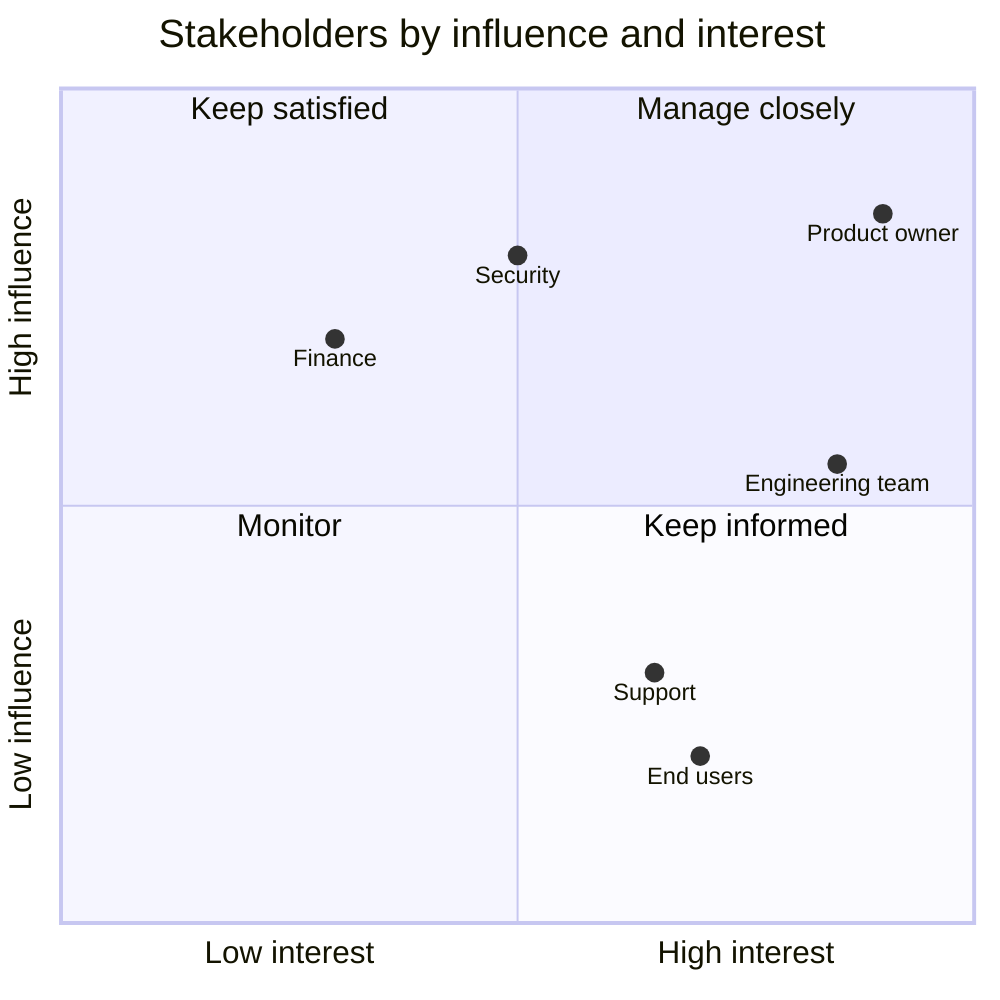

# Communicating & Influencing

> Architecture succeeds when people understand and adopt it. Know your stakeholders, explain trade-offs in their language, bring options and a recommendation, run useful reviews, handle pushback with data, and say no with alternatives.

Roadmap topic 15 · Stage 4: Documenting & Communicating

**Go deeper:** `3` Trade-Offs · `14` Documentation · `17` Governance · `07-behavioral-leadership/09-Conflict-Resolution-and-Disagreement`, `11-Communication-and-Stakeholder-Management` and `12-Leadership-Without-Authority`.

**Marks:** 🟢 must know · 🟡 good to know

---

#### 1. What Is It?

*Getting decisions understood, accepted and carried out.*

| 🟢 Must know | 🟡 Good to know |
|---|---|
| know your stakeholders | say no with alternatives |
| explain trade-offs in the listener's language | risk registers and status for leadership |
| present options and a recommendation | estimates and roadmaps: ranges, assumptions, confidence |
| run useful, kind design reviews | working with product, QA, security, operations |
| disagree and commit; handle pushback with data | storytelling for interviews |

1. **Stakeholder:** anyone affected by, or with a say in, the system.
2. **Influence without authority:** persuading through evidence, trust and clear proposals.
3. **Design review:** a meeting where a design is examined before building.

**Signals in an interview:** "how do you convince people?", "how do you explain a trade-off to a non-technical manager?", "how do you run a design review?", "what do you do when the team disagrees?".

---

#### 2. How It Works

**Know your stakeholders.**



| Stakeholder | Cares about | Message |
|---|---|---|
| Product | time to market, features, user value | what ships when; what each option costs in time |
| Engineering | maintainability, tools, autonomy | clear guidelines, less rework |
| Operations/SRE | stability, alerts, runbooks | operability, failure behaviour |
| Security / legal | risk, compliance | threat model, data handling |
| Finance | cost, predictability | cost per user, build vs buy |
| Leadership | strategy, risk, money | outcome, risk, ask |
| Support | fewer tickets | quality, error messages |

**Explain trade-offs in the listener's language.** Convert technical choices into **cost, risk, time and user impact** (topic 3).

| Technical statement | Business statement |
|---|---|
| "we need a message queue" | "so a failure in notifications can't block saving a note; adds two weeks and ~$300/month" |
| "technical debt in sync" | "every sync change takes twice as long; fixing it costs three weeks and saves about a day per feature" |
| "multi-region" | "survives a regional outage; doubles cost and adds consistency risk — is the outage risk worth about $8k/month?" |

**Present options and a recommendation.** Not only a problem. Two or three options with cost, risk and time, a clear recommendation and why, and what you need decided and by when.

**Design reviews that work.**

1. **Before:** send the document 2 days earlier; state the goal of the review and the decision needed; invite the right people (affected teams, security, operations).
2. **During:** present briefly (10 min), then discuss; ask for the strongest objections; capture them; focus on requirements and risks, not style.
3. **After:** send notes with decisions, actions, owners; update the doc/ADR.
4. **Tone:** kind and specific ("I'm worried about X because Y; could we test Z?"); attack the problem, not the person.

**Disagree and commit; handle pushback with data.** Listen to understand the concern; restate it; bring evidence (a spike, numbers, a precedent); look for a compromise or an experiment; agree who decides; after the decision, support it fully and set a review point (`07-behavioral-leadership/09-Conflict-Resolution-and-Disagreement`).

🟡 **Say no with alternatives.** "We can't do the full redesign by the 14th without cutting tests. I can do the checkout flow by the 14th and the rest by the 28th, or all of it by the 28th. Which do you prefer?"

🟡 **Risk registers and leadership status.** A short table of risks with likelihood, impact, owner, mitigation; a status of green/amber/red with what you need.

🟡 **Estimates and roadmaps.** Give ranges and assumptions ("6 to 9 weeks, most likely 7; assumes sandbox access"), confidence levels, and update as you learn. A roadmap shows outcomes by quarter with confidence, not fixed dates years ahead.

🟡 **Working with others.** *Product:* trade scope against date together. *QA:* agree testability and release criteria early. *Security:* involve early, model threats together. *Operations:* design for operability, agree alerts and runbooks.

🟡 **Storytelling.** For interviews and leadership: situation, options, decision, result, what you'd change (`07-behavioral-leadership`).

---

#### 3. Naive vs Better Design

| Naive | Better |
|---|---|
| "we need to refactor" | cost, risk, time and user impact |
| presenting the problem only | options, recommendation, ask |
| a design review to approve a finished design | reviews early, with options still open |
| winning the argument | finding the shared goal and the evidence |
| hiding bad news | early, with options |
| "we'll see" estimates | ranges, assumptions, confidence |
| architecture handed down | developed with the people who build it |

---

#### 4. Templates & Examples

**Decision request (one page).**

```text
Decision needed by Friday from: Product + Engineering lead
Context: sync loses edits in ~1 of 200 offline sessions.
Options: A) fix in place (2 weeks, medium risk)  B) move to an outbox + cursor design (5 weeks, low risk)  C) ship now, accept the risk (0 weeks, ~500 users/day affected)
Recommendation: B. It removes the root cause; we ship A's quick mitigation in week 1.
Cost: 5 person-weeks. Risk if we do nothing: rising support load and rating loss.
```

**Risk register with scoring.**

```kotlin
data class Risk(val name: String, val likelihood: Int, val impact: Int, val owner: String)   // 1..5 each

fun score(r: Risk) = r.likelihood * r.impact
fun top(risks: List<Risk>, n: Int = 3) = risks.sortedByDescending { score(it) }.take(n).map { it.name }
```

Checks: risks `data loss in sync (2×5=10)`, `provider outage (3×3=9)`, `team turnover (3×2=6)`, `schedule slip (4×3=12)` → `top` → `[schedule slip, data loss in sync, provider outage]`. Review monthly; every top risk has an owner and a mitigation.

**Estimate with a range.**

```kotlin
fun expected(optimistic: Double, likely: Double, pessimistic: Double) = (optimistic + 4 * likely + pessimistic) / 6
fun spread(optimistic: Double, pessimistic: Double) = (pessimistic - optimistic) / 6
```

Checks: `expected(6.0, 7.0, 11.0)` → `7.5` weeks; `spread(6.0, 11.0)` → `0.83` weeks standard deviation. Say: "6 to 9 weeks, most likely 7 to 8, assuming sandbox access; I'll update after the spike."

**Design review agenda (45 minutes).**

```text
0–5   Goal of the review and decision needed
5–15  Walk through the design (context, options, proposal)
15–35 Questions and concerns (strongest objections first)
35–45 Decisions, actions, owners, follow-up date
```

**Reply patterns for pushback.**

| Pushback | Reply |
|---|---|
| "This is over-engineered." | "What part feels heavy? Here is the failure it prevents and the simpler option I considered." |
| "We don't have time." | "Here's the smallest slice that reduces the biggest risk in two days." |
| "We've always done it this way." | "What does the current approach cost us? Can we try the new one on one module and compare?" |
| "I disagree." | "Help me understand your concern. What evidence would change your mind? Who decides?" |

**Status for leadership.**

```text
Notes sync rebuild — AMBER. On track for Apr 8 if sandbox approval arrives by Mar 10 (risk owner: S. Kim).
Done: design, API contract. Next: outbox implementation. Decision needed: staged rollout to 5% on Mar 28.
```

---

#### 5. Numbers & Rules of Thumb

| Item | Guide |
|---|---|
| Options | 2 to 3 with a recommendation |
| Design review | 30 to 60 minutes; document 2 days ahead; 5 to 8 people |
| Executive message | 3 to 5 sentences: answer, reason, ask |
| Estimates | a range with a most-likely value and assumptions |
| Risk review | monthly; top 5 shown to leadership |
| Decision latency | days, not weeks, for two-way decisions |
| Meeting notes | sent the same day |

---

#### 6. Common Mistakes & Edge Cases

1. Jargon with non-technical people.
2. Bringing problems without options.
3. Reviews as approvals rather than discussions.
4. Treating pushback as an attack.
5. Overpromising on dates.
6. Surprises: bad news late.
7. Not listening to people who build and run the system.
8. Decisions that are never communicated.

Edge cases: a senior stakeholder who insists on a bad option (write the risk, propose an experiment or staged approach, escalate if needed); remote or async reviews (written comments with a deadline); a team that resists a standard (find the problem it solves for them); conflicting priorities between stakeholders (put them side by side, ask the decision owner).

---

#### 7. Say This in the Interview

1. "I map stakeholders by influence and interest and speak to what each cares about: cost, risk, time and user impact."
2. "I bring two or three options with a recommendation and a clear ask, not just a problem."
3. "I run design reviews early: document sent ahead, strongest objections first, decisions and owners recorded."
4. "With pushback I listen, restate the concern, bring data or a small experiment, agree who decides, and then commit."
5. "I say no with an alternative, give estimates as ranges with assumptions, and share bad news early."

---

#### 8. Quick Check

1. How do you explain "technical debt" to a product manager?
2. What do you bring to a decision meeting?
3. What makes a design review useful?
4. How do you give an estimate?

<details>
<summary>Answers</summary>

1. As a cost: "every change takes twice as long; three weeks of work removes it and saves a day per feature."
2. Options with cost, risk and time, a recommendation, and the decision needed.
3. It happens early, has a goal, the right people, strongest objections first, and recorded decisions and owners.
4. As a range, with the assumptions and a confidence level.

</details>

---

#### 9. Practice

**Interview questions**

1. How do you get buy-in for an architecture?
2. How do you explain a technical trade-off to a non-technical audience?
3. How do you run a design review?
4. How do you handle strong disagreement from a senior engineer?
5. How do you present estimates and risks to leadership?
6. How do you say no?

**Exercises**

1. Write a one-page decision request for a real decision.
2. Translate three technical statements into cost, risk, time and user impact.
3. Build a risk register of five items and rank them.
4. Run a mock design review with a friend; ask for feedback on tone and clarity.

**Remember:** know your stakeholders · cost, risk, time, user impact · options + recommendation + ask · early, kind reviews · listen, bring evidence, decide who decides, then commit · say no with alternatives · ranges for estimates.
