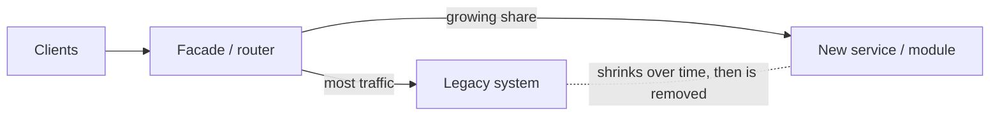

# Evolutionary Architecture & Technical Debt

> Requirements, teams and technology keep changing, so architecture must change too. Design so change is cheap: small steps, automated checks, incremental migrations, and visible, managed technical debt.

Roadmap topic 16 · Stage 5: Evolving & Governing

**Go deeper:** `3` Trade-Offs · `8` Boundaries · `17` Governance · `18` Teams & Delivery · `05-system-design/28-Deployment-and-Release` and `33-Follow-Up-Topics` (migrations) · `07-behavioral-leadership/06-Architecture-Decisions` and `14-Delivery-Prioritization-and-Team-Health`.

**Marks:** 🟢 must know · 🟡 good to know

---

#### 1. What Is It?

*Keeping the design healthy as everything around it changes.*

| 🟢 Must know | 🟡 Good to know |
|---|---|
| design so change is cheap | architecture drift and erosion |
| technical debt: deliberate vs accidental; tracking it | large migrations without downtime |
| refactoring in small, safe steps | rewrite vs refactor |
| strangler fig migration | versioning strategy for APIs, data and apps |
| fitness functions | |
| deprecation and removal plans | |

1. **Evolutionary architecture:** supports guided, incremental change across multiple dimensions.
2. **Technical debt:** a shortcut (or an outdated design) that makes future change more costly, like a loan with interest.
3. **Fitness function:** an automated check that an architectural quality still holds.
4. **Strangler fig:** replace a system piece by piece behind a common front.

**Signals in an interview:** "how do you modernise a legacy system?", "rewrite or refactor?", "how do you manage tech debt?", "how do you stop architecture from decaying?".

---

#### 2. How It Works

**Design so change is cheap.** Small modules with clear contracts; automated tests; continuous delivery; feature flags; backward-compatible data and APIs; observability. The cheaper it is to change and to verify, the more freely you can evolve.

**Technical debt.**

| | Deliberate | Accidental |
|---|---|---|
| Prudent | "ship now, refactor next sprint" (a conscious loan) | "now we know how it should have been built" (learning) |
| Reckless | "we don't have time for design" | "what's layering?" (no skill or care) |

Manage it:

1. **Make it visible:** a debt list with description, location, impact, estimated fix cost and "interest" (extra time per change or per incident).
2. **Prioritise by interest:** fix debt that slows frequent changes or causes incidents; ignore debt in code that never changes.
3. **Pay continuously:** reserve a steady share of capacity (15 to 25%); fix debt as you touch the code ("boy-scout rule"); schedule larger items with a business case.
4. **Prevent:** definition of done, reviews, fitness functions (topic 17).

**Refactoring in small, safe steps.** Change structure without changing behaviour, backed by tests: tiny commits, run tests after each, keep the system releasable, use feature flags for risky parts, "parallel change" (add new, migrate callers, remove old).

**Strangler fig migration.** Put a routing layer in front, move one capability at a time to the new implementation, send a growing share of traffic to it, and retire the old part when unused.



Steps: identify a seam → build the new piece behind the facade → shadow or dual-run and compare → shift traffic gradually (1%, 10%, 50%, 100%) → remove the old code and data paths.

**Fitness functions.** Automated checks that protect qualities: no dependency cycles, module boundary rules, build time under 3 minutes, startup under 2 seconds, p95 latency in a load test, no new use of a deprecated API, test coverage on core modules, bundle/APK size limits. Run in CI so drift fails the build.

**Deprecation and removal.** Announce, give a replacement and a deadline, measure usage, warn in logs/headers/IDE, remove after the deadline, and record it in an ADR. For public APIs and mobile apps the deadline is tied to the support window of old app versions.

🟡 **Architecture drift and erosion.** Drift: the real system slowly diverges from the intended design (shortcuts, exceptions, new people unaware). Erosion: the rules decay until the design no longer protects anything. Causes: deadlines, unclear rules, no automated checks, team churn. Cures: fitness functions, short guidelines, reviews, regular architecture reviews of the actual code.

🟡 **Large migrations without downtime (`SD 33`).** Backfill → dual-write → validate → cut over → clean up, with rollback until the end. Move data and traffic in stages; keep both paths working; verify with comparisons.

🟡 **Rewrite vs refactor.** Rewrites often fail: the old system's hidden rules are forgotten, features freeze, the old system keeps changing, and the new one takes longer than planned. Prefer incremental replacement (strangler). Rewrite only small, well-understood parts, or when the old technology is truly unsupportable, and still migrate in slices.

🟡 **Versioning strategy.** APIs (add-only, versions, deprecation), data (schema versions, expand/contract), apps (minimum supported version, force-update), events (schema compatibility). Decide the support window, since users on old versions stay for years (`SD 30`).

---

#### 3. Naive vs Better Design

| Naive | Better |
|---|---|
| "we'll fix it later" with no list | a visible debt register with interest |
| a debt sprint once a year | steady capacity share + fix as you touch |
| the big-bang rewrite | strangler migration in slices |
| refactor without tests | tests first, tiny steps |
| architecture rules in a wiki nobody reads | fitness functions in CI |
| remove an API on the deadline day | usage-based deprecation with warnings |
| freeze features during migration | migrate behind flags while shipping |

---

#### 4. Templates & Examples

**Debt register entry.**

```text
D-014 Sync conflict handling is copy-pasted in 4 places
Location: sync/*Worker.kt      Type: accidental (learning)      Found: 2025-02
Impact: every sync change takes ~2 extra days; 3 bugs last quarter
Interest: ~4 days per feature × ~5 sync features per quarter = 20 days/quarter
Fix cost: ~15 days (extract ConflictResolver + tests)      Payback: < 1 quarter
Decision: schedule in Q2 with feature S-12
```

**Is it worth paying down?**

```kotlin
fun interestPerQuarter(extraDaysPerChange: Double, changesPerQuarter: Int) = extraDaysPerChange * changesPerQuarter
fun paybackQuarters(fixCostDays: Double, interestPerQuarterDays: Double) = if (interestPerQuarterDays <= 0) Double.POSITIVE_INFINITY else fixCostDays / interestPerQuarterDays
```

Checks: interest `4 × 5 = 20` days per quarter; a fix costing `15` days pays back in `0.75` quarters: do it. Debt in code that changes once a year has near-zero interest: leave it.

**Strangler routing by stable bucket.**

```kotlin
fun useNew(userId: String, percent: Int, killSwitch: Boolean = false): Boolean =
    !killSwitch && Math.floorMod((userId + ":notes-v2").hashCode(), 100) < percent
```

Checks: the same user always gets the same side (no flipping); `percent = 0` → everyone on legacy; `100` → everyone on new; `killSwitch = true` → legacy, immediately. Roll `1 → 10 → 50 → 100` while comparing error rates, latency and results (shadow-compare responses).

**Shadow comparison.**

```kotlin
fun mismatch(old: String, new: String) = old.trim() != new.trim()
fun mismatchRate(pairs: List<Pair<String, String>>) = pairs.count { mismatch(it.first, it.second) }.toDouble() / pairs.size
```

Checks: 1,000 pairs with 6 mismatches → `0.006` (0.6%). Investigate every class of mismatch before raising the traffic share.

**Fitness functions (examples as CI rules).**

```text
- No cycles between modules (see topic 8).               - :feature:* must not depend on each other.
- Cold start (macrobenchmark) < 2.0 s on the reference device; fail if +10% over baseline.
- Build time of the :app module < 3 min on CI.            - APK size < 40 MB.
- No usage of deprecated `LegacyApi` in new modules (lint).
```

```kotlin
fun fitnessFailures(metrics: Map<String, Double>, limits: Map<String, Double>) =
    limits.filter { (k, max) -> (metrics[k] ?: Double.MAX_VALUE) > max }.keys.sorted()
```

Checks: metrics `{coldStartSec: 1.8, buildMin: 4.2, apkMb: 38}`, limits `{coldStartSec: 2.0, buildMin: 3.0, apkMb: 40}` → `[buildMin]` fails. A missing metric counts as a failure (no data is a risk).

**Deprecation plan.**

```text
Deprecate: GET /v1/notes?page=N (offset paging)      Replacement: GET /v2/notes?cursor=…
Announce: 2025-03-01 (docs + Deprecation header)     Measure: share of calls from app versions < 4.6 (now 18%)
Warn: log + in-app update prompt for old versions    Remove when: usage < 1% AND minimum supported version ≥ 4.7
```

**Rewrite vs refactor decision.**

```text
Rewrite only if: the technology is unsupportable AND the system is small/well understood AND we can run old and new side by side.
Otherwise: strangler. Each slice must ship and be reversible within one release.
```

---

#### 5. Numbers & Rules of Thumb

| Item | Guide |
|---|---|
| Debt capacity | 15 to 25% of each sprint |
| Migration traffic steps | 1% → 10% → 50% → 100% with checks at each |
| Shadow mismatch | investigate anything above 0.1 to 1% |
| Deprecation window | at least the support window of old app versions (6 to 12 months for mobile APIs) |
| Refactoring step | a commit that passes tests; PRs under a few hundred lines |
| Fitness functions | 5 to 10 well-chosen checks, all in CI |
| Rewrite | multiply your estimate by 2 to 3; prefer slices |
| Debt review | monthly; top items to the roadmap |

---

#### 6. Common Mistakes & Edge Cases

1. Treating all debt as bad, or none as real.
2. No record of debt or interest.
3. The big-bang rewrite.
4. Refactoring without tests.
5. A migration with no rollback.
6. Rules without automated checks.
7. Removing things with unknown users.
8. Never deleting the old path after migration (two systems forever).

Edge cases: legacy code without tests (add characterisation tests around the seam first); data migrations that take weeks; the old system keeps changing during migration (freeze or dual-maintain the changed parts); shared databases (carve the data out last); regulations that require old behaviour to be preserved.

---

#### 7. Say This in the Interview

1. "I design for cheap change: small modules with contracts, automated tests, continuous delivery and flags."
2. "I track technical debt in a register with its interest — extra days per change — and pay down what slows frequent changes or causes incidents, with a steady share of capacity."
3. "For legacy systems I use the strangler fig: a facade in front, move one capability at a time, shadow-compare, shift traffic 1%, 10%, 50%, 100%, then remove the old path."
4. "Fitness functions in CI keep qualities from eroding: no cycles, boundary rules, build time and startup budgets."
5. "I avoid big-bang rewrites; they lose hidden rules and stall features. Deprecations are announced, measured and tied to the support window of old app versions."

---

#### 8. Quick Check

1. What is a fitness function?
2. What is the strangler fig pattern?
3. How do you decide which debt to pay?
4. Why do rewrites often fail?

<details>
<summary>Answers</summary>

1. An automated check that an architectural quality still holds, run in CI.
2. Replace a system piece by piece behind a common front, shifting traffic until the old part can be removed.
3. By interest: debt that slows frequent changes or causes incidents, relative to the fix cost.
4. Hidden rules are forgotten, features freeze while the old system keeps changing, and the effort is underestimated.

</details>

---

#### 9. Practice

**Interview questions**

1. How do you modernise a legacy system?
2. Rewrite or refactor?
3. How do you manage technical debt?
4. What is architecture drift, and how do you prevent it?
5. How do you migrate data without downtime?
6. How do you retire an API?

**Exercises**

1. Create a debt register with five items and compute the payback of each.
2. Plan a strangler migration for one legacy screen or service: seam, facade, rollout steps, rollback, removal.
3. Write five fitness functions for your project and wire one into CI.
4. Write a deprecation plan for an old API field.

**Remember:** make change cheap · debt register with interest, steady paydown · small safe refactors · strangler fig, slice by slice · fitness functions in CI · deprecate with measurement · avoid big-bang rewrites.
