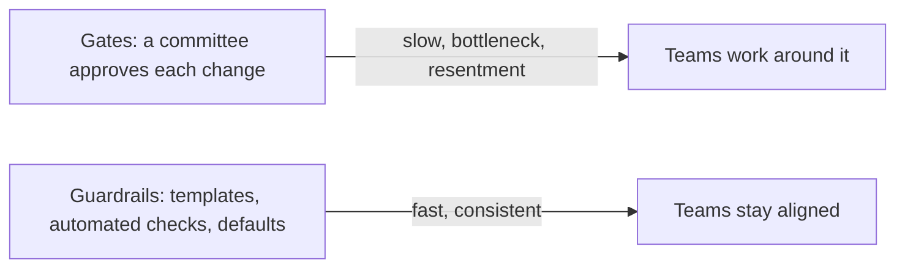

# Architecture Governance & Quality

> Governance keeps many teams building in a compatible direction without slowing them down. Prefer guardrails over gates: make the right way the easy way, check rules automatically, and review the few decisions that matter.

Roadmap topic 17 · Stage 5: Evolving & Governing

**Go deeper:** `3` Trade-Offs (ADRs) · `8` Boundaries · `16` Evolutionary Architecture (fitness functions) · `18` Teams & Delivery · `14` Documentation · `07-behavioral-leadership/12-Leadership-Without-Authority`.

**Marks:** 🟢 must know · 🟡 good to know

---

#### 1. What Is It?

*Light-weight control that preserves quality and autonomy.*

| 🟢 Must know | 🟡 Good to know |
|---|---|
| guardrails over gates | paved road (golden path) |
| architecture reviews: when, who, what to look for | tech radar: adopt, trial, assess, hold |
| automated architecture tests | balance standards with team autonomy |
| coding standards and definition of done | ATAM-style reviews |
| | ownership of services, modules and data |

1. **Gate:** a manual approval step before work continues (slow, bottleneck).
2. **Guardrail:** an automatic or built-in constraint that keeps teams on a safe path (fast, scalable).
3. **Paved road:** the easy, supported default way to build and deploy.
4. **Fitness function:** an automated architecture check (topic 16).

**Signals in an interview:** "how do you make sure teams follow the architecture?", "do you review every design?", "how do you introduce a standard without annoying teams?", "who owns this service?".

---

#### 2. How It Works

**Guardrails over gates.**



Make the right way the easy way: project templates that already contain logging, auth, CI and security scanning; shared libraries for cross-cutting concerns; automated checks in CI; defaults in the platform. Use human review only for decisions that are hard to reverse.

**Architecture reviews.**

| Question | Answer |
|---|---|
| When | for one-way or cross-team decisions, new systems, major changes, before big launches; not for every pull request |
| Who | the owning team, affected teams, an architect, security/operations as needed |
| What to look for | quality attribute fit (ASRs), boundaries and dependencies, failure modes, data ownership and privacy, operability, cost, simplicity, exit path |
| How | design doc sent ahead; short meeting; recorded decisions and actions |
| Output | approve / approve with conditions / rethink, in an ADR |

**Automated architecture tests.** Dependency rules, layer rules, cycle checks, naming and package rules, banned APIs, API compatibility checks, size and performance budgets. They run on every pull request and fail the build. Tools: ArchUnit-style libraries, Gradle dependency rules, custom lint rules.

**Coding standards and definition of done.** A short, shared set: formatting (automated), naming, error handling, logging, testing expectations; a **definition of done** (tests, review, docs/ADR updated, feature flag, monitoring, accessibility) that includes architectural expectations. Automate everything that can be.

🟡 **Paved road (golden path).** The supported, documented, easy default for building a service or an app: templates, CI/CD, observability, security. Teams may leave it, but must justify and own the extra cost.

🟡 **Tech radar.** A list of technologies in four rings: **adopt** (use by default), **trial** (use on non-critical work), **assess** (explore), **hold** (don't start new work with it). Reviewed every few months; reduces random technology sprawl while allowing experiments.

🟡 **Balance standards with autonomy.** Standardise what has little product value and high cost of variety (CI, logging, auth, security basics). Leave choice where teams know best (internal design, domain models). More standards when teams are many and juniors common; fewer when experienced teams own clear boundaries.

🟡 **ATAM-style reviews.** A structured method (Architecture Tradeoff Analysis Method): list quality attribute scenarios, examine how the architecture responds, identify risks, sensitivity points and trade-offs. Use a light version for major systems.

🟡 **Ownership.** Every service, module, data set, dashboard and runbook has an owner (a team, not a person) listed in a catalogue or `CODEOWNERS`. Unowned things decay.

---

#### 3. Naive vs Better Design

| Naive | Better |
|---|---|
| architecture board approves every change | guardrails and reviews for the few big decisions |
| rules in a wiki | rules as automated checks |
| a different stack for every team | paved road + a tech radar |
| standards imposed without reasons | standards explained, owned by practitioners, revisited |
| "everyone owns it" | named owners |
| reviews after the build | reviews while options are open |
| a review checklist of 80 items | 8 to 10 questions that matter |

---

#### 4. Templates & Examples

**Architecture review checklist (short).**

```text
[ ] Which ASRs does this serve? Are they measurable?       [ ] Boundaries: data ownership and dependencies clear?
[ ] Failure modes: timeouts, retries, fallbacks, SPOFs?    [ ] Security: threat model, authn/authz, secrets, data classes?
[ ] Operability: logs, metrics, alerts, runbook, rollback?  [ ] Cost estimated? Exit path if a vendor/tech is wrong?
[ ] Simpler alternative considered?                        [ ] Backward compatibility with old clients and data?
Result: Approve | Approve with conditions (list) | Rethink     ADR link: …
```

**Tech radar as data, and a check.**

```kotlin
enum class Ring { ADOPT, TRIAL, ASSESS, HOLD }
data class Tech(val name: String, val ring: Ring)

fun disallowedInNewModules(radar: List<Tech>, used: Set<String>) =
    radar.filter { it.ring == Ring.HOLD && it.name in used }.map { it.name }.sorted()
```

Checks: radar `Hilt = ADOPT`, `RxJava = HOLD`, `Koin = TRIAL`; a new module using `{Hilt, RxJava}` → `[RxJava]` (CI warns: put it on a justified exception list or migrate). Existing code is grandfathered until its migration plan.

**Ownership coverage check.**

```kotlin
fun unowned(modules: List<String>, owners: Map<String, String>) = modules.filter { it !in owners }
```

Checks: modules `[notes, sync, billing, search]`, owners `{notes: team-a, sync: team-a, billing: team-b}` → `[search]` is unowned; the build or a weekly report flags it.

**CODEOWNERS.**

```text
/feature/notes/    @org/notes-team
/core/network/     @org/platform-team
/docs/adr/         @org/architecture-guild
```

**Definition of done (architecture-aware).**

```text
- Tests for new logic (failure paths too)      - Code reviewed by an owner
- ADR or doc updated if a significant decision - Feature flag and rollback considered
- Metrics/logs/alerts added                    - Accessibility and security checks passed
- No new dependency cycles or banned APIs (CI) - Migration/compatibility plan if data or API changed
```

**Paved road example.**

```text
`./new-service` creates: Ktor service with auth middleware, structured logging, OpenTelemetry, health checks, Dockerfile, CI pipeline,
dependency/secret scanning, runbook template, dashboards, default SLO alerts. Teams start here; deviations are recorded as ADRs.
```

**Review triage: which changes need an architecture review?**

```kotlin
fun needsReview(oneWay: Boolean, teamsAffected: Int, newDataStore: Boolean, newExternalDependency: Boolean, touchesSecurity: Boolean) =
    oneWay || teamsAffected >= 2 || newDataStore || newExternalDependency || touchesSecurity
```

Checks: a new screen `(false, 1, false, false, false)` → `false`; adding Kafka `(true, 3, true, true, false)` → `true`; a login change `(false, 1, false, false, true)` → `true`.

---

#### 5. Numbers & Rules of Thumb

| Item | Guide |
|---|---|
| Review turnaround | within a few days; not a bottleneck |
| Review checklist | 8 to 10 questions |
| Architecture tests | run in CI on every pull request |
| Tech radar | reviewed quarterly; each ring has criteria |
| Standards | few, justified, automated |
| Owners | 100% of services, modules and data sets |
| Exceptions | allowed with an ADR and an expiry date |
| Paved road adoption | target 80%+ of new services |

---

#### 6. Common Mistakes & Edge Cases

1. Governance as approval bureaucracy.
2. Rules nobody checks.
3. Standards with no reasons or owners.
4. Too many technologies.
5. Reviews with no clear output.
6. Unowned services and docs.
7. Ivory-tower standards from people who don't build.
8. Applying the same rigour to every change.

Edge cases: acquisitions with different stacks; urgent fixes (allow an exception with a follow-up); experienced teams who want a different approach (evaluate on the quality attributes, allow if justified); compliance-driven gates (automate the evidence); open-source dependencies with changing licences.

---

#### 7. Say This in the Interview

1. "I prefer guardrails over gates: templates, defaults and automated architecture tests make the right way the easy way, and human review is for the hard-to-reverse decisions."
2. "Reviews happen early, with a short checklist: ASRs, boundaries, failure modes, security, operability, cost, simpler alternatives and an exit path; the output is an ADR."
3. "Fitness functions run in CI: dependency rules, cycles, budgets, banned APIs."
4. "A paved road and a tech radar limit sprawl while leaving teams autonomy where it matters; every service, module and data set has an owner."
5. "Standards are explained, owned by practitioners, and revisited, so they're followed willingly."

---

#### 8. Quick Check

1. Guardrail vs gate?
2. What does the tech radar's "hold" mean?
3. Which changes deserve an architecture review?
4. Why do owners matter?

<details>
<summary>Answers</summary>

1. A guardrail is an automatic constraint or default; a gate is a manual approval step.
2. Don't start new work with this technology.
3. One-way or cross-team decisions, new data stores or dependencies, security-sensitive changes.
4. Without owners things decay; someone must answer for quality, incidents and change.

</details>

---

#### 9. Practice

**Interview questions**

1. How do you make sure many teams follow the architecture?
2. What is a paved road, and how do you balance it with autonomy?
3. How do you run an architecture review?
4. What are fitness functions, and what would you test?
5. How do you introduce a new standard?
6. What is a tech radar?

**Exercises**

1. Write a 10-question architecture review checklist for your team.
2. Build a tech radar for your stack with the criteria for each ring.
3. Add an architecture test to CI that fails on a forbidden dependency.
4. Check ownership coverage of all modules and services.

**Remember:** guardrails over gates · automate the rules (fitness functions in CI) · review the few big decisions early with a short checklist · paved road + tech radar · standards with reasons · named owners.
