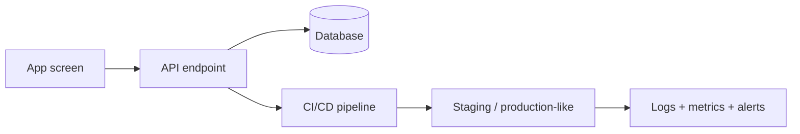
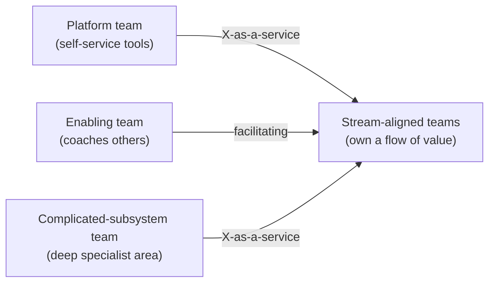

# Teams & Delivery

> Architecture and organisation shape each other. Match teams to the architecture you want, deliver the thinnest end-to-end slice first, work in vertical slices, own what you build, and measure delivery health with a few team-level metrics.

Roadmap topic 18 · Stage 5: Evolving & Governing

**Go deeper:** `8` Boundaries (Conway's law) · `13` Operations (DevOps, CI/CD) · `16` Evolutionary Architecture · `17` Governance · `07-behavioral-leadership/14-Delivery-Prioritization-and-Team-Health` and `15-Hiring-and-Team-Building`.

**Marks:** 🟢 must know · 🟡 good to know

---

#### 1. What Is It?

*Organising people and work so the architecture can be built and changed quickly.*

| 🟢 Must know | 🟡 Good to know |
|---|---|
| Conway's law and the inverse Conway manoeuvre | Team Topologies |
| walking skeleton | architecture in agile teams: just enough design up front |
| vertical slices vs horizontal layers | MVP thinking |
| DevOps mindset: you build it, you run it | onboarding: docs, diagrams, readable code |
| delivery metrics (DORA) | |

1. **Conway's law:** a system's structure mirrors the communication structure of the team that builds it.
2. **Inverse Conway manoeuvre:** shape teams to get the architecture you want.
3. **Walking skeleton:** the thinnest end-to-end version that runs through all layers.
4. **Vertical slice:** a thin piece of work cutting through UI, logic and data that delivers user value.

**Signals in an interview:** "how do you structure teams around a system?", "where do you start building?", "how do you measure delivery performance?", "how much design up front?".

---

#### 2. How It Works

**Conway's law and the inverse manoeuvre.** Four teams build a four-part system; a separate "frontend team" and "backend team" produce a hard seam between them and a ticket queue for every feature. If you want independent feature modules, form **stream-aligned teams** that own a feature end to end (app screen, API, data). If you want a shared platform, create a platform team.

**Walking skeleton.** Before building features, build the thinnest slice that connects everything: app → API → database → deployment → monitoring, with one trivial feature (for example "create and list a note"), running in CI/CD to production-like environments. It proves the architecture, exposes integration problems early, and gives the team a base to extend.



**Vertical slices vs horizontal layers.**

| Horizontal | Vertical |
|---|---|
| "build the database layer, then the API, then the UI" | "build 'share a note' through all layers" |
| value arrives at the end; integration risk late | value and feedback every slice; risk early |
| layers wait for each other | a team can finish a slice alone |

Plan work in vertical slices, each shippable behind a flag.

**DevOps mindset: you build it, you run it.** The team that builds a service is on call for it, owns its dashboards, alerts, cost and incidents. This tightens feedback: unreliable designs hurt the people who can fix them. Support with a platform (paved road), runbooks, and sustainable on-call.

**Delivery metrics (DORA).** Four team-level measures, used to find system problems, never to rank people:

| Metric | Meaning |
|---|---|
| Deployment frequency | how often you release to production |
| Lead time for changes | from commit to production |
| Change failure rate | share of deployments causing incidents/rollbacks |
| Time to restore | how fast you recover from an incident |

Better performers deploy often with small changes and recover fast; speed and stability go together.

🟡 **Team Topologies.** Four team types and three interaction modes:



Interaction modes: *collaboration* (work closely for a time), *X-as-a-service* (consume a stable service), *facilitating* (help another team learn). Keep each team's **cognitive load** manageable.

🟡 **Architecture in agile teams: just enough design up front.** Decide the big, hard-to-reverse things early (ASRs, main boundaries, data ownership, security), validate them with a walking skeleton, and leave the rest to emerge in small steps with refactoring and fitness functions. Avoid both "big design up front" and "no design".

🟡 **MVP thinking.** The smallest version that tests the biggest assumption with real users. Decide what to build now and what to defer; defer by design (keep a seam), not by neglect. An MVP is not a prototype that gets shipped as is: set quality bars for security, data safety and reliability, which don't get cut.

🟡 **Onboarding.** A new engineer can read the overview, run the app and tests locally, and ship a small change in the first week. That needs current docs, diagrams (topic 14), a one-command setup, and code organised by feature.

---

#### 3. Naive vs Better Design

| Naive | Better |
|---|---|
| separate frontend, backend, database teams with handoffs | stream-aligned teams owning features end to end |
| build all layers, integrate at the end | walking skeleton, then vertical slices |
| "throw it over the wall" to ops | you build it, you run it, with a platform |
| measure individuals' velocity | team-level DORA metrics |
| three months of design, then build | enough design to de-risk, then iterate |
| an MVP with no security or backups | MVP scope cut, quality bars kept |
| tribal knowledge | docs, diagrams, templates, onboarding checklist |

---

#### 4. Templates & Examples

**Walking skeleton checklist.**

```text
[ ] App screen creates and lists a note (real API, real database)      [ ] Auth in place (real tokens)
[ ] CI builds, tests and publishes artifacts                           [ ] Deploy to staging automatically
[ ] Logs, metrics, a dashboard and one alert exist                    [ ] Rollback tested once
[ ] README: how to run, test and deploy                                [ ] ADRs for the key decisions
```

**DORA metrics from raw data.**

```kotlin
data class Deployment(val leadTimeHours: Double, val failed: Boolean, val restoreMinutes: Int? = null)

fun deploymentFrequencyPerDay(deploys: List<Deployment>, days: Int) = deploys.size.toDouble() / days
fun medianLeadTimeHours(deploys: List<Deployment>): Double {
    val s = deploys.map { it.leadTimeHours }.sorted()
    return if (s.size % 2 == 1) s[s.size / 2] else (s[s.size / 2 - 1] + s[s.size / 2]) / 2
}
fun changeFailureRate(deploys: List<Deployment>) = deploys.count { it.failed }.toDouble() / deploys.size
fun meanTimeToRestoreMinutes(deploys: List<Deployment>) = deploys.mapNotNull { it.restoreMinutes }.average()
```

Checks: 45 deployments in 30 days → `1.5` a day; lead times `[2, 4, 6, 8, 30]` hours (sample of five) → median `6.0`; 3 failures in 45 → `0.067` (6.7%); restore times `30, 90, 60` minutes → `60.0`. Track the trend: smaller changes should raise frequency, shorten lead time and lower failure rate.

**Vertical slice example.**

```text
Slice: "Share a note with a teammate (view only)"
UI: share sheet → API: POST /notes/{id}/shares → Data: shares table + permission check → Event: NoteShared → Push to recipient
Done when: works end to end behind a flag, tested, monitored, rolled out to 5% of users.
Not in this slice: edit permissions, link sharing, expiry (next slices).
```

**Aligning teams with the architecture (inverse Conway).**

| Desired architecture | Team change |
|---|---|
| independent Notes, Sharing and Billing modules | one stream-aligned team per area, each owning UI, API and data |
| a shared design system and networking layer | a small platform team with a roadmap based on internal customers |
| a hard specialist problem (sync engine) | a complicated-subsystem team, with an enabling team to spread knowledge |

**Onboarding checklist (first week).**

```text
Day 1: accounts, laptop, run the app and tests with one command, read the overview and C4 diagrams
Day 2–3: pair on a small bug; learn the release process
Day 4–5: ship a small change to production behind a flag; meet the team's stakeholders
Feedback: what was confusing? fix the docs.
```

**MVP scoping.**

```text
Biggest assumption: people will share notes with teammates.
MVP: share by email, view-only, no folders, no web app. Quality bars kept: encryption, access checks, backups, crash reporting.
Deferred (with seams): edit rights (permission model supports roles), link sharing, web client.
Learning goal: 20% of active users share within 2 weeks.
```

---

#### 5. Numbers & Rules of Thumb

| Item | Guide |
|---|---|
| Team size | 5 to 9 people (two-pizza); one team owns a few services or modules |
| Cognitive load | a team should be able to understand all it owns |
| Slice size | shippable in days to 1–2 weeks |
| Walking skeleton | days to 2 weeks |
| Deployment frequency | healthy teams: daily to multiple times a day; at least weekly |
| Lead time | hours to a day for strong teams |
| Change failure rate | under 15%, often under 5% |
| Time to restore | under an hour for strong teams |
| Onboarding | first production change within a week |

---

#### 6. Common Mistakes & Edge Cases

1. Component teams with endless handoffs.
2. Building horizontal layers for months.
3. Ignoring Conway's law.
4. Using DORA metrics to rank individuals.
5. Big design up front; or none at all.
6. "MVP" meaning "no quality".
7. On-call without tools, runbooks or rotation.
8. Knowledge that lives only in people's heads.

Edge cases: a very small team (one team owns everything: keep boundaries in code); outsourced or distributed teams (clear contracts, shared pipelines, written decisions); regulated releases (automate evidence instead of adding gates); a shared legacy system (carve out ownership slowly); team reorganisations mid-project (revisit boundaries).

---

#### 7. Say This in the Interview

1. "Conway's law says design mirrors team structure, so I shape teams to match the architecture I want: stream-aligned teams that own a feature end to end, plus a platform team."
2. "I start with a walking skeleton, the thinnest end-to-end slice with CI/CD and monitoring, then build in vertical slices behind flags."
3. "You build it, you run it, with a paved road and runbooks."
4. "I use the four DORA metrics at team level to find system problems, never to rank people."
5. "Enough design up front for the hard-to-reverse decisions, then iterate; an MVP cuts scope, not security or data safety."

---

#### 8. Quick Check

1. What is a walking skeleton?
2. Vertical vs horizontal slicing?
3. Name the four DORA metrics.
4. What is the inverse Conway manoeuvre?

<details>
<summary>Answers</summary>

1. The thinnest end-to-end version running through all layers, pipeline and monitoring.
2. Vertical slices cut through all layers to deliver user value; horizontal builds one layer at a time.
3. Deployment frequency, lead time for changes, change failure rate, time to restore.
4. Organising teams to produce the architecture you want.

</details>

---

#### 9. Practice

**Interview questions**

1. How do team structures affect architecture?
2. Where do you start building a new system?
3. How do you split work into slices?
4. What does "you build it, you run it" require?
5. How do you measure delivery performance?
6. How much design up front is right?

**Exercises**

1. Draw your current teams against your modules; mark mismatches and propose changes.
2. Define a walking skeleton for a new feature or system.
3. Split a large feature into five vertical slices with a "done when" for each.
4. Compute your DORA metrics for the last month from your pipeline data.

**Remember:** teams shape architecture · stream-aligned teams, platform team · walking skeleton first · vertical slices behind flags · build it, run it · DORA at team level · just enough design · MVP keeps the quality bars.
