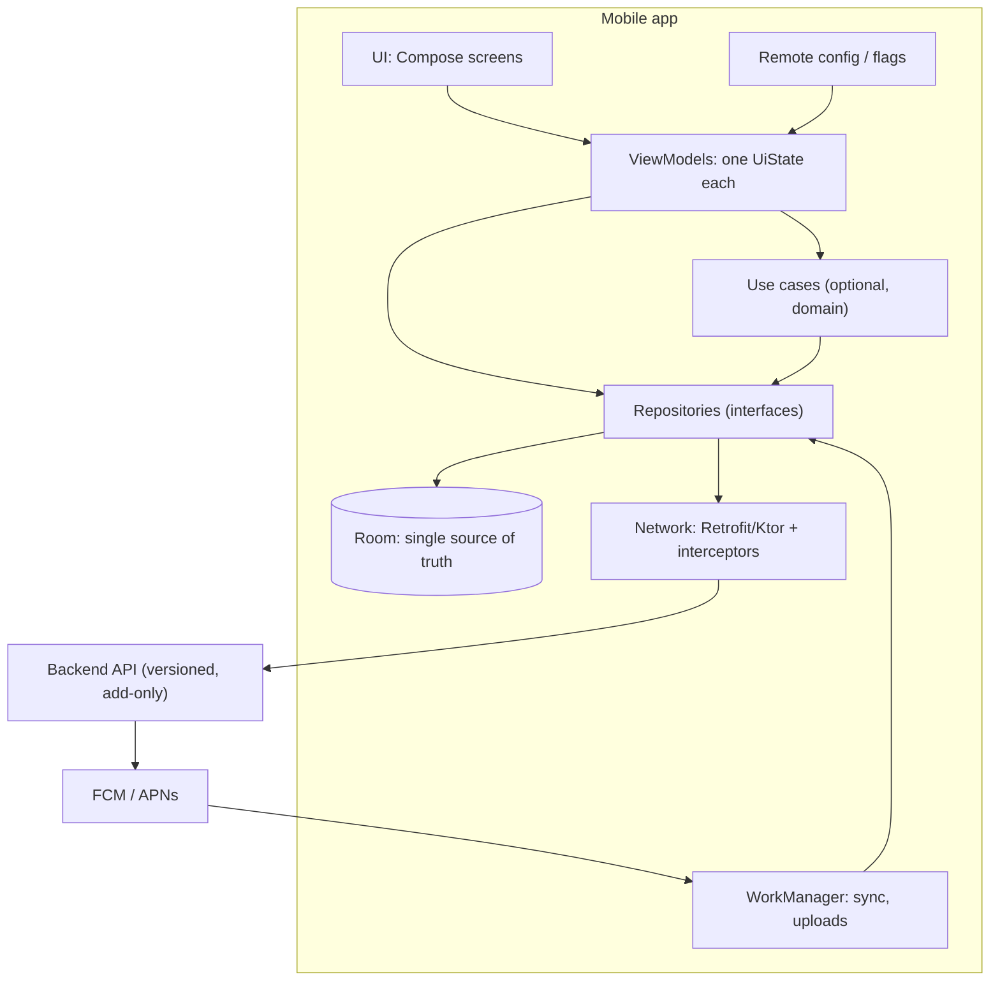

# Mobile App Architecture

> The architect's view of a mobile app: the quality attributes that matter on a phone, the layers and boundaries that serve them, the decisions worth writing down, and how the app and the backend evolve together while old app versions stay alive.

Roadmap topic 19 · Stage 6: Your Domain (New)

**Go deeper:** `06-mobile-engineering` (all platform detail: `6` App Architecture, `7` DI & Modularization, `8` Networking, `9` Offline-First, `11` Performance, `13` Security, `15` Release, `17` KMP, `18` Mobile System Design) · `05-system-design/30-Mobile-Specific-Topics` · `8` Boundaries · `10` Integration.

**Marks:** 🟢 must know · 🟡 good to know · (New) for a mobile engineer moving into architecture

---

#### 1. What Is It?

*Architecture decisions for the client that sits on an unreliable, battery-limited device you do not control.*

| 🟢 Must know | 🟡 Good to know |
|---|---|
| layers: UI, domain (optional), data | networking layer, caching, error handling |
| MVVM, MVI, clean architecture on mobile | navigation and wiring of features |
| unidirectional data flow, single source of truth | feature flags, remote config, staged rollouts |
| dependency injection | security: token storage, pinning, obfuscation |
| modularization by feature with clear module APIs | testing strategy |
| offline-first: local database as source of truth, with sync | cross-platform options and trade-offs |
| backward compatibility with old app versions | platform details live in `06-mobile-engineering` |

1. **Mobile architecture** = the structure of the app (layers, modules, state, data flow) plus its contract with the backend.
2. **The unusual constraints:** the OS can kill the process; the network is unreliable; the battery and memory are limited; you cannot force users to update.

**Signals in an interview:** "how would you architect the Android app for X?", "how do you structure modules?", "how do you handle offline and old versions?", "native or cross-platform?".

---

#### 2. How It Works

**Mobile quality attributes (the usual ASRs).**

| Attribute | Typical requirement | Architectural consequence |
|---|---|---|
| Reliability on bad networks | core flows work offline | local database as source of truth; outbox; sync |
| Startup and responsiveness | cold start < 2 s; 60 fps | light `Application`, lazy init, background work, baseline profiles |
| Battery and data | no polling; batching | push + sync, WorkManager, compression |
| Backward compatibility | support the last N app versions | add-only APIs, ignore unknown fields, force-update path |
| Security and privacy | tokens safe; minimal data | Keystore, TLS, no secrets in the app |
| Maintainability and speed of delivery | weekly releases, many engineers | modular, testable, DI |
| Release safety | can't recall a release | staged rollout, flags, kill switches |
| Accessibility, localisation | many users, many languages | design system, resources, semantics |

**Reference architecture.**



**Layers and patterns.** UI layer (state + events), optional domain layer (pure Kotlin use cases and models), data layer (repositories over Room, network and caches). **MVVM or MVI** with **unidirectional data flow**: state flows down, events flow up; one `UiState` per screen. **Single source of truth**: the UI reads the database; the network updates it (`MOB 6`, `MOB 9`).

**Dependency injection.** Constructor injection everywhere; Hilt, Koin or manual wiring at the edges; test with fakes (`MOB 7`).

**Modularization.** `:app` (wiring and navigation host), `:feature:*` (screens), `:core:*` (design system, data, network, model). Dependencies point down; features don't depend on each other; small public APIs; a version catalog and convention plugins. Modularise when build time, ownership or reuse demand it (topic 8).

**Offline-first.** Local-first writes with client ids and an outbox; push and pull sync with a cursor; tombstones; a stated conflict rule; tested migrations (`MOB 9`, `SD 30`).

**Backward compatibility with old app versions.** The contract is the architecture's longest-living part:

1. Add-only API changes; the app ignores unknown fields.
2. A minimum supported version and a force-update path.
3. Server-side flags control behaviour without a release.
4. The local database migrates from every supported old version.
5. Keep a "support window" policy (for example the last 12 months of versions, or the versions covering 99% of users).

🟡 **Networking layer, caching, error handling.** One HTTP client with timeouts, an auth interceptor, a token refresh authenticator, retries with backoff for safe calls, `ETag` caching, and one `AppError` model from network to screen (`MOB 8`, `MOB 6`).

🟡 **Navigation and feature wiring.** A navigation host in `:app` that knows every feature's public route; typed routes; deep links validated; features expose routes and screens, not internals.

🟡 **Feature flags, remote config, staged rollouts.** Flags decouple deploy from release; a kill switch for every risky feature; staged rollout with crash-free and ANR gates (`MOB 15`).

🟡 **Security.** Tokens in the Keystore, TLS only, pinning with a backup pin (optional), obfuscation as a speed bump only, validation of all inputs, the server as the authority (`MOB 13`).

🟡 **Testing strategy.** Many JVM unit tests (ViewModels, mappers, reducers) with fakes, repository tests with a fake server and in-memory Room, a few UI tests for critical flows, migration tests; fitness functions for startup and size (`MOB 12`).

🟡 **Cross-platform options and trade-offs.** Native for the best fit; Kotlin Multiplatform to share logic and data while keeping native UI; Compose Multiplatform to share UI too; Flutter or React Native for one codebase with their own trade-offs. Decide by team skills, product needs and long-term cost (`MOB 17`).

---

#### 3. Naive vs Better Design

| Naive | Better |
|---|---|
| UI calls the network | UI → ViewModel → repository → Room |
| network-first screens | local database as source of truth |
| one big `:app` module | modules by feature + core, with rules |
| rename an API field | add-only; min supported version |
| release to 100% and hope | staged rollout, flags, kill switch |
| secrets in the app | server holds secrets; Keystore for tokens |
| tests only through the UI | JVM tests + a few UI tests |
| pick cross-platform by hype | decide by skills, needs and cost |

---

#### 4. Templates & Examples

**Mobile ADR set (typical).**

```text
ADR-001 MVVM with a single UiState per screen and StateFlow          ADR-002 Room as the single source of truth; sync via outbox + cursor
ADR-003 Hilt for DI; constructor injection                          ADR-004 Feature modules + core modules; no feature→feature dependencies
ADR-005 API is add-only; min supported version + force update       ADR-006 Remote flags with a kill switch for all risky features
ADR-007 Tokens in Keystore; TLS only; no secrets in the app          ADR-008 Staged rollout gates: crash-free ≥ 99.3%, ANR ≤ 0.47%
```

**Choosing the minimum supported version from adoption.**

```kotlin
fun coverage(sharesByVersion: Map<String, Int>, versionsSupported: Int): Int =
    sharesByVersion.values.take(versionsSupported).sum()          // map is ordered newest → oldest
```

Checks: with shares `4.8: 55, 4.7: 25, 4.6: 12, 4.5: 5, 4.4: 2, older: 1` (percent of active users), supporting the newest `3` versions covers `92%`; `4` versions cover `97%`; `5` cover `99%`. The last 2% costs you two more versions of compatibility code, so decide with the business: a force-update screen for the rest is a legitimate trade-off.

**Fitness functions for a mobile app.**

```text
- Cold start (macrobenchmark, mid-range device, release build) < 2.0 s                - APK/AAB size < 40 MB
- No dependency cycles; :feature:* must not depend on each other                    - Compose stability report: no unstable parameters in list items
- Migration tests pass for every supported old DB version                           - Crash-free users ≥ 99.3% at each rollout step
```

**A feature module contract.**

```kotlin
// :feature:notes:api — the only thing other modules may see
interface NotesNavigation { fun openNote(id: Long); fun openEditor(id: Long?) }
@Serializable data class NoteRoute(val id: Long)

// :feature:notes:impl — internal screens, ViewModels, repositories
```

**Test strategy numbers.** For about 500 tests: `350` JVM unit tests (70%), `100` integration tests (20%), `50` UI tests (10%).

**Backend contract checklist (agree with the backend team).**

```text
[ ] Cursor pagination      [ ] Idempotency-Key on writes     [ ] Error format {code, message}
[ ] Unknown fields ignored [ ] `minSupportedVersion` in config [ ] Delta endpoint: changes?since=<cursor> (with tombstones)
[ ] Rate limits + Retry-After  [ ] Versioning/deprecation policy   [ ] Push payload = ids, not data
```

**Decision: native vs KMP vs Flutter (example record).**

```text
Context: two teams (Android, iOS), strong Kotlin skills, offline-first is the core feature, platform look matters.
Decision: Kotlin Multiplatform for data + sync + domain; native Compose and SwiftUI for UI.
Because: shares the hardest, bug-prone logic (sync, conflict rules); keeps native UX; incremental adoption (start with the sync module).
Consequences: iOS devs learn KMP tooling; Swift sees Kotlin flows through wrappers; CI needs macOS runners.
Review: after the first shared module ships and after 6 months.
```

---

#### 5. Numbers & Rules of Thumb

| Item | Guide |
|---|---|
| Cold start | < 2 s on a mid-range device (Play Vitals marks ≥ 5 s as slow) |
| Crash-free users | ≥ 99.5% target; staged rollout gate ~99.3% |
| ANR rate | ≤ 0.47% (Play bad-behaviour threshold; check current) |
| Version support | enough versions to cover ≥ 95–99% of active users, with force-update for the rest |
| API deprecation | at least the support window of old app versions |
| Module count | as few as needed for build time and ownership (10 to 40 for large apps) |
| Test mix | ~70% unit, 20% integration, 10% UI |
| Release cadence | weekly or fortnightly, with staged rollout |

---

#### 6. Common Mistakes & Edge Cases

1. Designing the app as if the network were reliable.
2. State in Activities; no handling of process death.
3. A giant app module and unclear ownership.
4. Breaking old app versions with API changes.
5. No kill switch for risky features.
6. Over-modularising early (slow builds) or never modularising.
7. Secrets and business rules in the client.
8. Cross-platform decisions made without a pilot.

Edge cases: a long-lived database schema on devices (migrations from every old version); a forced-update policy that blocks users in poor-connectivity regions; regulated apps (store policies, data-safety declarations); white-label apps (flavors, config-driven features); tablets and foldables; app clips/instant apps and widgets sharing code.

---

#### 7. Say This in the Interview

1. "I start with the mobile ASRs: reliability on bad networks, startup and battery, backward compatibility with old app versions, release safety and security."
2. "Architecture: UI → ViewModel with one UiState → repository → Room as the source of truth, with the network refreshing it and WorkManager syncing from an outbox; DI with constructor injection; modules by feature plus core."
3. "The API contract is the longest-lived piece: add-only changes, a minimum supported version, force-update, and server-side flags."
4. "Release safety: staged rollout with crash-free and ANR gates, kill switches, and fitness functions for startup and size."
5. "Cross-platform: I'd pilot Kotlin Multiplatform on the sync/domain layer and keep native UI, deciding by team skills, product needs and long-term cost."

---

#### 8. Quick Check

1. Why is a local database the source of truth?
2. How do you support old app versions?
3. What goes in `:app` vs `:feature:*`?
4. What is a sensible rollout gate?

<details>
<summary>Answers</summary>

1. The UI always has data and works offline; the network only refreshes it, and state survives process death.
2. Add-only API, ignore unknown fields, a minimum supported version with force-update, server flags, and database migrations from old versions.
3. `:app` wires dependencies and navigation; features hold screens and logic, depending on core modules only.
4. Crash-free users and ANR rate above thresholds (for example ≥ 99.3% and ≤ 0.47%) before widening the rollout.

</details>

---

#### 9. Practice

**Interview questions**

1. How would you architect the Android app for a notes/chat/shopping product?
2. How do you structure modules and navigation?
3. How do you make the app work offline and survive old versions?
4. How do you release safely?
5. Native, KMP or Flutter: how do you decide?
6. How do you test the architecture?

**Exercises**

1. Draw the reference architecture of your own app and mark the boundaries and problems.
2. Write the ASR table (with numbers) and eight ADR titles for it.
3. Compute version coverage from your analytics and propose a support policy.
4. Add two mobile fitness functions to CI.

**Remember:** mobile ASRs first (offline, startup, battery, old versions, release safety) · UI → ViewModel → repository → Room, network refreshes · modules by feature · add-only API + min version · flags, kill switches, staged rollout · pilot cross-platform on one module.
