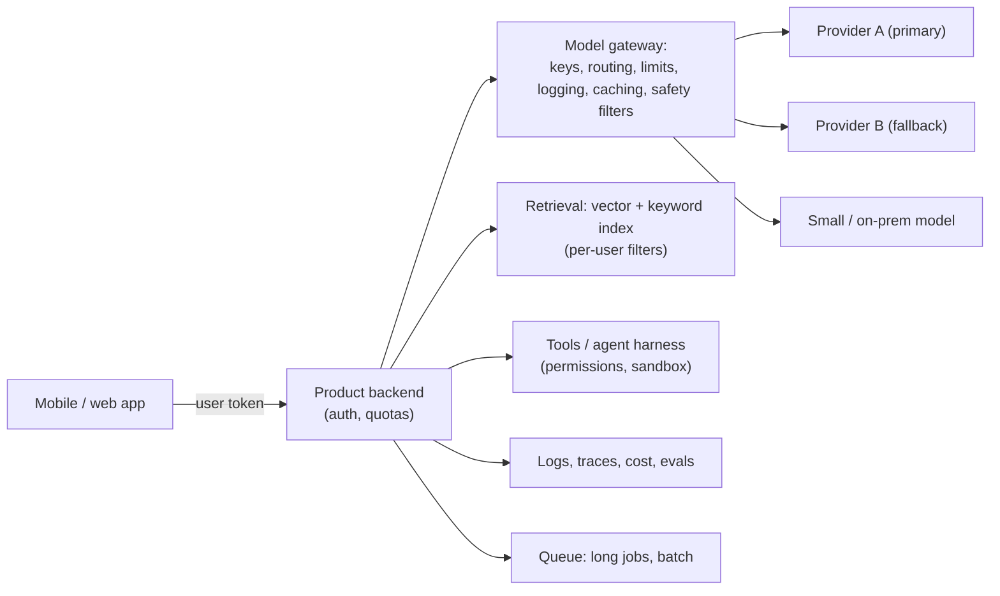

# Architecting AI-Enabled Systems

> An AI feature is a system with an unusual component: a model that is probabilistic, slow, costly and changeable. Architect around it: keep it behind your backend, design for wrong answers, treat cost, latency and reliability as requirements, control the data flow, and make models swappable and evaluated.

Roadmap topic 20 · Stage 6: Your Domain (New)

**Go deeper:** `08-artificial-intelligence` (all topics: `5` Calling an LLM API, `7` RAG, `8` Tool Use, `10` Agents, `15` Evaluation, `16` Safety, `17` Cost & Reliability, `18` Observability, `19` On-Device vs Cloud) · `5` Styles · `10` Integration · `11` Security · `12` Resilience.

**Marks:** 🟢 must know · 🟡 good to know · (New) still changing

---

#### 1. What Is It?

*Fitting models, retrieval, tools and agents into a normal architecture.*

| 🟢 Must know | 🟡 Good to know |
|---|---|
| the model sits behind your backend; never a key in the app | model gateway: keys, limits, routing, logging |
| building blocks: prompts, retrieval, tools, agents, evals | swappable providers and model versions |
| design for wrong answers: grounding, validation, approval | on-device vs cloud |
| cost, latency, reliability as first-class requirements | evaluation as part of the delivery pipeline |
| privacy and data flow to third-party models | |

1. **Model gateway:** one backend layer through which every model call passes.
2. **Grounding:** tying answers to retrieved sources.
3. **Eval:** a test set plus scoring, run like tests.

**Signals in an interview:** "add AI to our product", "where does the model run?", "how do you handle wrong answers?", "how do you control cost?", "what if the provider changes the model?".

---

#### 2. How It Works

**Reference architecture.**



**Where the model sits.** Always behind your backend: keys, per-user quotas, safety filters, logging, and the freedom to change models without an app release (`AI 5`, `AI 20`).

**Building blocks and when to use each.**

| Block | Use for | Note |
|---|---|---|
| Prompt | behaviour, format | version and test it |
| Retrieval (RAG) | private or fresh facts, citations | per-user access control |
| Tools | actions and exact data | validate, authorise, confirm side effects |
| Agent | open-ended multi-step work | limits, permissions, evals; workflow first |
| Evals | measuring quality | run in CI and on production samples |
| Cache/queue | cost and long tasks | answers, prompt prefixes, batch |

**Design for wrong answers.** Assume the model is sometimes wrong, unsafe or manipulated. Architecture responses: **ground** in sources and cite; **validate** output (schema, ranges, policy); **limit** what actions it can take (least privilege); **approve** irreversible actions with a human; **fall back** to simpler behaviour; **monitor** quality and feedback. A wrong answer should be an annoyance, never a catastrophe.

**Cost, latency, reliability as first-class requirements.** Write them as ASRs: "median time to first token under 1 s; p95 complete under 6 s; cost under $0.01 per conversation; 99.5% of requests get an answer or a clear fallback." Then design: streaming, caching, small-model routing, token budgets, queues for long jobs, timeouts, retries, circuit breakers, multi-provider fallback (`AI 17`).

**Privacy and data flow to third-party models.** Draw where data goes: user device → your backend → provider. Decide what may be sent (classification), redact personal data, check the provider's retention and training terms, region and contract (DPA), allow opt-out, avoid sending secrets, log carefully, and support deletion (including memories and embeddings) (`AI 16`, topic 9).

🟡 **Model gateway.** One service (or library) that: holds provider keys; applies per-user and global quotas; routes requests (by task, tier, load, cost); applies timeouts, retries and fallbacks; caches; redacts and filters; records tokens, latency, cost and versions; enforces data-handling rules. Benefits: provider independence, central control, consistent observability.

🟡 **Swappable providers and model versions.** Use an interface for "complete this chat" and "embed this text"; keep prompts and model names in configuration; run your eval before changing; canary the change; keep a rollback; plan for retirement dates (`AI 18`). Avoid features that only one provider offers unless the value is clear and you accept the lock-in.

🟡 **On-device vs cloud.** On-device for private, offline, low-latency and simple tasks; cloud for hard reasoning and long context; hybrid with a fallback (`AI 19`).

🟡 **Evaluation in the delivery pipeline.** Eval sets run on every prompt, model or tool change; a regression gate blocks the release; production samples and user feedback become new eval cases (`AI 15`).

---

#### 3. Naive vs Better Design

| Naive | Better |
|---|---|
| the app calls the provider with an embedded key | app → backend → gateway → provider |
| model name hard-coded in ten places | config + interface; eval before change |
| trust the answer | grounding, validation, approval, fallback |
| cost discovered on the invoice | cost per request as a requirement; budgets and alerts |
| one provider, no fallback | fallback chain and degraded mode |
| log full prompts forever | redact, sample, retain briefly |
| ship a prompt change by hand | change → eval → staged rollout |
| agents given broad permissions | least privilege, sandbox, approvals |

---

#### 4. Templates & Examples

**Model gateway interface and routing (Kotlin).**

```kotlin
data class ChatRequest(val userId: String, val feature: String, val messages: List<Msg>, val maxOutputTokens: Int = 800, val needsReasoning: Boolean = false)
data class ChatResult(val text: String, val model: String, val inputTokens: Int, val outputTokens: Int)

interface ModelProvider { val name: String; suspend fun chat(model: String, req: ChatRequest): ChatResult }

class ModelGateway(
    private val providers: List<ModelProvider>,
    private val quota: (String, Int) -> Boolean,                       // per-user token budget
    private val route: (ChatRequest) -> String,                        // chooses "small" or "large"
    private val models: Map<String, Map<String, String>>               // tier → provider name → model id (from configuration)
) {
    suspend fun chat(req: ChatRequest): ChatResult {
        require(quota(req.userId, req.maxOutputTokens)) { "quota exceeded" }
        val tier = route(req)
        var last: Exception? = null
        for (p in providers) {                                         // primary first, then fallbacks
            val model = models.getValue(tier)[p.name] ?: continue
            try { return withTimeout(20_000) { p.chat(model, req) } }
            catch (e: CancellationException) { throw e }
            catch (e: Exception) { last = e }
        }
        throw IllegalStateException("all providers failed", last)
    }
}

fun simpleRoute(req: ChatRequest) = if (req.needsReasoning || req.messages.sumOf { it.text.length } > 20_000) "large" else "small"
```

Checks (fake providers): a request without reasoning is routed to `small`; with `needsReasoning = true` → `large`. If provider A throws, provider B answers (`model` shows B's id) and the caller sees one result; if both throw, an `IllegalStateException` carries the last error (the app shows a degraded answer). A user over quota gets `IllegalArgumentException("quota exceeded")` before any provider is called.

**Data-flow classification for model calls.**

| Data | May go to a third-party model? | Handling |
|---|---|---|
| Public docs | yes | none |
| User's own notes (personal) | yes, with consent/contract | redact identifiers if not needed; no training on the data; retention ≤ N days |
| Payment details, health, credentials | no (or only an approved, isolated provider) | never in prompts; tools fetch masked values |
| Other users' data | never | per-user retrieval filters |

```kotlin
enum class DataClass { PUBLIC, PERSONAL, SENSITIVE }
fun mayLeave(c: DataClass, userConsented: Boolean, providerApproved: Boolean) = when (c) {
    DataClass.PUBLIC -> true
    DataClass.PERSONAL -> userConsented && providerApproved
    DataClass.SENSITIVE -> false
}
```

Checks: `mayLeave(PUBLIC, false, false)` → `true`; `(PERSONAL, true, true)` → `true`; `(PERSONAL, true, false)` → `false`; `(SENSITIVE, true, true)` → `false`.

**Eval gate in CI.**

```kotlin
fun releaseAllowed(baselinePass: Double, candidatePass: Double, criticalFailures: Int, costPerRequestUsd: Double, maxCost: Double, maxDrop: Double = 0.02) =
    candidatePass >= baselinePass - maxDrop && criticalFailures == 0 && costPerRequestUsd <= maxCost
```

Checks: baseline `0.90`, candidate `0.91`, no critical failures, cost `$0.008` with limit `$0.01` → `true`; candidate `0.86` → `false`; one critical failure (an injection case) → `false`; cost `$0.02` → `false`.

**ASRs for an AI feature (example).**

| Attribute | Requirement |
|---|---|
| Quality | ≥ 90% correct and ≥ 95% grounded on the eval set; "I don't know" on unanswerable questions ≥ 90% |
| Latency | time to first token p50 < 1 s; complete p95 < 6 s |
| Cost | < $0.01 per conversation; hard cap $200/day |
| Reliability | 99.5% of requests answered or gracefully degraded |
| Safety | 0 critical failures on the red-team set; actions behind approval |
| Privacy | no personal data to providers without consent; deletion within 30 days |

**ADRs for an AI feature.**

```text
ADR-A1 Model calls only through the backend model gateway          ADR-A2 RAG over help articles with per-tenant filters and citations
ADR-A3 Read-only tools first; write tools require user approval    ADR-A4 Provider-neutral interface; model ids in config; eval before changes
ADR-A5 Prompt caching + small-model routing for cost               ADR-A6 Logs redact PII; prompts sampled 5%, retained 14 days
```

---

#### 5. Numbers & Rules of Thumb

| Item | Guide |
|---|---|
| Time to first token | 0.3 to 2 s; stream |
| Cost | tokens × price; agents use 10 to 50× the tokens of one call |
| Caching | prompt cache reads ≈ 10% of input price; exact-answer cache for repeats |
| Fallback | at least one alternate provider/model, tested |
| Eval set | 30 to 100 to start; run on every change |
| Quotas | per user and global; alerts at 50/80/100% |
| Model change | eval → canary 1–10% → 100%, with rollback |
| Data retention | prompts/outputs days to weeks, redacted |

---

#### 6. Common Mistakes & Edge Cases

1. A provider key in the app.
2. Designing for the happy path only (no wrong answers, outages, injection).
3. No cost or latency requirements.
4. Hard-coding one provider and model.
5. Sending personal or sensitive data without a decision.
6. No eval, so quality changes unnoticed.
7. An agent with broad permissions.
8. Treating AI output as authoritative.

Edge cases: a provider silently updates a model; a retired model; regional data-residency rules; rate limits during a spike; a prompt injection in retrieved content; a user asking for deletion of data that went into embeddings; very long contexts blowing the budget; offline mode.

---

#### 7. Say This in the Interview

1. "The model sits behind my backend, through a model gateway that holds keys, applies quotas, routes by difficulty, falls back across providers, and logs tokens, latency, cost and versions."
2. "I design for wrong answers: grounding with citations, validation, least-privilege tools, approval for irreversible actions, and a fallback."
3. "Cost, latency and reliability are written as requirements and designed in: streaming, caching, small-model routing, queues for long jobs."
4. "I decide what data may reach a third-party model, redact the rest, check retention and training terms, and support deletion."
5. "Models and prompts are configuration behind an interface; every change passes an eval gate and a canary rollout."

---

#### 8. Quick Check

1. What does a model gateway do?
2. How do you design for wrong answers?
3. Why keep model ids in configuration?
4. Which data should never go to a third-party model?

<details>
<summary>Answers</summary>

1. Holds keys, enforces quotas, routes and falls back, filters, caches and logs every model call.
2. Ground and cite, validate, limit permissions, require approval for risky actions, fall back, and monitor.
3. To change or roll back models without code changes, after an eval.
4. Sensitive data (payment, health, credentials) and other users' data, unless an approved, isolated arrangement exists.

</details>

---

#### 9. Practice

**Interview questions**

1. How would you architect an AI assistant for our app?
2. Where does the model run, and why?
3. How do you handle wrong answers?
4. How do you control cost and latency?
5. How do you avoid vendor lock-in?
6. How do you handle privacy with third-party models?

**Exercises**

1. Draw the architecture for an AI feature in a product you know, with the data flow and trust boundaries.
2. Write the ASR table (quality, latency, cost, reliability, safety, privacy) with numbers.
3. Implement the gateway with two fake providers and test fallback and quota.
4. Write the eval gate and the rollout plan for a model change.

**Remember:** behind the backend, through a gateway · design for wrong answers · cost, latency, reliability as ASRs · classify data and control what leaves · provider-neutral and eval-gated changes · least-privilege agents with approvals.
