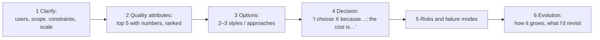

# Architecture Interview Answers

> An architecture interview checks how you think: clarify, rank the quality attributes, compare options, decide with a named trade-off, see the risks, and plan for evolution. Answer in that order, name the cost of every choice, and back it with real decision stories.

Roadmap topic 21 · Stage 7: Interview & Practice (New)

**Go deeper:** every note `1`–`20` · `05-system-design/31-Interview-Answer-Structure` · `06-mobile-engineering/21-Mobile-Interview-Answer-Points` · `08-artificial-intelligence/21-AI-Interview-Answer-Points` · `07-behavioral-leadership` (stories).

**Marks:** 🟢 must know · 🟡 good to know · (New) added beyond the original roadmaps

---

#### 1. What Is It?

*A repeatable way to answer architecture questions and design prompts.*

| 🟢 Must know | 🟡 Good to know |
|---|---|
| structure: clarify → quality attributes → options → decision → risks → evolution | handling disagreement and pushback |
| name the trade-off in every choice | questions to ask about the company's architecture |
| ready answers: monolith vs microservices, choosing a stack, handling change | common traps |
| ready answers: documenting decisions, keeping a design from drifting | |
| one or two real decision stories | |

**Signals in an interview:** "design the architecture for…", "monolith or microservices?", "how would you choose the stack?", "how do you handle change?", "tell me about an architecture decision you made".

---

#### 2. How It Works

**The answer structure.**



**Name the trade-off in every choice.** "I choose a modular monolith because delivery speed and a small team matter most; the cost is shared scaling and a single deploy unit; if one module needs independent scale I'd extract it."

**Ready answers.**

| Question | Core of the answer |
|---|---|
| Monolith vs microservices? | Start from the ranked quality attributes and the team. For most new products a modular monolith: strict module boundaries and per-module data, one deploy. Move to services for independent scaling or independent team deployment, with a clear boundary and platform maturity; otherwise you get a distributed monolith. Costs of services: network latency, partial failure, data consistency (sagas), operations. |
| How do you choose a stack? | Requirements and quality attributes, team skills, maturity and community, operations cost, security, integration, cost and an exit path. Compare 2 to 3 options with a weighted matrix, spike the riskiest assumption, record an ADR. Prefer boring technology unless a new one gives a decisive advantage. |
| How do you handle change? | Make change cheap: small modules with contracts, tests, CI/CD, flags, backward-compatible APIs and data, observability. Migrate incrementally with the strangler pattern; fitness functions guard qualities; track debt with its interest. |
| How do you document decisions? | Short ADRs next to the code (context, options, decision, consequences, review date), C4 diagrams as text in the repo, design docs for big changes; keep them few, owned and current. |
| How do you keep a design from drifting? | Guardrails over gates: templates and paved road, automated architecture tests in CI (dependency rules, cycles, budgets), ownership, light reviews for one-way decisions, regular looks at the real code. |
| How do you design for failure? | Timeouts, bounded retries with jitter, idempotency, circuit breakers, bulkheads, fallbacks, redundancy without SPOFs, SLOs with error budgets, tested failover and restore. |
| How do you design for security? | Defense in depth, least privilege, server-side authz, threat model with STRIDE, small attack surface, secrets in a vault, encryption in transit and at rest. |
| How do you handle old clients? | Add-only APIs, minimum supported version, force-update path, flags, contract tests. |
| How do you decide build vs buy? | Build what differentiates; buy the rest; compare 3-year TCO including upkeep and exit. |
| How do you estimate? | Ranges with assumptions; spike the unknowns; update as you learn. |

**Tell one or two real decision stories** (`07-behavioral-leadership/05` and `06`): context and quality goals, the options and criteria, the evidence (spike/benchmark), the decision and who agreed, the rollout, the result with numbers, what you'd change.

🟡 **Handling disagreement and pushback.** Restate the concern, find the shared goal, bring data or a small experiment, agree who decides, then commit and set a review point. Don't defend an option as "best"; defend it as the best *for these attributes*.

🟡 **Questions to ask about the company's architecture.** What are the top quality attributes and the biggest risks? How are architecture decisions made and recorded? How do teams own services and on-call? How do you handle old versions and deprecations? What does the release and rollback process look like? Where is the biggest technical debt?

🟡 **Common traps.**

| Trap | Instead |
|---|---|
| naming tools first (Kafka, Kubernetes) | start from requirements and trade-offs |
| ignoring constraints (team, budget, deadline) | state them and use them |
| only the happy path | failure modes, security, operations |
| one option | two or three, with a recommendation |
| "it depends" and stop | "it depends on X; given our numbers, Y" |
| over-engineering for scale you don't have | design for the next 10×; say when you'd revisit |
| a design with no evolution | how it starts simple and where it can grow |

---

#### 3. Naive vs Better Design

| Naive answer | Better answer |
|---|---|
| "I'd use microservices, Kafka and Kubernetes." | "Top attributes are X, Y, Z. Given a team of 6, I'd start with a modular monolith…" |
| draws boxes immediately | clarifies, estimates, ranks attributes first |
| "this is the best design" | trade-offs and the cost of the choice |
| silent about failures | failure modes and mitigation |
| no numbers | rough capacity, latency and cost numbers |
| ends at the diagram | rollout, evolution, risks |
| rehearsed buzzwords | plain explanation with an example from experience |

---

#### 4. Templates & Examples

**45-minute split.**

| Step | Time |
|---|---|
| Clarify scope, users, constraints | 5 |
| Quality attributes with numbers and a rough estimate | 7 |
| Options and the decision (with trade-offs) | 10 |
| Design: context/containers, key flow, data, API | 12 |
| Risks, failure, security, operations | 6 |
| Evolution and wrap-up | 5 |

**A worked answer outline: "Design the architecture of a chat app (mobile + backend)".**

```text
1. Clarify: 1:1 and group chat, text + images, 5M daily users, mobile first, must work on poor networks, message history, push when offline.
2. Attributes (ranked): reliability (no lost messages) > latency (delivery < 1 s p95) > availability (99.9%) > security/privacy > cost > maintainability (small team).
   Numbers: 5M DAU × 40 messages = 200M/day ≈ 2.3k msg/s average, ≈ 12k at peak; 10% concurrent = 500k connections; 200M × 200 B = 40 GB/day (≈ 14.6 TB/year).
3. Options: A) polling over REST  B) WebSocket gateway + message service + database  C) a managed chat service (buy).
4. Decision: B for the core (messages are our product; control and cost at scale); buy push (FCM) and media storage/CDN.
   Cost of the choice: we operate a connection layer and need reconnect/recovery logic. Revisit if the team stays under 8 people for a year → compare with a managed service.
5. Design: apps (Room outbox, client ids) → WebSocket gateway (stateless, scaled by connections) → message service (ordering per conversation, idempotent by client id) →
   database partitioned by conversation id → fan-out via queue → push for offline users; media via signed URLs and CDN.
6. Risks: connection storms after outages (jittered reconnect); hot groups (fan-out on read for huge groups); message ordering (per-conversation sequence); abuse (rate limits);
   privacy (encryption in transit/at rest; E2E as a later decision); old app versions (add-only protocol, min version).
7. Evolution: start as a modular monolith (gateway + messages + media modules); extract the gateway first when connections need independent scaling; add search and E2E later.
```

**A decision-story skeleton (60 seconds).**

```text
Context: offline sync lost edits (11% of tickets). Goals: no lost edits; ship in a quarter.
Options: patch vs outbox + cursor vs third-party SDK. Criteria: risk, time, skills, exit path.
Evidence: 2-day spike on 500 queued edits. Decision: outbox + cursor (ADR-007), agreed by Android, backend and product.
Rollout: flag, 5% → 100%. Result: tickets 11% → 2%, crash-free stayed 99.5%. Change: define the success metric and rollback before coding.
```

**Self-check after a mock interview (code).**

```kotlin
val steps = setOf("clarified", "ranked attributes", "numbers", "options", "decision with trade-off", "risks", "security", "operations", "evolution")
fun missing(done: Set<String>) = (steps - done).sorted()
```

Checks: `missing(setOf("clarified", "options", "decision with trade-off"))` → `[evolution, numbers, operations, ranked attributes, risks, security]`. Use it after each practice run.

**Trade-off sentence patterns.**

```text
"I choose ___ because ___ matters most here; the cost is ___; if ___ changes I would ___."
"The alternative was ___; I rejected it because ___ for this team and these numbers."
"This is a two-way (one-way) decision, so I (spiked it / documented it) first."
```

---

#### 5. Numbers & Rules of Thumb

| Item | Guide |
|---|---|
| Clarifying questions | 5 to 8 |
| Quality attributes | top 5, ranked, with numbers |
| Estimates | 3 to 4 numbers: requests per second, peak factor, storage, connections |
| Options | 2 to 3 |
| Diagrams | context + container + one key flow |
| Time on failure and evolution | at least 10 minutes in 45 |
| Stories | prepare 2 architecture stories with numbers |

---

#### 6. Common Mistakes & Edge Cases

1. Technology before requirements.
2. No trade-offs; "best" designs.
3. Ignoring constraints and team size.
4. Happy path only.
5. Over-engineering for imaginary scale.
6. Skipping security, operations, cost.
7. No evolution path.
8. Defending instead of discussing when challenged.

Edge cases: the interviewer changes a requirement (say what it affects, change only that, state the new trade-off); you don't know a technology (reason from the quality attributes and say how you'd learn it); a question about legacy systems (strangler, incremental); a very senior interviewer pressing on a decision (stay calm, give evidence, accept valid points).

---

#### 7. Say This in the Interview

1. "Before I draw anything, let me clarify the users and scale, and agree the top quality attributes with numbers."
2. "I see two or three options; here are their trade-offs against our top attributes. I choose X because…; the cost is…"
3. "The main risks are… and the failure modes are…; here's how I'd detect and handle them."
4. "It starts simple and evolves: here's what I'd revisit at 10× load or with more teams."
5. "I record this as an ADR and guard it with a fitness function so the design doesn't drift."

---

#### 8. Quick Check

1. What is the answer structure?
2. How do you answer "monolith or microservices?"
3. Name two traps.
4. What should every choice include?

<details>
<summary>Answers</summary>

1. Clarify → quality attributes → options → decision → risks → evolution.
2. From the ranked attributes and the team: usually a modular monolith first; services for independent scaling or deployment with a clear boundary.
3. For example: naming tools first; ignoring constraints; only the happy path; no evolution.
4. A named trade-off: what you gain, what it costs, and when you'd revisit.

</details>

---

#### 9. Practice

**Interview questions**

1. Design the architecture of a chat app / notes app / checkout.
2. Monolith vs microservices?
3. How do you choose a technology stack?
4. How do you handle change over time?
5. How do you document decisions and keep a design from drifting?
6. Tell me about an architecture decision you made.
7. What would you ask us about our architecture?

**Exercises**

1. Run the chat-app outline above aloud in 45 minutes and use `missing(...)`.
2. Prepare two architecture decision stories with numbers (one that worked, one you'd change).
3. Write the ready answer for five questions in your own words, 60 seconds each.
4. Do a mock review with a friend who pushes back; practise disagree-and-commit.

**Remember:** clarify → attributes (numbers, ranked) → options → decision with trade-off → risks → evolution · no tools first · constraints matter · failures, security and operations are part of the design · bring real decision stories.
