# Practice: Case Studies & Exercises

> Architecture is learned by doing: write ADRs, draw diagrams, rank quality attributes, compare styles, threat-model, review real systems, and think through case studies out loud.

Roadmap topic 22 · Stage 7: Interview & Practice

**Go deeper:** every note `1`–`21` · `05-system-design/32-Practice-Projects-and-Designs` · `06-mobile-engineering/22-Practice-Projects-and-Exercises` · `07-behavioral-leadership/21-Mock-Interviews-and-Practice-Plan`.

**Marks:** 🟢 must know · 🟡 good to know

---

#### 1. What Is It?

*Nine exercises and five case studies.*

| 🟢 Must know | 🟡 Good to know |
|---|---|
| three ADRs for a real decision | review the architecture of an app you know |
| C4 context and container diagrams for the Notes app | plan a strangler-fig migration |
| top 5 quality attributes for three apps, with numbers | design mobile + backend architecture for an AI feature |
| compare monolith, modular monolith, microservices | run a mock design review |
| threat-model one feature with STRIDE | |
| case studies: notes with sync and offline, chat, payments/checkout | case studies: startup outgrowing a monolith, legacy migration |

**Signals in an interview:** "walk me through an architecture you designed", "show me an ADR you wrote", "how would you approach this system?".

---

#### 2. How It Works

**The practice path.**

```mermaid
flowchart LR
    A["Write 3 ADRs"] --> B["Draw C4 for the Notes app"] --> C["Quality attributes for 3 apps"] --> D["Compare 3 styles"] --> E["Threat-model a feature"] --> F["Review a real app"] --> G["Plan a strangler migration"] --> H["Architect an AI feature"] --> I["Mock design review"]
```



**Exercises, with deliverables and checks.**

| # | Exercise | Deliverable | Check |
|---|---|---|---|
| 1 🟢 | Write three ADRs for real decisions (made or possible) | 3 one-page ADRs | each has context, ≥ 2 options, decision, consequences, review trigger |
| 2 🟢 | Draw C4 context + container diagrams for the Notes app (`BE 12`) | 2 diagrams (Mermaid) | every arrow labelled with what and how |
| 3 🟢 | List the top 5 quality attributes for three different apps with numbers | 3 ASR tables | measurable, ranked |
| 4 🟢 | Compare monolith, modular monolith, microservices for one case | a comparison table + recommendation + "revisit when" | trade-offs named |
| 5 🟢 | Threat-model login or sharing with STRIDE | data-flow diagram + threat table | each threat has a mitigation or accepted risk |
| 6 🟡 | Review an app you know | strengths, risks, debt (with interest), top 3 recommendations | evidence for each point |
| 7 🟡 | Plan a strangler migration for a legacy screen or service | seam, facade, rollout steps, rollback, removal | each step shippable and reversible |
| 8 🟡 | Design the mobile and backend architecture for one AI feature (`AI 22`) | architecture + ASR table + ADRs | gateway, data flow, eval gate |
| 9 🟡 | Run a mock design review with a friend | notes, decisions, actions | strongest objections recorded |

**Case studies to think through.**

| Case | Top attributes | Key decisions | Main risks | Evolution |
|---|---|---|---|---|
| 🟢 **Notes app with sync and offline** | reliability, sync latency, privacy, delivery speed | Room as source of truth; outbox + cursor sync; conflict rule; add-only API; modular monolith backend | lost edits, migrations, old versions, conflicts | extract sync service; real-time collaboration |
| 🟢 **Chat app** | message reliability, latency, availability, cost | WebSocket gateway; per-conversation ordering; client ids; push for offline; partition by conversation | connection storms, hot groups, ordering, abuse | extract gateway; search; E2E encryption |
| 🟢 **Payments / checkout** | correctness, security, availability, auditability | idempotency keys; state machine; ledger; provider adapter + webhooks; reconciliation; strong consistency | double charge, lost webhook, fraud, PCI scope | multiple providers; saga for multi-step orders |
| 🟡 **Startup outgrowing its monolith** | delivery speed, team independence, scalability | modularise first; extract the hottest module; platform basics (CI/CD, observability); data ownership | distributed monolith, ops load, consistency | strangler; team topologies |
| 🟡 **Migration from a legacy backend** | continuity, risk reduction, cost | strangler facade; ACL; shadow traffic; data migration with dual-write; deprecation plan | hidden rules, data drift, long dual-run | decommission; fitness functions |

**How to work a case study (20 minutes).**

1. Clarify (2 min): users, scale, constraints. 2. Attributes with numbers (3 min). 3. Options (3 min). 4. Decision and diagram (5 min). 5. Risks, security, operations (4 min). 6. Evolution (3 min). Then record one ADR.

---

#### 3. Naive vs Better Design

| Naive | Better |
|---|---|
| read about architecture, never write it down | write ADRs and diagrams for real systems |
| practise only "design X" prompts | also review existing systems and plan migrations |
| draw once and forget | keep diagrams in the repo and update them |
| practise silently | explain aloud to a friend; ask for hard questions |
| one perfect answer | explore alternatives and trade-offs |
| ignore failure and security | include STRIDE and failure modes every time |

---

#### 4. Templates & Examples

**ADR quality rubric (use it to review your own ADRs).**

```kotlin
data class Adr(val hasContext: Boolean, val options: Int, val hasDecision: Boolean, val hasConsequences: Boolean, val hasReviewTrigger: Boolean, val namesTradeOff: Boolean)

fun adrScore(a: Adr): Int = listOf(
    a.hasContext, a.options >= 2, a.hasDecision, a.hasConsequences, a.hasReviewTrigger, a.namesTradeOff
).count { it }
```

Checks: a complete ADR `(true, 3, true, true, true, true)` → `6`; one with a single option and no review trigger `(true, 1, true, true, false, true)` → `4`: add an alternative and a revisit date.

**Case study worksheet.**

```text
CASE: ____                      USERS / SCALE: ____             CONSTRAINTS: team ___, budget ___, deadline ___
TOP ATTRIBUTES (ranked, numbers): 1. ____ 2. ____ 3. ____ 4. ____ 5. ____
OPTIONS: A) ____ B) ____ C) ____            DECISION (I choose ___ because ___; the cost is ___; revisit when ___):
DIAGRAMS: context, containers, one key flow (with a failure path)
DATA: owners, store, consistency, retention, privacy      SECURITY: STRIDE highlights, authz, secrets
FAILURES: SPOFs, timeouts/retries/fallbacks, SLOs         OPERATIONS: deploy, observe, cost estimate
EVOLUTION: first slice, next 3 changes, what I'd extract or replace, debt I accept
```

**Estimates for a case (practice numbers).**

```kotlin
fun avgRps(dailyUsers: Long, perUser: Int) = dailyUsers * perUser / 86_400.0
fun storageTbPerYear(eventsPerDay: Long, bytesEach: Int) = eventsPerDay * bytesEach * 365 / 1e12
```

Checks: `avgRps(5_000_000, 40)` → `2314.8`; `storageTbPerYear(200_000_000, 200)` → `14.6` TB for the chat case. Do these numbers in 2 minutes, aloud.

**Review of an app: what to look at.**

```text
Structure: layers, modules, dependency directions, cycles          Data: ownership, source of truth, migrations
Quality: crash-free, ANR, startup, build time, test mix           Delivery: CI/CD, release cadence, rollback, flags
Security: tokens, secrets, authz, dependencies                    Compatibility: API versioning, old versions
Debt register: top 5 with interest                                  Recommendations: 3 changes, in order, with evidence and effort
```

**Mock design review checklist.**

```text
[ ] Document sent 2 days ahead   [ ] Goal and decision needed stated   [ ] Strongest objections first
[ ] Decisions + owners + dates recorded   [ ] ADR updated after the review   [ ] Feedback on tone and clarity
```

**Portfolio set (what to have ready for interviews).**

```text
- 3 ADRs (one adopted, one rejected option explained, one superseded)    - C4 diagrams + 1 sequence diagram of a real app
- 1 threat model                                                         - 1 migration plan (strangler)
- 2 decision stories with numbers                                        - 1 case study you can present in 10 minutes
```

---

#### 5. Numbers & Rules of Thumb

| Item | Guide |
|---|---|
| ADR | one page; 15 to 30 minutes to write |
| C4 diagrams | 5 to 12 boxes each |
| Case study | 20 minutes working, 10 minutes review |
| Mock review | 45 minutes with 3 to 5 people |
| Practice cadence | one exercise a week for 9 weeks; repeat the case studies |
| Quality attributes | 5 per system, with numbers |
| Estimates | do requests per second and storage in under 2 minutes |

---

#### 6. Common Mistakes & Edge Cases

1. Producing diagrams with no decisions or reasons.
2. ADRs with a single option or no consequences.
3. Skipping numbers.
4. Only practising greenfield designs.
5. Never presenting to another person.
6. Treating one case as "the answer".
7. Forgetting failure, security and cost.

Edge cases: no real project to use (use the Notes app or an open-source app); confidential details (generalise); different roles in teams (adapt the exercises to your scope); no one to review (record yourself and critique).

---

#### 7. Say This in the Interview

1. "I write ADRs for the decisions that are costly to reverse. Here is one: context, three options, the decision, the cost, and the review trigger."
2. "For this system I'd draw a context and container diagram, one sequence diagram for the main flow including failure, and keep them in the repo."
3. "I threat-model with STRIDE on a data-flow diagram and record mitigations and accepted risks."
4. "I planned a strangler migration: the facade, the shadow comparison, the rollout steps, the rollback, and the removal of the old path."
5. "I practise case studies out loud with numbers and ask a friend to challenge the trade-offs."

---

#### 8. Quick Check

1. What must an ADR contain?
2. What is the first step of any case study?
3. What makes a diagram useful?
4. Which exercises cover migration and review skills?

<details>
<summary>Answers</summary>

1. Context, options, decision, consequences (plus status and a review trigger).
2. Clarify users, scale and constraints; then agree the quality attributes with numbers.
3. A clear audience, labelled arrows, and a manageable number of boxes.
4. Review an app you know, and plan a strangler-fig migration.

</details>

---

#### 9. Practice

**Interview questions**

1. Walk me through an architecture you designed.
2. Show me an ADR you wrote and explain the trade-off.
3. How would you approach a chat app / checkout / notes app?
4. How would you migrate a legacy system?
5. How do you review an existing architecture?

**Exercises**

1. Do exercises 1 to 5 first (all 🟢), in order.
2. Work two case studies with the worksheet and a timer.
3. Present one case study to a friend and note the questions that stumped you.
4. Build your portfolio set and keep it in a repository.

**Remember:** write it down: ADRs, diagrams, ASRs · numbers every time · compare options, name the trade-off · include failure, security, operations · review real systems and plan migrations · practise aloud and repeat.
