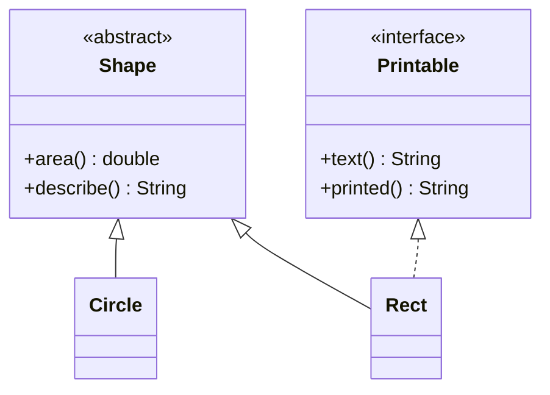
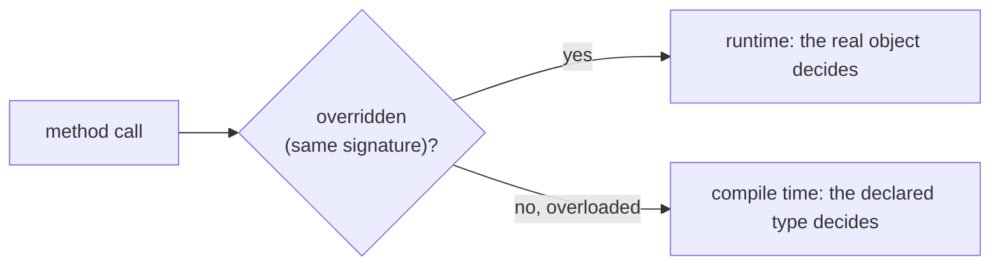

# OOP & Java Basics

> Object-oriented programming organises code into objects that hold data and behaviour. Know the four pillars (encapsulation, abstraction, inheritance, polymorphism), when to choose an interface or an abstract class, and the Java details interviewers love: `equals`/`hashCode`, immutability, `==` vs `equals`, and pass-by-value.

Roadmap topic 23 · Stage 8: Code-Level Foundations (read first if OOP is new)

**Go deeper:** `4` Design Principles · `24` SOLID in Code · `25` Design Patterns in Code · `06-mobile-engineering/02-Kotlin-Essentials` · `03-leetcode-patterns/03-Kotlin for Coding Interviews`.

**Marks:** 🟢 must know · 🟡 good to know

---

#### 1. What Is It?

*The vocabulary that every design discussion uses.*

| 🟢 Must know | 🟡 Good to know |
|---|---|
| class and object | enums and `record` / `data class` |
| encapsulation | nested and inner classes |
| abstraction: abstract class vs interface | `Object` methods and `toString` |
| inheritance and polymorphism | generics: type erasure, bounded types |
| overriding vs overloading | try-with-resources / `use` |
| composition vs inheritance | Java vs Kotlin differences |
| `equals`, `hashCode`, immutability | |
| `==` vs `equals`, pass-by-value | |
| access modifiers, `static`, `final` | |
| checked vs unchecked exceptions | |

1. **Class:** a blueprint (fields + methods). **Object:** one instance of a class, living on the heap.
2. **Encapsulation:** keep data private and change it only through methods that protect the rules.
3. **Abstraction:** show *what* something does, hide *how*.
4. **Inheritance:** a subclass reuses and specialises a parent class ("is-a").
5. **Polymorphism:** one call, different behaviour depending on the real object type.

**Signals in an interview:** "explain the four pillars", "abstract class vs interface", "overloading vs overriding", "why override `hashCode`?", "what does immutable mean?", "is Java pass-by-value?", "`==` vs `equals`?".

---

#### 2. How It Works

**The four pillars.**

| Pillar | Purpose | Example |
|---|---|---|
| Encapsulation | protect rules, change the inside freely | `Account` keeps `balance` private; only `deposit` and `withdraw` change it |
| Abstraction | simple view of a complex thing | `Shape.area()`, callers never see the formula |
| Inheritance | reuse and specialise | `Circle` and `Rect` extend `Shape` |
| Polymorphism | one call, many behaviours | `shape.area()` runs the right code for each shape |



**Abstract class vs interface.**

| | Abstract class | Interface |
|---|---|---|
| State (fields) | yes | no (only constants) |
| Constructor | yes | no |
| Inheritance | a class extends **one** | a class implements **many** |
| Method bodies | yes | `default` methods (Java 8+); Kotlin interfaces can have them too |
| Use it when | related classes share state and code ("is-a") | you define a **capability** or a contract ("can-do") |

Rule of thumb: start with an interface; use an abstract class only when subclasses really share state or a common algorithm.

**Overriding vs overloading.**

| | Overriding | Overloading |
|---|---|---|
| Meaning | subclass replaces a parent method (same signature) | same name, different parameters |
| Chosen | at **runtime**, by the object's real type | at **compile time**, by the declared types |
| Example | `Dog.sound()` replaces `Animal.sound()` | `meet(Animal)` and `meet(Dog)` |



**Composition vs inheritance.** Inheritance ("is-a") ties a subclass to its parent's details. Composition ("has-a") builds behaviour from small parts you can swap. Prefer composition; inherit only for a true is-a with stable parent code (topic 4).

**`equals` and `hashCode` contract.** If two objects are equal, they **must** have the same hash code. `HashMap` and `HashSet` find the bucket with `hashCode()` first, then compare with `equals()`. Override both, or neither. `equals` must be reflexive, symmetric, transitive and consistent.

**`==` vs `equals`.** For objects in Java, `==` compares **references** (same object?) and `equals` compares **content**. String literals are shared (the string pool), but `new String("java")` makes a new object. `Integer` values from -128 to 127 are cached, so `==` can look like it works, then fail at 1000. In Kotlin, `==` calls `equals`, and `===` compares references.

**Pass-by-value.** Java always copies the argument. For objects, the copy is of the **reference**, so a method can change the object's contents but cannot make the caller's variable point somewhere else.

**Immutability.** An immutable object never changes after creation, so it is safe to share and to use as a map key. Recipe: `final` class, `private final` fields, no setters, copy mutable inputs and outputs (defensive copies).

**Exceptions.** *Checked* exceptions (like `IOException`) must be caught or declared. *Unchecked* ones (`RuntimeException`, `Error`) need not. Kotlin has no checked exceptions. Use try-with-resources (Java) or `use {}` (Kotlin) so resources close even on failure.

**Generics.** `List<String>` checks types at compile time. At runtime the type argument is erased. A bound like `<T extends Comparable<T>>` lets you call `compareTo`.

**Access modifiers.**

| Java | Kotlin | Visible to |
|---|---|---|
| `public` | `public` (default) | everyone |
| `protected` | `protected` | subclasses (Java: also the same package) |
| package-private (default) | `internal` | Java: same package · Kotlin: same module |
| `private` | `private` | the class (Kotlin: or the file) |

---

#### 3. Naive vs Better Design

| Naive | Better |
|---|---|
| public mutable fields | private fields + methods that enforce the rules |
| `equals` without `hashCode` | override both (or use `record` / `data class`) |
| deep inheritance to reuse code | composition and small interfaces |
| comparing strings with `==` | `equals` (Kotlin `==`) |
| exposing an internal `List` | return a copy or an unmodifiable view |
| a giant base class "just in case" | a small interface plus a helper object |
| catching `Exception` and ignoring it | catch the specific type and handle or rethrow |

```java
// Naive: anyone can break the rule
class Account { public long balance; }
// acct.balance = -500;   // nothing stops this
```

---

#### 4. Templates & Examples

**Encapsulation (Java, then Kotlin).**

```java
class Account {
    private long balance;
    Account(long initial) { if (initial < 0) throw new IllegalArgumentException("negative"); balance = initial; }
    void deposit(long c) { if (c <= 0) throw new IllegalArgumentException("amount"); balance += c; }
    boolean withdraw(long c) { if (c <= 0 || c > balance) return false; balance -= c; return true; }
    long balance() { return balance; }
}
```

```kotlin
class Account(initial: Long) {
    var balance: Long = initial.also { require(it >= 0) { "negative" } }
        private set
    fun deposit(c: Long) { require(c > 0) { "amount" }; balance += c }
    fun withdraw(c: Long): Boolean { if (c <= 0 || c > balance) return false; balance -= c; return true }
}
```

Checks (run in Java): open with `100`, deposit `50` → `150`; `withdraw(500)` → `false`, balance still `150`; `withdraw(30)` → `true`, balance `120`; `new Account(-1)` throws `IllegalArgumentException("negative")`.

**Abstraction and polymorphism.**

```java
abstract class Shape {
    abstract double area();
    String describe() { return getClass().getSimpleName() + " area=" + String.format("%.2f", area()); }
}
class Circle extends Shape { final double r; Circle(double r) { this.r = r; } double area() { return Math.PI * r * r; } }
class Rect extends Shape { final double w, h; Rect(double w, double h) { this.w = w; this.h = h; } double area() { return w * h; } }
```

```kotlin
abstract class Shape {
    abstract fun area(): Double
    fun describe() = "${this::class.simpleName} area=${"%.2f".format(area())}"
}
class Circle(private val r: Double) : Shape() { override fun area() = Math.PI * r * r }
class Rect(private val w: Double, private val h: Double) : Shape() { override fun area() = w * h }
```

Checks: for `listOf(Circle(1.0), Rect(2.0, 3.0))`, calling `describe()` on each prints `Circle area=3.14` and `Rect area=6.00`. The loop never asks "what kind of shape?", so adding `Triangle` changes nothing else.

**Interface with a default method.**

```java
interface Printable { String text(); default String printed() { return "[" + text() + "]"; } }
// Printable p = () -> "hi";   p.printed() -> "[hi]"
```

```kotlin
fun interface Printable { fun text(): String; fun printed() = "[${text()}]" }
val p = Printable { "hi" }       // p.printed() -> "[hi]"
```

Checks: `p.printed()` → `[hi]`. If two interfaces give the same default method, the class must override it and choose (`A.super.m()` in Java, `super<A>.m()` in Kotlin).

**Overriding vs overloading: the classic trap.**

```java
class Animal { String sound() { return "..."; } String meet(Animal a) { return "animal meets animal"; } }
class Dog extends Animal { @Override String sound() { return "woof"; }
                           String meet(Dog d) { return "dog meets dog"; } }    // overload, not override
// Animal an = new Dog();  Dog d = new Dog();
```

Checks: `an.sound()` → `woof` (override: real type decides). `d.meet(an)` → `animal meets animal` (the argument's *declared* type is `Animal`). `d.meet(d)` → `dog meets dog`. `an.meet(d)` → `animal meets animal` (the receiver's declared type `Animal` has only `meet(Animal)`).

**`equals` and `hashCode`.**

```java
class GoodPoint { final int x, y; GoodPoint(int x, int y) { this.x = x; this.y = y; }
    @Override public boolean equals(Object o) { return o instanceof GoodPoint p && p.x == x && p.y == y; }
    @Override public int hashCode() { return Objects.hash(x, y); } }
```

```kotlin
data class Pt(val x: Int, val y: Int)      // equals, hashCode, toString, copy are generated
```

Checks: with a `HashSet` holding `new BadPoint(1, 2)` (has `equals` but no `hashCode`), `contains(new BadPoint(1, 2))` → `false` in this run (the two objects get different identity hashes). With `GoodPoint` → `true`. A Java `record Pt(int x, int y)` gives `Pt[x=1, y=2]` and equal points are `equals`; a Kotlin `data class` prints `Pt(x=1, y=2)`.

**`==` vs `equals` in Java.**

```java
String a = "java", b = "java", c = new String("java");
// a == b -> true   a == c -> false   a.equals(c) -> true   c.intern() == a -> true
Integer x = 127, y = 127, p = 1000, q = 1000;
// x == y -> true   p == q -> false   p.equals(q) -> true
```

Checks (from a real run): `true false true true`, then `true false true`. The `Integer` cache covers -128 to 127 by default.

**Pass-by-value.**

```java
static void change(int[] arr, int n, StringBuilder sb) { arr[0] = 99; n = 99; sb.append("!"); arr = new int[]{7}; }
// int[] arr = {1}; int n = 1; StringBuilder sb = new StringBuilder("hi"); change(arr, n, sb);
```

Checks: after the call `arr[0]` is `99` (contents changed), `n` is still `1` (primitive copied), `sb` is `hi!` (contents changed). The reassignment `arr = new int[]{7}` inside the method is invisible to the caller.

**Immutability and defensive copies.**

```java
final class Schedule { private final List<String> items; Schedule(List<String> in) { items = List.copyOf(in); } int size() { return items.size(); } }
```

```kotlin
class Schedule(items: List<String>) { private val items: List<String> = items.toList(); val size get() = items.size }
```

Checks: build `Schedule` from a list of 2 items, then add a third item to the original list: `schedule.size` is still `2`, the original list has `3`.

**Generics and erasure.**

```java
static <T extends Comparable<T>> T max(List<T> xs) { T best = xs.get(0); for (T x : xs) if (x.compareTo(best) > 0) best = x; return best; }
```

Checks: `max(List.of(3, 9, 4))` → `9`; `max(List.of("b", "z", "a"))` → `z`. `new ArrayList<String>().getClass() == new ArrayList<Integer>().getClass()` → `true` (erasure).

**Closing resources.**

```java
try (Res r1 = new Res("A"); Res r2 = new Res("B")) { System.out.println("work"); }
```

```kotlin
Res("A").use { a -> Res("B").use { b -> println("work") } }
```

Checks: prints `open A`, `open B`, `work`, `close B`, `close A`. Resources close in reverse order, even when an exception is thrown.

**Java vs Kotlin: quick table.**

| Idea | Java | Kotlin |
|---|---|---|
| Inherit from a class | open by default | `final` by default; write `open` |
| Override | `@Override` (recommended) | `override` (required) |
| Static members | `static` | `companion object` or top-level functions |
| Singleton | enum or holder class | `object` |
| Value class with `equals` | `record` (Java 16+) | `data class` |
| Reference equality | `==` | `===` |
| Content equality | `.equals()` | `==` |
| Checked exceptions | yes | no |
| Null safety | annotations only | built into the type (`String?`) |

---

#### 5. Numbers & Rules of Thumb

| Item | Guide |
|---|---|
| Inheritance depth | 1 to 2 levels |
| Interface size | 1 to 5 methods |
| Class | one clear job; fields private; split when it has several reasons to change |
| `equals` / `hashCode` | always override together |
| `Integer` cache | -128 to 127 (default) |
| Mutable keys | never use a mutable object as a `HashMap` key |
| Inheritance vs interface | a class extends 1 class, implements many interfaces |
| Constructor parameters | 3 or fewer; use a builder or a data class beyond that (topic 25) |

---

#### 6. Common Mistakes & Edge Cases

1. Overriding `equals` but not `hashCode`.
2. Comparing strings or boxed numbers with `==`.
3. Using inheritance only to reuse code.
4. Returning an internal mutable list.
5. Confusing overloading with overriding (the "classic trap" above).
6. Calling an overridable method from a constructor (the subclass runs before its fields are set).
7. Believing "Java passes objects by reference".
8. Catching `Exception` and doing nothing.
9. Mutable `HashMap` keys that change after insertion.
10. Making everything `public`.

Edge cases: `null` in `equals` (the method must return `false`); `equals` symmetry with subclasses; `float`/`double` comparison with `==`; `hashCode` changes when a mutable field changes; interface default-method conflicts.

---

#### 7. Say This in the Interview

1. "OOP has four ideas: encapsulation keeps data private behind methods, abstraction hides details, inheritance reuses a parent, and polymorphism lets one call run different code depending on the real type."
2. "I start with an interface for a capability. I use an abstract class only when subclasses share state or an algorithm."
3. "Overriding is decided at runtime by the object, overloading at compile time by the declared types."
4. "If I override `equals`, I override `hashCode` too, because hash-based collections find the bucket first and compare second."
5. "Java is pass-by-value: the reference is copied, so a method can change the object but not the caller's variable."
6. "I make classes immutable when I can: final fields, no setters, defensive copies. They are safe to share and to use as map keys."
7. "I prefer composition to inheritance."

---

#### 8. Quick Check

1. Abstract class or interface: which can hold state?
2. Why must you override `hashCode` with `equals`?
3. What does `new String("a") == "a"` give in Java, and why?
4. After `change(arr, n, sb)` in the pass-by-value example, why is `n` unchanged?

<details>
<summary>Answers</summary>

1. The abstract class. An interface has no instance state.
2. Hash-based collections look in the bucket from `hashCode()` first. Equal objects with different hashes land in different buckets, so lookups fail.
3. `false`. `new` creates a separate object; `==` compares references. `equals` would be `true`.
4. The method received a copy of the number. Changing the copy does not change the caller's variable.

</details>

---

#### 9. Practice

**Interview questions**

1. Explain the four pillars with an example.
2. Abstract class vs interface: when do you choose each?
3. Overloading vs overriding?
4. `==` vs `equals`; why does `Integer` 127 behave differently from 1000?
5. How do you create an immutable class?
6. Is Java pass-by-value or pass-by-reference?
7. Checked vs unchecked exceptions?
8. Composition vs inheritance: give an example.
9. What happens if you override `equals` but not `hashCode`?
10. Why are `String`s immutable?

**Exercises**

1. Write `Account` with private state and tests for the rules (negative deposit, overdraft).
2. Model `Shape` with `Circle`, `Rect`, `Triangle`; sum the areas in one loop without `instanceof`.
3. Break `equals`/`hashCode` on purpose and watch a `HashSet` fail; then fix it.
4. Convert a class with public fields into an immutable class with a copy method.
5. Read your own app code: find one place where inheritance should be composition.

**LeetCode (class design basics, Easy → Medium)**

| # | Question | Practises |
|---|---|---|
| 1603 | [Design Parking System](https://leetcode.com/problems/design-parking-system/) (Easy) | a small class with state and rules |
| 706 | [Design HashMap](https://leetcode.com/problems/design-hashmap/) (Easy) | `hashCode`, buckets, `equals` |
| 232 | [Implement Queue using Stacks](https://leetcode.com/problems/implement-queue-using-stacks/) (Easy) | composition |
| 155 | [Min Stack](https://leetcode.com/problems/min-stack/) (Medium) | encapsulating extra state |
| 1472 | [Design Browser History](https://leetcode.com/problems/design-browser-history/) (Medium) | object design with a clear API |
| 146 | [LRU Cache](https://leetcode.com/problems/lru-cache/) (Medium) | composition of a map and a list |

**Remember:** encapsulate · abstract · inherit sparingly · polymorphism removes `if (type)` · `equals` and `hashCode` together · `==` is a reference check in Java · Java is pass-by-value · prefer immutable.
