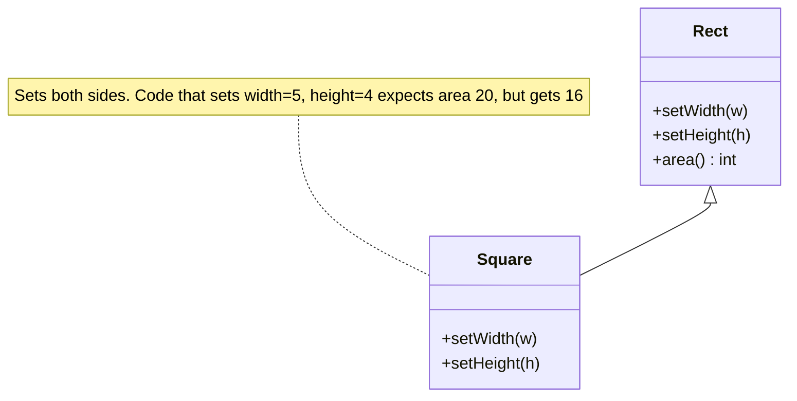
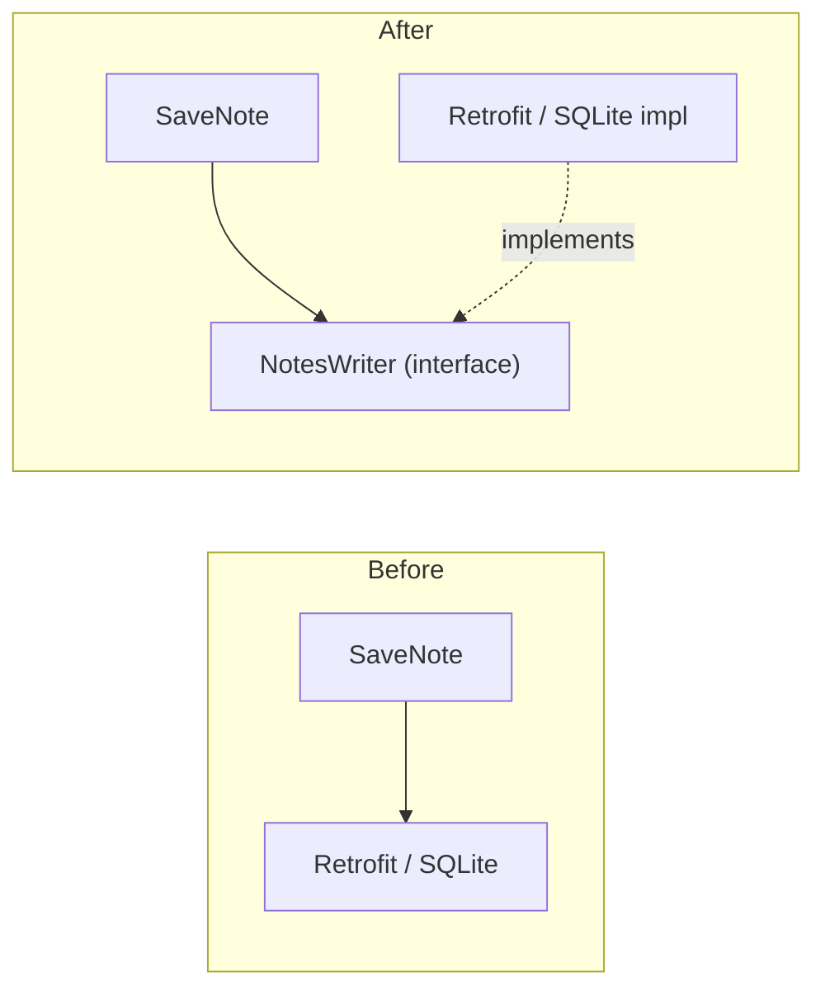
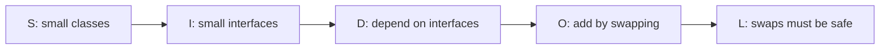
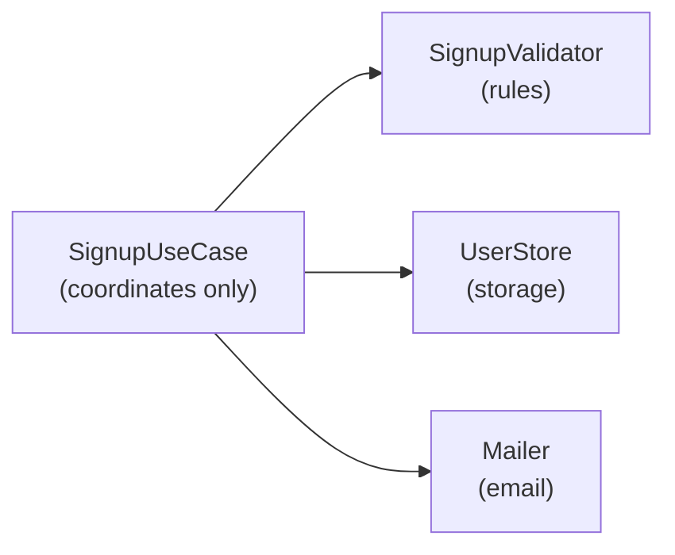

# SOLID in Code

> SOLID is five habits that keep classes easy to change: one reason to change, extend instead of edit, subtypes that keep their promises, small interfaces, and depend on abstractions. Learn each as a smell, a fix, and a one-line test, then practise on real code (signup, payments, ViewModels, listeners).

Roadmap topic 24 · Stage 8: Code-Level Foundations

**Go deeper:** `4` Design Principles (cohesion, coupling, DRY/KISS/YAGNI) · `23` OOP & Java Basics · `25` Design Patterns in Code · `06-mobile-engineering/07-Dependency-Injection-and-Modularization`.

**Marks:** 🟢 must know · 🟡 good to know

---

#### 1. What Is It?

*Five questions you can ask about any class.*

| 🟢 Must know | 🟡 Good to know |
|---|---|
| **S**ingle responsibility | how SOLID maps to patterns |
| **O**pen–closed | when SOLID is overkill |
| **L**iskov substitution | spotting violations in code review |
| **I**nterface segregation | SOLID in Android code (ViewModel, listeners, `Clock`) |
| **D**ependency inversion | sealed class (closed set) vs interface (open set) |

| Letter | One-line test |
|---|---|
| S | "Does this class have more than one reason to change?" |
| O | "To add a new case, do I edit old code, or only add new code?" |
| L | "Can I use any subtype wherever the parent is expected, without surprises?" |
| I | "Is any class forced to implement methods it does not use?" |
| D | "Does my business code depend on a concrete library, or on an interface?" |

**Why it matters (in one line each).**

| Without it | With it |
|---|---|
| One change breaks three unrelated features | A change touches one small class |
| Every new payment type edits 10 files | A new payment type is one new class |
| Tests need a real network or database | Tests use a small fake |
| Subclasses behave in surprising ways | Any subtype is safe to pass around |

**Signals in an interview:** "explain SOLID with an example", "give a Liskov violation", "how do you add a payment method without changing old code?", "why use interfaces?", "how would you make this ViewModel testable?".

---

#### 2. How It Works

**S: Single responsibility.** A class has one job and therefore one reason to change. *Smell:* a class that mixes calculation, formatting, networking and storage; its name contains "And" or "Manager". *Fix:* split by reason to change.

*Tip:* "one responsibility" does not mean "one method". It means one *actor* who asks for changes (the business rules owner, the designer, the DBA). If two different people can ask you to change the same class for different reasons, split it.

**O: Open–closed.** Open for extension, closed for modification. *Smell:* the same `when (type)` / `if-else` chain repeated in several files, edited every time a new type appears. *Fix:* put each case behind an interface (strategy) and register new cases.

**L: Liskov substitution.** If `B` is a subtype of `A`, code written for `A` must work with `B`. A subtype may not strengthen what it requires or weaken what it promises. *Smell:* a subclass that throws `UnsupportedOperationException`, has an empty override, or needs `is`/`instanceof` checks by callers. *Fix:* model what really holds (separate interfaces, or composition).



Three ways a subtype breaks the promise:

| Break | Example |
|---|---|
| Stronger requirement (precondition) | parent accepts any amount, child rejects amounts over 500 |
| Weaker result (postcondition) | parent returns a sorted list, child returns an unsorted one |
| Surprise behaviour | child throws `UnsupportedOperationException` or does nothing |

**I: Interface segregation.** Many small, focused interfaces beat one big one. *Smell:* implementers with `TODO()` bodies. *Fix:* split into role interfaces (`NotesReader`, `NotesWriter`).

**D: Dependency inversion.** High-level code and low-level code both depend on an abstraction, which the high-level code owns. *Smell:* a ViewModel that creates Retrofit or a database directly. *Fix:* depend on an interface; pass the implementation in (constructor injection).



**How SOLID connects to patterns.**

| Principle | Common tools |
|---|---|
| S | split classes; facade; extract function |
| O | strategy, decorator, factory, template method |
| L | proper interfaces; composition instead of inheritance |
| I | role interfaces, adapters |
| D | dependency injection, repository, adapter |

**The principles work together.** Splitting a class (S) gives you small pieces. Putting each piece behind an interface (D, I) lets you swap them. Swapping instead of editing is the open–closed idea (O). And every swapped piece must keep its promise (L).



---

#### 3. Naive vs Better Design

| Naive | Better |
|---|---|
| one `ReportService` that calculates, formats and saves | three small pieces, wired together |
| `when (plan)` copied into five files | a map or list of `Pricing` strategies |
| `Square` extends `Rect` with setters | immutable shapes behind one `Shape` interface |
| one `NotesRepository` with 12 methods | `NotesReader` + `NotesWriter` |
| ViewModel creates `Retrofit` | ViewModel receives a `NotesRepo` |
| `Bird.fly()` and `Penguin` throws | `Bird` and `FlyingBird` are separate types |
| `System.currentTimeMillis()` inside the logic | a `Clock` passed in, fixed in tests |
| a `Worker` interface with `work()` and `eat()` that a robot also implements | `Workable` and `Eatable` |

**Naive: one class doing everything.**

```kotlin
// Naive: calculates, formats and saves in one place, so a change to any of the three edits this class
class ReportService(private val db: Database) {
    fun run(items: List<Int>) {
        var t = 0L; for (i in items) t += i
        db.insert("Total: $t")
    }
}
```

**Naive: a signup function that does five jobs.**

```kotlin
class SignupManager(private val db: Database) {
    fun signup(email: String, name: String): String {
        if (!email.contains("@")) return "bad email"            // validation rules
        if (name.isBlank()) return "name required"
        db.insert("users", email, name)                         // storage
        SmtpClient("smtp.example.com").send(email, "Welcome $name")   // email provider
        return "ok"
    }
}
```

Why it hurts: a new rule, a new database and a new mail provider all edit this one class, and a unit test needs a real database and a real SMTP server.

---

#### 4. Templates & Examples

*Checks come from running the same logic in Java on JDK 21. The Kotlin versions were not compiled.*

##### S: Single responsibility

**Example 1: split by reason to change.**

```kotlin
fun total(items: List<Int>): Long = items.sumOf { it.toLong() }     // changes with business rules
fun format(total: Long) = "Total: $total"                           // changes with wording
fun interface Store { fun save(s: String) }                         // changes with storage

// wiring: store.save(format(total(listOf(10, 20, 30))))
```

Checks: saving through a `Store` that appends to a list gives `[Total: 60]`. Each piece can be tested alone, and changing the wording touches only `format`.

**Example 2: the signup class, split.**

```kotlin
data class User(val email: String, val name: String)
fun interface UserStore { fun save(u: User) }
fun interface Mailer { fun send(to: String, body: String) }

class SignupValidator {
    fun errors(email: String, name: String): List<String> = buildList {
        if (!email.contains("@")) add("bad email")
        if (name.isBlank()) add("name required")
    }
}

class SignupUseCase(
    private val validator: SignupValidator,
    private val store: UserStore,
    private val mailer: Mailer,
) {
    fun run(email: String, name: String): String {
        val errs = validator.errors(email, name)
        if (errs.isNotEmpty()) return "invalid: $errs"
        store.save(User(email, name))
        mailer.send(email, "Welcome $name")
        return "ok"
    }
}
```

Checks: with a list as the store and a list as the mailer, `run("a@x.com", "Asha")` → `ok`, the store holds one user and the mailer one message `a@x.com:Welcome Asha`. `run("nope", " ")` → `invalid: [bad email, name required]` and nothing is saved or sent (store size stays `1`).



*Reading the picture:* the use case only coordinates. Each box changes for exactly one reason.

##### O: Open–closed

**Example 1: add a case without editing old code.**

```kotlin
fun interface Pricing { fun price(base: Long): Long }

val pricing = mutableMapOf(
    "regular" to Pricing { it },
    "student" to Pricing { it * 80 / 100 },
    "member"  to Pricing { it * 90 / 100 },
)
fun priceFor(plan: String, base: Long) = (pricing[plan] ?: pricing.getValue("regular")).price(base)

// later:  pricing["senior"] = Pricing { it * 70 / 100 }      // priceFor is not edited
```

Checks: `priceFor("student", 1000)` → `800`, `"member"` → `900`, `"unknown"` → `1000` (falls back to regular). After registering `"senior"`, `priceFor("senior", 1000)` → `700`.

**Example 2: notification channels.** Naive code has `if (channel == "push") … else if (channel == "email") …` in every place that sends a notification. Better: one interface, and a list of implementations.

```kotlin
fun interface Notifier { fun send(msg: String): String }

val notifiers = mutableListOf(
    Notifier { "push:$it" },
    Notifier { "email:$it" },
)
fun notifyAll(msg: String) = notifiers.map { it.send(msg) }

// later:  notifiers += Notifier { "sms:$it" }        // notifyAll is not edited
```

Checks: `notifyAll("hi")` → `[push:hi, email:hi]`. After adding SMS: `[push:hi, email:hi, sms:hi]`.

**Example 3: payment methods in a map.**

```kotlin
fun interface Payment { fun pay(amount: Int): String }

val payments = mapOf(
    "card" to Payment { "card $it" },
    "upi"  to Payment { "upi $it" },
)
// payments.getValue("card").pay(500) -> "card 500"
```

Checks: `payments["card"].pay(500)` → `card 500` and `payments["upi"].pay(200)` → `upi 200`.

**Sealed class or interface?** Both are "extension" styles, but they suit different cases.

| Use | When | Trade-off |
|---|---|---|
| `sealed` class/interface + `when` | the set of cases is **closed and known** (UI state: `Loading`, `Success`, `Error`) | compiler forces you to handle every case; adding a case means updating each `when` |
| interface + implementations | the set of cases is **open** and grows (payment methods, discounts, notification channels) | new cases need no edits to old code |

Rule of thumb: states of one screen → `sealed`; plug-in behaviours → interface.

##### L: Liskov substitution

**Example 1: the Rectangle and Square violation, and the fix.**

```kotlin
// Violation
open class Rect {
    protected var w = 0; protected var h = 0
    open fun setWidth(v: Int) { w = v }
    open fun setHeight(v: Int) { h = v }
    fun area() = w * h
}
class Square : Rect() {
    override fun setWidth(v: Int) { w = v; h = v }           // surprises callers
    override fun setHeight(v: Int) { w = v; h = v }
}
fun resize(r: Rect): Int { r.setWidth(5); r.setHeight(4); return r.area() }

// Fix: no setters; each shape keeps its own promise
interface Shape { fun area(): Int }
data class RectS(val w: Int, val h: Int) : Shape { override fun area() = w * h }
data class SquareS(val side: Int) : Shape { override fun area() = side * side }
```

Checks: `resize(Rect())` → `20`; `resize(Square())` → `16`, but a caller of `Rect` expected `20`, so `Square` is not a safe substitute. After the fix, `RectS(5, 4).area()` → `20` and `SquareS(4).area()` → `16`, both correct.

**Example 2: the flying bird.**

```kotlin
// Violation: every Bird must fly, but a penguin cannot
open class BadBird { open fun fly(): String = "flies" }
class BadPenguin : BadBird() { override fun fly(): String = throw UnsupportedOperationException() }

// Fix: model what is true
interface Bird { val name: String }
interface FlyingBird : Bird { fun fly(): String }

class Sparrow : FlyingBird { override val name = "sparrow"; override fun fly() = "sparrow flies" }
class Penguin : Bird { override val name = "penguin" }

fun launch(b: FlyingBird) = b.fly()          // a Penguin cannot even be passed here
```

Checks: `launch(Sparrow())` → `sparrow flies`; `Penguin().name` → `penguin`. A `Penguin` passed to `launch` is a compile error, which is better than a crash at run time.

**Example 3: a stronger precondition.**

```kotlin
open class Account {
    var balance = 1000
    open fun withdraw(x: Int) {
        require(x in 1..balance) { "bad amount" }
        balance -= x
    }
}
class LimitedAccount : Account() {
    override fun withdraw(x: Int) {
        check(x <= 500) { "limit" }               // new rule the parent never had
        super.withdraw(x)
    }
}
```

Checks: `Account().withdraw(600)` works (balance `400`), but `LimitedAccount().withdraw(600)` throws `limit`. Code that was fine with any `Account` now fails with a subtype.

*Fix:* do not hide the limit in a subclass. Make it an explicit policy object (`WithdrawalLimit`) passed to the account, or a separate type that callers know has a limit.

**Quick LSP test.** Run the parent's tests against the subclass. Any failure means the subclass is not a true subtype.

##### I: Interface segregation

**Example 1: role interfaces.**

```kotlin
interface NotesReader { fun all(): List<String> }
interface NotesWriter { fun save(body: String) }

class MemoryRepo : NotesReader, NotesWriter {
    private val data = mutableListOf<String>()
    override fun all() = data.toList()
    override fun save(body: String) { data += body }
}
class ReadOnlyRepo : NotesReader { override fun all() = listOf("x", "y") }   // no fake save() needed

fun count(r: NotesReader) = r.all().size
```

Checks: after two `save` calls, `count(memoryRepo)` → `2`; `count(ReadOnlyRepo())` → `2`. The read-only class never has to throw from a method it should not have.

**Example 2: Worker and Robot.**

```kotlin
// Fat interface: a robot is forced to implement eat()
interface BadWorker { fun work(): String; fun eat(): String }

// Segregated
interface Workable { fun work(): String }
interface Eatable { fun eat(): String }

class Human : Workable, Eatable { override fun work() = "human works"; override fun eat() = "human eats" }
class Robot : Workable { override fun work() = "robot works" }

fun runShift(ws: List<Workable>) = ws.map { it.work() }
```

Checks: `runShift(listOf(Human(), Robot()))` → `[human works, robot works]`.

**Example 3: Android listeners with many callbacks.** `TextWatcher` has three methods, but most screens need only one. Two ways to avoid empty overrides:

```kotlin
// 1. A small interface with default methods: override only what you need
interface TextListener {
    fun before(s: String) {}
    fun changed(s: String) {}
    fun after(s: String) {}
}
val l = object : TextListener { override fun after(s: String) = println("after $s") }

// 2. Or a function type when only one event matters
fun onTextChanged(listener: (String) -> Unit) { /* ... */ }
```

Checks: calling `before("x")`, `changed("x")`, `after("x")` on the first listener prints only `after x`. The `doAfterTextChanged { }` extension in Android KTX exists for the same reason: you pass only the event you care about.

##### D: Dependency inversion

**Example 1: depend on an abstraction, test with a fake.**

```kotlin
fun interface Formatter { fun format(t: String): String }

class SaveNote(private val f: Formatter, private val w: NotesWriter) {
    fun run(t: String) = w.save(f.format(t))
}

val markdown = Formatter { Regex("""\*\*(.+?)\*\*""").replace(it, "<b>$1</b>") }
val plain = Formatter { it }
```

Checks: with a `MemoryRepo` as the fake writer, `SaveNote(markdown, repo).run("**hi**")` then `SaveNote(plain, repo).run("**hi**")` leaves `[<b>hi</b>, **hi**]`. No network or database was needed, and a new `HtmlFormatter` changes nothing in `SaveNote`.

**Example 2: a ViewModel and a repository (the Android classic).**

```kotlin
// Naive: ViewModel builds the dependency itself, so it cannot be tested without a real network
class NotesViewModelBad : ViewModel() {
    private val api = Retrofit.Builder().baseUrl("https://x").build().create(NotesApi::class.java)
}

// Better: depend on an interface the ViewModel owns; receive the implementation
interface NotesRepo { fun all(): List<String> }

class NotesViewModel(private val repo: NotesRepo) : ViewModel() {
    fun title(): String {
        val n = repo.all()
        return if (n.isEmpty()) "No notes yet" else "${n.size} notes"
    }
}
// production:  NotesViewModel(RetrofitNotesRepo(api))
// test:        NotesViewModel(NotesRepo { listOf("a", "b", "c") })
```

Checks: with a fake that returns an empty list, `title()` → `No notes yet`; with three items → `3 notes`. The test needs no Android framework or network.

**Example 3: time as a dependency.** Code that calls the system clock directly is hard to test, because the answer changes with the real time.

```kotlin
fun interface Clock { fun hour(): Int }

class Greeter(private val clock: Clock) {
    fun greet() = when {
        clock.hour() < 12 -> "Good morning"
        clock.hour() < 18 -> "Good afternoon"
        else -> "Good evening"
    }
}
// production: Greeter { LocalTime.now().hour }
// test:       Greeter { 9 }.greet()
```

Checks: hours `9`, `14`, `21` give `Good morning`, `Good afternoon`, `Good evening`, every time, on any day. The same idea works for random numbers, UUIDs and network connectivity.

**Dependency inversion, injection, inversion of control: the three words.**

| Term | Meaning | Example |
|---|---|---|
| Dependency **inversion** | the design rule: depend on abstractions | `SaveNote` knows `NotesWriter`, not Retrofit |
| Dependency **injection** | the technique: pass dependencies in | constructor parameter, Hilt, Koin |
| **Inversion of control** | the framework calls you | Android calls `onCreate`, not you |

##### Putting it together: one refactor, step by step

**Start: a checkout that breaks four principles.**

```kotlin
class Checkout {
    fun run(items: List<Item>, code: String): String {
        var t = 0L
        for (i in items) t += i.price * i.qty              // calculation
        if (code == "SAVE10") t = t * 90 / 100             // discount rules inline
        else if (code == "HALF") t = t / 2
        return StripeApi.charge(t)                         // concrete payment library
    }
}
```

| Problem | Principle | Step |
|---|---|---|
| calculating and charging in one class | S | move the subtotal into its own function |
| a new code means editing `run` | O | put discounts in a map of `Discount` |
| `StripeApi` is hard-wired | D | depend on a `PaymentGateway` interface |
| tests would hit the real gateway | D | inject a fake gateway |

**After.**

```kotlin
data class Item(val name: String, val price: Long, val qty: Int)

fun interface Discount { fun apply(total: Long): Long }
fun interface PaymentGateway { fun charge(amount: Long): String }

class Checkout(
    private val discounts: Map<String, Discount>,
    private val gateway: PaymentGateway,
) {
    fun subtotal(items: List<Item>) = items.sumOf { it.price * it.qty }

    fun run(items: List<Item>, code: String): String {
        val total = (discounts[code] ?: Discount { it }).apply(subtotal(items))
        return gateway.charge(total)
    }
}

// production: Checkout(mapOf("SAVE10" to Discount { it * 90 / 100 }), StripeGateway())
```

Checks: with items `pen 50 × 4` and `book 300 × 1`, `subtotal` → `500`. With a fake gateway that records the amount: `run(items, "SAVE10")` → `charged 450`, `run(items, "NONE")` → `charged 500`; recorded amounts `[450, 500]`. After adding `"HALF" to Discount { it / 2 }`, `run(items, "HALF")` → `charged 250` without editing `Checkout`.

**Where is each principle?** S: `subtotal` and the discounts are separate. O: a new code is a new map entry. D: `Checkout` knows `PaymentGateway`, not Stripe. L: every `Discount` is a pure function from a total to a total, so any of them can be swapped. I: both interfaces have one method.

##### Smell → principle quick table

| What you see in code | Principle | First move |
|---|---|---|
| Class name ends in `Manager`, `Helper`, `Utils` and has 20 methods | S | list the reasons to change, split |
| `when (type)` copied in several files | O | strategy map or interface |
| `if (x is Square)` in code that takes a `Rect` | L | separate types, or composition |
| `override fun save() { TODO() }` | I | split the interface |
| `Retrofit.Builder()` inside a ViewModel | D | interface + constructor injection |
| `System.currentTimeMillis()` inside business logic | D | inject a `Clock` |
| a test needs a database for pure logic | S and D | separate logic from storage |

**Code-review checklist.**

```text
[ ] Class name needs "And" or "Manager" to describe it            (S)
[ ] The same when/if chain on a type appears in several files     (O)
[ ] A subclass throws UnsupportedOperationException or is empty   (L)
[ ] Implementers leave methods as TODO()                          (I)
[ ] Business code imports a concrete library class                (D)
```

---

#### 5. Numbers & Rules of Thumb

| Item | Guide |
|---|---|
| Class size | a few hundred lines; split when you can name two reasons to change |
| Interface size | 1 to 5 methods |
| Duplicated `when` on a type | at the second or third copy, introduce a strategy |
| Implementations of an interface | add the interface when you have, or truly expect, a second one or need a fake in tests |
| Constructor parameters | 3 to 4; more suggests two responsibilities |
| Inheritance depth | 1 to 2 |
| Layers between UI and data | ViewModel → use case (only if logic is shared) → repository |
| What to inject | network, database, clock, random, file system: anything slow, random or external |

**Rule of three for O.** First time: write the plain code. Second time: notice the repetition. Third time: introduce the abstraction. Doing it on the first time guesses the wrong shape.

---

#### 6. Common Mistakes & Edge Cases

1. Applying SOLID everywhere: an interface for every class, with one implementation and no reason.
2. Splitting classes so small that the logic is scattered across ten files.
3. Treating OCP as "never edit a class". Fix bugs and change behaviour freely; the rule is about *adding* new cases.
4. Using inheritance for code reuse and breaking LSP.
5. Confusing dependency inversion (a design rule) with dependency injection (a technique to follow it).
6. Fat interfaces "for convenience".
7. Ignoring LSP in tests: a subclass should pass the parent's tests.
8. Calling a class "single responsibility" because it has one method, while it still mixes validation, storage and email.
9. Creating `IUserRepositoryImpl`-style pairs with one implementation just to look "clean".
10. Putting the interface next to the implementation. Under D, the **high-level** module owns the interface (the ViewModel side, not the Retrofit side).
11. Using `sealed` for an open set that keeps growing, or an interface for a closed UI state that the compiler could check for you.
12. Hiding a rule in a subclass (a limit, a validation) so callers hit it only at run time.

Edge cases: a quick prototype or a script (accept violations, delete it later); performance-critical code that needs a concrete type; generated code; framework classes you cannot split; Kotlin `object` singletons (a global, so hard to fake: wrap it behind an interface if tests need it).

**Over-engineering example.**

```kotlin
// Too much: one implementation, no second one in sight, nothing to fake
interface TitleFormatter { fun format(s: String): String }
class TitleFormatterImpl : TitleFormatter { override fun format(s: String) = s.trim().uppercase() }

// Enough
fun formatTitle(s: String) = s.trim().uppercase()
```

An abstraction should pay for itself with a real second implementation or a real test need.

---

#### 7. Say This in the Interview

1. "S: a class has one reason to change. If calculating, formatting and saving all live in one class, I split them so each change touches one place."
2. "O: I add a new payment method by adding a class that implements the interface, not by editing a `when` in ten places."
3. "L: a subtype must be usable anywhere the parent is. `Square` extending `Rect` with setters breaks that, because a caller that sets width 5 and height 4 expects area 20."
4. "I: small interfaces, so a read-only class does not have to implement `save`."
5. "D: the ViewModel depends on a repository interface, not on Retrofit, so I can test it with a fake and swap the implementation."
6. "I use SOLID where change is likely, and I avoid abstractions with only one implementation and no purpose."
7. "For a closed set like screen state I use a sealed class; for an open set like payment methods I use an interface, so new cases need no edits."
8. "I inject the clock, so a test can say it is 9 am and always get 'Good morning'."
9. "My quick LSP check: the parent's tests must pass for the subclass."

**Walk-through answer for "design a payment system".** Say: "I would define a `PaymentMethod` interface with `pay(amount)`. Card, UPI and wallet are classes behind it, registered in a map by name. The checkout depends only on the interface, so adding a method is one new class (O, D). A shared `PaymentGateway` interface lets me fake the network in tests. Each class has one job (S)."

---

#### 8. Quick Check

1. Which principle does "a subclass throws `UnsupportedOperationException`" usually break?
2. How do you add a new discount type without editing `priceFor`?
3. Dependency inversion vs dependency injection?
4. Why is `Square extends Rect` a classic Liskov violation?
5. Which principle is broken: a `Penguin` extends `Bird` and `fly()` throws?
6. A `Printer` interface has `print()`, `scan()`, `fax()`. A basic printer must implement all three. Which principle, and the fix?
7. A ViewModel calls `LocalTime.now()` inside its logic. What is the problem, and how do you fix it?
8. Sealed class or interface for payment methods that marketing keeps adding?

<details>
<summary>Answers</summary>

1. Liskov substitution (and often interface segregation: the interface is too big).
2. Register a new `Pricing` strategy in the map. `priceFor` stays unchanged (open–closed).
3. Inversion is the rule (depend on abstractions). Injection is a technique: pass the dependency in from outside.
4. A caller that treats it as a `Rect` sets width and height separately and expects `w × h`; the square changes both, so the result is different.
5. Liskov. Split into `Bird` and `FlyingBird`, so only flying birds have `fly()`.
6. Interface segregation. Split into `Printer`, `Scanner`, `Fax`; a multifunction machine implements all three, a basic printer only `Printer`.
7. It depends on the real time (dependency inversion), so tests give different answers at different times. Inject a `Clock` and use a fixed one in tests.
8. An interface. The set is open and keeps growing, so new payment methods should be new classes. Use `sealed` for a closed set such as screen states.

</details>

**Which principle? (try before reading the answers).**

| # | Situation |
|---|---|
| a | A `when (shape)` with 6 branches is copied in `draw`, `area` and `export`. |
| b | `UserManager` validates input, writes to SQLite and sends push notifications. |
| c | `ReadOnlyList` extends `MyList` and its `add` does nothing. |
| d | A fragment implements a listener with 8 methods and leaves 7 empty. |
| e | A use case creates `OkHttpClient()` inside its function. |

<details>
<summary>Answers</summary>

- a: **O**. Make `Shape` an interface with `draw`, `area`, `export`, or a strategy map.
- b: **S**. Split validation, storage and notifications.
- c: **L**. A list that silently ignores `add` breaks the parent's promise. Use a read-only interface (`ReadableList`) that `MyList` extends.
- d: **I**. Use a smaller interface, default methods, or a function type.
- e: **D**. Take a `HttpClient` interface in the constructor.

</details>

---

#### 9. Practice

**Interview questions**

1. Explain SOLID with one example each.
2. Give a Liskov violation and fix it.
3. How do you add a new feature without modifying existing classes?
4. Dependency inversion vs injection vs inversion of control?
5. When is applying SOLID a mistake?
6. How does SOLID help testing?
7. Refactor this: a `PaymentService` with `if (type == "card") … else if (type == "upi") …`. What changes, step by step?
8. Why should the high-level module own the interface in dependency inversion?
9. How would you make an Android ViewModel testable?
10. Sealed class vs interface for extension: when each?

**Exercises**

1. Take a class with three responsibilities and split it; write one test per piece.
2. Replace a repeated `when (type)` with a map of strategies.
3. Find a `UnsupportedOperationException` in your codebase and redesign the types.
4. Break one fat interface into two role interfaces.
5. Make a ViewModel depend on an interface and test it with a fake.
6. Replace a direct `System.currentTimeMillis()` or `Random()` call with an injected `Clock` or `Random` and write a test with a fixed value.
7. Write the parent's test for `Rect` and run it against `Square`; watch it fail, then fix the design.
8. Take a "God" `Manager`/`Helper` class from any app and list every reason it could change; draw the split.
9. Add a fourth payment method to the `Checkout` example without editing `Checkout`.
10. Find an interface with one implementation and no test fake; decide whether to delete it.

**Self-review: rate your own code.** For any class, answer yes or no: (S) can I describe it without "and"? (O) can I add a case without editing it? (L) would the parent's tests pass for every subclass? (I) does every implementer use every method? (D) can I test it without a network or database? Five yeses is good design; a "no" shows where to refactor.

**LeetCode (design problems that reward clean classes, Easy → Medium)**

| # | Question | SOLID angle |
|---|---|---|
| 1603 | [Design Parking System](https://leetcode.com/problems/design-parking-system/) (Easy) | S: one small class, one job |
| 706 | [Design HashMap](https://leetcode.com/problems/design-hashmap/) (Easy) | D: hide the storage behind an API |
| 232 | [Implement Queue using Stacks](https://leetcode.com/problems/implement-queue-using-stacks/) (Easy) | L: the new type keeps the queue's promise |
| 155 | [Min Stack](https://leetcode.com/problems/min-stack/) (Medium) | S: keep the extra bookkeeping inside |
| 1396 | [Design Underground System](https://leetcode.com/problems/design-underground-system/) (Medium) | S: separate check-ins from statistics |
| 1472 | [Design Browser History](https://leetcode.com/problems/design-browser-history/) (Medium) | clear public API, hidden state |
| 146 | [LRU Cache](https://leetcode.com/problems/lru-cache/) (Medium) | composition of a map and a list |
| 622 | [Design Circular Queue](https://leetcode.com/problems/design-circular-queue/) (Medium) | small interface, hidden array details |
| 355 | [Design Twitter](https://leetcode.com/problems/design-twitter/) (Medium) | S and O: separate users, tweets and feed |

**Remember:** one reason to change · add, don't edit · subtypes keep promises · small interfaces · depend on abstractions · inject time and network · use SOLID where change is likely.
