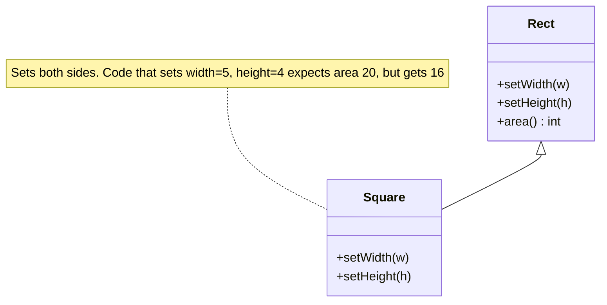
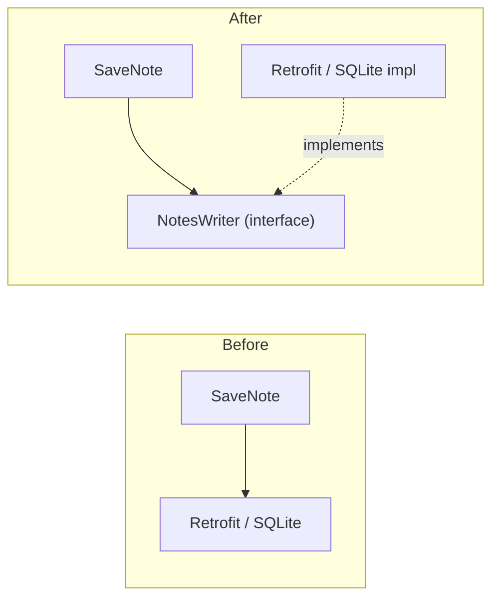

# SOLID in Code

> SOLID is five habits that keep classes easy to change: one reason to change, extend instead of edit, subtypes that keep their promises, small interfaces, and depend on abstractions. Learn each as a smell, a fix, and a one-line test.

Roadmap topic 24 · Stage 8: Code-Level Foundations

**Go deeper:** `4` Design Principles (cohesion, coupling, DRY/KISS/YAGNI) · `23` OOP & Java Basics · `25` Design Patterns in Code · `06-mobile-engineering/07-Dependency-Injection-and-Modularization`.

**Marks:** 🟢 must know · 🟡 good to know

---

#### 1. What Is It?

*Five questions you can ask about any class.*

| 🟢 Must know | 🟡 Good to know |
|---|---|
| **S**ingle responsibility | how SOLID maps to patterns |
| **O**pen–closed | when SOLID is overkill |
| **L**iskov substitution | spotting violations in code review |
| **I**nterface segregation | |
| **D**ependency inversion | |

| Letter | One-line test |
|---|---|
| S | "Does this class have more than one reason to change?" |
| O | "To add a new case, do I edit old code, or only add new code?" |
| L | "Can I use any subtype wherever the parent is expected, without surprises?" |
| I | "Is any class forced to implement methods it does not use?" |
| D | "Does my business code depend on a concrete library, or on an interface?" |

**Signals in an interview:** "explain SOLID with an example", "give a Liskov violation", "how do you add a payment method without changing old code?", "why use interfaces?".

---

#### 2. How It Works

**S: Single responsibility.** A class has one job and therefore one reason to change. *Smell:* a class that mixes calculation, formatting, networking and storage; its name contains "And" or "Manager". *Fix:* split by reason to change.

**O: Open–closed.** Open for extension, closed for modification. *Smell:* the same `when (type)` / `if-else` chain repeated in several files, edited every time a new type appears. *Fix:* put each case behind an interface (strategy) and register new cases.

**L: Liskov substitution.** If `B` is a subtype of `A`, code written for `A` must work with `B`. A subtype may not strengthen what it requires or weaken what it promises. *Smell:* a subclass that throws `UnsupportedOperationException`, has an empty override, or needs `is`/`instanceof` checks by callers. *Fix:* model what really holds (separate interfaces, or composition).



**I: Interface segregation.** Many small, focused interfaces beat one big one. *Smell:* implementers with `TODO()` bodies. *Fix:* split into role interfaces (`NotesReader`, `NotesWriter`).

**D: Dependency inversion.** High-level code and low-level code both depend on an abstraction, which the high-level code owns. *Smell:* a ViewModel that creates Retrofit or a database directly. *Fix:* depend on an interface; pass the implementation in (constructor injection).



**How SOLID connects to patterns.**

| Principle | Common tools |
|---|---|
| S | split classes; facade; extract function |
| O | strategy, decorator, factory, template method |
| L | proper interfaces; composition instead of inheritance |
| I | role interfaces, adapters |
| D | dependency injection, repository, adapter |

---

#### 3. Naive vs Better Design

| Naive | Better |
|---|---|
| one `ReportService` that calculates, formats and saves | three small pieces, wired together |
| `when (plan)` copied into five files | a map or list of `Pricing` strategies |
| `Square` extends `Rect` with setters | immutable shapes behind one `Shape` interface |
| one `NotesRepository` with 12 methods | `NotesReader` + `NotesWriter` |
| ViewModel creates `Retrofit` | ViewModel receives a `NotesWriter` |

```kotlin
// Naive: calculates, formats and saves in one place, so a change to any of the three edits this class
class ReportService(private val db: Database) {
    fun run(items: List<Int>) {
        var t = 0L; for (i in items) t += i
        db.insert("Total: $t")
    }
}
```

---

#### 4. Templates & Examples

*Checks come from running the same logic in Java on JDK 21. The Kotlin versions were not compiled.*

**S: split by reason to change.**

```kotlin
fun total(items: List<Int>): Long = items.sumOf { it.toLong() }     // changes with business rules
fun format(total: Long) = "Total: $total"                           // changes with wording
fun interface Store { fun save(s: String) }                         // changes with storage

// wiring: store.save(format(total(listOf(10, 20, 30))))
```

Checks: saving through a `Store` that appends to a list gives `[Total: 60]`. Each piece can be tested alone, and changing the wording touches only `format`.

**O: add a case without editing old code.**

```kotlin
fun interface Pricing { fun price(base: Long): Long }

val pricing = mutableMapOf(
    "regular" to Pricing { it },
    "student" to Pricing { it * 80 / 100 },
    "member"  to Pricing { it * 90 / 100 },
)
fun priceFor(plan: String, base: Long) = (pricing[plan] ?: pricing.getValue("regular")).price(base)

// later:  pricing["senior"] = Pricing { it * 70 / 100 }      // priceFor is not edited
```

Checks: `priceFor("student", 1000)` → `800`, `"member"` → `900`, `"unknown"` → `1000` (falls back to regular). After registering `"senior"`, `priceFor("senior", 1000)` → `700`.

**L: the Rectangle and Square violation, and the fix.**

```kotlin
// Violation
open class Rect {
    protected var w = 0; protected var h = 0
    open fun setWidth(v: Int) { w = v }
    open fun setHeight(v: Int) { h = v }
    fun area() = w * h
}
class Square : Rect() {
    override fun setWidth(v: Int) { w = v; h = v }           // surprises callers
    override fun setHeight(v: Int) { w = v; h = v }
}
fun resize(r: Rect): Int { r.setWidth(5); r.setHeight(4); return r.area() }

// Fix: no setters; each shape keeps its own promise
interface Shape { fun area(): Int }
data class RectS(val w: Int, val h: Int) : Shape { override fun area() = w * h }
data class SquareS(val side: Int) : Shape { override fun area() = side * side }
```

Checks: `resize(Rect())` → `20`; `resize(Square())` → `16`, but a caller of `Rect` expected `20`, so `Square` is not a safe substitute. After the fix, `RectS(5, 4).area()` → `20` and `SquareS(4).area()` → `16`, both correct.

**I: role interfaces.**

```kotlin
interface NotesReader { fun all(): List<String> }
interface NotesWriter { fun save(body: String) }

class MemoryRepo : NotesReader, NotesWriter {
    private val data = mutableListOf<String>()
    override fun all() = data.toList()
    override fun save(body: String) { data += body }
}
class ReadOnlyRepo : NotesReader { override fun all() = listOf("x", "y") }   // no fake save() needed

fun count(r: NotesReader) = r.all().size
```

Checks: after two `save` calls, `count(memoryRepo)` → `2`; `count(ReadOnlyRepo())` → `2`. The read-only class never has to throw from a method it should not have.

**D: depend on an abstraction, test with a fake.**

```kotlin
fun interface Formatter { fun format(t: String): String }

class SaveNote(private val f: Formatter, private val w: NotesWriter) {
    fun run(t: String) = w.save(f.format(t))
}

val markdown = Formatter { Regex("""\*\*(.+?)\*\*""").replace(it, "<b>$1</b>") }
val plain = Formatter { it }
```

Checks: with a `MemoryRepo` as the fake writer, `SaveNote(markdown, repo).run("**hi**")` then `SaveNote(plain, repo).run("**hi**")` leaves `[<b>hi</b>, **hi**]`. No network or database was needed, and a new `HtmlFormatter` changes nothing in `SaveNote`.

**Code-review checklist.**

```text
[ ] Class name needs "And" or "Manager" to describe it            (S)
[ ] The same when/if chain on a type appears in several files     (O)
[ ] A subclass throws UnsupportedOperationException or is empty   (L)
[ ] Implementers leave methods as TODO()                          (I)
[ ] Business code imports a concrete library class                (D)
```

---

#### 5. Numbers & Rules of Thumb

| Item | Guide |
|---|---|
| Class size | a few hundred lines; split when you can name two reasons to change |
| Interface size | 1 to 5 methods |
| Duplicated `when` on a type | at the second or third copy, introduce a strategy |
| Implementations of an interface | add the interface when you have, or truly expect, a second one or need a fake in tests |
| Constructor parameters | 3 to 4; more suggests two responsibilities |
| Inheritance depth | 1 to 2 |

---

#### 6. Common Mistakes & Edge Cases

1. Applying SOLID everywhere: an interface for every class, with one implementation and no reason.
2. Splitting classes so small that the logic is scattered across ten files.
3. Treating OCP as "never edit a class". Fix bugs and change behaviour freely; the rule is about *adding* new cases.
4. Using inheritance for code reuse and breaking LSP.
5. Confusing dependency inversion (a design rule) with dependency injection (a technique to follow it).
6. Fat interfaces "for convenience".
7. Ignoring LSP in tests: a subclass should pass the parent's tests.

Edge cases: a quick prototype or a script (accept violations, delete it later); performance-critical code that needs a concrete type; generated code; framework classes you cannot split.

---

#### 7. Say This in the Interview

1. "S: a class has one reason to change. If calculating, formatting and saving all live in one class, I split them so each change touches one place."
2. "O: I add a new payment method by adding a class that implements the interface, not by editing a `when` in ten places."
3. "L: a subtype must be usable anywhere the parent is. `Square` extending `Rect` with setters breaks that, because a caller that sets width 5 and height 4 expects area 20."
4. "I: small interfaces, so a read-only class does not have to implement `save`."
5. "D: the ViewModel depends on a repository interface, not on Retrofit, so I can test it with a fake and swap the implementation."
6. "I use SOLID where change is likely, and I avoid abstractions with only one implementation and no purpose."

---

#### 8. Quick Check

1. Which principle does "a subclass throws `UnsupportedOperationException`" usually break?
2. How do you add a new discount type without editing `priceFor`?
3. Dependency inversion vs dependency injection?
4. Why is `Square extends Rect` a classic Liskov violation?

<details>
<summary>Answers</summary>

1. Liskov substitution (and often interface segregation: the interface is too big).
2. Register a new `Pricing` strategy in the map. `priceFor` stays unchanged (open–closed).
3. Inversion is the rule (depend on abstractions). Injection is a technique: pass the dependency in from outside.
4. A caller that treats it as a `Rect` sets width and height separately and expects `w × h`; the square changes both, so the result is different.

</details>

---

#### 9. Practice

**Interview questions**

1. Explain SOLID with one example each.
2. Give a Liskov violation and fix it.
3. How do you add a new feature without modifying existing classes?
4. Dependency inversion vs injection vs inversion of control?
5. When is applying SOLID a mistake?
6. How does SOLID help testing?

**Exercises**

1. Take a class with three responsibilities and split it; write one test per piece.
2. Replace a repeated `when (type)` with a map of strategies.
3. Find a `UnsupportedOperationException` in your codebase and redesign the types.
4. Break one fat interface into two role interfaces.
5. Make a ViewModel depend on an interface and test it with a fake.

**LeetCode (design problems that reward clean classes, Easy → Medium)**

| # | Question | SOLID angle |
|---|---|---|
| 1603 | [Design Parking System](https://leetcode.com/problems/design-parking-system/) (Easy) | S: one small class, one job |
| 706 | [Design HashMap](https://leetcode.com/problems/design-hashmap/) (Easy) | D: hide the storage behind an API |
| 155 | [Min Stack](https://leetcode.com/problems/min-stack/) (Medium) | S: keep the extra bookkeeping inside |
| 1396 | [Design Underground System](https://leetcode.com/problems/design-underground-system/) (Medium) | S: separate check-ins from statistics |
| 1472 | [Design Browser History](https://leetcode.com/problems/design-browser-history/) (Medium) | clear public API, hidden state |
| 146 | [LRU Cache](https://leetcode.com/problems/lru-cache/) (Medium) | composition of a map and a list |

**Remember:** one reason to change · add, don't edit · subtypes keep promises · small interfaces · depend on abstractions · use SOLID where change is likely.
