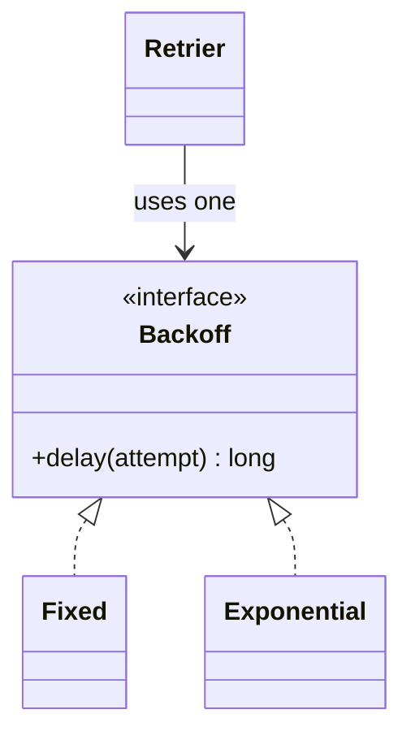
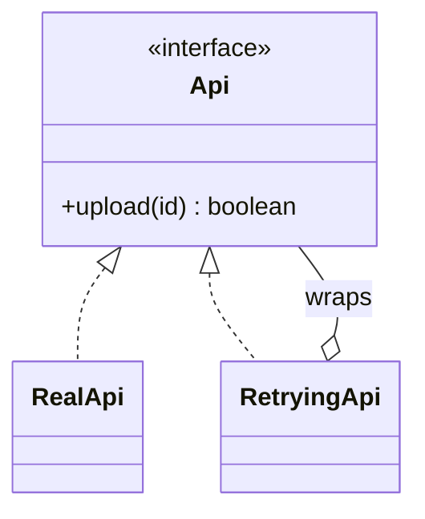
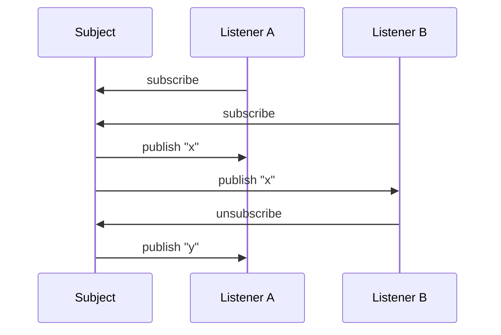
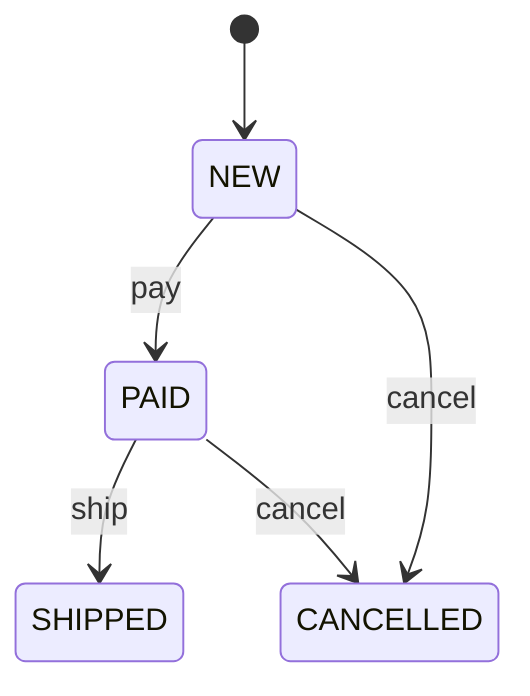

# Design Patterns in Code

> A design pattern is a named, proven shape for a common coding problem. Know the eleven that interviews ask about (Singleton, Factory, Builder, Adapter, Decorator, Facade, Strategy, Observer, State, Command, Template Method), how to spot the problem each solves, and when **not** to use it.

Roadmap topic 25 · Stage 8: Code-Level Foundations

**Go deeper:** `6` Architecture & Design Patterns (UI, resilience and integration patterns) · `23` OOP & Java Basics · `24` SOLID in Code · `06-mobile-engineering/07-Dependency-Injection-and-Modularization`.

**Marks:** 🟢 must know · 🟡 good to know

---

#### 1. What Is It?

*Names for solutions you already half-know.*

| 🟢 Must know | 🟡 Good to know |
|---|---|
| **Creational:** Singleton, Factory Method, Builder | Abstract Factory, Prototype |
| **Structural:** Adapter, Decorator, Facade | Proxy, Composite |
| **Behavioral:** Strategy, Observer, State, Command, Template Method | Iterator, Chain of Responsibility, Mediator, Visitor |
| a pattern picker: problem → pattern | the "Gang of Four" catalogue (23 patterns, names only) |
| when a pattern is overkill | |

1. **Creational:** how objects are created. **Structural:** how objects are combined. **Behavioral:** how objects cooperate and share work.
2. A pattern is a **vocabulary** and a starting shape, not a template to paste.

**Signals in an interview:** "explain Singleton and its problems", "Factory vs Abstract Factory", "when would you use Builder?", "Strategy vs State", "how does Observer work in Android?", "design a parking lot" (patterns appear in the design).

---

#### 2. How It Works

**Pattern picker: start from the problem.**

| You have this problem | Use |
|---|---|
| exactly one shared instance is needed | Singleton (usually via DI scope or Kotlin `object`) |
| create objects by a type or name, without `new` everywhere | Factory Method |
| a constructor has many optional parameters | Builder (Kotlin: named and default arguments) |
| a third-party API does not match yours | Adapter |
| add logging, retry or caching without editing a class | Decorator |
| a subsystem is complex; callers need one simple call | Facade |
| swap an algorithm at runtime | Strategy |
| many parties must hear about a change | Observer |
| behaviour changes with the current state | State |
| undo/redo, queue or log actions | Command |
| same steps in the same order, different details | Template Method |
| a tree of parts treated like one thing | Composite |
| pass a request along a chain of handlers | Chain of Responsibility |
| control access, lazy-load or cache an object | Proxy |

**Where you already see them on Android.**

| Pattern | Example |
|---|---|
| Builder | `OkHttpClient.Builder`, `AlertDialog.Builder`, `Retrofit.Builder` |
| Factory | `ViewModelProvider.Factory` |
| Singleton | Hilt `@Singleton`, the `Application` object |
| Adapter | `RecyclerView.Adapter` |
| Observer | `StateFlow`, `LiveData`, `Flow.collect` |
| Template Method | `Activity` lifecycle callbacks (`onCreate`, `onStart`) |
| Chain of Responsibility | OkHttp interceptors |
| Proxy | Retrofit builds a proxy object for your API interface |
| Command | `Runnable`, a `WorkRequest`, an undo stack |
| Strategy | `Comparator`, a retry/backoff policy |

**Class shapes (three that are easy to confuse).**





**Strategy vs State vs Decorator.** *Strategy:* the caller picks one interchangeable algorithm. *State:* the object changes its own behaviour as its state changes. *Decorator:* wraps an object with the same interface to add behaviour.

**Observer in one picture.**



**Order state machine (State).**



---

#### 3. Naive vs Better Design

| Naive | Better |
|---|---|
| `if (type == "email") ... else if (type == "sms") ...` in every caller | one factory, one interface |
| a constructor with nine parameters | builder, or named and default arguments |
| a global `object` that anyone mutates | an injected object with a narrow API |
| retry code pasted into five repositories | one retrying decorator |
| a giant `when (state)` in every method | a state type with one method per transition |
| UI code calling a vendor SDK directly | an adapter behind your own interface |
| callbacks you never remove | a subscription you cancel with the lifecycle |

```kotlin
// Naive: the caller knows every channel; each new channel edits this function
fun notify(channel: String, msg: String) =
    if (channel == "email") "email:$msg" else if (channel == "sms") "sms:$msg" else error("?")
```

---

#### 4. Templates & Examples

*Checks come from running the same logic in Java on JDK 21. The Kotlin versions were not compiled.*

**Singleton.**

```kotlin
object Config { val name = "cfg" }          // Kotlin: one instance, created safely on first use
```

```java
enum Config { INSTANCE }                    // Java: simplest and safest

class Holder {                              // Java: lazy and thread-safe without locks
    private Holder() {}
    private static class H { static final Holder I = new Holder(); }
    static Holder get() { return H.I; }
}

class Dcl {                                 // Java: double-checked locking, needs volatile
    private static volatile Dcl inst;
    private Dcl() {}
    static Dcl get() {
        Dcl r = inst;
        if (r == null) { synchronized (Dcl.class) { r = inst; if (r == null) inst = r = new Dcl(); } }
        return r;
    }
}
```

Checks: eight threads each call `Dcl.get()` and `Holder.get()`; each class's constructor ran exactly once (`2` constructions in total), and `Config.INSTANCE == Config.valueOf("INSTANCE")` → `true`. Remove `volatile` and the double-checked version is no longer safe. In Android apps, prefer a DI scope (`@Singleton` in Hilt) to a hand-written singleton, so tests can replace it.

**Factory Method.**

```kotlin
fun interface Notifier { fun send(msg: String): String }

fun create(channel: String): Notifier = when (channel) {
    "email" -> Notifier { "email:$it" }
    "sms"   -> Notifier { "sms:$it" }
    else    -> throw IllegalArgumentException("unknown channel: $channel")
}
```

Checks: `create("email").send("hi")` → `email:hi`; `create("sms").send("yo")` → `sms:yo`; `create("push")` throws `IllegalArgumentException("unknown channel: push")`. Callers depend on `Notifier`, never on a concrete class.

**Builder.**

```kotlin
class Request private constructor(val url: String, val method: String, val timeout: Int) {
    class Builder {
        private var url: String? = null
        private var method = "GET"
        private var timeout = 30
        fun url(u: String) = apply { url = u }
        fun method(m: String) = apply { method = m }
        fun timeout(t: Int) = apply { timeout = t }
        fun build() = Request(checkNotNull(url) { "url required" }, method, timeout)
    }
    override fun toString() = "$method $url timeout=${timeout}s"
}
// In Kotlin, named and default arguments often replace a builder: Request(url = "https://x", method = "POST")
```

Checks: `Builder().url("https://x").method("POST").timeout(5).build()` prints `POST https://x timeout=5s`; `Builder().url("https://y").build()` prints `GET https://y timeout=30s`; `Builder().build()` throws `IllegalStateException("url required")`. Validation lives in `build()`, so no half-built object escapes.

**Adapter.**

```kotlin
interface Analytics { fun track(event: String, props: Map<String, String> = emptyMap()) }

class VendorAnalytics(private val sdk: VendorSdk) : Analytics {
    override fun track(event: String, props: Map<String, String>) = sdk.logEvent(event, props)
}
```

Checks: `track("open", mapOf("screen" to "home"))` reaches the vendor as `open{screen=home}`. Changing vendors means one new adapter; the rest of the app is untouched.

**Decorator.**

```kotlin
interface Api { fun upload(id: String): Boolean }

class RetryingApi(private val inner: Api, private val tries: Int = 3) : Api {
    override fun upload(id: String): Boolean {
        repeat(tries) { if (runCatching { inner.upload(id) }.getOrDefault(false)) return true }
        return false
    }
}
```

Checks: an `Api` that fails twice and then succeeds returns `true` through `RetryingApi(inner, 3)` after `3` calls; one that always fails returns `false` after exactly `3` calls. Real code retries only safe (idempotent) calls and adds backoff.

**Facade.**

```kotlin
class PaymentFacade(private val log: MutableList<String>) {
    fun pay(cents: Int): Boolean {
        log += "validate"
        if (cents <= 0) return false
        log += "charge"; log += "receipt"
        return true
    }
}
```

Checks: `pay(500)` → `true` and the log is `[validate, charge, receipt]`. The caller makes one call instead of three.

**Strategy.**

```kotlin
fun interface Backoff { fun delay(attempt: Int): Long }
fun fixed(ms: Long) = Backoff { ms }
fun exponential(ms: Long) = Backoff { ms shl it }
```

Checks: for attempts `0..3`, `fixed(100)` gives `100,100,100,100` and `exponential(100)` gives `100,200,400,800`. A new policy is one new lambda.

**Observer.**

```kotlin
class Subject {
    private val listeners = mutableListOf<(String) -> Unit>()
    fun subscribe(l: (String) -> Unit): () -> Unit { listeners += l; return { listeners -= l } }
    fun publish(e: String) { listeners.toList().forEach { it(e) } }
}
```

Checks: listeners `a` and `b` subscribe; `publish("x")`; `b` unsubscribes; `publish("y")` → the log is `[a:x, b:x, a:y]`. Copying the list before looping lets a listener unsubscribe during delivery. Forgetting to unsubscribe is a memory leak (cancel with the lifecycle).

**State.**

```kotlin
enum class State {
    NEW, PAID, SHIPPED, CANCELLED;
    fun pay(): State { check(this == NEW) { "cannot pay from $this" }; return PAID }
    fun ship(): State { check(this == PAID) { "cannot ship from $this" }; return SHIPPED }
    fun cancel(): State { check(this != SHIPPED && this != CANCELLED) { "cannot cancel from $this" }; return CANCELLED }
}
```

Checks: `NEW.pay().ship()` → `SHIPPED`; `SHIPPED.cancel()` throws `IllegalStateException("cannot cancel from SHIPPED")`; `NEW.cancel()` → `CANCELLED`. Illegal transitions fail loudly instead of leaving the order in a strange state.

**Command (with undo).**

```kotlin
interface Command { fun run(t: StringBuilder); fun undo(t: StringBuilder) }

class Append(private val s: String) : Command {
    override fun run(t: StringBuilder) { t.append(s) }
    override fun undo(t: StringBuilder) { t.setLength(t.length - s.length) }
}

class Editor {
    val text = StringBuilder()
    private val done = ArrayDeque<Command>()
    fun exec(c: Command) { c.run(text); done.addLast(c) }
    fun undo() { done.removeLastOrNull()?.undo(text) }
}
```

Checks: `exec(Append("a"))`, `exec(Append("b"))` → text `ab`; `undo()` → `a`; two more `undo()` calls → empty text (the extra undo does nothing).

**Template Method.**

```kotlin
abstract class Exporter {
    val log = mutableListOf<String>()
    fun export() { log += "open"; log += write(); log += "close" }      // fixed order
    protected abstract fun write(): String                               // the changing step
}
class CsvExporter : Exporter() { override fun write() = "write csv" }
```

Checks: `CsvExporter().export()` leaves the log `[open, write csv, close]`. Subclasses cannot reorder the steps.

**🟡 Names to know.**

| Pattern | One line |
|---|---|
| Abstract Factory | a factory that creates a whole family of related objects (for example a light-theme or dark-theme widget set) |
| Prototype | create a new object by copying an existing one (Kotlin `copy()`) |
| Proxy | a stand-in that controls access: lazy loading, caching, permission checks |
| Composite | a tree where a leaf and a group have the same interface (`View` / `ViewGroup`) |
| Iterator | walk a collection without exposing how it is stored (`Iterable`, `Iterator`) |
| Chain of Responsibility | pass a request through handlers until one handles it (OkHttp interceptors) |
| Mediator | one object coordinates the others so they do not know each other |
| Memento | save an object's state so it can be restored later (undo snapshots) |
| Visitor | add operations to a class family without changing it (rare in app code) |

---

#### 5. Numbers & Rules of Thumb

| Item | Guide |
|---|---|
| Patterns to know well | about 11, plus the names of 8 more |
| Constructor parameters | 3 or fewer; beyond that use a builder or named arguments |
| Singletons | as few as possible; prefer a DI scope |
| Implementations | add a Strategy or Factory at the second real variant, not before |
| Decorator layers | 2 to 3; more is hard to debug |
| Observer | always have a way to unsubscribe |
| Naming | name the role (`RetryingApi`), not the pattern (`ApiDecoratorImpl`) |

---

#### 6. Common Mistakes & Edge Cases

1. Using a pattern because it sounds smart ("pattern-itis"); the simplest code that works is better.
2. Singleton as a global mutable bag: hard to test, hidden coupling, shared state between tests.
3. A lazy singleton that is not thread-safe, or double-checked locking without `volatile`.
4. Observers that are never removed (leaks), or that change the subscriber list during delivery.
5. A factory that grows into a giant `when` nobody can maintain; register creators in a map instead.
6. A builder that allows an invalid object (no validation in `build()`).
7. Strategy vs State confusion: in State the object moves between states itself.
8. A Decorator that changes the contract (breaks Liskov).
9. A Facade that grows until it is a god class.

Edge cases: Kotlin features replace some patterns (named and default arguments replace many builders; `object` replaces a singleton; lambdas replace small strategies and commands; `by lazy` gives lazy initialisation).

---

#### 7. Say This in the Interview

1. "A pattern is a named solution to a recurring problem. I start from the problem, then pick the pattern, and I avoid patterns when a plain function is enough."
2. "Singleton guarantees one instance, but it is global state, so I inject it through a DI scope to keep it testable. In Kotlin it is an `object`."
3. "Factory hides which class is created, so callers depend on an interface. Builder is for objects with many optional parts and validates in `build()`."
4. "Adapter makes a vendor API fit my interface; Decorator adds behaviour like retry or logging while keeping the same interface; Facade gives a simple entry point to a complex subsystem."
5. "Strategy swaps an algorithm, State changes behaviour as the object's state changes, Command wraps an action so I can queue or undo it, Observer notifies many listeners, and Template Method fixes the steps while subclasses fill in one."
6. "On Android I see Builder in OkHttp, Observer in `StateFlow`, and Template Method in the Activity lifecycle."

---

#### 8. Quick Check

1. A constructor has seven optional parameters. Which pattern, and what does Kotlin offer instead?
2. Strategy or State: the checkout object must behave differently in `NEW`, `PAID` and `SHIPPED`.
3. Why is a plain lazy `if (inst == null) inst = Foo()` unsafe?
4. What do you add to an `Api` to retry failed calls without editing it?

<details>
<summary>Answers</summary>

1. Builder; in Kotlin, named and default arguments often do the job.
2. State, because the object's own state decides its behaviour.
3. Two threads can both see `null` and create two instances. Use an `object`, an enum, the holder idiom, or `volatile` double-checked locking.
4. A decorator, `RetryingApi(inner)`, that implements the same interface.

</details>

---

#### 9. Practice

**Interview questions**

1. Explain Singleton and its drawbacks. Make one thread-safe.
2. Factory Method vs Abstract Factory?
3. When would you use Builder? What does Kotlin give you instead?
4. Adapter vs Facade vs Decorator?
5. Strategy vs State?
6. How does Observer work, and how do you avoid leaks?
7. Where do you see Template Method on Android?
8. How do you implement undo?
9. Name three patterns in the code you work on today.

**Exercises**

1. Replace a repeated `if (type)` with a factory and an interface.
2. Wrap a vendor SDK in an `Analytics` adapter and add a fake for tests.
3. Add a `RetryingApi` decorator and a backoff strategy.
4. Model an order or a download as a state machine with legal transitions only.
5. Build a tiny text editor with `Append`/`Delete` commands and undo.
6. Write a thread test for a lazy singleton (8 threads, count the constructions).

**Class-design (LLD) interviews: how to approach one**

1. Clarify the requirements and the scale (who uses it, what must it do, what is out of scope).
2. List the nouns as classes and the verbs as methods.
3. Draw the relationships (has-a, is-a, uses) and the interfaces.
4. Write the core classes and the main flow in code.
5. Add a pattern only where it removes a real problem, and say why.
6. Cover edge cases, errors and thread safety. Then test with a small example.

| Problem | Patterns that often appear |
|---|---|
| Parking lot | Strategy (pricing), Factory (vehicles), State (slot free/taken) |
| Vending machine | State, Command |
| Elevator | State, Strategy (scheduling), Observer |
| Tic-tac-toe / chess | Strategy, Command (undo), Factory (pieces) |
| Notification service | Strategy, Factory, Observer, Decorator (retry) |
| Library system | Observer (due dates), Facade |
| Text editor | Command (undo/redo), Memento |

**LeetCode (design problems, Easy → Medium)**

| # | Question | Pattern or skill |
|---|---|---|
| 1603 | [Design Parking System](https://leetcode.com/problems/design-parking-system/) (Easy) | a small class with state and rules |
| 622 | [Design Circular Queue](https://leetcode.com/problems/design-circular-queue/) (Medium) | encapsulating a data structure |
| 284 | [Peeking Iterator](https://leetcode.com/problems/peeking-iterator/) (Medium) | Iterator, Decorator |
| 341 | [Flatten Nested List Iterator](https://leetcode.com/problems/flatten-nested-list-iterator/) (Medium) | Iterator |
| 1797 | [Design Authentication Manager](https://leetcode.com/problems/design-authentication-manager/) (Medium) | state with expiry rules |
| 380 | [Insert Delete GetRandom O(1)](https://leetcode.com/problems/insert-delete-getrandom-o1/) (Medium) | composing two structures |
| 355 | [Design Twitter](https://leetcode.com/problems/design-twitter/) (Medium) | class design, Observer-like feeds |
| 146 | [LRU Cache](https://leetcode.com/problems/lru-cache/) (Medium) | composition |

**Remember:** start from the problem · Singleton via DI · Factory hides the class · Builder validates · Adapter fits · Decorator wraps · Facade simplifies · Strategy swaps · Observer notifies (and unsubscribes) · State owns transitions · Command undoes · Template Method fixes the steps.
