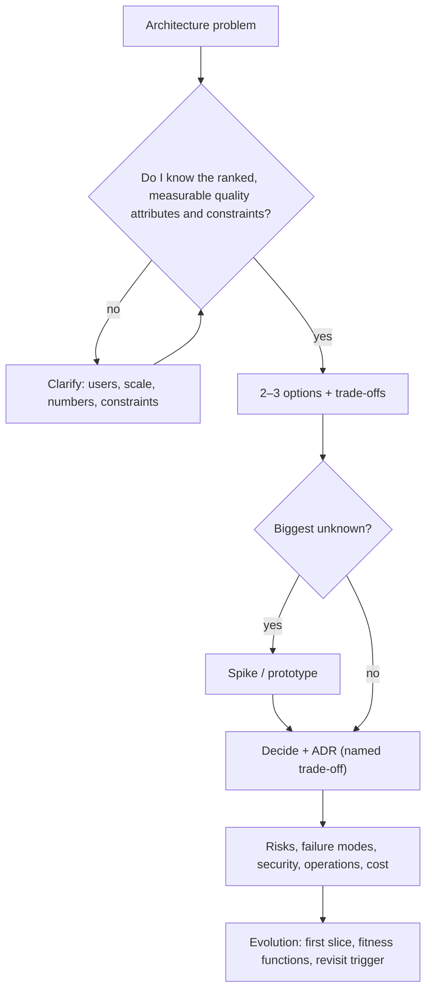

# Architecture Cheat Sheet

> One-page revision for the night before an interview. The full explanations are in notes 1–22.

---

#### 1. Key Takeaways

1. **Architecture** = the important decisions that are costly to change. The architect decides with the team, records, keeps consistent, enables, and stays hands-on.
2. **Quality attributes** (performance, scalability, availability, reliability, security, maintainability, testability, observability, cost) are measurable and ranked; a few ASRs shape the design. Constraints (budget, date, skills, regulation, existing systems) are part of the problem.
3. **No best architecture, only trade-offs.** 2–4 options, criteria, evidence (spike), a decision recorded in an ADR, one-way vs two-way, build the core and buy the rest.
4. **Principles:** separation of concerns, high cohesion, low coupling, SOLID, information hiding, KISS/YAGNI/DRY (rule of three), design for failure.
5. **Styles:** modular monolith first; microservices for real needs (else distributed monolith); event-driven for decoupling and fan-out; hexagonal/clean to protect the core; choose from ranked attributes and team.
6. **Patterns:** adapter, decorator, strategy; repository; MVVM/MVI; timeouts, retries, circuit breaker, bulkhead; BFF; saga + outbox; strangler + ACL; CQRS/event sourcing only with a need.
7. **DDD:** ubiquitous language, bounded contexts (candidate module/service boundaries), entities/value objects/aggregates, invest in the core subdomain.
8. **Boundaries:** small public API, hidden insides, depend toward stability, no cycles, package by feature, Conway's law, contracts that evolve add-only.
9. **Data:** one owner per data set, store by shape and access pattern, consistency per feature, expand → migrate → contract, retention and deletion designed up front.
10. **Integration:** contract first; add-only; sync vs async; idempotency keys; verified, stored, async webhooks; reconcile; adapters around third parties.
11. **Security:** defense in depth, least privilege, server-side authz, STRIDE threat models, small attack surface, secrets vault + rotation, encryption, zero trust.
12. **Scale and resilience:** numbers first, find the bottleneck, stateless, remove SPOFs, timeouts/retries/breakers/fallbacks, SLO + error budget + burn rate, RTO/RPO, load and chaos tests.
13. **Operations and cost:** CI/CD with canary and rollback, logs/metrics/traces, config outside code, infrastructure as code, cost as a requirement with a number.
14. **Docs:** C4 + sequence diagrams as text in the repo; ADRs; design docs; short, owned, current.
15. **Communication:** know stakeholders; cost, risk, time, user impact; options + recommendation + ask; early, kind reviews; disagree and commit; no with alternatives; ranges for estimates.
16. **Evolution:** make change cheap; debt register with interest; small safe refactors; strangler migrations; fitness functions; deprecate with measurement; avoid big-bang rewrites.
17. **Governance:** guardrails over gates; automated architecture tests; light reviews of one-way decisions; paved road + tech radar; named owners.
18. **Teams:** inverse Conway; stream-aligned + platform teams; walking skeleton; vertical slices; you build it, you run it; DORA at team level.
19. **Mobile:** offline-first with Room as source of truth; UI → ViewModel → repository; modules by feature; add-only API + min version; flags + staged rollout; pilot KMP.
20. **AI systems:** model behind the backend via a gateway; design for wrong answers; cost/latency/reliability as ASRs; control data flow; provider-neutral, eval-gated changes.
21. **Interview:** clarify → attributes → options → decision with trade-off → risks → evolution; real decision stories.

---

#### 2. Numbers and Rules of Thumb

| Topic | Remember |
|---|---|
| Seconds per day | 86,400; 1M requests/day ≈ 12 rps |
| Peak factor | 3–10× the average; design for 10× the next milestone |
| Availability | 99% = 7.2 h/month · 99.9% = 43 min/month (8.8 h/year) · 99.99% = 4.3 min/month (53 min/year) |
| Series / parallel | series multiplies (0.999⁵ ≈ 99.5%); parallel: 1 − (1 − a)ⁿ (two 99% → 99.99%) |
| Little's law | in-flight = throughput × latency (2,000 rps × 0.1 s = 200) |
| Servers | peak ÷ per-server capacity + spare(s) |
| Error budget | 100% − SLO; burn rate = fraction used ÷ fraction of period |
| Instability | I = Ce ÷ (Ca + Ce); depend toward lower I |
| Decision score | Σ weight × score; argue weights, not arithmetic |
| Build vs buy | 3-year TCO including upkeep and exit |
| Debt payback | fix cost ÷ interest per quarter |
| DORA | frequency, lead time, change failure rate, time to restore |
| Team size | 5–9; cognitive load limits what a team owns |
| Test mix | ~70% unit, 20% integration, 10% UI |
| Strangler steps | 1% → 10% → 50% → 100% with checks |

---

#### 3. Patterns and How to Identify Them

| Signal in the question | Think of | Note |
|---|---|---|
| "what does an architect do / is this architectural?" | cost to reverse, scope | 1 |
| "design for X users / make it fast / secure" | measurable ASRs, ranked | 2 |
| "why this technology? build or buy?" | options, criteria, ADR, TCO | 3 |
| "how do you structure the code?" | SOLID, cohesion/coupling, layers | 4 |
| "monolith or microservices?" | ranked attributes + team → modular monolith first | 5 |
| "which pattern?" | strategy, adapter, decorator, saga, outbox, BFF | 6 |
| "where are the service boundaries?" | bounded contexts, aggregates | 7 |
| "modularise this / Conway's law" | module APIs, dependency direction, cycles | 8 |
| "who owns this data / GDPR / schema change" | ownership, lifecycle, expand → migrate → contract | 9 |
| "integrate with a provider / version an API" | contract first, idempotency, webhooks, add-only | 10 |
| "secure this / threat model" | defense in depth, STRIDE, least privilege | 11 |
| "scale it / what if X fails / SLOs" | numbers, bottleneck, SPOF, error budget | 12 |
| "release safely / cut cost" | CI/CD, canary, IaC, FinOps | 13 |
| "how do you document?" | C4, ADRs, design docs, docs as code | 14 |
| "convince the team / explain to product" | stakeholders, options + recommendation | 15 |
| "legacy / debt / rewrite?" | strangler, debt register, fitness functions | 16 |
| "how do you keep teams aligned?" | guardrails, tests, paved road, owners | 17 |
| "team structure / delivery speed" | inverse Conway, walking skeleton, DORA | 18 |
| "mobile architecture / old versions" | offline-first, modules, add-only API | 19 |
| "add AI to the product" | gateway, wrong answers, eval gate | 20 |



---

#### 4. Templates to Memorise

**ADR**

```text
Title / Status / Date / Owner
Context (ASRs, constraints) → Options (2–4, incl. do nothing) → Decision → Consequences (+/−) → Review date or trigger
```

**ASR row**

```text
Attribute | Measurable requirement (metric, target, load, percentile) | Priority | How we check
```

**Trade-off sentence**

```text
"I choose ___ because ___ matters most here; the cost is ___; if ___ changes I would ___."
```

**Quality attribute scenario:** source → stimulus → artifact → environment → response → response measure.

**STRIDE:** Spoofing · Tampering · Repudiation · Information disclosure · Denial of service · Elevation of privilege.

**Expand → migrate → contract:** add (nullable) → dual-write + backfill → switch reads → remove the old.

**Strangler:** facade in front → move one capability → shadow-compare → shift traffic → remove the old.

**Design review checklist:** ASRs · boundaries and data ownership · failure modes · security · operability · cost and exit path · simpler alternative · backward compatibility.

**C4:** Context → Containers → Components (→ Code). Sequence diagram for each main flow, including failure.

**Walking skeleton:** app → API → database → CI/CD → staging → logs/metrics/alerts, with one trivial feature.

**Interview answer:** Clarify → Attributes (numbers) → Options → Decision (trade-off) → Risks → Evolution.

---

#### 5. Naive to Better

| Naive | Better |
|---|---|
| technology first | requirements and quality attributes first |
| "fast and scalable" | p95 < 300 ms at 2,000 rps; 10× headroom |
| one option | 2–4 options, criteria, evidence |
| decisions in chat | ADRs in the repo |
| microservices on day one | modular monolith, extract with cause |
| shared database across services | each owner has its data |
| rename an API field | add-only; min version; deprecation |
| retry everything | idempotent calls only, bounded, with jitter |
| trust the internal network | zero trust, least privilege |
| security at the end | threat model during design |
| optimise by guessing | measure the bottleneck |
| big-bang rewrite | strangler migration |
| rules in a wiki | fitness functions in CI |
| approval boards | guardrails and paved roads |
| component teams with handoffs | stream-aligned teams |
| huge diagram | C4 levels per audience |

---

#### 6. Common Mistakes and Edge Cases

1. Designing before knowing the numbers and constraints.
2. Treating all attributes as equal; no ranking.
3. Naming tools first; hype- or résumé-driven choices.
4. A distributed monolith; shared databases; cycles; a `common` dumping ground.
5. Breaking old clients; no deprecation plan.
6. Missing failure modes: no timeouts, retries storms, SPOFs, untested failover.
7. Security bolted on; secrets in code; client-only authorisation.
8. No docs or ADRs; stale diagrams; an ivory-tower architect.
9. Rewrites; no debt register; rules without automated checks.
10. Ignoring Conway's law and team skills.
11. Edge cases: unknown numbers (estimate and state assumptions); conflicting attributes (rank and negotiate); regulation (data residency, audit); legacy (strangler + ACL); mobile (old app versions, offline); AI (wrong answers, data leaving, model changes).

---

#### 7. What to Say Out Loud

1. "Architecture is the set of decisions that are costly to change. First, the ranked, measurable quality attributes and the constraints."
2. "There's no best architecture, only trade-offs: I choose X because Y matters most; the cost is Z; I'd revisit if W changes."
3. "I start with a modular monolith and extract services only for independent scaling or team deployment with a clear boundary."
4. "Each data set has one owner; consistency is chosen per feature; schema changes expand, migrate, contract."
5. "Contracts are add-only; old clients never go away; writes are idempotent; webhooks are verified, stored and reconciled."
6. "I threat-model with STRIDE, apply least privilege and server-side authorisation, and keep secrets in a vault."
7. "I design for failure: timeouts, bounded retries with jitter, breakers, fallbacks, no SPOFs, and I define SLOs with error budgets."
8. "I document with C4 and ADRs in the repo, and protect the design with fitness functions and light reviews."
9. "For legacy systems: strangler fig, shadow traffic, gradual rollout, rollback, and remove the old path."

---

#### 8. Practice Order

| Step | Do |
|---|---|
| 1 | Write three ADRs and an ASR table for a real system (2, 3) |
| 2 | Draw C4 context and container diagrams plus one sequence diagram (14) |
| 3 | Compare monolith, modular monolith and microservices for a case (5) |
| 4 | Threat-model login or sharing with STRIDE (11) |
| 5 | Estimate load, availability and cost with numbers (12, 13) |
| 6 | Plan a strangler migration and write five fitness functions (16, 17) |
| 7 | Work the case studies aloud: notes sync, chat, checkout (22) |
| 8 | Practise the interview structure with a friend (21) |
| 9 | Read this sheet, then the "Say This in the Interview" parts of your weakest notes |
