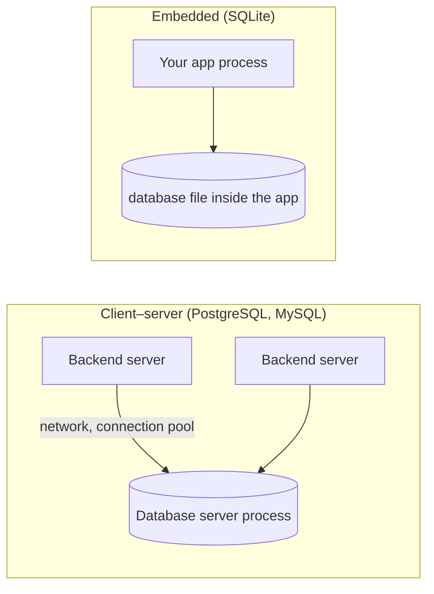
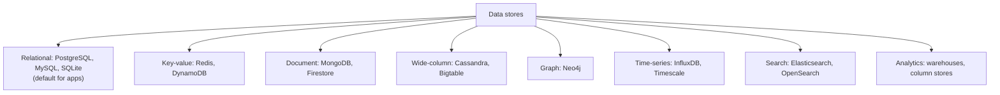

# Database Basics & Landscape

> A database stores data safely, finds it fast, and keeps it correct while many users change it at once. Start with the vocabulary and the map, then learn why one relational database such as PostgreSQL is the default answer.

Roadmap topic 1 · Stage 1: Foundations

**Go deeper:** `2` Relational Model · `3` SQL Fundamentals · `11` Choosing a Database · `20` Analytics · `21` Mobile Databases · `04-backend-engineering/08-Databases-SQL-and-Data-Modeling` · `05-system-design/17-Choosing-a-Database`.

**Marks:** 🟢 must know · 🟡 good to know · (New) for a mobile engineer, or still changing

**How the examples are checked:** SQL here is checked on SQLite 3.54 (the engine inside every phone, also a good laptop practice database). PostgreSQL-only syntax is marked, and not run.

---

#### 1. What Is It?

*The words and the map.*

| 🟢 Must know | 🟡 Good to know |
|---|---|
| what a database does: store safely, find fast, stay correct | a short history: why so many databases exist |
| DBMS, database, table, row, column, schema, query | SQL dialect differences (PostgreSQL, MySQL, SQLite) |
| relational vs non-relational at a glance | managed services vs running your own |
| client–server vs embedded database | |
| OLTP vs OLAP | |
| why the app talks to a database only through a backend | |

1. **DBMS** (database management system): the software (PostgreSQL, MySQL, SQLite). A **database** is the data it manages.
2. **Table:** rows and columns. **Row:** one record. **Column:** one attribute with a type. **Schema:** the structure (tables, columns, types, constraints). **Query:** a request to read or change data.
3. **Relational database:** data in tables with relationships, queried with SQL, with transactions and constraints.
4. **Non-relational (NoSQL):** other models (key-value, document, wide-column, graph, search) built for particular access patterns (topic 12).

**Signals in an interview:** "SQL or NoSQL?", "what is a transaction?", "what is the difference between OLTP and OLAP?", "why not let the app talk to the database directly?".

---

#### 2. How It Works

**What a database does for you.**

| Job | How |
|---|---|
| Store safely | writes go to a log first (WAL), survive crashes (topic 7) |
| Find fast | indexes, a query planner (topics 5, 6) |
| Stay correct | types, constraints, transactions (topics 2, 8) |
| Share | many users at once without corrupting data (topic 9) |
| Protect | users, permissions, encryption (topic 18) |

You could keep data in files, but you would have to build all of this yourself: crash safety, concurrent access, fast search and rules.

**Client–server vs embedded.**



| | Client–server | Embedded |
|---|---|---|
| Runs as | its own server process | a library inside your app |
| Users | many concurrent clients over a network | one app (several threads) |
| Where | servers | phones, desktop apps, tests |
| Examples | PostgreSQL, MySQL, SQL Server | SQLite (Room, Core Data use it) |
| Admin | roles, replicas, backups, tuning | a file you copy and migrate |

**Why the app talks to the database only through a backend (`BE 1`).** A database inside a mobile app's reach would mean credentials in the app, no central rules, and no way to protect other users' data. The backend owns authentication, validation, business rules and the connection. (Backend-as-a-service tools such as Firebase and Supabase put rules in the database layer: topics 12 and 18.)

**OLTP vs OLAP.**

| | OLTP | OLAP |
|---|---|---|
| Purpose | run the app: many small reads/writes | analyse: few large queries over history |
| Example | "save this note", "list my orders" | "revenue per country per month" |
| Storage | row store | column store |
| Latency | milliseconds | seconds to minutes |
| Systems | PostgreSQL, MySQL | warehouses (BigQuery, Snowflake), ClickHouse |

Don't run heavy analytics on the production database; copy data to a warehouse (topic 20).

**The landscape in one picture.**



🟡 **A short history.** Hierarchical and network databases (1960s) → relational model and SQL (1970s–80s) → web-scale and varied needs: key-value, document and wide-column stores ("NoSQL", 2000s) → "NewSQL" and distributed SQL, managed cloud databases, and vector search (2010s–now). Many kinds exist because workloads differ; the relational model remains the strongest general default.

🟡 **SQL dialects.** The core is standard (`SELECT`, `JOIN`, `GROUP BY`), but details differ:

| | PostgreSQL | MySQL | SQLite |
|---|---|---|---|
| Auto id | `GENERATED ... AS IDENTITY` / `SERIAL` | `AUTO_INCREMENT` | `INTEGER PRIMARY KEY` |
| Boolean | `BOOLEAN` | `TINYINT(1)` | integers 0/1 |
| Types | strict, rich (arrays, JSONB, ranges) | many | flexible typing ("type affinity") |
| `RETURNING` | yes | no (recent versions partly) | yes (3.35+) |
| Upsert | `ON CONFLICT` | `ON DUPLICATE KEY UPDATE` | `ON CONFLICT` |
| Strings | `||` | `CONCAT()` | `||` |

🟡 **Managed services vs your own.** Managed databases (Amazon RDS/Aurora, Cloud SQL, Azure Database, Supabase, Neon) handle backups, patches, failover and monitoring for a fee; you give up some control and tuning. Self-hosting gives control and can be cheaper at scale, but you own operations. For most teams, managed is the right start.

---

#### 3. Naive vs Better Design

| Naive | Better |
|---|---|
| keep data in JSON files | a database: crash-safe, concurrent, queryable |
| the mobile app connects to the production database | the app calls an API; the backend owns the database |
| "NoSQL is faster, so use it" | relational by default; another store for a clear, measured need |
| run reports on the production database at noon | a replica or a warehouse |
| a new database for every feature | one relational database, then add stores for measured reasons |
| everything in memory "for speed" | a durable store, plus a cache for hot data |

```kotlin
// Naive: the "database" is a file the app rewrites completely on every change
fun save(notes: List<Note>) = File("notes.json").writeText(Json.encodeToString(notes))
```

---

#### 4. SQL & Code

A first look at what a database gives you, in SQLite (run it yourself):

```sql
CREATE TABLE notes (
  id         INTEGER PRIMARY KEY,
  user_id    INTEGER NOT NULL,
  title      TEXT    NOT NULL,
  created_at TEXT    NOT NULL DEFAULT (datetime('now'))
);
CREATE INDEX idx_notes_user ON notes(user_id);

INSERT INTO notes(user_id, title) VALUES (1, 'Buy milk'), (1, 'Call Ann'), (2, 'Plan trip');
SELECT id, title FROM notes WHERE user_id = 1 ORDER BY id;          -- 2 rows
```

Checks: the `SELECT` returns `(1, Buy milk)` and `(2, Call Ann)`. A second statement `INSERT INTO notes(user_id) VALUES (3)` fails with `NOT NULL constraint failed: notes.title`: the database protects the rule even if the app forgets.

Safety in one transaction (all or nothing):

```sql
BEGIN;
UPDATE accounts SET balance = balance - 100 WHERE id = 1;
UPDATE accounts SET balance = balance + 100 WHERE id = 2;
COMMIT;                                          -- or ROLLBACK; if anything failed
```

Use it from Kotlin through JDBC (PostgreSQL URL shown; SQLite works the same way with `jdbc:sqlite:app.db`):

```kotlin
fun titlesFor(userId: Long): List<String> =
    dataSource.connection.use { conn ->
        conn.prepareStatement("SELECT title FROM notes WHERE user_id = ? ORDER BY id").use { ps ->    // parameterized query
            ps.setLong(1, userId)
            ps.executeQuery().use { rs -> generateSequence { if (rs.next()) rs.getString("title") else null }.toList() }
        }
    }
```

Checks: `titlesFor(1)` → `["Buy milk", "Call Ann"]`; `titlesFor(99)` → `[]`.

On a phone, the same SQL runs inside the app (Room is a layer over SQLite):

```kotlin
@Dao interface NoteDao {
    @Query("SELECT * FROM notes WHERE user_id = :userId ORDER BY id") fun observe(userId: Long): Flow<List<NoteEntity>>
}
```

A decision rule you can say aloud:

```kotlin
fun defaultStore(needsTransactions: Boolean, relationalData: Boolean, hugeWriteVolume: Boolean, fullTextSearch: Boolean) = when {
    hugeWriteVolume -> "consider wide-column / time-series, after measuring"
    fullTextSearch && !relationalData -> "search engine"
    else -> "PostgreSQL (relational)"
}
```

Checks: a notes app `(true, true, false, false)` → PostgreSQL; clickstream at 1M writes/s `(false, false, true, false)` → wide-column / time-series. Add numbers before you leave the default.

---

#### 5. Numbers & Limits

| Item | Rule of thumb |
|---|---|
| A single PostgreSQL server | handles thousands of simple transactions per second and hundreds of GB to a few TB comfortably |
| When to look beyond one server | measured limits: CPU/IO saturated after indexing, caching and tuning |
| Disk vs memory | memory access ≈ 100 ns; SSD ≈ 100 µs; network round trip in a data centre ≈ 0.5 ms |
| Row size | a typical row is 100 bytes to a few KB; 1M rows × 200 B ≈ 200 MB |
| Connections | each costs memory; PostgreSQL's default limit is 100 (use a pool) |
| SQLite | one writer at a time; great up to hundreds of MB to GBs for a single app |
| Managed services | expect 20–50% more than raw VMs, minus the operations time you save |

---

#### 6. Common Mistakes & Edge Cases

1. Choosing a database by fashion.
2. Letting a client reach the production database.
3. Using the production database for analytics.
4. Treating SQLite as "not a real database" (it is the most deployed one).
5. Building your own storage on files.
6. Assuming SQL is the same everywhere.
7. No backups.

Edge cases: SQLite type flexibility (a `TEXT` column can store a number; use `STRICT` tables or constraints); time zones in dates; case-sensitivity and collation differences between engines; `AUTO_INCREMENT` gaps after rollbacks.

---

#### 7. Say This in the Interview

1. "A database stores data durably, finds it fast with indexes, keeps it correct with constraints and transactions, and lets many clients work at once."
2. "I default to one relational database, PostgreSQL, and add a cache, a search engine or another store only when I can name the measured need."
3. "The mobile app never talks to the database directly; the backend owns the credentials and the rules."
4. "OLTP runs the app with many small transactions; OLAP analyses history, so I move analytics to a warehouse or replica."
5. "On the phone, SQLite is the embedded database; Room is a layer over it."

---

#### 8. Quick Check

1. Client–server vs embedded database?
2. OLTP vs OLAP?
3. Why not connect the app straight to the database?
4. What is the default choice for a new app backend?

<details>
<summary>Answers</summary>

1. A client–server database runs as a separate server used over a network; an embedded one is a library inside the app, storing in a local file.
2. OLTP: many small transactions to run the app; OLAP: large analytical queries over history.
3. It would expose credentials and bypass central rules and per-user protection; the backend enforces them.
4. A relational database such as PostgreSQL.

</details>

---

#### 9. Practice

**Interview questions**

1. SQL vs NoSQL: how do you decide?
2. What is the difference between a database and a DBMS?
3. OLTP vs OLAP?
4. Why do apps talk to a database only through a backend?
5. Managed or self-hosted database?
6. What makes SQLite different from PostgreSQL?

**Hands-on**

1. Install PostgreSQL (or use SQLite) and run the examples above; insert bad data and read the errors.
2. Open your app's database file on a device or emulator (`adb shell`, `sqlite3`) and list its tables.
3. Write down which of your app's data is OLTP and which would belong in analytics.

**Remember:** a database stores, finds, protects and shares data · relational by default · client–server vs embedded · OLTP vs OLAP · the app talks to a backend, not the database · add other stores only for measured needs.
