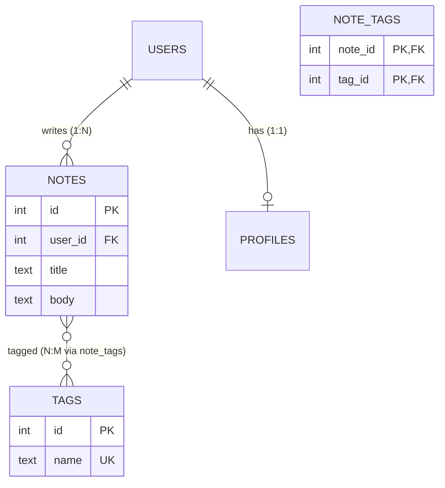

# Relational Model & Data Modeling

> A good schema makes correct data easy and wrong data impossible. Design it from the questions you need to answer, keep each fact in one place, and let the database enforce the rules with keys and constraints.

Roadmap topic 2 · Stage 1: Foundations

**Go deeper:** `3` SQL Fundamentals · `5` Indexes · `8` Transactions · `10` Schema Migrations · `04-backend-engineering/08-Databases-SQL-and-Data-Modeling` · `05-system-design/20-Unique-ID-Generation` · `09-architecture/09-Data-Architecture`.

**Marks:** 🟢 must know · 🟡 good to know

**How the examples are checked:** SQL runs on SQLite 3.54 with `PRAGMA foreign_keys = ON`. PostgreSQL-only syntax is marked.

---

#### 1. What Is It?

*Tables, keys, relationships and rules.*

| 🟢 Must know | 🟡 Good to know |
|---|---|
| primary, foreign, unique, composite keys | ER diagrams |
| surrogate vs natural keys | soft delete vs hard delete |
| relationships: 1:1, 1:N, N:M (join table) | audit columns |
| design the schema from the queries | modeling trees, hierarchies, tags, history |
| normalization: 1NF, 2NF, 3NF in plain words | |
| denormalization and its cost | |
| constraints: `NOT NULL`, `UNIQUE`, `FOREIGN KEY`, `CHECK` | |
| data types: money, time, text vs enum | |
| `NULL` | |

1. **Primary key (PK):** uniquely identifies a row. **Foreign key (FK):** refers to a row in another table. **Unique key:** no duplicates allowed.
2. **Normalization:** store each fact once to avoid conflicting copies.
3. **Constraint:** a rule the database enforces, whatever the application does.

**Signals in an interview:** "design the schema for…", "one-to-many vs many-to-many?", "normalization vs denormalization?", "surrogate key or natural key?", "what does NULL mean?".

---

#### 2. How It Works

**Keys.**

| Key | Meaning | Example |
|---|---|---|
| Primary | identifies a row; unique, not null | `id` |
| Composite | several columns together | `(note_id, tag_id)` |
| Foreign | points to a row elsewhere | `orders.user_id → users.id` |
| Unique | no duplicates (other than the PK) | `users.email` |

**Surrogate vs natural keys.** A *surrogate* key is a system-made ID (`1, 2, 3` or a UUID) with no business meaning. A *natural* key is real-world data (email, ISBN). Prefer a surrogate PK (stable, small, never changes) and add a `UNIQUE` constraint on the natural key. Emails change; IDs should not. For distributed or offline-created IDs use UUIDs/ULIDs (`SD 20`).

**Relationships.**



| Relationship | How |
|---|---|
| One-to-one | FK with `UNIQUE` (or the same PK) |
| One-to-many | FK on the "many" side |
| Many-to-many | a join table with two FKs and a composite PK |

**Design from the queries (`BE 8`).** List the top 10 reads and writes first ("my notes, newest first", "notes with tag X", "all orders of a user"). The schema should answer them with simple joins and indexes. A schema designed from "what things exist" without the queries tends to be awkward.

**Normalization in plain words.**

| Form | Rule | Violation example |
|---|---|---|
| 1NF | each cell holds one value; no repeating groups | `tags = "work,home"` in one column |
| 2NF | every non-key column depends on the *whole* key | order lines keyed `(order_id, product_id)` storing `customer_name` |
| 3NF | non-key columns depend on the key, nothing else | `orders.customer_city` that depends on `customer_name` |

Rule of thumb: "the key, the whole key, and nothing but the key". Normalising stops **update anomalies**: change a city in one row and forget another, and the data contradicts itself.

**Denormalization.** Copy data on purpose to make reads faster (store `comment_count` on the post, `author_name` on the comment). It speeds reads but you must keep copies in sync (in a transaction, by trigger, or by an async job), and accept possible staleness. Normalise first; denormalize a measured hot path.

**Constraints.**

| Constraint | Protects |
|---|---|
| `NOT NULL` | required values |
| `UNIQUE` | duplicates (emails, idempotency keys, one vote per user) |
| `FOREIGN KEY` | orphan rows (an order for a missing user); can `ON DELETE CASCADE/RESTRICT` |
| `CHECK` | value rules (`total_cents >= 0`) |
| `DEFAULT` | sensible starting values |

The application validates for good messages; the database enforces for **correctness**, even when a bug or a second client forgets.

**Data types.**

| Data | Use | Avoid |
|---|---|---|
| Money | integer minor units (cents) or `DECIMAL`/`NUMERIC` | `FLOAT`/`REAL` (0.1 + 0.2 ≠ 0.3) |
| Time | UTC timestamps (`timestamptz` in PostgreSQL; ISO-8601 text or epoch in SQLite) | local times without a zone |
| Text | `TEXT`/`VARCHAR`; set sensible limits at the API | storing numbers as text |
| Enums | a lookup table or `CHECK (status IN (...))` / native enum | free-text status codes |
| IDs | bigint identity, UUID/ULID | meaningful codes as PKs |
| JSON | `JSONB` (PostgreSQL) for truly flexible fields | hiding core, queried data in JSON |

**`NULL`.** It means "unknown / no value", not zero or empty. Comparisons with `NULL` are never true: `NULL = NULL` is `NULL`, so use `IS NULL`. Aggregates ignore `NULL` (`COUNT(col)`, `AVG`). Use `NOT NULL` wherever a value is always required; avoid `NULL` meaning two different things.

🟡 **ER diagrams.** Boxes for tables, lines for relationships, crow's foot for "many". Draw them to agree on the model with the team (Mermaid `erDiagram` is text and lives in the repo).

🟡 **Soft vs hard delete.** *Hard delete* removes the row. *Soft delete* sets `deleted_at` and filters it out; it allows undo and sync tombstones but complicates uniqueness, queries and privacy deletion. Use soft delete for user-visible recovery and sync; hard delete (or purge later) for privacy.

🟡 **Audit columns.** `created_at`, `updated_at`, `created_by`, and optionally a `version` column for optimistic locking (topic 9).

🟡 **Trees, hierarchies, tags, history.** Trees: adjacency list (`parent_id`, with recursive queries, topic 4), closure table, or materialised path. Tags: a join table. History: an append-only table of changes (event log) or temporal columns (`valid_from`, `valid_to`).

---

#### 3. Naive vs Better Design

| Naive | Better |
|---|---|
| `tags = "work,home"` in one column | a `tags` table and a join table |
| `price FLOAT` | `price_cents INTEGER` (or `NUMERIC`) |
| email as the primary key | surrogate `id` + `UNIQUE(email)` |
| no foreign keys "for speed" | foreign keys; index the FK column |
| status as free text | `CHECK` constraint or a lookup table |
| one wide table for everything | normalised tables, denormalise a measured hot path |
| validation only in the app | constraints in the database too |
| local time strings | UTC timestamps |

```sql
-- Naive: duplicated customer data and floats
CREATE TABLE orders (id INT, customer_name TEXT, customer_city TEXT, total FLOAT);
```

---

#### 4. SQL & Code

A small, well-constrained schema:

```sql
PRAGMA foreign_keys = ON;                                    -- SQLite needs this; PostgreSQL always enforces

CREATE TABLE users (
  id    INTEGER PRIMARY KEY,
  name  TEXT    NOT NULL,
  email TEXT    NOT NULL UNIQUE,
  age   INTEGER CHECK (age IS NULL OR age >= 0)
);
CREATE TABLE orders (
  id          INTEGER PRIMARY KEY,
  user_id     INTEGER NOT NULL REFERENCES users(id),
  total_cents INTEGER NOT NULL CHECK (total_cents >= 0),
  status      TEXT    NOT NULL DEFAULT 'new' CHECK (status IN ('new','paid','shipped','cancelled'))
);
```

Checks (on SQLite): inserting a second user with an existing email fails with `UNIQUE constraint failed: users.email`; an order for user `99` fails with `FOREIGN KEY constraint failed`; `total_cents = -5` fails with a `CHECK` error; a user with `name = NULL` fails with `NOT NULL constraint failed: users.name`; deleting a user who has orders fails with `FOREIGN KEY constraint failed` (the database refuses to leave orphans).

`NULL` behaviour, with users `Ann (30)`, `Bob (NULL)`, `Cy (25)`:

```sql
SELECT NULL = NULL, NULL IS NULL, 1 = NULL;                 -- NULL, 1, NULL
SELECT COUNT(*), COUNT(age), AVG(age) FROM users;           -- 3, 2, 27.5
SELECT name FROM users WHERE age = NULL;                    -- no rows (always unknown)
SELECT name FROM users WHERE age IS NULL;                   -- Bob
SELECT name FROM users WHERE age <> 30;                     -- Cy only: Bob's NULL is "unknown", so he is not returned
```

Checks: the outputs above are what SQLite returns: `COUNT(*)` counts rows (3) but `COUNT(age)` skips `NULL` (2), and `AVG` ignores it (27.5).

Many-to-many with a composite primary key:

```sql
CREATE TABLE tags (id INTEGER PRIMARY KEY, name TEXT NOT NULL UNIQUE);
CREATE TABLE note_tags (
  note_id INTEGER NOT NULL,
  tag_id  INTEGER NOT NULL REFERENCES tags(id),
  PRIMARY KEY (note_id, tag_id)                               -- no duplicate (note, tag) pairs
);
```

Checks: with tags `work`, `home` and links `(10, work)`, `(10, home)`, `(11, work)`, a count per tag gives `work = 2`, `home = 1`; inserting `(10, work)` again fails with `UNIQUE constraint failed`.

Money: never floats.

```sql
SELECT 0.1 + 0.2 = 0.3;                                      -- 0 (false) with floating point
SELECT 1050 / 100, 1050 % 100, printf('%d.%02d', 1050/100, 1050%100);     -- 10, 50, '10.50' (cents as integers)
```

The update anomaly that normalisation prevents:

```sql
-- orders_flat(id, customer_name, customer_city): the same customer stored twice
-- (1, 'Ann', 'Berlin'), (2, 'Ann', 'Paris')                  → Ann lives in two cities? 
SELECT DISTINCT customer_name, customer_city FROM orders_flat; -- returns BOTH rows: the data contradicts itself
-- Fix: customers(id, name, city) + orders.customer_id → one place to update.
```

A tree with an adjacency list (comments):

```sql
CREATE TABLE comments (id INTEGER PRIMARY KEY, parent_id INTEGER REFERENCES comments(id), body TEXT NOT NULL);
-- (1, NULL, 'root'), (2, 1, 'reply'), (3, 2, 'reply2'), (4, 1, 'reply3')
WITH RECURSIVE t(id, depth) AS (
  SELECT id, 0 FROM comments WHERE parent_id IS NULL
  UNION ALL
  SELECT c.id, t.depth + 1 FROM comments c JOIN t ON c.parent_id = t.id
)
SELECT id, depth FROM t ORDER BY id;                          -- (1,0) (2,1) (3,2) (4,1)
```

Entity mapping in Room (Kotlin) matches the same schema:

```kotlin
@Entity(tableName = "notes", foreignKeys = [ForeignKey(UserEntity::class, ["id"], ["userId"], onDelete = ForeignKey.CASCADE)], indices = [Index("userId")])
data class NoteEntity(@PrimaryKey val id: String, val userId: Long, val title: String, val updatedAt: Long, val deleted: Boolean = false)
```

---

#### 5. Numbers & Limits

| Item | Rule of thumb |
|---|---|
| Normal form | design to 3NF, then denormalize measured hot paths |
| Index every foreign key | joins and cascading deletes use them |
| Row width | keep rows well under a few KB; move big blobs to object storage |
| Key size | 8-byte integer (bigint) vs 16-byte UUID: larger keys mean larger indexes |
| UUID ordering | random UUIDs fragment B-tree indexes; time-ordered ids (UUIDv7, ULID) are friendlier (`SD 20`) |
| Money | integer cents: up to ~9.2 × 10¹⁸ in a 64-bit integer |
| Soft delete | add a partial unique index so uniqueness ignores deleted rows (`WHERE deleted_at IS NULL`) |
| JSON columns | fine for flexible attributes; not for fields you filter on constantly |

---

#### 6. Common Mistakes & Edge Cases

1. No foreign keys or constraints "because the app checks".
2. Comma-separated lists in a column.
3. Floats for money; local time without a zone.
4. Natural keys that change (email).
5. Over-normalising (ten joins for a simple read) or never normalising.
6. `NULL` used for several meanings; `= NULL` comparisons.
7. A status field that anyone can fill with any text.
8. Forgetting the index on the foreign key.
9. `NOT IN (subquery)` when the subquery can return `NULL` (returns nothing).

Edge cases: `NOT IN` with a `NULL` in the list: with `orders.user_id` containing `NULL`, `SELECT name FROM users WHERE id NOT IN (SELECT user_id FROM orders)` returns no rows, while `NOT EXISTS` correctly returns `Bob, Cy`; unique constraints with `NULL` (most databases allow several); cascading deletes removing more than expected; case-insensitive emails (store lowercase or use a case-insensitive collation).

---

#### 7. Say This in the Interview

1. "I design the schema from the top queries: entities, keys, relationships, and the indexes those queries need."
2. "I use surrogate primary keys, a unique constraint on natural keys, foreign keys for relationships, and `NOT NULL`, `CHECK` and `UNIQUE` so the database rejects bad data even if the app has a bug."
3. "I normalise to third normal form to avoid update anomalies, then denormalise a measured hot path and keep the copies in sync."
4. "Money is stored as integer cents or `NUMERIC`, time as UTC, status as a constrained value."
5. "`NULL` means unknown, so I compare with `IS NULL`, and I'm careful with `NOT IN` and aggregates."

---

#### 8. Quick Check

1. Why prefer a surrogate key?
2. What does 3NF mean in one line?
3. Why not use `FLOAT` for money?
4. How do you model many-to-many?

<details>
<summary>Answers</summary>

1. It is stable, small and has no business meaning that can change; keep a `UNIQUE` constraint on the natural key.
2. Non-key columns depend on the key, the whole key and nothing but the key.
3. Binary floating point cannot represent decimals exactly (0.1 + 0.2 ≠ 0.3); use integer cents or `NUMERIC`.
4. A join table with two foreign keys and a composite primary key.

</details>

---

#### 9. Practice

**Interview questions**

1. Design the schema for a notes app / e-commerce / chat.
2. Normalization: what is it and when would you denormalize?
3. Surrogate vs natural keys?
4. What constraints would you add and why?
5. How do you handle soft deletes and uniqueness?
6. What does `NULL` mean, and what traps does it cause?

**Hands-on**

1. Create the users/orders schema in SQLite and try each constraint violation.
2. Model notes with tags (many-to-many) and write the query "notes with tag X".
3. Convert a flat table with repeated customer data into normalised tables.
4. Draw the ER diagram of your app's local database from its Room entities.

**Remember:** design from the queries · surrogate PK + unique natural key · foreign keys and constraints do the enforcing · 3NF first, denormalize measured paths · cents not floats, UTC not local · `NULL` means unknown.
