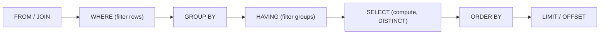
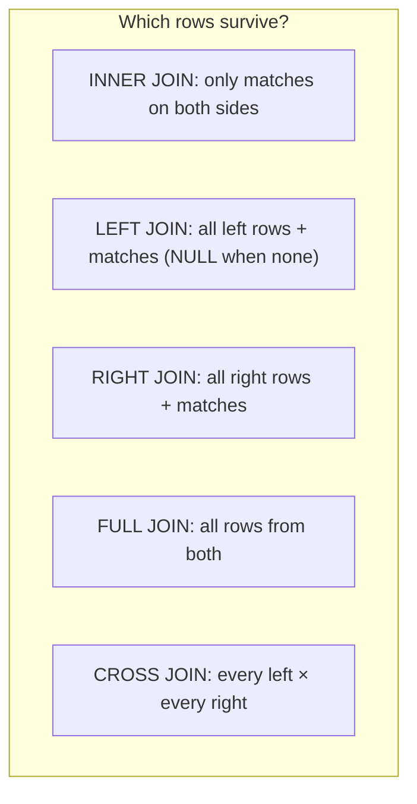

# SQL Fundamentals

> SQL is how you ask for exactly the data you need. Master `SELECT`, `WHERE`, joins, grouping, subqueries and safe pagination, and always pass values as parameters.

Roadmap topic 3 · Stage 1: Foundations

**Go deeper:** `2` Relational Model · `4` Advanced SQL · `5` Indexes · `6` Query Performance · `18` Security (SQL injection) · `04-backend-engineering/08-Databases-SQL-and-Data-Modeling` and `09-Connecting-API-to-Database`.

**Marks:** 🟢 must know · 🟡 good to know

**How the examples are checked:** all queries run on SQLite 3.54 against the dataset below. PostgreSQL-only syntax is marked.

---

#### 1. What Is It?

*Reading and changing data with queries.*

| 🟢 Must know | 🟡 Good to know |
|---|---|
| `SELECT`, `WHERE`, `ORDER BY`, `LIMIT`, `DISTINCT` | upsert (`ON CONFLICT`) |
| `INSERT`, `UPDATE`, `DELETE` and the missing-`WHERE` danger | `UNION`, `INTERSECT`, `EXCEPT` |
| aggregates: `COUNT`, `SUM`, `AVG`, `MIN`, `MAX` | bulk insert and batching |
| `GROUP BY` and `HAVING` | readable SQL |
| joins: inner, left, right, full, cross | |
| subqueries and `EXISTS` | |
| pagination: `OFFSET` vs keyset | |
| parameterized queries | |

**The sample data used below:**

```sql
-- users: (1, Ann, age 30), (2, Bob, age NULL), (3, Cy, age 25)
-- orders: (1, user 1, 1000, paid), (2, user 1, 2500, paid), (3, user 2, 500, new)
```

**Signals in an interview:** "write a query that…", "inner vs left join?", "`WHERE` vs `HAVING`?", "why is `OFFSET` slow?", "how do you prevent SQL injection?".

---

#### 2. How It Works

**Logical order of a query** (not the order you write it):



This explains why you can't use a `SELECT` alias in `WHERE` (it runs later), and why `WHERE` filters rows before grouping while `HAVING` filters groups after.

**Changing data.** `INSERT` adds rows, `UPDATE` changes them, `DELETE` removes them. **An `UPDATE` or `DELETE` without `WHERE` changes every row.** Habit: write the `WHERE`, run it as a `SELECT` first, and do changes inside a transaction.

**Aggregates and grouping.** `COUNT(*)` counts rows, `COUNT(col)` counts non-null values, `SUM/AVG/MIN/MAX` ignore `NULL`. `GROUP BY` makes one output row per group; every selected column must be grouped or aggregated.

**Joins.**



Use `LEFT JOIN` to keep rows without a match ("users with zero orders"). Filtering on the right table in `WHERE` turns a left join into an inner join; put such conditions in the `ON` clause.

**Subqueries and `EXISTS`.** A subquery is a query inside a query. `EXISTS (SELECT 1 ...)` asks "is there at least one matching row?" and is usually the safest way to say "users with no orders" (`NOT EXISTS`); `NOT IN` breaks when the subquery returns `NULL`.

**Pagination.**

| | `OFFSET` | Keyset (cursor) |
|---|---|---|
| Query | `ORDER BY id DESC LIMIT 20 OFFSET 40` | `WHERE id < :last ORDER BY id DESC LIMIT 20` |
| Cost | reads and discards the first 40 rows: slower on later pages | uses the index to jump to the position: constant |
| Live data | rows shift: duplicates or gaps | stable |
| Jump to page N | easy | not directly |

Mobile feeds should use keyset pagination (`BE 3`). Sort by a unique column (add `id` as a tie-breaker).

**Parameterized queries.** Send SQL text and values separately (`WHERE email = ?`). The database never treats the value as SQL, which prevents SQL injection (topic 18). Never build SQL with string concatenation.

🟡 **Upsert.** Insert, or update if the key exists: `INSERT ... ON CONFLICT (id) DO UPDATE SET ...` (PostgreSQL and SQLite; MySQL uses `ON DUPLICATE KEY UPDATE`). Great for idempotent writes and sync.

🟡 **Set operations.** `UNION` (distinct), `UNION ALL` (keep duplicates, faster), `INTERSECT`, `EXCEPT`. Columns must match in number and type.

🟡 **Bulk insert and batching.** One multi-row `INSERT` or a batch of prepared statements inside one transaction is far faster than thousands of single inserts (fewer round trips and commits).

🟡 **Readable SQL.** One clause per line, meaningful aliases, explicit `JOIN ... ON`, no `SELECT *` in code, comments for the unusual, and CTEs for steps (topic 4).

---

#### 3. Naive vs Better Design

| Naive | Better |
|---|---|
| `"... WHERE email = '" + email + "'"` | `WHERE email = ?` with a parameter |
| `SELECT *` | only the columns you need |
| `OFFSET 100000` for deep paging | keyset pagination |
| `UPDATE ... ` with no `WHERE` | `WHERE` + test as a `SELECT` + a transaction |
| `NOT IN (subquery)` | `NOT EXISTS` |
| `COUNT(*)` after a `LEFT JOIN` | `COUNT(right_table.id)` |
| a query per row in a loop (N+1) | one join or one `IN` query |
| thousands of single inserts | one transaction with batches |

```kotlin
// Naive: SQL injection and N+1 in four lines
val rows = users.map { u -> db.query("SELECT * FROM orders WHERE user_id = " + u.id) }       // one query per user, string-built
```

---

#### 4. SQL & Code

Basic reads (checks are the results on the sample data):

```sql
SELECT name FROM users WHERE age >= 25 ORDER BY name;                  -- Ann, Cy   (Bob's NULL age is not >= 25)
SELECT DISTINCT status FROM orders ORDER BY status;                    -- new, paid
SELECT id FROM orders ORDER BY id DESC LIMIT 2;                        -- 3, 2
```

Aggregates and grouping:

```sql
SELECT u.name, COUNT(o.id) AS orders, COALESCE(SUM(o.total_cents), 0) AS spent
FROM users u LEFT JOIN orders o ON o.user_id = u.id
GROUP BY u.id ORDER BY u.id;
-- Ann 2 3500 | Bob 1 500 | Cy 0 0

SELECT u.name FROM users u JOIN orders o ON o.user_id = u.id
GROUP BY u.id HAVING SUM(o.total_cents) > 1000;                         -- Ann
```

Checks: the left join keeps `Cy` with `0` orders. The common bug `COUNT(*)` instead of `COUNT(o.id)` makes Cy show `1` (the single joined row of NULLs). `HAVING` filters after grouping: only `Ann` spent more than 1000.

Subqueries and `EXISTS`:

```sql
SELECT name FROM users u WHERE NOT EXISTS (SELECT 1 FROM orders o WHERE o.user_id = u.id);     -- Cy
SELECT name FROM users WHERE id NOT IN (SELECT user_id FROM orders);                           -- Cy (but see below)
```

Checks: both return `Cy` here. If `orders.user_id` contained a `NULL`, the `NOT IN` version would return **no rows**, while `NOT EXISTS` still returns the right ones (`Bob`, `Cy` in that case).

Keyset vs offset:

```sql
SELECT id FROM orders WHERE id < 4 ORDER BY id DESC LIMIT 2;           -- page 1: 3, 2
SELECT id FROM orders WHERE id < 2 ORDER BY id DESC LIMIT 2;           -- page 2: 1   (the client sends the last id it saw)
SELECT id FROM orders ORDER BY id DESC LIMIT 2 OFFSET 2;               -- same page 2 with OFFSET: 1 (but scans and discards 2 rows first)
```

Checks: both give the same rows on a static table. If a new order arrives between the two page requests, `OFFSET` shows a duplicate (everything shifts down); keyset does not.

The Kotlin side of keyset pagination (cursor in, cursor out):

```kotlin
data class Page<T>(val items: List<T>, val nextCursor: Long?)

fun page(conn: Connection, userId: Long, cursor: Long?, limit: Int = 20): Page<Order> {
    val sql = "SELECT id, total_cents FROM orders WHERE user_id = ? AND id < ? ORDER BY id DESC LIMIT ?"
    conn.prepareStatement(sql).use { ps ->
        ps.setLong(1, userId); ps.setLong(2, cursor ?: Long.MAX_VALUE); ps.setInt(3, limit + 1)        // ask for one extra row
        val rows = ps.executeQuery().use { rs -> generateSequence { if (rs.next()) Order(rs.getLong(1), rs.getLong(2)) else null }.toList() }
        return Page(rows.take(limit), if (rows.size > limit) rows[limit - 1].id else null)             // extra row ⇒ there is a next page
    }
}
```

Checks: with 45 orders and `limit = 20`: page 1 has 20 items and a cursor; page 2 has 20 and a cursor; page 3 has 5 items and `nextCursor = null`.

Upsert (idempotent write):

```sql
INSERT INTO users(id, name, email) VALUES (3, 'Cyrus', 'cy@x.com')
ON CONFLICT(id) DO UPDATE SET name = excluded.name;                      -- Cy becomes Cyrus; running it twice changes nothing more
```

Set operations:

```sql
SELECT 1 UNION SELECT 1 UNION SELECT 2;                                 -- 1, 2
SELECT 1 UNION ALL SELECT 1;                                            -- 1, 1
```

Batch insert in one transaction (Kotlin/JDBC):

```kotlin
conn.autoCommit = false
conn.prepareStatement("INSERT INTO notes(user_id, title) VALUES (?, ?)").use { ps ->
    notes.chunked(500).forEach { chunk -> chunk.forEach { ps.setLong(1, it.userId); ps.setString(2, it.title); ps.addBatch() }; ps.executeBatch() }
}
conn.commit()
```

SQL injection, shown safely:

```sql
-- String-built:  "SELECT * FROM users WHERE name = '" + input + "'"   with input = x' OR '1'='1
--   → SELECT * FROM users WHERE name = 'x' OR '1'='1'      returns EVERY user
-- Parameterized: SELECT * FROM users WHERE name = ?        the whole input is just a (non-matching) name
```

---

#### 5. Numbers & Limits

| Item | Rule of thumb |
|---|---|
| Page size | 20 to 50 rows; ask for `limit + 1` to know if there is more |
| `OFFSET` cost | reads `offset + limit` rows; deep pages (offset 100,000) are slow |
| Batching | 500 to 5,000 rows per batch inside one transaction |
| `IN (...)` list | hundreds are fine; thousands: use a temp table or a join |
| `COUNT(*)` on big tables | scans or uses index statistics; avoid on hot paths, use estimates or counters |
| Round trips | each query costs ≈ 0.5 ms in the data centre; N+1 with 100 items ≈ 50 ms extra |
| Join size | joining two 1M-row tables without a good index can be catastrophic: check the plan |

---

#### 6. Common Mistakes & Edge Cases

1. SQL built from strings (injection).
2. `UPDATE`/`DELETE` without `WHERE`.
3. `COUNT(*)` after `LEFT JOIN`.
4. `WHERE` condition on the right table in a left join, turning it into an inner join.
5. `NOT IN` with `NULL`s.
6. `OFFSET` pagination on feeds.
7. Ordering by a non-unique column and paginating with a cursor (rows repeat or vanish): add `id`.
8. `SELECT *` in application code.
9. Selecting non-grouped columns with `GROUP BY`.

Edge cases: ties in `ORDER BY`; case-sensitive comparisons; integer division (`1050/100` is `10` in integer arithmetic); dates and time zones in filters; empty `IN ()`; `LIKE '%x'` can't use an index; `LIMIT` without `ORDER BY` returns arbitrary rows.

---

#### 7. Say This in the Interview

1. "A query logically runs `FROM/JOIN`, `WHERE`, `GROUP BY`, `HAVING`, `SELECT`, `ORDER BY`, `LIMIT`. `WHERE` filters rows; `HAVING` filters groups."
2. "I use `LEFT JOIN` to keep rows without matches and `COUNT(right.id)` so missing rows count as zero. For 'none exist' I use `NOT EXISTS`, not `NOT IN`."
3. "Mobile lists use keyset pagination: `WHERE id < :last ORDER BY id DESC LIMIT n`, because offsets get slower and shift when data changes."
4. "All values go in as parameters, never string concatenation, which prevents SQL injection."
5. "I batch writes in one transaction and use upserts for idempotent writes."

---

#### 8. Quick Check

1. `WHERE` vs `HAVING`?
2. Inner vs left join?
3. Why is `OFFSET 100000` slow?
4. How do you prevent SQL injection?

<details>
<summary>Answers</summary>

1. `WHERE` filters rows before grouping; `HAVING` filters groups after aggregation.
2. Inner returns only matching rows; left returns all left rows with `NULL` for missing matches.
3. The database must read and discard 100,000 rows before returning the page.
4. Parameterized queries (separate SQL and values), plus least-privilege database users.

</details>

---

#### 9. Practice

**Interview questions**

1. Write a query for the top 3 customers by total spend.
2. List users with no orders (and explain why `NOT EXISTS`).
3. Count orders per user including users with none.
4. Implement pagination for a feed.
5. What is the difference between `UNION` and `UNION ALL`?
6. How do you make a write idempotent in SQL?

**Hands-on**

1. Create the sample tables in SQLite and run every query above; change the data and re-predict the output.
2. Build a 100,000-row table and compare `OFFSET 90000` with a keyset query (time both).
3. Write a SQL-injection test against a string-built query, then fix it with parameters.
4. Write the Room `@Query` versions of three of the queries.

**Remember:** `FROM → WHERE → GROUP BY → HAVING → SELECT → ORDER BY → LIMIT` · `LEFT JOIN` + `COUNT(right.id)` · `NOT EXISTS` over `NOT IN` · keyset pagination · parameters always · always a `WHERE` on updates and deletes.
