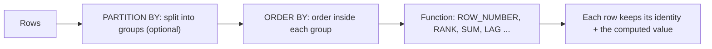

# Advanced SQL

> CTEs make queries readable, window functions compute across related rows without collapsing them, and a handful of patterns (top N per group, latest row per user, de-duplication, gaps and islands) solve most interview and real-life problems.

Roadmap topic 4 · Stage 1: Foundations

**Go deeper:** `3` SQL Fundamentals · `5` Indexes · `6` Query Performance · `20` Analytics · `03-leetcode-patterns` (SQL problems) · `04-backend-engineering/08-Databases-SQL-and-Data-Modeling`.

**Marks:** 🟢 must know · 🟡 good to know

**How the examples are checked:** all queries run on SQLite 3.54 (window functions, CTEs, JSON, FTS5). PostgreSQL-only syntax is marked.

---

#### 1. What Is It?

*The SQL features that turn long, repeated queries into short, clear ones.*

| 🟢 Must know | 🟡 Good to know |
|---|---|
| CTEs (`WITH`) | recursive CTEs |
| window functions: `ROW_NUMBER`, `RANK`, running totals, `LAG`/`LEAD` | views and materialized views |
| `CASE` expressions | stored procedures, functions, triggers |
| patterns: top N per group, latest row per user, de-duplication, gaps and islands | JSON columns and queries |
| | full-text search in the database |
| | generated columns |

**The sample data:**

```sql
-- sales(id, user_id, region, amount, day)
-- (1,1,'EU',100,'2025-01-01') (2,1,'EU',50,'2025-01-02') (3,2,'EU',70,'2025-01-02') (4,2,'US',200,'2025-01-03')
-- (5,3,'US',150,'2025-01-03') (6,3,'US',150,'2025-01-04') (7,1,'US',30,'2025-01-05')
```

**Signals in an interview:** "top 3 per category", "latest order per customer", "running total", "find duplicates", "consecutive days".

---

#### 2. How It Works

**CTEs.** `WITH name AS (query)` defines a named temporary result you can use below. They turn nested subqueries into readable steps; in many databases they are inlined, so they are for clarity, not magic speed.

**Window functions.** A window function computes a value for each row using a "window" of related rows, **without collapsing rows** the way `GROUP BY` does.



| Function | Meaning |
|---|---|
| `ROW_NUMBER()` | 1, 2, 3 … no ties |
| `RANK()` | ties share a rank, then skip (1, 2, 2, 4) |
| `DENSE_RANK()` | ties share a rank, no skip (1, 2, 2, 3) |
| `SUM() OVER (ORDER BY ...)` | running total |
| `LAG(x)` / `LEAD(x)` | previous / next row's value |
| `NTILE(n)`, `FIRST_VALUE` … | buckets, first/last in window |

**`CASE`.** `CASE WHEN condition THEN value ... ELSE value END` gives conditional logic inside a query, including pivots and bucketed counts.

**Common patterns.**

| Problem | Pattern |
|---|---|
| Top N per group | `ROW_NUMBER() OVER (PARTITION BY group ORDER BY metric DESC)`, filter `rn <= N` |
| Latest row per user | `ROW_NUMBER() OVER (PARTITION BY user ORDER BY time DESC)`, keep `rn = 1` |
| De-duplicate | `ROW_NUMBER() OVER (PARTITION BY key ORDER BY id)`, delete `rn > 1` |
| Running total / moving average | `SUM(...) OVER (ORDER BY ...)` |
| Change from previous | `value - LAG(value) OVER (ORDER BY ...)` |
| Gaps and islands | `date - ROW_NUMBER()` is constant within a run of consecutive dates |

🟡 **Recursive CTEs.** A base query plus a recursive step that refers to itself; for trees (comments, org charts, folders) and graphs (`WITH RECURSIVE`).

🟡 **Views and materialized views.** A *view* is a saved query (no stored data). A *materialized view* stores the result and must be refreshed (PostgreSQL `REFRESH MATERIALIZED VIEW`; SQLite has none). Use views for readability and access control; materialized views for expensive reports.

🟡 **Stored procedures, functions, triggers.** Code inside the database. Good for data rules that must hold for every client, audit triggers, and set-based batch work. Costs: harder to test, version, debug and scale; logic hides from the application. Prefer constraints and application code; use triggers sparingly.

🟡 **JSON columns.** `JSONB` (PostgreSQL) or `json_extract` (SQLite) for flexible attributes. Index the paths you filter on; don't hide core, frequently queried fields inside JSON.

🟡 **Full-text search.** PostgreSQL `tsvector`/`tsquery` with GIN indexes; SQLite FTS5. Good enough for many search needs before adding a search engine (topic 12).

🟡 **Generated columns.** A column computed from others and stored (`total = price * qty`), keeping derived data consistent.

---

#### 3. Naive vs Better Design

| Naive | Better |
|---|---|
| a self-join to find the latest row per user | `ROW_NUMBER() OVER (PARTITION BY user ...)` |
| loop in the app to compute a running total | `SUM() OVER (ORDER BY ...)` |
| nested subqueries three levels deep | CTEs with names |
| fetch all rows and group in Kotlin | `GROUP BY` / windows in SQL |
| business logic in a 300-line stored procedure | application code + constraints |
| JSON for everything | relational columns for queried fields, JSON for extras |
| `RANK` when you need exactly one row per group | `ROW_NUMBER` with a tie-breaker |

---

#### 4. SQL & Code

CTE for readability:

```sql
WITH per_user AS (
  SELECT user_id, SUM(amount) AS total FROM sales GROUP BY user_id
)
SELECT user_id, total FROM per_user WHERE total >= 200 ORDER BY user_id;       -- (2, 270) (3, 300)
```

Top 1 per group (largest sale per region), with a tie-breaker:

```sql
SELECT region, user_id, amount FROM (
  SELECT *, ROW_NUMBER() OVER (PARTITION BY region ORDER BY amount DESC, id) AS rn FROM sales
) WHERE rn = 1 ORDER BY region;                                                 -- EU: user 1, 100 | US: user 2, 200
```

`ROW_NUMBER` vs `RANK` vs `DENSE_RANK` on amounts `200, 150, 150, 100, 70, 50, 30`:

```sql
SELECT amount, RANK() OVER (ORDER BY amount DESC) AS r, DENSE_RANK() OVER (ORDER BY amount DESC) AS d,
       ROW_NUMBER() OVER (ORDER BY amount DESC, id) AS n
FROM sales ORDER BY amount DESC, id;
```

Checks: rows are `(200, 1, 1, 1)`, `(150, 2, 2, 2)`, `(150, 2, 2, 3)`, `(100, 4, 3, 4)`, `(70, 5, 4, 5)`, `(50, 6, 5, 6)`, `(30, 7, 6, 7)`. The two 150s tie: `RANK` gives them 2 and skips to 4; `DENSE_RANK` goes 2 then 3; `ROW_NUMBER` always gives unique numbers. If you need "top 3 sales" with ties kept, use `DENSE_RANK`; if you need exactly N rows, use `ROW_NUMBER`.

Running total and change from the previous row:

```sql
SELECT day, amount, SUM(amount) OVER (ORDER BY day, id) AS running,
       amount - LAG(amount) OVER (ORDER BY day, id) AS diff
FROM sales ORDER BY day, id;
```

Checks: running totals are `100, 150, 220, 420, 570, 720, 750`; `diff` is `NULL, -50, 20, 130, -50, 0, -120` (the first row has no previous row).

Latest row per user, and de-duplication:

```sql
SELECT user_id, day FROM (
  SELECT *, ROW_NUMBER() OVER (PARTITION BY user_id ORDER BY day DESC, id DESC) AS rn FROM sales
) WHERE rn = 1 ORDER BY user_id;                                                -- (1, 2025-01-05) (2, 2025-01-03) (3, 2025-01-04)

-- emails(id, email): (1,'a') (2,'b') (3,'a') (4,'a')   → duplicates to delete (keep the first of each email)
SELECT id FROM (SELECT id, ROW_NUMBER() OVER (PARTITION BY email ORDER BY id) AS rn FROM emails) WHERE rn > 1;   -- 3, 4
```

Gaps and islands (consecutive login days): logins on `01, 02, 03, 05, 06` January.

```sql
WITH x AS (
  SELECT day, julianday(day) - ROW_NUMBER() OVER (ORDER BY day) AS grp FROM logins      -- PostgreSQL: day - (ROW_NUMBER() OVER (ORDER BY day))::int
)
SELECT MIN(day) AS start, MAX(day) AS finish, COUNT(*) AS days FROM x GROUP BY grp ORDER BY start;
-- (2025-01-01, 2025-01-03, 3) (2025-01-05, 2025-01-06, 2)
```

Checks: two streaks, 3 days and 2 days. Within a run of consecutive days, `date − row_number` stays constant, so grouping by it finds each island. The longest streak is `MAX(days)`.

`CASE` pivot:

```sql
SELECT SUM(CASE WHEN region = 'EU' THEN amount ELSE 0 END) AS eu,
       SUM(CASE WHEN region = 'US' THEN amount ELSE 0 END) AS us FROM sales;       -- 220, 530
```

Recursive CTE for a comment tree (see topic 2): depths `(1,0) (2,1) (3,2) (4,1)`.

JSON, view, generated column, full-text:

```sql
SELECT json_extract(payload, '$.type'), json_extract(payload, '$.x') FROM ev;      -- 'click', 5   (PostgreSQL: payload->>'type')
CREATE VIEW eu_sales AS SELECT * FROM sales WHERE region = 'EU';                    -- SELECT COUNT(*) FROM eu_sales → 3
CREATE TABLE p (price INT, qty INT, total INT GENERATED ALWAYS AS (price * qty) STORED);   -- (3, 4) → total 12
CREATE VIRTUAL TABLE docs USING fts5(body);                                         -- SQLite FTS5
SELECT body FROM docs WHERE docs MATCH 'running';                                   -- 'red running shoes'
```

A trigger that keeps an audit trail (PostgreSQL-style sketch, not run):

```sql
CREATE FUNCTION touch_updated_at() RETURNS trigger AS $$ BEGIN NEW.updated_at = now(); RETURN NEW; END $$ LANGUAGE plpgsql;
CREATE TRIGGER notes_touch BEFORE UPDATE ON notes FOR EACH ROW EXECUTE FUNCTION touch_updated_at();
```

From Kotlin, the "latest per user" query inside Room:

```kotlin
@Query("""SELECT * FROM (SELECT *, ROW_NUMBER() OVER (PARTITION BY userId ORDER BY createdAt DESC, id DESC) rn FROM messages) WHERE rn = 1""")
fun latestPerUser(): Flow<List<MessageEntity>>
```

---

#### 5. Numbers & Limits

| Item | Rule of thumb |
|---|---|
| Window functions | sort the partition: index `(partition_col, order_col)` can avoid it |
| CTE | in recent PostgreSQL versions a non-recursive CTE is inlined unless used more than once or marked `MATERIALIZED` |
| Recursive CTE | add a depth limit to avoid endless loops on cyclic data |
| Materialized view | refresh cost vs freshness: nightly, or incremental if supported |
| Triggers | add per-row cost to every write; keep them tiny |
| JSON | ~2× storage and slower scans than typed columns; index with GIN/expression indexes |
| Full-text | good to millions of documents in one PostgreSQL; beyond, a search engine |

---

#### 6. Common Mistakes & Edge Cases

1. Using `RANK` when exactly one row per group is needed (ties return several).
2. Missing tie-breaker in `ORDER BY` (nondeterministic results).
3. Window functions in `WHERE` (not allowed; wrap in a subquery or CTE).
4. Assuming a CTE is always materialised or always inlined.
5. Hiding business rules in triggers.
6. JSON for fields you filter on all day.
7. A recursive CTE on cyclic data with no guard.
8. Counting streaks without handling duplicate days.

Edge cases: time zones when grouping by day; `NULL` ordering (nulls first or last); `LAG` on the first row is `NULL`; duplicates on the date column break gaps-and-islands (de-duplicate first); the default window frame with `ORDER BY` is "up to the current row" and with ties includes peers (use `ROWS BETWEEN ...` for strict row-by-row).

---

#### 7. Say This in the Interview

1. "I use window functions when I need per-row results alongside group information: top N per group, latest row per user, running totals, previous-row differences."
2. "For 'top N per group' I use `ROW_NUMBER() OVER (PARTITION BY ... ORDER BY ...)` with a tie-breaker, and `DENSE_RANK` when ties must be kept."
3. "CTEs make multi-step queries readable; recursive CTEs handle trees."
4. "Gaps and islands: date minus row number is constant inside a streak, so I group by it."
5. "I keep business logic in the application and constraints in the database; triggers only for small, universal rules like audit columns."

---

#### 8. Quick Check

1. `RANK` vs `DENSE_RANK` vs `ROW_NUMBER` with ties?
2. How do you get the latest row per user?
3. Why can't you filter on a window function in `WHERE`?
4. When is a materialized view useful?

<details>
<summary>Answers</summary>

1. `RANK` skips numbers after ties (1, 2, 2, 4); `DENSE_RANK` doesn't (1, 2, 2, 3); `ROW_NUMBER` is always unique.
2. `ROW_NUMBER() OVER (PARTITION BY user ORDER BY time DESC)` and keep `rn = 1`.
3. Window functions are computed after `WHERE`; wrap the query and filter outside.
4. For expensive aggregations read often and tolerant of staleness; refresh on a schedule.

</details>

---

#### 9. Practice

**Interview questions**

1. Return the top 3 products per category by revenue.
2. Return each customer's most recent order.
3. Find duplicate rows and delete all but one.
4. Compute a 7-day moving average.
5. Find users who logged in on 3 consecutive days.
6. List a comment thread with depth.

**Hands-on**

1. Load the sales sample and run every query; change ties and predict the output.
2. Solve the gaps-and-islands problem for your own login data and find the longest streak.
3. Rewrite a query with three nested subqueries using CTEs.
4. Explore `EXPLAIN` for the top-N-per-group query with and without an index on `(region, amount)`.

**Coding warm-ups (LeetCode SQL)**

| # | Question | Link to this topic |
|---|---|---|
| 185 | [Department Top Three Salaries](https://leetcode.com/problems/department-top-three-salaries/) (Hard) | top N per group |
| 196 | [Delete Duplicate Emails](https://leetcode.com/problems/delete-duplicate-emails/) (Easy) | de-duplication |
| 180 | [Consecutive Numbers](https://leetcode.com/problems/consecutive-numbers/) (Medium) | gaps and islands / `LAG` |
| 603 | [Consecutive Available Seats](https://leetcode.com/problems/consecutive-available-seats/) (Easy, premium) | consecutive rows |
| 1321 | [Restaurant Growth](https://leetcode.com/problems/restaurant-growth/) (Medium) | moving average |
| 1127 | [User Purchase Platform](https://leetcode.com/problems/user-purchase-platform/) (Hard, premium) | `CASE` pivots |

**Remember:** CTEs for readability · windows keep rows and add per-row calculations · `ROW_NUMBER` + tie-breaker for exactly one row · `RANK`/`DENSE_RANK` for ties · date minus row number finds islands · business rules in code, not triggers.
