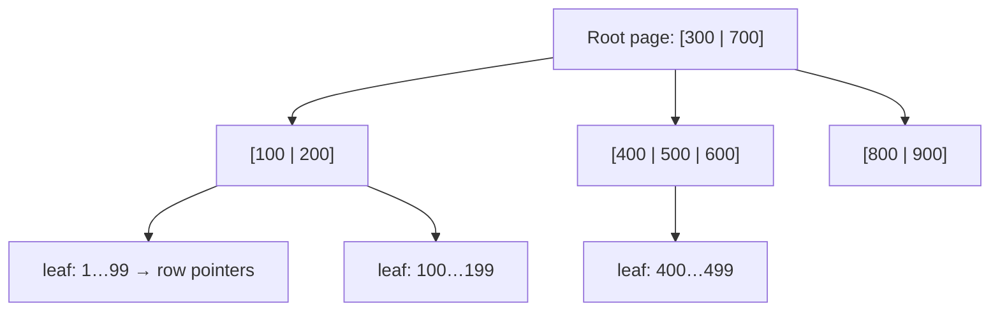

# Indexes

> An index is a sorted structure that lets the database find rows without reading the whole table. It is the biggest performance lever you have, and it has a price: slower writes and more storage.

Roadmap topic 5 · Stage 2: Performance

**Go deeper:** `6` Query Performance & Execution Plans · `7` Storage Engines (B-trees) · `2` Relational Model · `04-backend-engineering/10-Indexes-and-Query-Performance` · `02-algorithm` (binary search, trees).

**Marks:** 🟢 must know · 🟡 good to know

**How the examples are checked:** run on SQLite 3.54 with a 200,000-row `notes` table (`EXPLAIN QUERY PLAN`; timings are from one laptop run and only show orders of magnitude). PostgreSQL's `EXPLAIN` output differs in wording but not in ideas.

---

#### 1. What Is It?

*A lookup structure that trades write cost and space for read speed.*

| 🟢 Must know | 🟡 Good to know |
|---|---|
| full table scan vs index lookup | covering index and index-only scan |
| B-tree: the default; equality and range | partial and expression indexes |
| the cost: slower writes, more storage | unique indexes as a correctness tool |
| composite index: column order, leftmost rule | selectivity and cardinality |
| what to index: `WHERE`, `JOIN`, `ORDER BY`, foreign keys | clustered vs non-clustered |
| why an index is not used | other types: hash, GIN, GiST, full-text, spatial |

1. **Full table scan:** read every row (`O(n)`).
2. **Index lookup:** walk a sorted tree to the rows (`O(log n)`).
3. **Selectivity:** how well a condition narrows rows. `user_id = 1234` (a few rows) is selective; `status = 'open'` (a third of rows) is not.

**Signals in an interview:** "how do you speed up this query?", "which index would you create?", "why isn't my index used?", "what's the cost of an index?".

---

#### 2. How It Works

**The B-tree.** A balanced tree of sorted pages. Each node holds many keys (hundreds) and pointers, so the tree is shallow: about 3 to 4 page reads find a row among a billion.



B-trees keep keys **sorted**, so they serve equality (`= 5`), ranges (`BETWEEN`, `>`), prefix searches (`LIKE 'abc%'`) and `ORDER BY` without a separate sort.

**The cost.** Every `INSERT`, `UPDATE` of an indexed column and `DELETE` must also update every index on the table, and indexes take disk and memory. Index what you query, not everything.

**Composite index and the leftmost rule.** An index on `(user_id, status, created)` is sorted by `user_id`, then `status` within it, then `created`. It helps queries that use a **leftmost prefix**: `user_id`; `user_id, status`; `user_id, status, created`. It does not help a query that skips the first column (`status` alone). Order columns: **equality columns first**, then the **range or sort column last**.

**What to index.**

1. Columns in `WHERE` filters you run often and that narrow results.
2. Foreign keys and join columns.
3. `ORDER BY` columns (to avoid sorting), combined with the filter columns.
4. Columns with `UNIQUE` requirements (the unique index enforces them).

**Why an index is not used.**

| Cause | Example | Fix |
|---|---|---|
| function on the column | `WHERE lower(title) = 'x'` | expression index on `lower(title)`, or store normalised |
| leading wildcard | `LIKE '%abc'` | full-text/trigram index, or reverse the design |
| type mismatch | `WHERE phone = 5551234` for a text column | match the types |
| low selectivity | `WHERE status = 'open'` (30% of rows) | the planner prefers a scan; combine with a selective column |
| skipping the leftmost column | index `(a, b)`, query on `b` | add an index starting with `b` |
| stale statistics | planner thinks the table is small | `ANALYZE` |
| `OR` across different columns | `a = 1 OR b = 2` | indexes on both, or `UNION` |

🟡 **Covering index and index-only scan.** If the index contains every column the query needs, the database never touches the table (PostgreSQL `INCLUDE` columns). Great for hot read paths.

🟡 **Partial (filtered) and expression indexes.** Index only the rows you query (`WHERE status = 'open'`) or a computed value (`lower(email)`). Smaller and faster to maintain.

🟡 **Unique indexes as a correctness tool.** `UNIQUE` prevents duplicate emails, double bookings and duplicate idempotency keys under concurrency, better than "check then insert" in code (topics 8, 9).

🟡 **Selectivity and cardinality.** *Cardinality* = number of distinct values. High-cardinality columns (`email`, `user_id`) make good leading index columns; boolean-like columns rarely do alone.

🟡 **Clustered vs non-clustered.** In InnoDB (MySQL) and SQLite (rowid tables), the table data is stored in primary-key order (clustered). In PostgreSQL the table is a heap and all indexes point to it. Consequences: primary-key choice affects locality and secondary index size.

🟡 **Other types.** Hash (equality only), GIN (arrays, JSONB, full-text), GiST/SP-GiST (geometry, ranges), BRIN (huge naturally ordered tables), full-text and spatial indexes, vector indexes (HNSW) for embeddings (`AI 6`).

---

#### 3. Naive vs Better Design

| Naive | Better |
|---|---|
| no indexes: "it's fast on my laptop" | indexes for the key queries, verified with `EXPLAIN` |
| an index on every column | indexes chosen from real queries |
| one single-column index per filter column | a composite index matching filter + sort |
| `WHERE lower(email) = ?` with a plain index | expression index or normalised column |
| indexing a boolean alone | partial index or composite with a selective column |
| forgetting FK indexes | index every foreign key |
| adding indexes in production without testing | test on realistic data, create concurrently |

```sql
-- Naive: the filter and the sort need two steps; the index covers only one
CREATE INDEX idx_user ON notes(user_id);
SELECT id FROM notes WHERE user_id = 1234 AND status = 'open' ORDER BY created DESC LIMIT 10;
```

---

#### 4. SQL & Code

No index vs index (200,000 rows, 5,000 users):

```sql
EXPLAIN QUERY PLAN SELECT id FROM notes WHERE user_id = 1234;
-- before: SCAN notes                                        (about 3 ms: reads all 200,000 rows)
CREATE INDEX idx_user ON notes(user_id);
-- after:  SEARCH notes USING COVERING INDEX idx_user (user_id=?)    (about 0.006 ms: roughly 500× faster)
```

Composite index for filter + sort:

```sql
SELECT id FROM notes WHERE user_id = 1234 AND status = 'open' ORDER BY created DESC LIMIT 10;
-- with idx_user only:  SEARCH ... USING INDEX idx_user (user_id=?)  +  USE TEMP B-TREE FOR ORDER BY   (finds the user's rows, then sorts)
CREATE INDEX idx_user_status_created ON notes(user_id, status, created);
-- with the composite:  SEARCH ... USING COVERING INDEX idx_user_status_created (user_id=? AND status=?)   (no sort step)
```

Checks: the composite removes the temporary sort and is about 5× faster in this run. Rule: equality columns (`user_id`, `status`) first, then the sort column (`created`) last.

The leftmost rule in the plans:

```sql
-- index (user_id, status, created)
WHERE user_id = 5 AND created > 100                 → SEARCH ... (user_id=?)            -- seeks on user_id only; created is filtered, not seeked
WHERE status = 'open' AND created > 100000          → SCAN ... USING COVERING INDEX     -- skipping user_id: scans the whole index, no fast seek
```

Why an index is not used:

```sql
CREATE INDEX idx_title ON notes(title);
WHERE title = 'note 5'                → SEARCH ... USING COVERING INDEX idx_title (title=?)
WHERE lower(title) = 'note 5'         → SCAN ...                      -- function on the column
WHERE title LIKE '%5'                 → SCAN ...                      -- leading wildcard
-- fix 1: CREATE INDEX idx_title_lower ON notes(lower(title));  (expression index; PostgreSQL and SQLite)
```

Partial index:

```sql
CREATE INDEX idx_open ON notes(user_id) WHERE status = 'open';      -- only 'open' rows are indexed: smaller, cheaper writes
```

The cost of indexes (100,000 inserts into a 4-column table): without secondary indexes about `0.04` s; with three indexes about `0.12` s, **2.8× slower**. Reads got faster; writes paid. Don't add indexes you don't use.

Unique index as correctness:

```sql
CREATE UNIQUE INDEX uq_idem ON payments(user_id, idempotency_key);   -- a repeated request cannot create a second payment
```

PostgreSQL extras (not run): `CREATE INDEX CONCURRENTLY idx ON notes(user_id);` builds without blocking writes; `CREATE INDEX ... INCLUDE (title)` makes a covering index; `CREATE INDEX ... USING GIN (payload)` for JSONB.

Room (Android) declares indexes on entities:

```kotlin
@Entity(tableName = "notes", indices = [Index(value = ["userId", "status", "created"])])
data class NoteEntity(@PrimaryKey val id: Long, val userId: Long, val status: String, val created: Long, val title: String)
```

Estimate B-tree depth:

```kotlin
fun btreeDepth(rows: Double, fanout: Int = 200): Int { var d = 1; var capacity = fanout.toDouble(); while (capacity < rows) { capacity *= fanout; d++ }; return d }
```

Checks: with a fan-out of 200, `btreeDepth(1_000.0)` → `2`, `btreeDepth(1_000_000.0)` → `3`, `btreeDepth(1_000_000_000.0)` → `4`. A billion rows need only about four page reads (the top levels are cached in memory).

---

#### 5. Numbers & Limits

| Item | Rule of thumb |
|---|---|
| Scan vs index | scan `O(n)`; index `O(log n)`: 200,000 rows ≈ 3 ms vs 0.006 ms in the sample run (about 500×) |
| B-tree depth | 3 to 4 levels for billions of rows (fan-out ~200 or more) |
| Write cost | each index adds cost to every write (2–3× slower inserts with a few indexes on a small table) |
| Index size | roughly 10–40% of table size per index; wide composite or text indexes more |
| Number of indexes | few per table (3 to 6 is typical); remove unused ones |
| Selectivity | an index helps when the condition matches a small share of rows (rule of thumb under ~10–20%) |
| UUID keys | random UUIDs scatter inserts across the tree; time-ordered ids are friendlier |
| Index build | big tables: use online/concurrent builds in production |

---

#### 6. Common Mistakes & Edge Cases

1. No index for a key query, or no index on a foreign key.
2. Indexing every column.
3. Wrong column order in a composite index.
4. Functions or implicit casts on indexed columns.
5. Leading wildcards.
6. Never checking the plan.
7. Creating indexes on a busy production table without a concurrent build.
8. Keeping unused or duplicate indexes (an index on `(a)` is redundant with `(a, b)`).

Edge cases: very small tables (a scan is faster; the planner ignores the index); skewed data (the planner uses statistics; one user with half the rows); case-insensitive search; sorting by two directions needs a matching index; `OR` conditions; updates to indexed columns on hot rows; on mobile, indexes also cost storage and write time on the device (topic 21).

---

#### 7. Say This in the Interview

1. "An index is a sorted B-tree: lookups and range scans take `O(log n)` instead of `O(n)`, a few page reads even for billions of rows. The price is slower writes and more storage."
2. "For a query with filters and a sort I make one composite index: equality columns first, then the range or sort column, so there's no separate sort."
3. "Indexes need a leftmost prefix; functions on the column, leading wildcards and type mismatches stop the index being used."
4. "I check with `EXPLAIN` before and after, and I index foreign keys and the hot queries rather than every column."
5. "Unique indexes are also my protection against duplicates and double bookings under concurrency."

---

#### 8. Quick Check

1. Why does a composite index `(a, b)` not help a query on `b`?
2. What is the cost of an index?
3. Name two reasons an index isn't used.
4. Equality columns or range column first?

<details>
<summary>Answers</summary>

1. It is sorted by `a` first; without `a` the database can't seek into it.
2. Slower writes, more storage and memory, and maintenance.
3. A function on the column, a leading wildcard, a type mismatch, low selectivity, skipping the leftmost column.
4. Equality columns first, the range or sort column last.

</details>

---

#### 9. Practice

**Interview questions**

1. This query is slow. What do you do?
2. How does a B-tree index work?
3. Which composite index would you create for `WHERE user_id = ? AND status = ? ORDER BY created DESC`?
4. Why can adding indexes slow down an app?
5. What is a covering index?
6. When is a partial index useful?

**Hands-on**

1. Create a 200,000-row table, time a query with and without an index, and read both plans.
2. Create `(a, b, c)` and test which of 6 queries use it, by plan.
3. Break an index with `lower()` and fix it with an expression index.
4. Measure insert time with 0, 1 and 3 indexes.
5. Find an unused index in your own schema.

**Coding warm-ups (LeetCode)**

| # | Question | Link to this topic |
|---|---|---|
| 704 | [Binary Search](https://leetcode.com/problems/binary-search/) (Easy) | the idea behind sorted lookups |
| 208 | [Implement Trie (Prefix Tree)](https://leetcode.com/problems/implement-trie-prefix-tree/) (Medium) | prefix indexes |
| 981 | [Time Based Key-Value Store](https://leetcode.com/problems/time-based-key-value-store/) (Medium) | sorted lookups by timestamp |

**Remember:** B-tree = sorted, shallow, great for equality + range + sort · composite: equality first, range last, leftmost prefix · don't wrap indexed columns in functions · index foreign keys and hot queries · writes pay for every index · check the plan.
