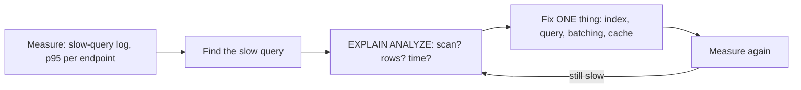

# Query Performance & Execution Plans

> Measure first, then fix one thing at a time. Read the execution plan to see what the database really does, and look for the usual suspects: a missing index, the N+1 pattern, `SELECT *`, deep `OFFSET`, no limits, and too many connections.

Roadmap topic 6 · Stage 2: Performance

**Go deeper:** `5` Indexes · `7` Storage Engines · `9` Concurrency (locks) · `13` Caching · `14` Replication · `19` Operations · `04-backend-engineering/09-Connecting-API-to-Database` and `10-Indexes-and-Query-Performance` · `06-mobile-engineering/11-Performance-and-Memory`.

**Marks:** 🟢 must know · 🟡 good to know

**How the examples are checked:** run on SQLite 3.54 (`EXPLAIN QUERY PLAN`, query counting). PostgreSQL's `EXPLAIN (ANALYZE, BUFFERS)` shows more detail with the same ideas.

---

#### 1. What Is It?

*Finding why a query is slow and making it fast.*

| 🟢 Must know | 🟡 Good to know |
|---|---|
| read a plan: `EXPLAIN`, `EXPLAIN ANALYZE` | join algorithms: nested loop, hash join, merge join |
| sequential scan vs index scan; estimated vs actual rows | statistics and the planner |
| usual causes: missing index, N+1, `SELECT *`, big `OFFSET`, no limits | batching and fewer round trips |
| the N+1 problem and fixes | result caching and read replicas |
| connection pooling and limits | locks and long transactions as a cause |
| measure first: slow-query log, p95 | |

1. **Execution plan:** the steps the database chose to run your query.
2. **`EXPLAIN`** shows the plan; **`EXPLAIN ANALYZE`** runs the query and shows actual time and rows.
3. **N+1:** one query for a list, then one more for each item.

**Signals in an interview:** "this endpoint is slow, how do you debug it?", "what is N+1?", "how do you read an EXPLAIN?", "why do we need a connection pool?".

---

#### 2. How It Works

**The method.**



Never guess. The slowest part is often not the query you suspected.

**Reading a plan.** Look at, in this order:

| Look at | Meaning |
|---|---|
| Access method | `Seq Scan`/`SCAN` (reads all rows) vs `Index Scan`/`SEARCH` (jumps to rows) |
| Rows: estimated vs actual | a big gap means stale statistics (`ANALYZE`) |
| Sort / temp table | an unindexed `ORDER BY` or `GROUP BY` |
| Join type and order | nested loop (good with an index on the inner side), hash join (good for big unsorted sets), merge join (both sides sorted) |
| Loops and time | a node repeated 10,000 times is the N+1 inside one plan |
| Buffers/IO (PostgreSQL) | pages read from disk vs cache |

**The usual causes of slow queries.**

| Cause | Symptom | Fix |
|---|---|---|
| missing index | `SCAN`/`Seq Scan` on a big table | index the filter/join/sort columns (topic 5) |
| N+1 queries | hundreds of tiny queries per request | join, or one `IN` query |
| `SELECT *` | wide rows, more IO, no covering index | select needed columns |
| deep `OFFSET` | later pages slower and slower | keyset pagination |
| no `LIMIT` | returning a huge result | limit and paginate |
| function on indexed column | index ignored | expression index or rewrite |
| too many round trips | latency × count | batch, join, cache |
| long transactions / locks | queries wait | shorten transactions (topic 9) |
| not enough memory / cold cache | disk reads | tune, scale, cache |

**The N+1 problem.** The code loads 100 users, then runs one query per user to load their orders: 101 queries. In a data centre each query costs ≈ 0.5 ms of round trip alone, so the page takes about 50 ms before any real work. Fix with one join, or two queries using `IN`.

**Connection pooling and limits.** Opening a connection is expensive and databases limit them (PostgreSQL's default is 100). A **pool** keeps a few open connections and lends them to requests. The pool size times the number of servers must fit under the limit; a pool that is too large causes contention, too small causes queueing. Size by `connections ≈ throughput × query time` (Little's law): 500 queries/second at 20 ms each ≈ 10 busy connections. External poolers (PgBouncer) help when many app instances exist. Always return connections (`use {}`).

**Measure first.** Turn on the **slow-query log** (queries slower than, say, 100 ms), use `pg_stat_statements` (PostgreSQL) for the most expensive queries by total time, and track p95/p99 latency per endpoint. Fix the biggest total cost, not the prettiest query.

🟡 **Join algorithms.** *Nested loop*: for each row on the left, probe the right (fast with an index on the right; terrible without). *Hash join*: build a hash table from the smaller input, probe with the larger (good for big, unsorted sets). *Merge join*: walk two sorted inputs together.

🟡 **Statistics and the planner.** The planner estimates row counts from statistics and chooses the cheapest plan by cost. Stale statistics or skewed data cause bad plans; `ANALYZE` refreshes them, and sometimes extended statistics or a rewrite help.

🟡 **Batching and fewer round trips.** Multi-row inserts, batch updates, one query returning what a screen needs, `RETURNING` clauses, and pipelining.

🟡 **Result caching and read replicas.** Cache hot, repeated, tolerant-of-stale results (cache-aside in Redis); send heavy reads to a replica (topics 13, 14).

🟡 **Locks and long transactions.** A transaction holding locks blocks others; a long-open transaction also keeps old row versions alive. Keep transactions short; never call external services inside one.

---

#### 3. Naive vs Better Design

| Naive | Better |
|---|---|
| guess and add random indexes | slow-query log → `EXPLAIN` → one fix → measure |
| loop with one query per item | join or `WHERE id IN (...)` |
| `SELECT *` everywhere | explicit columns |
| `OFFSET` pagination | keyset pagination |
| open a connection per request | a pool with a sensible size |
| unbounded queries | `LIMIT` and pagination |
| reports on the primary at peak | replica or warehouse |
| trust the ORM blindly | log the SQL it generates |

```kotlin
// Naive: N+1 — one query for users, then one per user
val users = userDao.all()
val withOrders = users.map { u -> u to orderDao.forUser(u.id) }
```

---

#### 4. SQL & Code

N+1 vs the fixes (100 users, 1,000 orders, counted on SQLite):

```sql
-- N+1: SELECT id FROM users;  then 100 × SELECT id,total FROM orders WHERE user_id = ?      → 101 queries
-- Fix 1 (IN):   SELECT id FROM users;  SELECT user_id,id,total FROM orders WHERE user_id IN (1,2,...,100)      → 2 queries
-- Fix 2 (join): SELECT u.id, o.id, o.total FROM users u LEFT JOIN orders o ON o.user_id = u.id               → 1 query
```

Checks: counted queries are `101`, `2` and `1`, all returning the same 1,000 orders. At ≈ 0.5 ms per round trip, N+1 costs ≈ 50 ms of pure latency; the join costs ≈ 0.5 ms plus the work.

In Kotlin (two-query version that groups in memory):

```kotlin
fun ordersByUser(conn: Connection, userIds: List<Long>): Map<Long, List<Order>> {
    if (userIds.isEmpty()) return emptyMap()
    val marks = userIds.joinToString(",") { "?" }
    conn.prepareStatement("SELECT user_id, id, total FROM orders WHERE user_id IN ($marks)").use { ps ->
        userIds.forEachIndexed { i, id -> ps.setLong(i + 1, id) }
        return ps.executeQuery().use { rs -> generateSequence { if (rs.next()) rs.getLong(1) to Order(rs.getLong(2), rs.getLong(3)) else null }.toList() }
            .groupBy({ it.first }, { it.second })
    }
}
```

In Room, avoid N+1 with a relation:

```kotlin
data class UserWithOrders(@Embedded val user: UserEntity, @Relation(parentColumn = "id", entityColumn = "userId") val orders: List<OrderEntity>)
@Transaction @Query("SELECT * FROM users") fun usersWithOrders(): Flow<List<UserWithOrders>>      // Room runs 2 queries, not N+1
```

Reading plans:

```sql
EXPLAIN QUERY PLAN SELECT u.name, o.total FROM users u JOIN orders o ON o.user_id = u.id WHERE u.id = 5;
-- SEARCH u USING INTEGER PRIMARY KEY (rowid=?)          ← one user by primary key
-- SEARCH o USING INDEX io (user_id=?)                   ← that user's orders via the index (nested loop with an index: good)
EXPLAIN QUERY PLAN SELECT * FROM orders WHERE total > 5000;
-- SCAN orders                                           ← no index on total: reads every row
```

PostgreSQL version (not run) with real timings:

```sql
EXPLAIN (ANALYZE, BUFFERS) SELECT * FROM orders WHERE user_id = 42 ORDER BY created_at DESC LIMIT 20;
-- Look for: Index Scan vs Seq Scan; "rows=… actual rows=…"; "Sort"; "Buffers: shared hit=… read=…"; Execution Time
```

Deep `OFFSET` vs keyset (200,000 rows, SQLite, one laptop run): `ORDER BY id DESC LIMIT 20 OFFSET 190000` ≈ `0.73 ms`; `WHERE id < 10001 ORDER BY id DESC LIMIT 20` ≈ `0.005 ms`: about 150× faster, and the gap grows with the offset.

Pool settings (HikariCP):

```kotlin
val ds = HikariDataSource(HikariConfig().apply {
    jdbcUrl = "jdbc:postgresql://db/notes"; username = "app"; password = secret
    maximumPoolSize = 10                    // per server instance; instances × 10 must stay under the database limit
    connectionTimeout = 2_000               // fail fast instead of queueing forever
    maxLifetime = 1_800_000
})
```

Pool size by Little's law:

```kotlin
fun busyConnections(queriesPerSecond: Double, avgQuerySeconds: Double) = Math.ceil(queriesPerSecond * avgQuerySeconds).toInt()
fun fitsLimit(instances: Int, poolPerInstance: Int, dbMax: Int, reserve: Int = 10) = instances * poolPerInstance <= dbMax - reserve
```

Checks: `busyConnections(500.0, 0.02)` → `10`. With 8 instances × 10 = 80 against a limit of 100 and 10 reserved → `80 <= 90` → `true`; with 12 instances → `120 <= 90` → `false` (use a pooler or shrink the pools).

Find the worst queries (PostgreSQL, not run):

```sql
SELECT query, calls, total_exec_time, mean_exec_time FROM pg_stat_statements ORDER BY total_exec_time DESC LIMIT 10;
```

Select only what you need:

```sql
SELECT id, title FROM notes WHERE user_id = ? ORDER BY id DESC LIMIT 20;      -- not SELECT * (which also loads the big body column)
```

---

#### 5. Numbers & Limits

| Item | Rule of thumb |
|---|---|
| Round trip in a data centre | ≈ 0.5 ms; across regions 50–150 ms |
| Slow-query threshold | log queries over 100 ms (200 ms for reporting); investigate the top by total time |
| API time budget | database time under ~50% of the p95 target (for example ≤ 100 ms of a 300 ms budget) |
| Pool size | `connections ≈ QPS × query seconds`; typically 10 to 20 per instance; PostgreSQL default max 100 |
| Page size | 20 to 50 rows |
| Batch size | 500 to 5,000 rows |
| Plan check | actual rows within ~10× of estimated rows |
| Cache hit ratio | aim for > 99% for OLTP working sets |

---

#### 6. Common Mistakes & Edge Cases

1. Optimising without measuring.
2. N+1 hidden inside an ORM or inside Room relations misuse.
3. Adding indexes without checking the plan.
4. A giant pool on many instances (exhausting connections).
5. `SELECT *`, no `LIMIT`.
6. Deep `OFFSET` on feeds.
7. Running analytics on the primary.
8. Ignoring the slow-query log until an incident.

Edge cases: the plan changes with data volume (a query fast on 1,000 rows, slow on 10 million: test at scale); parameter sniffing (a plan good for one value, bad for another); stale statistics after a bulk load; a "fast" query that waits on a lock; ORMs generating huge `IN` lists; a connection leak (missing `close`) draining the pool.

---

#### 7. Say This in the Interview

1. "I measure first with the slow-query log or `pg_stat_statements` and p95 per endpoint, read the `EXPLAIN ANALYZE` plan, change one thing, and measure again."
2. "The usual causes are a missing index, the N+1 pattern, `SELECT *`, deep `OFFSET` and unbounded queries."
3. "For N+1 I use a join or one `IN` query; in Room, `@Relation` with `@Transaction`."
4. "I pool connections: pool size ≈ queries per second × query time, and instances × pool must stay under the database's limit."
5. "Beyond query tuning I use caching and read replicas for heavy reads, and keep transactions short so locks don't pile up."

---

#### 8. Quick Check

1. What is N+1 and how do you fix it?
2. What does a `Seq Scan` on a big table suggest?
3. Why use a connection pool?
4. Which comes first: guessing or measuring?

<details>
<summary>Answers</summary>

1. One query for a list plus one per item; fix with a join or a single `IN` query.
2. A missing or unusable index (or a query returning most of the table).
3. Opening connections is expensive and databases limit them; a pool reuses a small set.
4. Measuring: slow-query log, `EXPLAIN ANALYZE`, p95.

</details>

---

#### 9. Practice

**Interview questions**

1. An endpoint takes 2 seconds. How do you find out why?
2. How do you read an execution plan?
3. What is the N+1 problem?
4. Why is `OFFSET` slow for deep pages?
5. How do you size a connection pool?
6. When would you use a read replica or a cache?

**Hands-on**

1. Build users and orders with 100 and 1,000 rows, count queries in the N+1 version and fix it two ways.
2. Run `EXPLAIN` on five queries and say what each plan means.
3. Compare `OFFSET` and keyset pagination at offset 190,000.
4. Turn on the slow-query log in a local PostgreSQL and find the worst query of your app.

**Remember:** measure → `EXPLAIN` → fix one thing → measure · scan vs index, estimated vs actual rows · N+1 → join or `IN` · keyset not `OFFSET` · pool size ≈ QPS × time, instances × pool < limit · short transactions.
