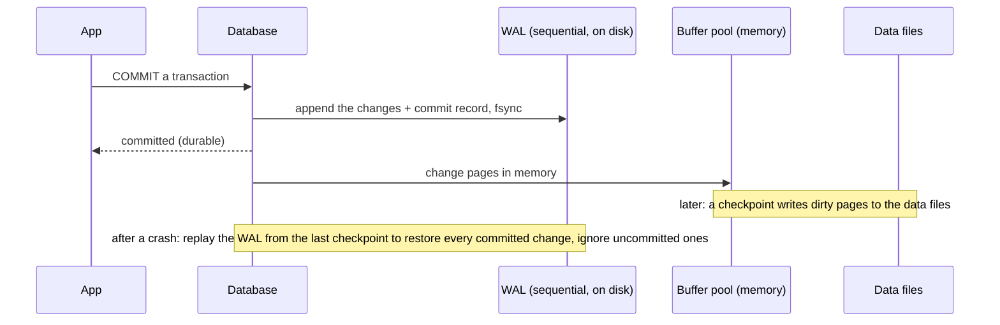

# Storage Engines & Internals

> Knowing how a database stores data on disk explains its behaviour: why writes go to a log first, why hot data lives in memory, why B-tree and LSM engines suit different workloads, and how a crash is survived.

Roadmap topic 7 · Stage 2: Performance

**Go deeper:** `5` Indexes (B-trees) · `8` Transactions (durability) · `9` Concurrency (MVCC) · `14` Replication (WAL shipping) · `17` Backup & Recovery (PITR) · `20` Analytics (column stores).

**Marks:** 🟢 must know · 🟡 good to know

**How the examples are checked:** small simulations and SQLite 3.54 (WAL mode). Page sizes and tuning values differ by engine; treat numbers as typical.

---

#### 1. What Is It?

*How data is laid out and protected on disk and in memory.*

| 🟢 Must know | 🟡 Good to know |
|---|---|
| pages, rows; disk vs memory speed | LSM basics: memtable, SSTable, compaction |
| write-ahead log (WAL) | row store vs column store |
| buffer pool / page cache | MVCC storage, vacuum and bloat |
| B-tree engines vs LSM-tree engines | checkpoints, fsync, durability settings |
| crash recovery in plain words | in-memory databases |

1. **Page:** the unit of storage and IO (commonly 4–16 KB). A table and its indexes are sets of pages.
2. **WAL:** an append-only log of changes written *before* the data pages.
3. **Buffer pool:** memory holding recently used pages.
4. **Engine:** the part of the database that stores and retrieves data (InnoDB, PostgreSQL heap, SQLite B-tree, RocksDB).

**Signals in an interview:** "what happens when the power fails mid-transaction?", "why is Cassandra good at writes?", "what is a WAL?", "B-tree vs LSM?".

---

#### 2. How It Works

**Disk and memory speeds.** Memory ≈ 100 ns, SSD random read ≈ 100 µs (1,000× slower), spinning disk ≈ 10 ms (100,000× slower), network round trip ≈ 0.5 ms. Databases are designed to avoid random disk IO: keep hot pages in memory, write sequentially, and read in pages, not rows.

**Pages and rows.** The database reads and writes whole pages. A page holds many rows (a row of 200 B in an 8 KB page: about 40 rows). A **B-tree** index page holds keys and pointers: with 8-byte keys and 8-byte pointers, a 4 KB page fits about 256 entries, so the tree is shallow (topic 5).

**Write-ahead log (WAL) and crash recovery.**



The rule: **log first, data later.** A commit only needs one sequential, fsynced log write (fast); the scattered data-page writes happen in the background. After a crash, the database replays the log (redo) and discards unfinished transactions (undo), so committed data is never lost and half-done transactions never appear. The same log feeds **replication** (followers replay it) and **point-in-time recovery** (topics 14, 17).

**Buffer pool / page cache.** Frequently used pages stay in memory; a read hits memory (fast) or loads the page from disk (slow). The **cache hit ratio** (ideally over 99% for OLTP) tells you whether the working set fits. A common setting is to give the buffer pool a large share of RAM (and leave the rest for the OS cache).

**B-tree engines vs LSM-tree engines.**

| | B-tree engines | LSM-tree engines |
|---|---|---|
| Examples | PostgreSQL, MySQL InnoDB, SQLite, Oracle | RocksDB, LevelDB, Cassandra, HBase, ScyllaDB |
| Writes | update pages in place (random writes) | append to memory then flush sorted files (sequential writes) |
| Reads | find in one tree: predictable, fast | check memory and several files (Bloom filters help) |
| Write amplification | moderate | compaction rewrites data repeatedly |
| Strength | read-heavy and mixed OLTP, range scans | very high write rates, time series, logs |
| Weakness | random write cost at scale | read latency variance, compaction work, space amplification |

🟡 **LSM basics.** Writes go to the WAL and an in-memory sorted **memtable**; when it fills it is flushed to an immutable sorted file (**SSTable**). Reads check the memtable, then SSTables newest to oldest. Background **compaction** merges SSTables, removes overwritten and deleted entries (tombstones), and keeps reads fast.

🟡 **Row store vs column store.** A *row store* keeps each row together (good for fetching or updating whole records: apps). A *column store* keeps each column together (good for scanning a few columns over many rows and for compression: analytics, topic 20).

🟡 **MVCC storage, vacuum and bloat.** PostgreSQL keeps old row versions so readers don't block writers (topic 9). Dead versions pile up as **bloat** until `VACUUM` reclaims them (autovacuum runs it); long transactions prevent cleanup. InnoDB keeps old versions in an undo log.

🟡 **Checkpoints, fsync and durability settings.** A **checkpoint** flushes dirty pages so recovery has less log to replay. `fsync` forces data to disk; turning it off (or `synchronous_commit = off`) makes commits faster but can lose the last moments of data on a crash. Defaults protect you; change them only knowingly.

🟡 **In-memory databases.** Redis, Memcached, and in-memory modes keep data in RAM for speed; durability needs snapshots or logs (topic 13). Trade-off: cost per GB and recovery time.

---

#### 3. Naive vs Better Design

| Naive | Better |
|---|---|
| turn off `fsync` for speed | keep defaults; batch writes inside transactions |
| a tiny buffer pool | size memory so the working set fits |
| one huge transaction that stays open | short transactions (bloat, locks, long recovery) |
| an LSM database for read-heavy relational data | a B-tree engine for mixed OLTP |
| a B-tree database for a firehose of append-only events | an LSM or time-series store |
| ignoring vacuum/bloat | monitor autovacuum and long transactions |
| random UUIDs as primary keys on a huge B-tree table | time-ordered keys |

---

#### 4. SQL & Code

SQLite in WAL mode, as an example of the log (run it yourself):

```sql
PRAGMA journal_mode = WAL;            -- returns: wal
CREATE TABLE t (x); INSERT INTO t VALUES (1);
-- the folder now holds:  t.db  t.db-wal  t.db-shm    ← the write-ahead log and its shared-memory index
PRAGMA wal_checkpoint(TRUNCATE);      -- copies logged pages into t.db and truncates the log (a checkpoint)
```

Checks: after the first write, the directory listing shows `t.db`, `t.db-shm` and `t.db-wal`. WAL mode lets readers keep reading while one writer appends, and it is the usual choice for Room/SQLite on Android (`JournalMode.WRITE_AHEAD_LOGGING`).

Android Room uses WAL by default on modern devices:

```kotlin
Room.databaseBuilder(context, AppDatabase::class.java, "app.db")
    .setJournalMode(RoomDatabase.JournalMode.WRITE_AHEAD_LOGGING)
    .build()
```

A toy write-ahead log (pure Kotlin) to show the idea:

```kotlin
class TinyKv(private val log: MutableList<String> = mutableListOf()) {
    private val data = HashMap<String, String>()

    fun put(k: String, v: String) { log += "PUT $k=$v"; data[k] = v }        // 1) append to the log, 2) update memory
    fun delete(k: String) { log += "DEL $k"; data.remove(k) }
    fun get(k: String) = data[k]

    companion object {                                                         // "crash recovery": rebuild state by replaying the log
        fun recover(log: List<String>): TinyKv = TinyKv(log.toMutableList()).also { kv ->
            kv.data.clear()
            log.forEach { line ->
                when {
                    line.startsWith("PUT ") -> line.removePrefix("PUT ").split("=", limit = 2).let { kv.data[it[0]] = it[1] }
                    line.startsWith("DEL ") -> kv.data.remove(line.removePrefix("DEL "))
                }
            }
        }
    }
    fun snapshotLog() = log.toList()
}
```

Checks: `put(a=1)`, `put(b=2)`, `put(a=3)`, `delete(b)` then losing memory and calling `recover(log)` gives `a = 3` and no `b`: replaying the log rebuilds the committed state exactly. Real engines add checksums, transaction boundaries, and checkpoints so replay starts late.

A toy LSM (memtable + sorted runs) to show reads and compaction:

```kotlin
class TinyLsm(private val flushAt: Int = 4) {
    private var mem = java.util.TreeMap<String, String?>()                     // null = tombstone
    private val runs = ArrayDeque<Map<String, String?>>()                      // newest first

    fun put(k: String, v: String) { mem[k] = v; if (mem.size >= flushAt) flush() }
    fun delete(k: String) { mem[k] = null; if (mem.size >= flushAt) flush() }
    private fun flush() { runs.addFirst(mem); mem = java.util.TreeMap() }
    fun get(k: String): String? { if (mem.containsKey(k)) return mem[k]; for (r in runs) if (r.containsKey(k)) return r[k]; return null }

    fun compact() {                                                             // merge all runs, newest wins, drop tombstones
        val merged = java.util.TreeMap<String, String?>()
        for (r in runs.reversed()) merged.putAll(r)
        runs.clear(); runs.addFirst(merged.filterValues { it != null })
    }
    val runCount get() = runs.size
}
```

Checks: writing `k0..k5, k0..k3` with values `0..9` and `flushAt = 4` creates `2` runs plus a memtable; `get("k1")` → `7` (newest value), `get("k5")` → `5`, `get("zz")` → `null`. After `compact()` there is one run and reads check one place. Writes were always sequential; the price is compaction work and multi-place reads.

Page arithmetic:

```kotlin
fun entriesPerPage(pageBytes: Int, keyBytes: Int = 8, pointerBytes: Int = 8) = pageBytes / (keyBytes + pointerBytes)
fun rowsPerPage(pageBytes: Int, rowBytes: Int) = pageBytes / rowBytes
```

Checks: `entriesPerPage(4096)` → `256`; `entriesPerPage(8192)` → `512`; `rowsPerPage(8192, 200)` → `40`. So a million 200-byte rows occupy about `25,000` pages (≈ 200 MB), and the index above them is only 3 levels deep.

PostgreSQL commands to know (not run): `SHOW shared_buffers;` (buffer pool), `SELECT pg_current_wal_lsn();`, `CHECKPOINT;`, `VACUUM (VERBOSE, ANALYZE) notes;`, `SELECT relname, n_dead_tup FROM pg_stat_user_tables ORDER BY n_dead_tup DESC;` (bloat watch).

---

#### 5. Numbers & Limits

| Item | Rule of thumb |
|---|---|
| Latency | memory 100 ns · SSD 100 µs · HDD 10 ms · data-centre network 0.5 ms |
| Page size | 4 KB (SQLite default), 8 KB (PostgreSQL), 16 KB (InnoDB) |
| Index fan-out | 200–500 entries per page → 3–4 levels for billions of keys |
| Buffer pool | 25–75% of RAM depending on the engine; target cache hit > 99% |
| WAL | sequential writes: thousands of commits per second per disk; group commit batches fsyncs |
| LSM write amplification | commonly 10–30× written bytes over a record's life (compaction) |
| Checkpoint interval | minutes; trades recovery time against write bursts |
| Bloat | watch tables where dead tuples exceed ~20% of live tuples |

---

#### 6. Common Mistakes & Edge Cases

1. Disabling durability settings for a benchmark, then shipping it.
2. A working set larger than memory without noticing (cache hit falls).
3. Huge, long-running transactions (bloat, long recovery).
4. Using the wrong engine type for the workload.
5. Assuming a replica or cache is durable.
6. Ignoring disk-full conditions (databases stop or corrupt).
7. Forgetting that `fsync` on cloud disks has a cost and a limit (IOPS).

Edge cases: a crash during a checkpoint (the WAL covers it); disk lying about `fsync`; a replica applying WAL slowly (lag); LSM write stalls when compaction can't keep up; space amplification during compaction (needs free disk); tombstones that never get compacted away and slow reads.

---

#### 7. Say This in the Interview

1. "Databases read and write pages. They keep hot pages in a buffer pool and write changes first to a sequential write-ahead log, so a commit is one fast fsync and a crash is recovered by replaying the log."
2. "The same log powers replication and point-in-time recovery."
3. "B-tree engines (PostgreSQL, InnoDB, SQLite) update pages in place and give predictable reads; LSM engines (RocksDB, Cassandra) append to a memtable and flush sorted files, which makes writes very fast at the cost of compaction and slower reads."
4. "Row stores suit applications, column stores suit analytics. MVCC databases need vacuum to clean old versions, and long transactions block that cleanup."
5. "I keep durability defaults, size memory for the working set, and watch cache hit ratio, bloat and checkpoints."

---

#### 8. Quick Check

1. What does the WAL guarantee?
2. B-tree vs LSM: which is better for heavy writes?
3. What is a checkpoint?
4. Why can a long transaction cause bloat?

<details>
<summary>Answers</summary>

1. Committed changes are logged durably before the data files change, so a crash can be recovered by replaying it.
2. LSM (sequential writes), at the cost of compaction and read complexity.
3. Writing dirty in-memory pages to the data files so recovery needs less log.
4. Old row versions can't be cleaned while a transaction might still need them.

</details>

---

#### 9. Practice

**Interview questions**

1. What happens when you commit a transaction?
2. What happens after a crash?
3. B-tree vs LSM storage engines?
4. What is the buffer pool, and how do you know it is big enough?
5. Row store vs column store?
6. What is MVCC bloat?

**Hands-on**

1. Enable WAL in SQLite, write rows, and list the files; run a checkpoint.
2. Implement the tiny WAL and recover from the log in a test.
3. Implement the tiny LSM; compare reads before and after `compact()`.
4. In PostgreSQL, check cache hit ratio and dead tuples for your largest tables.

**Coding warm-ups (LeetCode)**

| # | Question | Link to this topic |
|---|---|---|
| 146 | [LRU Cache](https://leetcode.com/problems/lru-cache/) (Medium) | a buffer pool |
| 706 | [Design HashMap](https://leetcode.com/problems/design-hashmap/) (Easy) | key-value storage |
| 23 | [Merge k Sorted Lists](https://leetcode.com/problems/merge-k-sorted-lists/) (Hard) | merging sorted runs (compaction) |
| 981 | [Time Based Key-Value Store](https://leetcode.com/problems/time-based-key-value-store/) (Medium) | versions and sorted lookups |

**Remember:** log first, data later · buffer pool keeps hot pages · crash recovery = replay the log · B-tree for mixed OLTP, LSM for write-heavy · columns for analytics · vacuum and short transactions · keep durability defaults.
