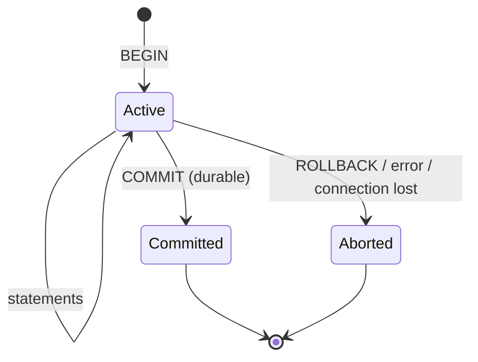

# Transactions & ACID

> A transaction makes several changes behave as one: all happen or none do. Put the transaction boundary around one business operation, keep it short, prefer atomic updates to read-modify-write, and use unique constraints and idempotency keys to stop duplicates.

Roadmap topic 8 · Stage 3: Correctness

**Go deeper:** `9` Concurrency & Isolation · `7` Storage Engines (durability) · `16` Consistency & Distributed Data (sagas) · `04-backend-engineering/11-Transactions-and-Concurrency` · `05-system-design/22-Reliable-Requests-and-External-Services` · `09-architecture/06-Architecture-and-Design-Patterns` (saga, outbox).

**Marks:** 🟢 must know · 🟡 good to know

**How the examples are checked:** run on SQLite 3.54. PostgreSQL-only syntax is marked and not run.

---

#### 1. What Is It?

*A group of operations treated as one unit.*

| 🟢 Must know | 🟡 Good to know |
|---|---|
| `BEGIN`, `COMMIT`, `ROLLBACK` | savepoints |
| ACID | autocommit; a dying connection mid-transaction |
| where to put the boundary in application code | durability settings and their cost |
| short transactions; no slow external calls inside | transactions in an ORM; hidden transaction problems |
| atomic updates instead of read-modify-write | |
| unique constraints and idempotency keys | |

1. **Transaction:** a sequence of statements that succeeds or fails as a whole.
2. **ACID:** the four guarantees.
3. **Boundary:** where `BEGIN` and `COMMIT` sit in your code.

**Signals in an interview:** "what does ACID mean?", "how do you transfer money safely?", "what if the app crashes between two updates?", "how do you prevent duplicate payments?".

---

#### 2. How It Works

**ACID.**

| Letter | Guarantee | In practice |
|---|---|---|
| **A**tomicity | all or nothing | a failure in step 2 undoes step 1 (rollback, via the log) |
| **C**onsistency | the database moves from one valid state to another | constraints (`CHECK`, `FOREIGN KEY`, `UNIQUE`) are never left violated by a committed transaction; your rules must be expressed as constraints or enforced in the transaction |
| **I**solation | concurrent transactions don't see each other's half-done work | levels from read committed to serializable (topic 9) |
| **D**urability | once committed, it stays committed | the write-ahead log is on disk before commit returns (topic 7) |

**The lifecycle.**



**Where to put the transaction boundary.** One transaction per **business operation** ("place order": create the order, reserve stock, record the payment intent). Not per statement (loses atomicity) and not per request that includes slow work. In layered code the **service layer** owns the boundary; repositories participate.

**Keep transactions short; never call slow external services inside one.** An open transaction holds locks and (in MVCC databases) prevents cleanup. Calling a payment provider or sending an email inside it can hold locks for seconds and, if the call fails after succeeding, leaves you inconsistent. Instead: do the database work in a short transaction, then call the outside world, then record the result (idempotently), or use an **outbox** (write the intent in the transaction, a worker performs it later; `SD 26`).

**Atomic updates instead of read-modify-write.** Reading a value in code, changing it, and writing it back lets two requests overwrite each other (lost update, topic 9). Let the database do the change in one statement: `UPDATE accounts SET balance = balance - 100 WHERE id = 1 AND balance >= 100`. The statement is atomic and its row count tells you whether it applied.

**Unique constraints and idempotency keys.** Networks retry; users double-tap. A `UNIQUE (user_id, idempotency_key)` makes the second insert fail (or do nothing), so the operation happens once (`BE 11`, `SD 22`). Stronger than "check, then insert" in code, which races.

🟡 **Savepoints.** Named points inside a transaction you can roll back to without abandoning the whole transaction (`SAVEPOINT s` … `ROLLBACK TO s`). ORMs use them for nested transactions.

🟡 **Autocommit and dying connections.** By default each statement is its own transaction (autocommit) until you `BEGIN`. If the connection dies mid-transaction, the database rolls it back. Your code must treat "unknown outcome" on commit as unknown: check the state or retry idempotently.

🟡 **Durability settings and cost.** Waiting for the log to reach disk on every commit is the safe default; `synchronous_commit = off` (PostgreSQL) or relaxed `fsync` is faster but can lose the last moments of commits on a crash. Group commit batches many commits into one flush.

🟡 **ORM transactions and hidden problems.** Lazy loading outside a transaction, the "transaction per request" that includes slow calls, nested transactions that don't nest, auto-flush surprises, and swallowed exceptions that commit partial work. Know what your framework does and keep explicit boundaries.

---

#### 3. Naive vs Better Design

| Naive | Better |
|---|---|
| two `UPDATE`s in autocommit for a transfer | one transaction |
| read balance, subtract in Kotlin, write back | `balance = balance - ?` with a condition |
| call the payment API inside the transaction | short transaction + outbox or idempotent follow-up |
| "check if exists, then insert" | `UNIQUE` constraint + handle the conflict |
| transaction per whole HTTP request | transaction per business operation |
| catch the exception and commit anyway | roll back on any failure |
| ignore "commit outcome unknown" | idempotent retry or state check |

```kotlin
// Naive: not atomic, not safe against concurrent requests
val from = db.balance(1); val to = db.balance(2)
db.setBalance(1, from - 100)       // crash here → money vanished
db.setBalance(2, to + 100)
```

---

#### 4. SQL & Code

An atomic transfer with a `CHECK` constraint (`bal >= 0`):

```sql
CREATE TABLE acc (id INTEGER PRIMARY KEY, bal INT NOT NULL CHECK (bal >= 0));
INSERT INTO acc VALUES (1, 100), (2, 50);

BEGIN;
UPDATE acc SET bal = bal - 30 WHERE id = 1;
UPDATE acc SET bal = bal + 30 WHERE id = 2;
COMMIT;                                              -- balances: (1, 70) (2, 80)

BEGIN;
UPDATE acc SET bal = bal - 500 WHERE id = 1;         -- fails: CHECK constraint failed: bal >= 0
ROLLBACK;                                            -- balances stay (1, 70) (2, 80): nothing was applied
```

Checks: the first transfer commits both changes; the second fails on the constraint and, after `ROLLBACK`, both balances are unchanged (atomicity), and the invalid state (negative balance) never existed (consistency).

The conditional atomic update (no read-modify-write, no race):

```sql
UPDATE acc SET bal = bal - 80 WHERE id = 1 AND bal >= 80;      -- balance 70 → 0 rows affected: insufficient funds, nothing changed
UPDATE acc SET bal = bal - 50 WHERE id = 1 AND bal >= 50;      -- 1 row affected: balance 20
```

Checks: the row count tells your code whether the withdrawal applied (`0` → return "insufficient funds"). Two concurrent withdrawals can't both pass the check, because the statement is atomic.

Savepoint:

```sql
BEGIN; UPDATE acc SET bal = bal + 1 WHERE id = 1;
SAVEPOINT s; UPDATE acc SET bal = bal + 100 WHERE id = 1;
ROLLBACK TO s;                                       -- undo only the +100
COMMIT;                                              -- the +1 stays
```

Idempotency with a unique key:

```sql
CREATE TABLE payment (id INTEGER PRIMARY KEY, idem_key TEXT NOT NULL UNIQUE, amount INT NOT NULL);
INSERT OR IGNORE INTO payment(idem_key, amount) VALUES ('k1', 10);   -- 1 row
INSERT OR IGNORE INTO payment(idem_key, amount) VALUES ('k1', 10);   -- ignored (retry)
INSERT OR IGNORE INTO payment(idem_key, amount) VALUES ('k2', 10);   -- 1 row   → COUNT(*) = 2
-- PostgreSQL:  INSERT ... ON CONFLICT (idem_key) DO NOTHING RETURNING id;   (no row returned ⇒ it already existed)
```

Checks: the three inserts leave `2` payments. A retried request with the same key never creates a second payment.

Transaction boundary in Kotlin (service layer, plain JDBC):

```kotlin
fun <T> DataSource.tx(block: (Connection) -> T): T = connection.use { c ->
    c.autoCommit = false
    try { block(c).also { c.commit() } }
    catch (e: Throwable) { c.rollback(); throw e }                       // any failure undoes everything
}

fun transfer(ds: DataSource, from: Long, to: Long, cents: Long): Boolean = ds.tx { c ->
    val debited = c.prepareStatement("UPDATE acc SET bal = bal - ? WHERE id = ? AND bal >= ?").use { ps ->
        ps.setLong(1, cents); ps.setLong(2, from); ps.setLong(3, cents); ps.executeUpdate()
    }
    if (debited == 0) return@tx false                                    // insufficient funds: nothing to undo yet
    c.prepareStatement("UPDATE acc SET bal = bal + ? WHERE id = ?").use { ps -> ps.setLong(1, cents); ps.setLong(2, to); ps.executeUpdate() }
    true
}
```

Checks: `transfer(ds, 1, 2, 30)` → `true` (both updates committed); `transfer(ds, 1, 2, 500)` → `false` with nothing changed; if the second `UPDATE` throws, `rollback()` also undoes the first.

Never call outside services inside the transaction; use an outbox:

```sql
BEGIN;
INSERT INTO orders(...) VALUES (...);
INSERT INTO outbox(event_type, payload) VALUES ('OrderPlaced', '{...}');      -- same transaction: both or neither
COMMIT;
-- a separate worker reads `outbox`, publishes/charges, marks rows sent (retries are idempotent)
```

Room: `@Transaction` makes several DAO calls atomic:

```kotlin
@Dao abstract class NoteDao {
    @Insert abstract suspend fun insertNote(n: NoteEntity)
    @Insert abstract suspend fun insertOutbox(o: OutboxEntity)
    @Transaction open suspend fun saveWithOutbox(n: NoteEntity, o: OutboxEntity) { insertNote(n); insertOutbox(o) }
}
```

---

#### 5. Numbers & Limits

| Item | Rule of thumb |
|---|---|
| Transaction length | milliseconds to a few hundred ms; seconds is a smell |
| Rows per transaction | batches of 500 to 5,000 for bulk work |
| Commit cost | one log flush (≈ 0.1–2 ms on SSD); batching many writes in one transaction is much faster |
| Contention | a hot row can be updated about `1 ÷ transaction time` times per second |
| Timeouts | set statement and lock timeouts (for example 5 to 30 s) |
| Retries | retry the whole transaction on deadlock/serialization failure, a few times with backoff |
| Idempotency keys | keep 24 hours to 7 days |
| `synchronous_commit = off` | risk window ≈ up to a few hundred ms of commits on a crash |

---

#### 6. Common Mistakes & Edge Cases

1. Multiple related statements outside a transaction.
2. Read-modify-write in application code.
3. External calls (HTTP, email, payment) inside a transaction.
4. "Check then insert" without a unique constraint.
5. A transaction held open across user think time.
6. Catching the error and committing anyway.
7. Assuming `COMMIT` succeeded when the connection dropped.
8. Huge transactions that lock tables and bloat the log.

Edge cases: autocommit in a script that you thought was one transaction; DDL inside a transaction (supported in PostgreSQL, not in some databases); sequences/auto-increment ids are not rolled back (gaps); triggers that fail; distributed operations across two databases (a single transaction can't cover both: sagas or an outbox).

---

#### 7. Say This in the Interview

1. "A transaction makes a group of changes atomic. ACID: all or nothing, constraints stay valid, concurrent transactions are isolated, and committed data survives a crash because of the write-ahead log."
2. "I put the boundary around one business operation in the service layer and keep it short; no HTTP calls or emails inside. For side effects I write an outbox row in the same transaction."
3. "I avoid read-modify-write: `UPDATE ... SET balance = balance - ? WHERE balance >= ?` is atomic and the row count tells me if it applied."
4. "Duplicates are stopped by unique constraints and idempotency keys, not by 'check then insert'."
5. "If the commit outcome is unknown, I retry idempotently or check the state."

---

#### 8. Quick Check

1. What does atomicity guarantee?
2. Why not call a payment API inside a transaction?
3. How do you stop duplicate payments on retry?
4. Why is `SET balance = balance - 100` better than read-modify-write?

<details>
<summary>Answers</summary>

1. All the transaction's changes happen, or none do.
2. It holds locks while waiting and can succeed externally yet fail locally, leaving inconsistent state; use an outbox or an idempotent follow-up.
3. A unique idempotency key (constraint) so the second attempt is ignored or returns the first result.
4. It is one atomic statement, so concurrent requests can't overwrite each other.

</details>

---

#### 9. Practice

**Interview questions**

1. Explain ACID with an example.
2. How would you implement a money transfer?
3. Where do you start and end a transaction in a backend service?
4. How do you make a payment endpoint idempotent?
5. What happens if the server crashes after the first `UPDATE` but before `COMMIT`?
6. How do you do "save in the database and publish an event" safely?

**Hands-on**

1. Build the `acc` table; run the transfer, the failing transfer, and the conditional withdrawal; read the row counts.
2. Write the Kotlin `tx` helper and test rollback by throwing inside the block.
3. Add an idempotency-key table and replay the same request five times.
4. Write a concurrent test (two threads) of the conditional update on one balance.

**Remember:** all or nothing · boundary = one business operation · short, no external calls inside · atomic conditional `UPDATE` instead of read-modify-write · unique constraint + idempotency key · outbox for side effects · roll back on any failure.
