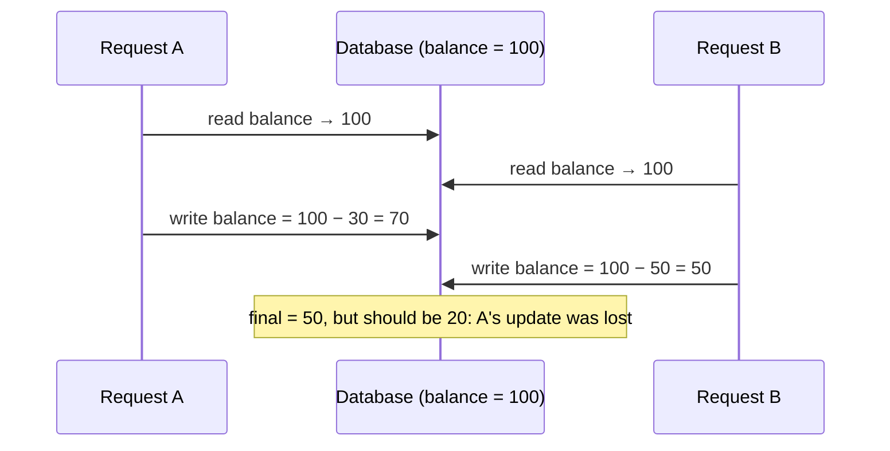
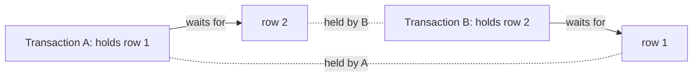

# Concurrency & Isolation

> When two requests touch the same data at the same time, results can go wrong in quiet ways: lost updates, double bookings, double spends. Know the anomalies, the isolation levels that prevent them, and the practical tools: atomic updates, unique constraints, optimistic versions and row locks.

Roadmap topic 9 · Stage 3: Correctness

**Go deeper:** `8` Transactions & ACID · `7` Storage Engines (MVCC) · `16` Consistency & Distributed Data · `04-backend-engineering/11-Transactions-and-Concurrency` · `05-system-design/32-Practice-Projects-and-Designs` (ticket booking) · `05-system-design/21-Queues-Events-and-Background-Jobs`.

**Marks:** 🟢 must know · 🟡 good to know

**How the examples are checked:** two SQLite connections to one file (autocommit) reproduce the races; PostgreSQL-only syntax (`FOR UPDATE`, `SKIP LOCKED`, isolation levels) is marked and not run.

---

#### 1. What Is It?

*Making concurrent work correct.*

| 🟢 Must know | 🟡 Good to know |
|---|---|
| race conditions: lost update, double booking, double spend | MVCC: readers don't block writers |
| isolation levels: read committed, repeatable read, serializable | choosing an isolation level and its cost |
| anomalies: dirty read, non-repeatable read, phantom read, lost update, write skew | advisory locks; queue tables with `SKIP LOCKED` |
| optimistic vs pessimistic locking | ticket booking and inventory patterns |
| row locks, table locks, what blocks what | long-running transactions and their side effects |
| deadlocks and retrying | |

1. **Race condition:** the result depends on the timing of concurrent operations.
2. **Isolation:** how much one transaction sees of another's changes.
3. **Lock:** a claim on data that makes others wait.
4. **MVCC:** keeping several versions of a row so readers see a consistent snapshot without blocking writers.

**Signals in an interview:** "two users book the last seat", "how do you avoid a lost update?", "explain isolation levels", "what is a deadlock?", "optimistic vs pessimistic locking".

---

#### 2. How It Works

**The classic race: lost update.**



**Fixes, from simplest.**

| Tool | How | Use for |
|---|---|---|
| Atomic update | `SET bal = bal - ? WHERE ... AND bal >= ?` | counters, balances, stock |
| Unique constraint | `UNIQUE (seat_id, slot)` | double booking, duplicates, idempotency |
| Optimistic locking | `version` column; `UPDATE ... WHERE version = ?`; 0 rows ⇒ conflict ⇒ reload and retry | low-contention edits (documents, profiles) |
| Pessimistic locking | `SELECT ... FOR UPDATE` locks the row until commit | high contention, short critical sections |
| Serializable isolation | the database detects conflicts and aborts one transaction | complex invariants; be ready to retry |
| Queue / single writer | serialise through one worker | very hot resources |

**Isolation levels and anomalies.**

| Anomaly | Meaning |
|---|---|
| Dirty read | reading another transaction's uncommitted change |
| Non-repeatable read | the same row read twice returns different values (another transaction committed between) |
| Phantom read | the same query returns different *sets* of rows (rows inserted/deleted between) |
| Lost update | two read-modify-writes overwrite each other |
| Write skew | two transactions each read overlapping data, check a rule, and write different rows, together breaking the rule |

| Level | Dirty | Non-repeatable | Phantom | Lost update / write skew |
|---|---|---|---|---|
| Read uncommitted | possible | possible | possible | possible |
| **Read committed** (PostgreSQL default) | prevented | possible | possible | possible |
| **Repeatable read** (MySQL InnoDB default; snapshot in PostgreSQL) | prevented | prevented | prevented in PostgreSQL's snapshot; possible by the standard | lost update detected in PostgreSQL; write skew possible |
| **Serializable** | prevented | prevented | prevented | prevented (conflicts abort a transaction; retry) |

Exact behaviour varies by database; read your engine's documentation. Higher isolation = more safety, more aborts or blocking, less throughput.

**Locks: what blocks what.** Row-level locks: a writer blocks other writers of the same row; with MVCC, readers don't block and aren't blocked. `SELECT ... FOR UPDATE` takes a row lock for readers who intend to update. Table-level locks (DDL, `LOCK TABLE`) block much more; schema changes can take locks that stall traffic (topic 10). Locks are held until commit or rollback, which is why short transactions matter.

**Deadlocks.** Transaction A holds row 1 and waits for row 2; B holds row 2 and waits for row 1. The database detects the cycle and aborts one (error `deadlock detected`). Prevention: take locks in a consistent order (always lower id first), keep transactions short, and **retry** the aborted transaction.



🟡 **MVCC: readers do not block writers.** Each transaction sees a snapshot; writers create new row versions. Great concurrency; cost: old versions to clean up (vacuum) and long transactions that hold snapshots open (topic 7).

🟡 **Choosing an isolation level.** Default (read committed) with atomic updates and constraints solves most problems. Use repeatable read for consistent multi-query reports; serializable for invariants spanning rows (write skew) when you can retry; avoid raising the level "just in case".

🟡 **Advisory locks and queue tables.** Advisory locks (`pg_advisory_lock(key)`) lock an application-defined key (for example "per-user sync"). Queue tables: workers claim rows with `SELECT ... FOR UPDATE SKIP LOCKED` so each takes a different job.

🟡 **Ticket booking and inventory patterns (`SD 32`).** Seat: `UPDATE seats SET held_by = ? WHERE id = ? AND held_by IS NULL` (1 row ⇒ you got it); holds expire (`held_until`); payment is idempotent; a unique `(show, seat)` booking row is the last line of defence. Inventory: `UPDATE products SET stock = stock - 1 WHERE id = ? AND stock > 0`.

🟡 **Long-running transactions.** They hold locks, block vacuum, delay replicas and make deploys risky. Do slow work outside; keep reports on replicas.

---

#### 3. Naive vs Better Design

| Naive | Better |
|---|---|
| read, check in code, write | one conditional atomic `UPDATE` |
| "if seat free then book" in two queries | `UPDATE ... WHERE held_by IS NULL` or a unique booking row |
| serializable everywhere | default level + constraints + atomic updates; serializable where needed |
| locks taken in random order | a consistent lock order |
| no retry on deadlock/serialization errors | retry the whole transaction with backoff |
| a global lock for everything | row-level, per-key locks |
| long transactions that span user input | short transactions; optimistic version for edits |

```kotlin
// Naive: two users can both see "free" and both book
if (seatRepo.isFree(seatId)) seatRepo.book(seatId, userId)
```

---

#### 4. SQL & Code

Lost update reproduced and fixed (two connections, balance 100; A subtracts 30, B subtracts 50):

```sql
-- Read-modify-write (broken): A reads 100, B reads 100, A writes 70, B writes 50   → final balance 50   (expected 20)
-- Atomic update (correct):    A: SET bal = bal - 30   B: SET bal = bal - 50                       → final balance 20
```

Checks: run on SQLite with two autocommit connections: the read-modify-write version ends at `50` (A's change was lost); the atomic version ends at `20`.

Double booking prevented:

```sql
CREATE TABLE seat (id INTEGER PRIMARY KEY, held_by TEXT);   INSERT INTO seat VALUES (1, NULL);
UPDATE seat SET held_by = 'ann' WHERE id = 1 AND held_by IS NULL;     -- 1 row ⇒ Ann got the seat
UPDATE seat SET held_by = 'bob' WHERE id = 1 AND held_by IS NULL;     -- 0 rows ⇒ Bob lost; tell him it's taken
CREATE TABLE booking (seat_id INT, slot TEXT, UNIQUE (seat_id, slot));
INSERT INTO booking VALUES (1, '10:00');
INSERT INTO booking VALUES (1, '10:00');                              -- fails: UNIQUE constraint failed
```

Checks: the first update affects `1` row and the second `0`; the second `INSERT` fails with `UNIQUE constraint failed: booking.seat_id, booking.slot`.

Optimistic locking with a `version` column:

```sql
-- both users load (bal = 100, version = 0)
UPDATE acc SET bal = 70, version = version + 1 WHERE id = 1 AND version = 0;     -- user A: 1 row → saved (version 1)
UPDATE acc SET bal = 50, version = version + 1 WHERE id = 1 AND version = 0;     -- user B: 0 rows → conflict
```

Checks: the first update affects `1` row and the second `0`; the stored values are `(70, version 1)`. B's code reloads (bal 70, version 1), re-applies its change (or asks the user) and retries.

In Kotlin (and Room's `@Version`-style check):

```kotlin
fun updateTitle(conn: Connection, id: Long, newTitle: String, expectedVersion: Int): Boolean =
    conn.prepareStatement("UPDATE notes SET title = ?, version = version + 1 WHERE id = ? AND version = ?").use { ps ->
        ps.setString(1, newTitle); ps.setLong(2, id); ps.setInt(3, expectedVersion)
        ps.executeUpdate() == 1                                   // false ⇒ someone else changed it: reload and decide
    }
```

Pessimistic locking (PostgreSQL, not run):

```sql
BEGIN;
SELECT balance FROM accounts WHERE id = 1 FOR UPDATE;           -- other writers of this row wait here
UPDATE accounts SET balance = balance - 30 WHERE id = 1;
COMMIT;
```

Claiming jobs without two workers taking the same one:

```sql
-- PostgreSQL:  SELECT id FROM jobs WHERE state = 'queued' ORDER BY id LIMIT 1 FOR UPDATE SKIP LOCKED;
-- Portable single statement (works in SQLite 3.35+ and PostgreSQL):
UPDATE jobs SET state = 'running', worker = 'w1'
WHERE id = (SELECT id FROM jobs WHERE state = 'queued' ORDER BY id LIMIT 1) RETURNING id;
```

Checks: two workers calling the statement against two queued jobs claim different ids (`1` and `2`).

Retry a transaction after a deadlock or serialization failure:

```kotlin
fun <T> retryOnConflict(maxTries: Int = 3, block: () -> T): T {
    var attempt = 0
    while (true) {
        try { return block() }
        catch (e: SQLException) {
            val retryable = e.sqlState == "40001" || e.sqlState == "40P01"       // serialization failure, deadlock (PostgreSQL)
            if (!retryable || ++attempt >= maxTries) throw e
            Thread.sleep((10L shl attempt) + (0..10).random())                    // short backoff with jitter
        }
    }
}
```

Lock ordering to avoid deadlocks (transfer between two accounts):

```kotlin
fun lockOrder(a: Long, b: Long) = if (a <= b) a to b else b to a          // always lock the smaller id first
```

Checks: `lockOrder(2, 1)` → `(1, 2)` and `lockOrder(1, 2)` → `(1, 2)`: transfers A→B and B→A take locks in the same order, so they can't deadlock on each other.

Write skew (explained, PostgreSQL repeatable read): two doctors on call; the rule is "at least one on call". Each transaction reads "2 on call", each sets themselves off; both commit; zero on call. Fixes: serializable isolation (one aborts), or lock the relevant rows (`SELECT ... FOR UPDATE` on the on-call set), or a constraint-based design.

---

#### 5. Numbers & Limits

| Item | Rule of thumb |
|---|---|
| Hot-row throughput | about `1 ÷ transaction time`: 10 ms transactions ⇒ ~100 updates/s on one row |
| Deadlock retries | 2 to 3 attempts; with jitter |
| Lock wait timeout | 1 to 30 s; fail fast rather than hang |
| Optimistic locking | good when conflicts are rare (< a few %); under heavy contention use atomic updates or locks |
| Isolation default | read committed (PostgreSQL), repeatable read (MySQL InnoDB) |
| Serializable | expect some aborts (1–5% under contention); retry |
| Long transactions | alert above 30–60 s |

---

#### 6. Common Mistakes & Edge Cases

1. Read-modify-write in application code.
2. Check-then-act without a constraint or lock.
3. Locking in different orders.
4. No retry for deadlocks or serialization failures.
5. Holding locks while calling external services or waiting for users.
6. Assuming the default isolation prevents everything.
7. Using `SELECT ... FOR UPDATE` on large ranges (locks too much).
8. Optimistic locking without a retry/merge path.

Edge cases: gap/range locks in InnoDB repeatable read; long-running reports blocking DDL; replicas with stale data used for read-then-write; clocks used as versions (use counters); idempotent retries after "unknown commit" errors; many workers contending on one queue row.

---

#### 7. Say This in the Interview

1. "For counters, balances and stock I use one conditional atomic update and check the row count; for uniqueness I use a unique constraint; those solve most races without locks."
2. "For user edits I use optimistic locking with a version column: `WHERE version = ?`, and on a conflict I reload and merge or ask."
3. "For high contention on a short critical section I use `SELECT ... FOR UPDATE`; for job queues `SKIP LOCKED`."
4. "Read committed is the usual default; I raise to repeatable read or serializable only for invariants that span rows, and I retry on serialization failures."
5. "Deadlocks happen when transactions wait in a cycle; I lock in a consistent order, keep transactions short, and retry."
6. "A double booking is prevented by an atomic `UPDATE ... WHERE held_by IS NULL` plus a unique booking constraint as the last line of defence."

---

#### 8. Quick Check

1. How do you prevent a lost update without locks?
2. What is write skew?
3. Optimistic vs pessimistic locking?
4. What do you do after a deadlock error?

<details>
<summary>Answers</summary>

1. Use an atomic conditional `UPDATE` (or an optimistic version check) instead of read-modify-write.
2. Two transactions read overlapping data, check a rule and write different rows, together breaking the rule.
3. Optimistic: detect a conflict at write time and retry (good when rare); pessimistic: lock first and make others wait.
4. Retry the whole transaction, with a short backoff.

</details>

---

#### 9. Practice

**Interview questions**

1. Two users try to book the last seat. How do you prevent a double booking?
2. Explain isolation levels and anomalies.
3. How do you prevent a lost update?
4. Optimistic or pessimistic locking: when each?
5. What is a deadlock and how do you handle it?
6. What is MVCC?

**Hands-on**

1. Reproduce a lost update with two connections, then fix it two ways.
2. Build a reservation table and test double booking with a unique constraint and with a conditional update, using 20 concurrent threads.
3. Implement optimistic locking in Kotlin and test the conflict path.
4. In PostgreSQL, create a deadlock with two `psql` sessions and read the log.

**Remember:** atomic conditional update first · unique constraints stop duplicates · optimistic version for edits, `FOR UPDATE` for hot short sections · default isolation + constraints, serializable only for cross-row invariants · lock in order, keep short, retry on deadlock.
