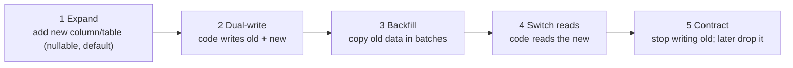

# Schema Migrations & Evolution

> The schema changes while the app is live, and old app versions and old server versions run at the same time. Make every change backward compatible, split risky changes into expand, migrate and contract steps, and keep migrations in version control.

Roadmap topic 10 · Stage 3: Correctness

**Go deeper:** `9-architecture/09-Data-Architecture` (expand → migrate → contract) · `05-system-design/28-Deployment-and-Release` and `30-Mobile-Specific-Topics` · `21` Mobile Databases (on-device migrations) · `17` Backup & Recovery · `6` Query Performance.

**Marks:** 🟢 must know · 🟡 good to know

**How the examples are checked:** run on SQLite 3.54. PostgreSQL/MySQL-specific online-change syntax is marked and not run.

---

#### 1. What Is It?

*Changing structure without breaking running code or losing data.*

| 🟢 Must know | 🟡 Good to know |
|---|---|
| versioned migration scripts in source control | big tables without downtime: batching, online tools |
| forward-only; test on a copy of production | backfilling data safely |
| backward-compatible changes (old and new run together) | migration tools: Flyway, Liquibase, built-in ones |
| expand and contract | rollback plans; why forward-fix is often better |
| risky changes: rename, drop, change type, add `NOT NULL` | schema and API versioning together |

1. **Migration:** a versioned script that moves the schema from version N to N+1.
2. **Backward compatible:** the previous version of the code still works with the new schema.
3. **Expand → migrate → contract:** add the new shape, move the data and code to it, then remove the old shape.

**Signals in an interview:** "how do you rename a column with no downtime?", "how do you add a NOT NULL column to a 500M-row table?", "old app versions are still in use; what do you do?", "how do you roll back a migration?".

---

#### 2. How It Works

**Why it is hard.** A deploy is not instant: for minutes the old and new servers run together; mobile apps run old versions for years; a database cannot change shape at the same instant for all code. So every schema state must work with **both** the previous and the next code version.

**Versioned scripts.**

```text
db/migrations/
  V001__create_notes.sql
  V002__add_status_to_notes.sql
  V003__create_tags.sql
```

Each script runs once, in order; the tool records applied versions in a table (`flyway_schema_history`, Liquibase `DATABASECHANGELOG`; SQLite/Room use `PRAGMA user_version` / `room_master_table`). Never edit a migration that has run anywhere; add a new one. Test the full chain on an empty database and the latest migrations on a copy of production.

**Forward-only.** Prefer fixing forward over writing "down" scripts: down migrations are rarely tested, and data created after the up step can't be restored. For safety, make each step small and backward compatible so the app can be rolled back *without* rolling the schema back.

**Expand and contract.**



Each arrow is a separate deploy. The old code keeps working until the contract step, and the contract step only happens after no running code (including old app versions) needs the old shape.

**Risky changes and safer ways.**

| Change | Risk | Safer way |
|---|---|---|
| Rename a column/table | old code breaks | add new, dual-write, backfill, switch, drop old (or a view alias) |
| Drop a column | old code breaks; data loss | stop using it first; wait until no code reads it; then drop (keep a backup) |
| Change a column type | rewrites the table; casts fail | add a new column of the new type, backfill, switch |
| Add `NOT NULL` | existing rows violate it | add nullable → backfill → add the constraint (or add with a default) |
| Add a column with a default | can rewrite the table in some engines | PostgreSQL 11+ and modern MySQL add it quickly; verify per version |
| Add an index | locks writes | build concurrently (`CREATE INDEX CONCURRENTLY`) |
| Add a foreign key / check | validates all rows under a lock | `NOT VALID` then `VALIDATE` later (PostgreSQL) |
| Change a unique constraint | duplicates exist | find and fix duplicates first |

🟡 **Big tables without downtime.** Do heavy work in small **batches** (1,000–10,000 rows) with pauses; build indexes concurrently; use online schema change tools for engines that lock (gh-ost, pt-online-schema-change for MySQL; `pg_repack`/native concurrent operations for PostgreSQL); watch replica lag and lock waits; set lock timeouts so a migration fails instead of blocking the whole app.

🟡 **Backfilling safely.** Idempotent batches (`WHERE new_col IS NULL`), resumable by id range, rate-limited, observable (counts), done outside the request path, verified afterwards (`SELECT COUNT(*) WHERE new_col IS NULL` = 0).

🟡 **Tools.** Flyway, Liquibase (JVM), framework migrations (Rails, Django, Alembic), Room migrations on Android, Core Data/SwiftData migrations on iOS. Run migrations as a separate step with a privileged user, not at app startup on every instance.

🟡 **Rollback plans.** Know before you run: can the app roll back without the schema (expand step: yes)? Is there a backup/PITR point (topic 17)? What is the fix-forward plan? Destructive steps (drop, type change) get the strongest plan.

🟡 **Schema and API versioning together.** The API contract (add-only fields, versions) and the schema evolve in step: the API may keep an old field name while the schema has the new one (`ARCH 10`). On mobile, **the on-device database also needs migrations** for every old app version (topic 21).

---

#### 3. Naive vs Better Design

| Naive | Better |
|---|---|
| edit the schema by hand in production | versioned migration scripts in source control |
| rename a column in one deploy | expand → dual-write → backfill → switch → contract |
| `ALTER TABLE ... ADD COLUMN x NOT NULL` on a big table | nullable + backfill in batches + constraint |
| `UPDATE` all 100M rows in one statement | batched, resumable backfill |
| migration runs on every app instance at startup | a separate, single migration job |
| "down" scripts nobody tests | small backward-compatible steps; forward fix |
| drop a column the day you stop using it | wait for all code versions to stop reading it |
| destructive migration for local databases (`fallbackToDestructiveMigration`) | real migrations that keep user data |

---

#### 4. SQL & Code

Adding a column safely (SQLite):

```sql
ALTER TABLE notes ADD COLUMN status TEXT NOT NULL DEFAULT 'active';       -- existing rows get 'active'
ALTER TABLE notes ADD COLUMN owner INTEGER NOT NULL;                       -- fails: Cannot add a NOT NULL column with default value NULL
```

Checks: with three existing notes, the first statement gives all three `status = 'active'`; the second fails because there is no value for the existing rows. Fix by adding with a default, or nullable → backfill → constrain.

Expand → backfill in batches → contract (renaming `title` to `title_v2`; 2,503 rows):

```sql
ALTER TABLE notes ADD COLUMN title_v2 TEXT;                                          -- 1 expand (nullable)
-- 2 dual-write in code: write title and title_v2
-- 3 backfill, repeated until it affects 0 rows:
UPDATE notes SET title_v2 = title
WHERE title_v2 IS NULL AND id IN (SELECT id FROM notes WHERE title_v2 IS NULL ORDER BY id LIMIT 1000);
-- 4 switch reads to title_v2 (deploy), verify:  SELECT COUNT(*) FROM notes WHERE title_v2 IS NULL;   → 0
-- 5 contract (a release later):
ALTER TABLE notes DROP COLUMN title;                                                  -- SQLite 3.35+; PostgreSQL always
```

Checks: the backfill runs in `3` batches (1,000 + 1,000 + 503 rows), then the check query returns `0`. Each batch is a short transaction, so it doesn't lock the table for long. `ALTER TABLE notes RENAME COLUMN body TO content` also works in SQLite 3.25+, but renaming breaks old code at once, which is why the expand/contract route is safer for live systems.

A batched backfill loop in Kotlin (resumable, rate-limited):

```kotlin
fun backfill(conn: Connection, batch: Int = 1_000, pauseMs: Long = 50): Int {
    var total = 0
    while (true) {
        val n = conn.prepareStatement("""UPDATE notes SET title_v2 = title
              WHERE title_v2 IS NULL AND id IN (SELECT id FROM notes WHERE title_v2 IS NULL ORDER BY id LIMIT ?)""").use { it.setInt(1, batch); it.executeUpdate() }
        conn.commit()
        if (n == 0) return total
        total += n
        Thread.sleep(pauseMs)                                  // let replicas catch up and other traffic breathe
    }
}
```

PostgreSQL online changes (not run):

```sql
SET lock_timeout = '3s';                                       -- fail instead of blocking the app
CREATE INDEX CONCURRENTLY idx_notes_user ON notes(user_id);    -- does not block writes
ALTER TABLE notes ADD CONSTRAINT notes_user_fk FOREIGN KEY (user_id) REFERENCES users(id) NOT VALID;   -- fast
ALTER TABLE notes VALIDATE CONSTRAINT notes_user_fk;           -- validates in the background with a weaker lock
```

Room migration (Android), with an automated test:

```kotlin
val MIGRATION_1_2 = object : Migration(1, 2) {
    override fun migrate(db: SupportSQLiteDatabase) {
        db.execSQL("ALTER TABLE notes ADD COLUMN status TEXT NOT NULL DEFAULT 'active'")
    }
}
Room.databaseBuilder(context, AppDatabase::class.java, "app.db").addMigrations(MIGRATION_1_2, MIGRATION_2_3).build()

@Test fun migrate1To2() {
    helper.createDatabase("test.db", 1).apply { execSQL("INSERT INTO notes(id, title) VALUES (1, 'a')"); close() }
    val db = helper.runMigrationsAndValidate("test.db", 2, true, MIGRATION_1_2)
    db.query("SELECT status FROM notes WHERE id = 1").use { check(it.moveToFirst() && it.getString(0) == "active") }
}
```

SQLite's version marker:

```sql
PRAGMA user_version;            -- 0 for a new database
PRAGMA user_version = 3;        -- the migration code records the schema version; Room does this with its own table and identity hash
```

A migration plan template:

```text
CHANGE: rename notes.title → notes.name        RISK: old app versions and servers read `title`        ROLLBACK: yes until step 5
STEP 1 (release 4.10): add `name` nullable; code writes both          STEP 2 (job): backfill in batches of 1,000, verify NULL count = 0
STEP 3 (release 4.11): code reads `name`; still writes both            STEP 4 (release 4.12 + after min version ≥ 4.11): stop writing `title`
STEP 5 (+1 release): drop `title`          Backup/PITR point taken before step 5      Owner: ____   Review: ____
```

---

#### 5. Numbers & Limits

| Item | Rule of thumb |
|---|---|
| Backfill batch | 1,000 to 10,000 rows, with a short pause |
| Lock timeout | 2 to 5 seconds for DDL in production |
| Releases for a rename | 3 to 4 (expand, dual-write, switch, contract) |
| Wait before dropping | until the oldest supported app/server version no longer needs it |
| Migration duration | aim for seconds; anything over a minute needs a plan |
| Replica lag during backfill | keep under a few seconds; pause if it grows |
| Test data | production-sized copy for timing; empty database for the full chain |
| Mobile | every supported old DB version must reach the latest schema |

---

#### 6. Common Mistakes & Edge Cases

1. Editing an applied migration.
2. Breaking the previous code version.
3. One huge `UPDATE` that locks and bloats.
4. `NOT NULL` without a plan for existing rows.
5. Dropping or renaming in one step.
6. Running migrations from every instance at startup.
7. No test of the migration on production-like data.
8. Destructive local migrations that wipe user data.
9. No backup or recovery point before a destructive step.

Edge cases: a migration that works on a small table but locks a large one for minutes; replicas lagging behind a backfill; two services sharing a table (coordinate the contract); enum value changes; renamed columns used in views and triggers; the database tool and ORM disagreeing about the schema.

---

#### 7. Say This in the Interview

1. "Migrations are versioned scripts in source control, applied once in order by a tool. Every step must be compatible with the previous code version, because old and new run together."
2. "For a rename or type change I use expand, migrate, contract: add the new column, dual-write, backfill in batches, switch reads, then drop the old column after all old versions are gone."
3. "To add `NOT NULL` to a big table I add it nullable, backfill, then enforce it, and I use lock timeouts and concurrent index builds."
4. "I prefer fixing forward over down-migrations, and I take a recovery point before destructive steps."
5. "On mobile, the on-device database needs a migration path from every supported old version, tested automatically."

---

#### 8. Quick Check

1. Why must schema changes be backward compatible?
2. What are the steps of expand and contract?
3. How do you backfill 100M rows?
4. What does a lock timeout protect?

<details>
<summary>Answers</summary>

1. Old and new code versions (and old app versions) run against the same database at the same time.
2. Add the new shape, dual-write, backfill, switch reads, then remove the old shape.
3. In small, idempotent, resumable batches with pauses, verifying the result.
4. It makes a migration fail quickly instead of blocking application traffic behind a lock.

</details>

---

#### 9. Practice

**Interview questions**

1. How do you rename a column in a live system?
2. How do you add a `NOT NULL` column to a table with 500M rows?
3. How do you handle a migration when old app versions are still in use?
4. Up/down migrations or forward-only?
5. How do you test migrations?
6. What goes in a migration plan?

**Hands-on**

1. Run the expand → backfill → contract steps in SQLite and count the batches.
2. Write a Room migration from version 1 to 2 and a test with `MigrationTestHelper`.
3. Write the migration plan for a rename you would really make.
4. Add a Flyway or Liquibase setup to a sample project and apply three migrations.

**Remember:** versioned scripts, never edit applied ones · backward-compatible steps · expand → dual-write → backfill → switch → contract · batches, lock timeouts, concurrent index builds · fix forward, keep a recovery point · mobile databases need migrations from every old version.
