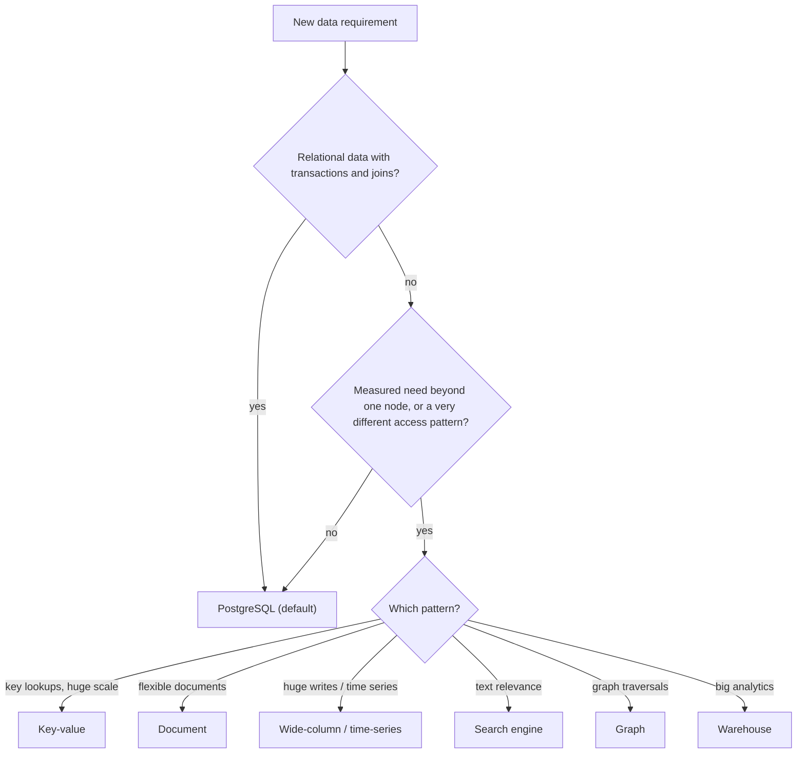
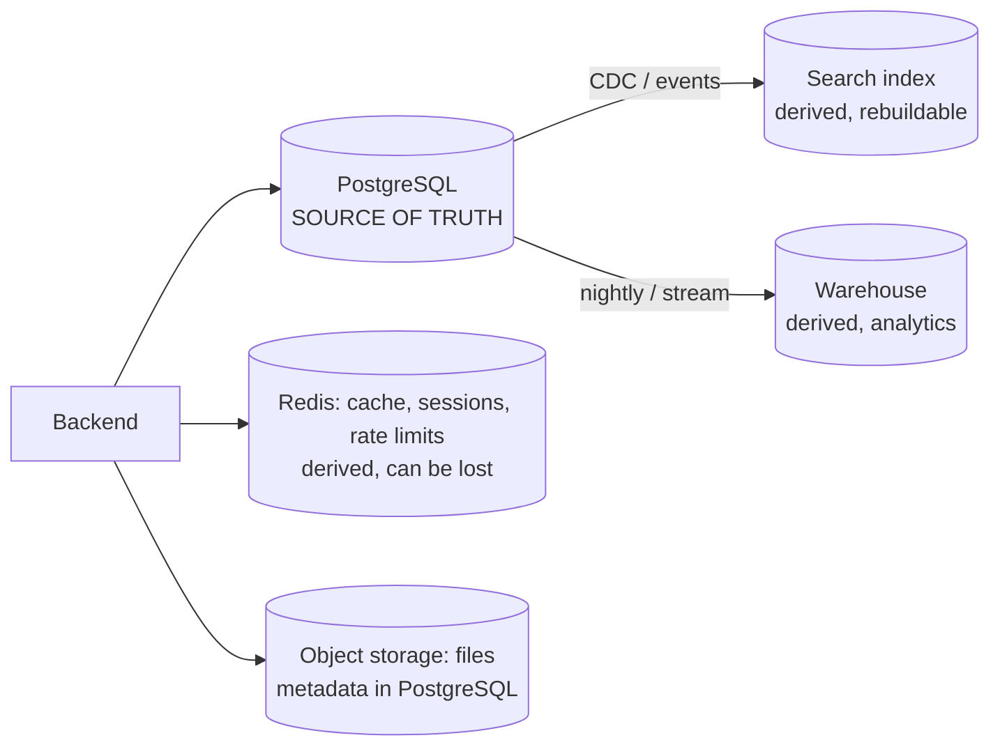

# Choosing a Database

> Start with one relational database. Choose something else only for a clear, measured reason: data shape, query pattern, consistency need, scale, or team skills. Real systems often use several stores, with one clear source of truth.

Roadmap topic 11 · Stage 4: Choosing & Scaling

**Go deeper:** `12` NoSQL Families · `13` Caching & Redis · `15` Partitioning & Sharding · `16` Consistency & CAP · `05-system-design/17-Choosing-a-Database` · `09-architecture/03-Trade-Offs-and-Decision-Making` and `09-Data-Architecture`.

**Marks:** 🟢 must know · 🟡 good to know

---

#### 1. What Is It?

*A way to choose stores by requirements, not by fashion.*

| 🟢 Must know | 🟡 Good to know |
|---|---|
| ask first: data shape, query patterns, consistency, scale, team skills | a decision table: which store for which job |
| relational as the default; clear reasons for otherwise | cost and licensing |
| polyglot persistence: database, cache, search, object storage | migration cost of switching later |
| source of truth vs derived data | hype-driven choices and how to avoid them |
| managed service vs self-hosted | |

1. **Polyglot persistence:** using several kinds of stores, each for what it does best.
2. **Source of truth:** the one store that owns the real data; others are copies that can be rebuilt.
3. **Derived data:** caches, search indexes, read models, analytics tables.

**Signals in an interview:** "SQL or NoSQL for this?", "why not MongoDB?", "do we need Redis/Elasticsearch/Kafka?", "managed or self-hosted?".

---

#### 2. How It Works

**Ask these first.**

| Question | Why it matters |
|---|---|
| What is the shape of the data (tables with relations, documents, events, graph, files)? | picks the model |
| What are the top reads and writes (by key, by range, by search, aggregate)? | picks the engine and indexes |
| What consistency do we need per feature? | strong (money) vs eventual (feed) |
| How much data and how many requests, now and in 1–3 years? | decides if one node is enough |
| What can the team run and debug? | operations cost is real |
| Latency, availability, regulatory needs? | managed service, region, encryption |
| Budget and lock-in tolerance? | managed vs self-hosted, open vs proprietary |

**The default: relational.** PostgreSQL covers transactions, constraints, joins, JSON, full-text search, geospatial, time-series extensions and vector search. It is the right answer for most applications, handles hundreds of GB to a few TB on one well-tuned node, and is understood everywhere. Choose otherwise with **evidence**:

| Reason | Possible choice |
|---|---|
| a huge write rate or time-series volume | wide-column / time-series (Cassandra, Timescale, ClickHouse for analytics) |
| key lookups at massive scale, single-digit-ms | key-value (DynamoDB, Redis) |
| flexible documents with per-document access, few relations | document store (MongoDB, Firestore) |
| relevance-ranked text search, facets | search engine (OpenSearch/Elasticsearch) |
| relationship traversals many levels deep | graph (Neo4j) |
| large analytical scans | warehouse / column store (BigQuery, Snowflake, ClickHouse) |
| files and media | object storage (+ metadata in the database) |
| embeddings similarity | vector index (pgvector or a vector database) |
| offline on-device data | SQLite/Room |



**Polyglot persistence and the source of truth.** A typical product:



Rules: each fact has one owner (the source of truth); derived stores are rebuildable from it; every extra store costs operations, consistency work and skills, so add one only for a measured need.

**Managed vs self-hosted.**

| | Managed (RDS, Cloud SQL, Atlas, Supabase…) | Self-hosted |
|---|---|---|
| Effort | low: backups, patches, failover included | high: you operate it |
| Control | limited extensions/tuning | full |
| Cost | higher per unit, lower people cost | lower per unit at scale, higher people cost |
| Lock-in | some (features, tooling) | less |
| Fit | most teams | large scale, special needs, strict control |

🟡 **A decision table.**

| Job | Store |
|---|---|
| orders, users, payments | PostgreSQL / MySQL |
| sessions, counters, rate limits, cache | Redis |
| product search with ranking | OpenSearch/Elasticsearch |
| large event streams, logs | Kafka + warehouse / ClickHouse |
| user profile documents with varied fields | PostgreSQL JSONB or MongoDB |
| social graph traversals | PostgreSQL first; graph DB if depth is the core |
| mobile offline data | SQLite/Room |
| images, videos | object storage + CDN |

🟡 **Cost and licensing.** Compare storage, IOPS, data transfer, backups, support; licence terms (open source vs source-available vs proprietary), per-seat or per-core fees, cloud egress.

🟡 **Migration cost of switching later.** Moving a core database is expensive (dual-write, backfill, validation; `SD 33`). Choose the one you can live with, behind a repository interface for the parts likely to change (cache, search).

🟡 **Hype-driven choices.** "It scales" without numbers, résumé-driven choices, and copying a big company's stack. Ask: what problem, what numbers, who runs it, what's the exit (`ARCH 3`).

---

#### 3. Naive vs Better Design

| Naive | Better |
|---|---|
| "NoSQL because we'll be big" | PostgreSQL until a measured limit |
| one database technology for everything, even search | the right store for each job, with one source of truth |
| a new store for each feature | extra stores only for measured needs |
| MongoDB for relational data, then manual joins | relational for relational data |
| Redis as the only copy of important data | Redis as a cache; the database owns the data |
| self-hosting with no ops capacity | a managed service |
| deciding by a benchmark blog | deciding by your queries and numbers |

---

#### 4. SQL & Code

A fit check you can say aloud — does one relational node suffice?

```kotlin
data class Load(val storageGb: Double, val writesPerSec: Double, val readsPerSec: Double)

fun oneNodeIsPlausible(l: Load, maxStorageGb: Double = 2_000.0, maxWrites: Double = 5_000.0, maxReads: Double = 50_000.0) =
    l.storageGb <= maxStorageGb && l.writesPerSec <= maxWrites && l.readsPerSec <= maxReads
```

Checks (rough limits for a well-tuned single PostgreSQL primary with replicas for reads): a notes app `Load(100.0, 200.0, 3_000.0)` → `true`; a clickstream `Load(50_000.0, 100_000.0, 1_000.0)` → `false` (look at wide-column/time-series/warehouse); a social feed read path `Load(500.0, 500.0, 200_000.0)` → `false` for reads on one node (add replicas and a cache first, topics 13 and 14). These limits are rules of thumb; measure your own hardware.

Size estimate:

```kotlin
fun storageGb(rows: Long, bytesPerRow: Int, indexOverhead: Double = 1.5, replicas: Int = 1) = rows * bytesPerRow * indexOverhead * replicas / 1e9
```

Checks: `storageGb(100_000_000, 300)` → `45.0` GB (100M rows at 300 B with 50% index overhead): one node is fine; `storageGb(10_000_000_000, 300, replicas = 3)` → `13,500` GB: a different conversation.

A repository interface that keeps derived stores replaceable:

```kotlin
interface NoteSearch { suspend fun index(note: Note); suspend fun search(userId: Long, q: String): List<Long> }

class PgSearch(private val db: DataSource) : NoteSearch { /* to_tsvector + GIN index inside PostgreSQL */ }
class OpenSearchSearch(private val client: OpenSearchClient) : NoteSearch { /* later, if relevance or scale demands it */ }
```

PostgreSQL covers more than people expect (not run):

```sql
CREATE INDEX notes_fts ON notes USING GIN (to_tsvector('english', title || ' ' || body));
SELECT id FROM notes WHERE to_tsvector('english', title || ' ' || body) @@ plainto_tsquery('english', 'buy milk');
CREATE EXTENSION vector;                                         -- pgvector for embeddings (AI 6)
SELECT id FROM chunks ORDER BY embedding <=> :q LIMIT 5;
```

A short decision record:

```text
ADR-021: PostgreSQL (managed) as the single source of truth for notes, users and sharing; Redis for sessions/rate limits only.
Why: relational data and transactions; ~100 GB, ~200 writes/s; team knows SQL; managed service removes ops.
Rejected: MongoDB (relations and transactions matter), DynamoDB (access patterns not stable yet).
Revisit when: > 2 TB or > 5k writes/s sustained, or search relevance needs outgrow PostgreSQL full-text.
```

---

#### 5. Numbers & Limits

| Item | Rule of thumb |
|---|---|
| One PostgreSQL primary | ~ thousands of write transactions/s, tens of thousands of simple reads/s (more with replicas/cache), up to a few TB with care |
| Row count | hundreds of millions of rows are fine with good indexes and partitioning |
| Redis | ~100k+ simple operations/s per node; memory-bound (cost per GB is high) |
| Search engine | adds a second copy of searchable data and lag of seconds |
| Extra store cost | operations, monitoring, backups, skills, consistency work: budget it |
| Managed premium | 20–50% over raw VMs; usually cheaper than the engineer-hours |
| Decision timing | before the schema grows around the wrong model |
| Revisit | when a measured limit is hit, or the access pattern changes |

---

#### 6. Common Mistakes & Edge Cases

1. Picking a database from a blog post, not from requirements and numbers.
2. NoSQL for relational data, then reinventing joins and transactions.
3. Too many stores, no source of truth.
4. A cache or search index treated as the primary copy.
5. Ignoring operations skills and cost.
6. Locking in without an exit path.
7. Premature distribution (sharding, multi-region) with no measured need.

Edge cases: workloads that change (a prototype becomes a product); regulation (data residency, audit); multi-tenant design (topic 18); mixed OLTP and analytics (separate stores); small apps that can use SQLite on the server; offline-first apps that need a client database in addition to the server one.

---

#### 7. Say This in the Interview

1. "I ask about data shape, top queries, consistency per feature, scale and team skills first."
2. "I default to PostgreSQL: transactions, constraints, joins, JSON, full-text and even vectors; I choose something else only for a measured need, such as huge write volume, key lookups at massive scale, or relevance-ranked search."
3. "Real systems use several stores, but one is the source of truth; caches, search indexes and warehouses are derived and rebuildable."
4. "I prefer managed services unless I have the scale and the people to self-host."
5. "I record the choice in an ADR with the numbers and the trigger for revisiting it."

---

#### 8. Quick Check

1. What is the default database choice for an app backend?
2. What is a source of truth?
3. Name two valid reasons not to use a relational database.
4. Why avoid adding a store "just in case"?

<details>
<summary>Answers</summary>

1. A relational database such as PostgreSQL.
2. The one store that owns the real data; other stores are derived copies.
3. For example: very high write volume or time-series scale; key-value access at massive scale; relevance-ranked text search; deep graph traversals.
4. Each store adds operations cost, skills and consistency problems; add one only for a measured need.

</details>

---

#### 9. Practice

**Interview questions**

1. SQL or NoSQL for a chat app? For analytics? For a shopping cart?
2. Why is PostgreSQL a good default?
3. When would you add Redis? Elasticsearch? A warehouse?
4. What does "source of truth" mean in a multi-store system?
5. Managed or self-hosted?
6. How do you avoid hype-driven choices?

**Hands-on**

1. For your app, list each kind of data, its store, and whether it is a source of truth or derived.
2. Compute the storage and request numbers for your product and test them against the single-node limits.
3. Write an ADR for your current database choice with a revisit trigger.

**Remember:** requirements and numbers first · PostgreSQL by default · add stores for measured needs only · one source of truth, derived stores rebuildable · managed unless you have scale and people · write the ADR and the revisit trigger.
