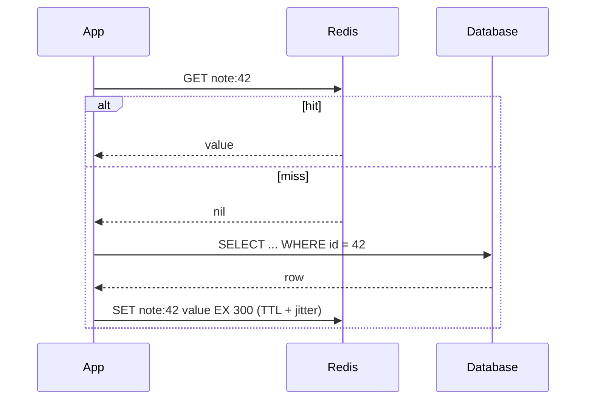

# Caching & Redis

> A cache keeps copies of hot data in fast memory to cut latency and database load. Use cache-aside with a TTL, protect against stampedes and hot keys, accept stale data on purpose, and never make the cache the only copy of anything important.

Roadmap topic 13 · Stage 4: Choosing & Scaling

**Go deeper:** `05-system-design/15-Caching` and `25-Overload-and-Failure-Handling` (rate limiting) · `6` Query Performance · `14` Replication · `16` Consistency · `06-mobile-engineering/08-Networking` (client caches) · `02-algorithm` (LRU).

**Marks:** 🟢 must know · 🟡 good to know

**How the examples are checked:** the cache logic is checked with Python/pure-Kotlin simulations; Redis commands are shown for the idea and not run (no Redis server in the check environment).

---

#### 1. What Is It?

*Fast copies of data, and Redis as the common shared cache.*

| 🟢 Must know | 🟡 Good to know |
|---|---|
| cache-aside, TTL, eviction (LRU), invalidation | persistence options: snapshots and append-only log |
| Redis data types: strings, hashes, lists, sets, sorted sets | pub/sub and streams |
| common uses: cache, sessions, counters, rate limiter, leaderboard | distributed locks and their limits |
| stampede, hot keys, stale data | cache sizing and hit-rate monitoring |
| never the only copy of important data | cluster mode and replication |

1. **Cache hit:** the data is in the cache. **Miss:** it isn't; load it from the source and store it.
2. **TTL (time to live):** seconds until an entry expires.
3. **Eviction:** removing entries when the cache is full (LRU = least recently used).
4. **Invalidation:** removing or updating entries when the source changes.

**Signals in an interview:** "how would you speed up this endpoint?", "cache stampede?", "how do you invalidate?", "Redis for what?", "what if Redis goes down?".

---

#### 2. How It Works

**Cache-aside (lazy loading).**



Write path: **update the database first, then delete the cache key** (the next read reloads). Updating the cache on write is faster but risks races; deleting is simpler and safer.

**Why caches help (the arithmetic).** Effective latency = `hit ratio × cache latency + miss ratio × (cache + database latency)`. With 95% hits at 1 ms and 5% misses at 50 ms: `0.95 × 1 + 0.05 × 50 = 3.45 ms` (versus 50 ms without a cache), and the database sees 5% of the reads.

**TTL, eviction, invalidation.** A TTL bounds staleness and memory (add random jitter so keys don't expire together). When memory is full, an eviction policy removes entries: `allkeys-lru` (usual for caches), `allkeys-lfu`, or `volatile-ttl`. Invalidate on writes (delete the key), by event (publish a message), or by versioned keys (`note:42:v7`). "There are only two hard things in computer science: cache invalidation and naming things": keep it simple.

**Stale data.** Caches can serve old values. Decide per feature how stale is acceptable (a follower count: minutes; a balance: never, don't cache it, or read from the primary). Document the TTL as a requirement.

**Stampede, hot keys.**

| Problem | What happens | Defence |
|---|---|---|
| Cache stampede (thundering herd) | a popular key expires; thousands of requests miss at once and hit the database | single-flight (one request reloads, others wait), jittered TTLs, refresh-ahead, serve stale while revalidating |
| Hot key | one key receives most traffic and saturates one node | local in-process cache in front, replicate the key (`key#1…#n`), split the value |
| Cache penetration | requests for keys that don't exist always miss | cache "not found" briefly; Bloom filter; validate input |
| Avalanche | many keys expire together or the cache goes down | jitter; replicas/cluster; a protected database path |

**Never the only copy.** A cache can be evicted, flushed or lost. The database remains the source of truth; the system must work (slower) when the cache is empty or down, and must not collapse the database when the cache restarts cold.

**Redis data types.**

| Type | Commands | Use |
|---|---|---|
| String | `SET/GET`, `INCR`, `SET NX EX` | cache values, counters, locks, flags |
| Hash | `HSET/HGET/HGETALL` | objects (a user's fields) |
| List | `LPUSH/RPOP/LRANGE` | queues, recent items |
| Set | `SADD/SISMEMBER/SINTER` | unique members, tags, online users |
| Sorted set | `ZADD/ZRANGE/ZRANK/ZINCRBY` | leaderboards, priority queues, sliding windows |
| Others | bitmaps, HyperLogLog, geo, streams | counting, unique counts, location, event logs |

Redis is single-threaded for commands (each command is atomic), in memory, and extremely fast (100k+ operations per second per node).

**Common uses.**

1. **Cache** (cache-aside) of query results and rendered fragments.
2. **Session store** with TTL.
3. **Counters** with `INCR` (atomic).
4. **Rate limiter** (token bucket or fixed/sliding window; `SD 25`).
5. **Leaderboard** with a sorted set.
6. **Queues/streams** for light background work (a real broker for guarantees).

🟡 **Persistence options.** *RDB snapshots* (periodic point-in-time files: fast restart, may lose recent writes) and *AOF* (append-only log of every write, `fsync` every second or always: safer, bigger). A pure cache can run without persistence; data that matters should not live only in Redis.

🟡 **Pub/sub and streams.** Pub/sub broadcasts messages to current subscribers (fire and forget). Streams are append-only logs with consumer groups (replay, acknowledgements). Names and purpose; use Kafka/queues for durable messaging at scale.

🟡 **Distributed locks and their limits.** `SET lock:x token NX PX 30000` gives a lease-based lock; release only if the token matches. Limits: clock/GC pauses and failover can break mutual exclusion; use fencing tokens for correctness-critical work (`SD 33`).

🟡 **Cache sizing and hit-rate monitoring.** Size for the working set (the hot 10–20%); watch hit ratio, evictions, memory, latency and key size distribution. A falling hit ratio means the cache is too small or keys are churning.

🟡 **Cluster mode and replication.** Redis Cluster shards keys over nodes (hash slots); replicas provide failover. Know the names; managed offerings hide the detail.

---

#### 3. Naive vs Better Design

| Naive | Better |
|---|---|
| cache without a TTL | TTL with jitter; bounded staleness |
| write to the cache, then the database | database first, then delete the cache key |
| everyone recomputes on a miss | single-flight; serve stale while one request refreshes |
| cache everything | cache hot, expensive, tolerant-of-stale reads |
| Redis as the only store for orders | Redis as a cache; PostgreSQL owns the data |
| one giant key | split or compress; avoid hot keys |
| cache private data under a shared key | key by user/tenant |
| no monitoring | hit ratio, evictions, latency |

```kotlin
// Naive: no TTL, no invalidation, no protection: stale forever, stampede on restart
val v = cache[key] ?: db.load(key).also { cache[key] = it }
```

---

#### 4. SQL & Code

Cache-aside with single-flight and TTL jitter (Kotlin, in-memory stand-in for Redis so it can be tested):

```kotlin
class Cache<K : Any, V : Any>(private val ttlMs: Long, private val jitterMs: Long = 0, private val clock: () -> Long = System::currentTimeMillis) {
    private data class Entry<V>(val value: V, val expiresAt: Long)
    private val map = java.util.concurrent.ConcurrentHashMap<K, Entry<V>>()
    private val inFlight = java.util.concurrent.ConcurrentHashMap<K, kotlinx.coroutines.Deferred<V>>()

    suspend fun get(key: K, scope: CoroutineScope, load: suspend () -> V): V {
        map[key]?.takeIf { it.expiresAt > clock() }?.let { return it.value }                    // hit
        return inFlight.getOrPut(key) {                                                          // single-flight: one loader per key
            scope.async { try { load().also { map[key] = Entry(it, clock() + ttlMs + (if (jitterMs > 0) (0..jitterMs).random() else 0)) } } finally { inFlight.remove(key) } }
        }.await()
    }
    fun invalidate(key: K) { map.remove(key) }
}
```

Checks (fake loader that counts calls): 100 concurrent `get("n42")` calls on a cold key run the loader **once**; the next call within the TTL is a hit (still one load); after the TTL it loads once more; `invalidate` followed by `get` loads again.

LRU cache (eviction), checked on capacity 2:

```kotlin
class Lru<K, V>(private val capacity: Int) : LinkedHashMap<K, V>(16, 0.75f, true) {
    override fun removeEldestEntry(eldest: MutableMap.MutableEntry<K, V>) = size > capacity
}
```

Checks: `put(a)`, `put(b)`, `get(a)`, `put(c)` → `b` is evicted; keys are `[a, c]`.

Hit ratio and effective latency:

```kotlin
fun effectiveLatencyMs(hit: Double, cacheMs: Double, dbMs: Double) = hit * cacheMs + (1 - hit) * (cacheMs + dbMs)
```

Checks: `effectiveLatencyMs(0.95, 1.0, 50.0)` → `3.5` ms (counting the cache lookup on a miss too); `effectiveLatencyMs(0.5, 1.0, 50.0)` → `26.0` ms. Raising the hit ratio matters far more than shaving the cache's own latency.

Redis commands (idea; not run):

```text
SET note:42 '{"title":"..."}' EX 300           # cache with TTL
GET note:42 ; DEL note:42                      # read; invalidate after a database write
INCR rate:u1:2025-03-04T10:15                  # counter ; EXPIRE rate:u1:2025-03-04T10:15 60
SET session:abc '{"uid":1}' EX 1800            # session with TTL
ZADD leaderboard 80 ann 70 bob 60 cy ; ZREVRANGE leaderboard 0 1 WITHSCORES      # top 2 → ann 80, bob 70
SET lock:job-7 <token> NX PX 30000             # a lease (release only if the token matches)
```

Checks (leaderboard semantics): after `ZADD leaderboard 50 ann 70 bob 60 cy` and `ZADD leaderboard 80 ann` (update), the top two by score are `ann 80`, `bob 70`.

A token-bucket rate limiter (the logic behind a Redis script):

```kotlin
class TokenBucket(private val capacity: Double, private val refillPerSec: Double, private var tokens: Double = capacity, private var last: Double = 0.0) {
    fun allow(nowSec: Double): Boolean {
        tokens = minOf(capacity, tokens + (nowSec - last) * refillPerSec); last = nowSec
        return if (tokens >= 1) { tokens -= 1; true } else false
    }
}
```

Checks: capacity `3`, refill `1` per second: requests at `t = 0, 0, 0, 0, 1, 1, 2` → `true, true, true, false, true, false, true` (a burst of 3 allowed, then roughly one per second). In Redis run the same logic in a Lua script so the read-modify-write is atomic.

Spring/Kotlin caching annotation is convenient but hides the policy; prefer explicit keys and TTLs:

```kotlin
fun noteKey(userId: Long, noteId: Long) = "note:$userId:$noteId"          // per-user key: never share private data
```

---

#### 5. Numbers & Limits

| Item | Rule of thumb |
|---|---|
| Redis speed | 100k+ ops/s per node, sub-millisecond latency |
| Hit ratio target | 90–99% for read-heavy data; below ~80% revisit what you cache |
| TTL | seconds to minutes for volatile data, hours for stable; add ±10–20% jitter |
| Memory | keys + values + ~50–100 bytes overhead per key; plan 2× headroom |
| Value size | keep under ~100 KB; large values hurt latency and replication |
| Hot key | one key above ~10–20% of traffic needs special handling |
| Eviction | `allkeys-lru` for caches; alert on eviction rate |
| Persistence | none for pure cache; AOF (everysec) for data that must survive a restart |

---

#### 6. Common Mistakes & Edge Cases

1. A cache with no TTL or invalidation.
2. Updating the cache before the database (or both without ordering).
3. A stampede after a restart or a TTL expiry.
4. Caching user-specific data under a shared key.
5. Treating Redis as the only copy.
6. Caching things that are cheap, or that must be exact.
7. Giant keys and hot keys.
8. Using distributed locks for correctness without fencing.

Edge cases: race between a read-miss loading old data and a concurrent write/invalidate (short TTLs, versioned keys); cache poisoning with bad data (validate before caching); memory fragmentation; failover causing a cold cache; serialization changes breaking old cached entries (include a version in the key); clock skew when comparing TTLs across machines.

---

#### 7. Say This in the Interview

1. "I use cache-aside: read the cache, on a miss load from the database and store with a TTL plus jitter; on writes I update the database then delete the key."
2. "To avoid stampedes I use single-flight, jittered TTLs and serve-stale-while-revalidate; hot keys get a local cache or replicas."
3. "Staleness is a requirement per feature. Balances and inventory aren't cached (or read from the primary); counts and feeds can be."
4. "Redis is a cache, session store, counter, rate limiter and leaderboard; it is never the only copy of important data."
5. "I monitor hit ratio, evictions, memory and latency; effective latency depends mostly on the hit ratio."

---

#### 8. Quick Check

1. Cache-aside in one sentence?
2. What is a cache stampede?
3. Why delete the key on write rather than update it?
4. Which Redis type for a leaderboard?

<details>
<summary>Answers</summary>

1. Read the cache first; on a miss load from the database and store the result.
2. Many requests miss the same key at once (after expiry) and overload the database.
3. Deleting avoids racing writers leaving a stale value in the cache; the next read reloads the fresh data.
4. A sorted set.

</details>

---

#### 9. Practice

**Interview questions**

1. How would you use a cache to speed up a slow endpoint?
2. How do you keep the cache consistent with the database?
3. What is a cache stampede and how do you prevent it?
4. When would you not cache something?
5. What would you use Redis for?
6. What happens when the cache goes down?

**Hands-on**

1. Implement the cache with single-flight and test 100 concurrent callers.
2. Build the LRU cache and the token bucket and test them with the checks above.
3. Add a Redis cache-aside layer to the Notes API and measure the hit ratio and latency.
4. Simulate a cold start (flush the cache) and watch database load; add jitter and single-flight.

**Coding warm-ups (LeetCode)**

| # | Question | Link to this topic |
|---|---|---|
| 146 | [LRU Cache](https://leetcode.com/problems/lru-cache/) (Medium) | eviction |
| 460 | [LFU Cache](https://leetcode.com/problems/lfu-cache/) (Hard) | frequency-based eviction |
| 362 | [Design Hit Counter](https://leetcode.com/problems/design-hit-counter/) (Medium, premium) | counters / rate limits |
| 359 | [Logger Rate Limiter](https://leetcode.com/problems/logger-rate-limiter/) (Easy, premium) | rate limiting |
| 295 | [Find Median from Data Stream](https://leetcode.com/problems/find-median-from-data-stream/) (Hard) | sorted-set style structures |

**Remember:** cache-aside with TTL + jitter · write the database, delete the key · single-flight against stampedes · hot keys need special care · staleness is a requirement · Redis types (string, hash, list, set, sorted set) · never the only copy.
