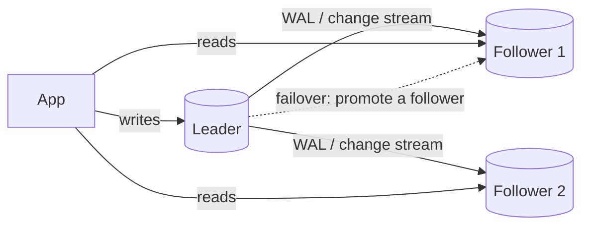

# Replication & High Availability

> Replication copies data to other servers for reads, safety and failover. Know leader–follower replication, the sync vs async trade-off, replication lag and read-your-writes, how failover works and what it can lose, and why replication is not a backup.

Roadmap topic 14 · Stage 4: Choosing & Scaling

**Go deeper:** `05-system-design/18-Replication` · `7` Storage Engines (WAL shipping) · `16` Consistency & Distributed Data · `17` Backup & Recovery · `19` Operations · `09-architecture/12-Scalability-Performance-and-Resilience`.

**Marks:** 🟢 must know · 🟡 good to know

**How the examples are checked:** routing logic and arithmetic are checked in plain Kotlin/Python simulations; PostgreSQL/MySQL commands are shown for the idea and not run.

---

#### 1. What Is It?

*More than one copy of the data, kept in step.*

| 🟢 Must know | 🟡 Good to know |
|---|---|
| leader–follower replication and read replicas | multi-leader and leaderless replication (names) |
| synchronous vs asynchronous replication | split brain and how it is prevented |
| replication lag, stale reads, read-your-writes | logical vs physical replication |
| failover: promotion and the risk of lost writes | connection routing: writes to leader, reads to replicas |
| replication is not a backup | high-availability setups and managed failover |

1. **Leader (primary):** takes all writes. **Follower (replica/standby):** copies the leader's changes and serves reads.
2. **Replication lag:** how far a follower is behind.
3. **Failover:** promoting a follower to leader when the leader fails.
4. **RPO/RTO:** how much data you can lose / how long you can be down (`SD 29`).

**Signals in an interview:** "how do you scale reads?", "what if the primary dies?", "what is replication lag?", "is a replica a backup?", "sync or async?".

---

#### 2. How It Works

**Leader–follower.**



Followers receive the leader's log (the same write-ahead log, topic 7) and apply it. Reads can be spread over followers, which scales read-heavy workloads. Writes still go to one leader, so write scaling needs partitioning (topic 15).

**Synchronous vs asynchronous.**

| | Asynchronous | Synchronous | Semi-synchronous / quorum |
|---|---|---|---|
| Commit returns | after the leader writes | after one or all followers confirm | after at least one follower confirms |
| Latency | lowest | higher (network round trip) | medium |
| Data loss on leader failure | recent commits may be lost (the lag) | none (for confirmed followers) | at most unconfirmed ones |
| Availability | leader keeps working if followers die | writes can stall if a sync follower is down | balanced |
| Typical use | default for read replicas | financial data, same-region standby | HA pairs |

**Replication lag and stale reads.** With async replication a follower may be milliseconds to seconds (or minutes under load) behind. A user who writes and then reads from a follower may not see their own change. Remedies:

1. **Read-your-writes:** read from the leader for a short window after the user writes (or for their own data); or track the last write's log position and read from a follower only when it has reached it.
2. **Monotonic reads:** pin a user to one follower so they don't see time go backwards.
3. Route lag-sensitive reads (balances, order status) to the leader.

**Failover.** Detect the leader failing (health checks, quorum), choose the most up-to-date follower, promote it, redirect writes, and repoint the others. Risks:

| Risk | What happens | Mitigation |
|---|---|---|
| Lost writes (async) | commits not yet on the promoted follower vanish | semi-sync replication; accept an RPO equal to the lag; reconcile from logs |
| Split brain | the old leader comes back and thinks it is still leader: two writers | fencing (STONITH), leases/consensus, a quorum that decides the leader |
| Promotion of a lagging follower | stale data becomes truth | choose the most advanced replica |
| Slow detection | long outage | tuned timeouts, managed failover (tens of seconds to minutes) |
| Clients still connect to the old leader | errors until DNS/endpoint updates | a proxy/virtual endpoint, retry logic |

**Replication is not a backup.** A replica copies *everything*, including `DROP TABLE`, a bad `UPDATE` without `WHERE`, corruption or ransomware, within seconds. Backups (and point-in-time recovery) are separate (topic 17).

🟡 **Multi-leader and leaderless (names).** *Multi-leader*: several nodes accept writes (multi-region, offline-capable); needs conflict resolution. *Leaderless* (Dynamo-style: Cassandra, DynamoDB): any replica accepts writes; reads and writes use quorums (`R + W > N`); conflicts resolved by last-write-wins or version vectors (topic 16).

🟡 **Split brain and prevention.** Two nodes both believing they are leader. Prevent with a majority vote (quorum), a lease with expiry plus fencing tokens, and shutting down the old leader (fencing) before promoting a new one. An odd number of voters avoids ties.

🟡 **Logical vs physical replication.** *Physical* (streaming the WAL bytes): exact copy of the whole cluster, same major version. *Logical* (row-level changes, publish/subscribe): choose tables, replicate across versions, feed other systems (CDC, topic 20), at higher overhead and with restrictions (DDL not included).

🟡 **Connection routing.** The app (or a proxy such as PgBouncer/ProxySQL/pgpool or a managed endpoint) sends writes to the leader and reads to replicas; a separate "reader" endpoint spreads load. Transactions that write must go to the leader entirely.

🟡 **High-availability setups and managed failover.** Managed databases offer Multi-AZ standbys with automatic failover (synchronous or near-synchronous), read replicas, and cross-region replicas for disaster recovery. Patroni/repmgr/Orchestrator automate self-managed clusters. Always test failover.

---

#### 3. Naive vs Better Design

| Naive | Better |
|---|---|
| "we have a replica, so we have a backup" | replicas for availability, backups and PITR for recovery |
| read your own write from a replica | route to the leader briefly, or wait for the log position |
| everything reads from replicas | lag-sensitive reads on the leader |
| failover never tested | rehearse failover and measure the time and lost writes |
| two nodes and no quorum | three or more voters, fencing |
| ignore replica lag until users complain | monitor lag and alert |
| write transactions split across leader and replica | the whole write transaction on the leader |

```kotlin
// Naive: read-after-write goes to a lagging replica; the user sees their note missing
repo.save(note)                    // leader
val mine = replicaRepo.notesFor(user)   // a second later, replica hasn't applied it yet
```

---

#### 4. SQL & Code

Read-your-writes routing (Kotlin, pure and testable):

```kotlin
class ReadRouter(private val clock: () -> Long, private val stickyMs: Long = 3_000) {
    private val lastWrite = HashMap<String, Long>()
    fun onWrite(userId: String) { lastWrite[userId] = clock() }
    fun target(userId: String, lagSensitive: Boolean = false) =
        if (lagSensitive || (lastWrite[userId]?.let { clock() - it < stickyMs } == true)) "leader" else "replica"
}
```

Checks (with a fake clock): a user who just wrote → `target` = `leader` for the next 3 seconds, then `replica`; a user who never wrote → `replica`; `lagSensitive = true` (balance) → `leader` always.

Waiting for the replica to catch up (log position):

```kotlin
fun readFrom(replicaLsn: Long, requiredLsn: Long) = if (replicaLsn >= requiredLsn) "replica" else "leader"
```

Checks: after a write returns LSN `1000`, a replica at `990` → `leader`; at `1005` → `replica`. (PostgreSQL: `pg_current_wal_lsn()` on the leader, `pg_last_wal_replay_lsn()` on the replica; MySQL uses GTIDs.)

Failover data loss arithmetic:

```kotlin
fun maxLostCommits(lagSeconds: Double, writesPerSecond: Double) = lagSeconds * writesPerSecond
```

Checks: async lag `2 s` at `500` writes/s → up to `1,000` commits lost if the leader dies at that moment. With semi-sync (one follower confirms) the unconfirmed window is near zero, at the cost of a round trip per commit.

PostgreSQL setup ideas (not run):

```sql
-- On the leader
ALTER SYSTEM SET wal_level = 'replica';  ALTER SYSTEM SET max_wal_senders = 10;
ALTER SYSTEM SET synchronous_standby_names = 'ANY 1 (replica1, replica2)';      -- quorum: at least one standby confirms
-- Monitor lag (on the leader)
SELECT client_addr, state, pg_wal_lsn_diff(pg_current_wal_lsn(), replay_lsn) AS lag_bytes, replay_lag FROM pg_stat_replication;
-- On a replica
SELECT now() - pg_last_xact_replay_timestamp() AS replay_delay;
```

Spring/HikariCP style read/write split with two pools:

```kotlin
class Databases(val writer: DataSource, val reader: DataSource)
fun <T> Databases.read(lagSensitive: Boolean = false, block: (Connection) -> T): T = (if (lagSensitive) writer else reader).connection.use(block)
fun <T> Databases.write(block: (Connection) -> T): T = writer.connection.use(block)
```

A failover runbook:

```text
DETECT: leader unreachable 10 s (3 failed health checks, confirmed by 2 of 3 voters)
CHOOSE: the follower with the highest replayed LSN
FENCE: make sure the old leader cannot accept writes (stop it, remove its endpoint)
PROMOTE: pg_ctl promote ; repoint followers ; update the writer endpoint
VERIFY: write test, replication status, application errors
AFTER: rebuild the old leader as a follower; review lost-write window; practise again next quarter
```

Replica lag alert rules:

```text
WARN  replay_lag > 5 s for 5 min        PAGE  replay_lag > 60 s or replica disconnected
Dashboard: lag per replica, replication slot size (WAL kept), write rate, apply rate
```

---

#### 5. Numbers & Limits

| Item | Rule of thumb |
|---|---|
| Replication lag | usually milliseconds; seconds under load; minutes during big migrations or slow queries on replicas |
| Read replicas | commonly 1–5; each adds leader load for streaming |
| Failover time | managed: 30–120 s; self-managed with tooling: 10–60 s |
| Async data-loss window | ≈ lag × write rate |
| Quorum | 3 voters tolerate 1 failure; 5 tolerate 2 |
| Sync replication | adds ≥ 1 network round trip (≈ 0.5–2 ms same region; far more across regions) to each commit |
| Read-your-writes window | 1–5 seconds sticky to the leader |
| Replication slots | an idle slot makes the leader retain WAL and can fill the disk: monitor |

---

#### 6. Common Mistakes & Edge Cases

1. Treating a replica as a backup.
2. Reading your own writes from a lagging replica.
3. Never testing failover.
4. Two-node "clusters" without a quorum (split brain).
5. Long queries on a replica delaying replication (conflicts).
6. Not monitoring lag and replication slots.
7. Routing parts of one write transaction to a replica.
8. Assuming synchronous replication means no downtime.

Edge cases: failover during a big transaction; a replica promoted while far behind; cross-region replication with seconds of lag; schema changes that replicate slowly; a dropped table replicated everywhere; DNS caching after failover; replicas having different hardware or indexes for reporting.

---

#### 7. Say This in the Interview

1. "Leader–follower replication: the leader takes writes and ships its log; followers serve reads. It scales reads and gives a standby, but not writes."
2. "Asynchronous replication is fast but can lose the lag window on failover; synchronous or quorum replication avoids loss at the cost of commit latency."
3. "Followers can be stale, so I route read-after-write and lag-sensitive reads to the leader for a short window, or wait for the log position."
4. "Failover must avoid split brain, with quorum and fencing, and must choose the most up-to-date follower; I test it regularly."
5. "A replica is not a backup: a bad delete replicates instantly. I also keep backups with point-in-time recovery."

---

#### 8. Quick Check

1. What does asynchronous replication risk on failover?
2. How do you give a user read-your-writes with replicas?
3. What is split brain?
4. Why isn't a replica a backup?

<details>
<summary>Answers</summary>

1. Losing commits that had not yet reached the promoted follower (about lag × write rate).
2. Read from the leader for a short time after their write, or wait until the replica has reached the write's log position.
3. Two nodes both acting as leader and accepting writes; prevent with quorum and fencing.
4. It copies mistakes and corruption immediately; only a separate, versioned backup can restore earlier states.

</details>

---

#### 9. Practice

**Interview questions**

1. How do you scale a read-heavy database?
2. What happens when the primary fails?
3. Sync vs async replication?
4. How do you handle replication lag in the application?
5. Replica vs backup?
6. What is split brain and how is it prevented?

**Hands-on**

1. Set up PostgreSQL streaming replication locally (two containers) and watch `pg_stat_replication`.
2. Introduce lag (a big write or a paused replica) and test your read-your-writes routing.
3. Promote the replica, write to it, and rebuild the old leader as a follower.
4. Write a failover runbook for your database and rehearse it.

**Remember:** leader writes, followers read · async = fast but can lose the lag window · lag means stale reads: read-your-writes via the leader or LSN · failover needs the freshest follower, quorum and fencing · replicas are not backups · monitor lag and test failover.
