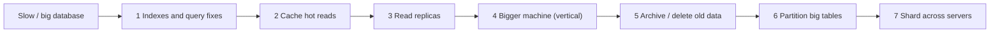

# Partitioning & Sharding

> Splitting data is a last step, not a first one. Try indexes, caching, replicas, a bigger machine and archiving first. When you do split, choose the key carefully, because it decides performance, hotspots and which queries and transactions stay cheap.

Roadmap topic 15 · Stage 4: Choosing & Scaling

**Go deeper:** `05-system-design/19-Partitioning-and-Sharding` (consistent hashing, virtual nodes) · `6` Query Performance · `13` Caching · `14` Replication · `16` Consistency · `09-architecture/12-Scalability-Performance-and-Resilience`.

**Marks:** 🟢 must know · 🟡 good to know

**How the examples are checked:** the sharding movement numbers come from a 100,000-key simulation in Python (MD5 hashing); SQL partitioning syntax is PostgreSQL and not run.

---

#### 1. What Is It?

*Splitting one big data set into smaller parts.*

| 🟢 Must know | 🟡 Good to know |
|---|---|
| try first: indexes, cache, replicas, a bigger machine, archiving | consistent hashing |
| table partitioning (one database) vs sharding (many databases) | directory-based sharding |
| hash vs range partitioning | resharding with double writes |
| choosing a shard key | partition pruning and archiving old partitions |
| hotspots and rebalancing | distributed SQL databases that shard for you |
| costs: cross-shard queries and transactions, operations | |

1. **Partitioning:** splitting a table into parts *inside one database* (PostgreSQL declarative partitions).
2. **Sharding:** splitting data across *several database servers*, each holding a subset.
3. **Shard key:** the column that decides which shard (or partition) a row belongs to.
4. **Hotspot:** one shard or key receiving far more load than the others.

**Signals in an interview:** "the database is too big or too busy, what do you do?", "how do you choose a shard key?", "what breaks when you shard?", "range vs hash?".

---

#### 2. How It Works

**Try these first.**



Each step is cheaper and simpler than the next. Shard only after measuring that writes or data size exceed what one primary can do (topic 11 numbers).

**Table partitioning (inside one database).** One logical table split into physical partitions (by date, by tenant, by hash). Benefits: **partition pruning** (queries that filter on the key touch only relevant partitions), cheap archiving (drop or detach an old partition instead of a giant `DELETE`), smaller indexes, parallelism. It does not add more machines or write capacity.

**Sharding (across servers).** Each shard is an independent database with a slice of the data. Adds capacity for storage and writes. A **router** (library, proxy or service) maps a key to a shard.

**Hash vs range partitioning.**

| | Hash (`hash(key) % N`) | Range (`key` between A and B) |
|---|---|---|
| Spread | even | can be uneven (new data piles into the newest range) |
| Range queries | scatter across all shards | stay local |
| Hotspots | rare (except one hot key) | common (time-based keys: "today" is hot) |
| Rebalancing | `% N` moves most keys when N changes; use consistent hashing | split or merge ranges |
| Good for | user data by `user_id` | time-series, archival, ordered scans |

**Choosing a shard key.**

1. **High cardinality**: many distinct values, so data can spread.
2. **Even distribution**: no single value dominating.
3. **Matches the main query**: most queries include the key, so each hits one shard (`WHERE user_id = ?`).
4. **Stable**: it doesn't change (a row can't easily move shards).
5. Avoid keys that create hotspots (`country`, `status`, a current date, a celebrity user).

Common good choices: `user_id` or `tenant_id`; conversation id for chat; composite keys for sub-ordering.

**Hotspots and rebalancing.** A skewed key (one tenant with 40% of traffic) overloads a shard. Mitigations: split large tenants onto their own shards, add a salt (`user_id#bucket`) for hot keys, use finer-grained shards (many logical shards mapped to fewer servers so you can move whole logical shards), monitor per-shard load.

**The costs.**

| Cost | Why |
|---|---|
| Cross-shard queries | joins, global aggregates and `ORDER BY` across all users must query every shard and merge (scatter-gather) |
| Cross-shard transactions | no single-database ACID across shards; sagas or two-phase commit (slow, complex) |
| Operations | many databases to back up, migrate, monitor, upgrade; schema changes ×N |
| Application complexity | routing, id generation (`SD 20`), uniqueness across shards, resharding |
| Global uniqueness | a unique email across shards needs a lookup table or a global service |

Design so most queries and transactions stay within one shard (all of a user's data together).

🟡 **Consistent hashing.** Place nodes (with many virtual nodes) on a ring; a key belongs to the next node clockwise. When a node is added, only about `1/(N+1)` of the keys move, instead of almost all with `hash % N`.

🟡 **Directory-based sharding.** A lookup table maps key (or key range, tenant) → shard. Flexible (move one tenant at a time) but the directory is a critical, cached dependency.

🟡 **Resharding with double writes.** Create the new layout, write to both, backfill the old data, verify, switch reads, remove the old (the migration pattern, topic 10 and `SD 33`). Plan for it from day one by using many logical shards.

🟡 **Partition pruning and archiving.** Filter on the partition key so the planner scans few partitions; detach/drop old partitions to archive or delete cheaply; keep indexes per partition.

🟡 **Distributed SQL databases.** CockroachDB, YugabyteDB, TiDB, Spanner, Citus (PostgreSQL extension), Vitess (MySQL) shard and rebalance for you with SQL; they add latency and cost and have their own limits, so measure before choosing.

---

#### 3. Naive vs Better Design

| Naive | Better |
|---|---|
| shard first "to be web scale" | indexes, cache, replicas, bigger box, archiving first |
| `hash(user_id) % N` forever | consistent hashing or many logical shards |
| shard by `country` or `status` | high-cardinality key matching the main query |
| range-partition time-series by day on one hot partition | hash + time sub-partitions, or per-device keys |
| global `ORDER BY` across all shards | design queries per shard; build a separate read model |
| cross-shard transactions everywhere | keep a user's data together; sagas for the rest |
| `DELETE FROM events WHERE day < ...` on a huge table | drop old partitions |

```sql
-- Naive: a huge events table, old data deleted with a giant DELETE (locks, bloat, hours)
DELETE FROM events WHERE created_at < now() - interval '90 days';
```

---

#### 4. SQL & Code

Table partitioning by month with cheap archiving (PostgreSQL, not run):

```sql
CREATE TABLE events (
  id bigint GENERATED ALWAYS AS IDENTITY, user_id bigint NOT NULL, created_at timestamptz NOT NULL, payload jsonb
) PARTITION BY RANGE (created_at);
CREATE TABLE events_2025_03 PARTITION OF events FOR VALUES FROM ('2025-03-01') TO ('2025-04-01');
CREATE TABLE events_2025_04 PARTITION OF events FOR VALUES FROM ('2025-04-01') TO ('2025-05-01');
CREATE INDEX ON events (user_id, created_at);                         -- created on each partition

EXPLAIN SELECT * FROM events WHERE created_at >= '2025-03-10' AND created_at < '2025-03-11';      -- scans only events_2025_03 (pruning)
ALTER TABLE events DETACH PARTITION events_2025_03;                    -- archive instantly, no giant DELETE
```

Checks: with 24 monthly partitions, a one-day query touches `1/24` (about `4.2%`) of the data; dropping the oldest month is a metadata operation.

Hash sharding in the application, and why `% N` is fragile (100,000 keys, MD5):

```kotlin
fun shardFor(key: String, shards: Int): Int = Math.floorMod(md5Int(key), shards)
```

Checks (simulation): going from 4 to 5 shards with `hash % N` moves **79.9%** of the keys (data you must migrate and caches you must refill). A consistent-hash ring with 100 virtual nodes per node moves **22.2%** (close to the ideal 20% = 1/5), and spreads keys within about ±25% across shards (`16,306 … 22,225` keys per shard for 100,000 keys).

Consistent hashing in Kotlin:

```kotlin
class Ring(nodes: List<String>, virtualNodes: Int = 100) {
    private val ring = java.util.TreeMap<Int, String>().apply { for (n in nodes) for (i in 0 until virtualNodes) put(md5Int("$n#$i"), n) }
    fun nodeFor(key: String): String = (ring.ceilingEntry(md5Int(key)) ?: ring.firstEntry()).value      // next point clockwise
}
```

Routing with many logical shards (so you can move whole logical shards between servers later):

```kotlin
const val LOGICAL_SHARDS = 1024
fun logicalShard(userId: Long) = Math.floorMod(userId.hashCode(), LOGICAL_SHARDS)
fun server(logical: Int, directory: Map<IntRange, String>) = directory.entries.first { logical in it.key }.value
// directory = {0..255 → "db1", 256..511 → "db2", 512..767 → "db3", 768..1023 → "db4"}; moving 0..127 to "db5" changes one entry and a copy job
```

Checks: with the 4-way directory, `server(300, directory)` → `db2`; after moving logical shards `0..127` to `db5`, users in those shards route to `db5` while 87.5% of the data stays put.

Scatter-gather (what cross-shard queries cost):

```kotlin
suspend fun topNotesAcrossShards(shards: List<Db>, n: Int): List<Note> =
    coroutineScope { shards.map { s -> async { s.recentNotes(limit = n) } }.awaitAll() }.flatten().sortedByDescending { it.createdAt }.take(n)
```

Every shard is asked; latency is the slowest shard; one failed shard breaks the result. Prefer queries that include the shard key.

Key hotspot check:

```kotlin
fun hottest(requestsByShard: Map<Int, Long>): Pair<Int, Double> {
    val total = requestsByShard.values.sum().toDouble()
    val (shard, count) = requestsByShard.maxByOrNull { it.value }!!
    return shard to count / total
}
```

Checks: shard loads `{0: 400, 1: 150, 2: 250, 3: 200}` → hottest shard `0` with `40%` of traffic (even would be 25%): a hotspot to fix (split the tenant, salt the key, or re-balance).

Salting a hot key:

```kotlin
fun saltedKey(hotKey: String, buckets: Int = 8, random: () -> Int = { (0 until 8).random() }) = "$hotKey#${random()}"      // writes spread over 8 keys; reads query all 8 and merge
```

---

#### 5. Numbers & Limits

| Item | Rule of thumb |
|---|---|
| When to shard | single primary saturated after indexing, caching and replicas, or data beyond a few TB |
| Table partition size | 10–100 GB per partition; monthly or weekly for time data |
| Shard count | start with many logical shards (hundreds to thousands) mapped to few servers |
| `hash % N` rebalancing | moves ~80% of keys going 4 → 5 nodes; consistent hashing ~20% |
| Per-shard skew | alert when one shard has > 1.5× the average load |
| Scatter-gather | latency = slowest shard; failure probability grows with shard count |
| Resharding | days to weeks of dual writes and verification: avoid by planning ahead |
| Archiving | keep hot data (30–90 days) on fast storage, old data in cheap tiers |

---

#### 6. Common Mistakes & Edge Cases

1. Sharding before exhausting simpler options.
2. A poor shard key (low cardinality, hot, or not in the main query).
3. `hash % N` with no rebalancing plan.
4. Cross-shard joins and transactions in the hot path.
5. Forgetting global uniqueness and id generation.
6. A time-based key that sends all writes to the newest partition.
7. No per-shard monitoring.
8. Schema changes and backups not automated across shards.

Edge cases: one huge tenant; moving a user between shards; global secondary indexes (a lookup by email must find the shard); shard-aware caching; failures of a single shard (partial outage); late-arriving data in a time-partitioned table; foreign keys across partitions or shards (not enforced across shards).

---

#### 7. Say This in the Interview

1. "I'd try indexes, caching, replicas, a bigger machine and archiving first, then partition big tables, and shard only when measured limits are exceeded."
2. "Partitioning splits a table inside one database (pruning, cheap archiving); sharding spreads data over servers (more write and storage capacity) at the cost of cross-shard queries and transactions."
3. "The shard key needs high cardinality, an even spread and to appear in the main queries; `user_id` or `tenant_id` is typical. I avoid keys that make hotspots."
4. "I'd use many logical shards or consistent hashing so adding servers moves about 1/N of the data instead of most of it."
5. "I design so a user's data lives in one shard, and handle the rest with sagas, read models and scatter-gather only where needed."

---

#### 8. Quick Check

1. Partitioning vs sharding?
2. What makes a good shard key?
3. Why is `hash % N` bad for rebalancing?
4. What are the costs of sharding?

<details>
<summary>Answers</summary>

1. Partitioning splits a table within one database; sharding spreads data across several database servers.
2. High cardinality, even distribution, present in the main query, and stable.
3. Changing N remaps most keys (about 80% when going from 4 to 5 nodes); consistent hashing moves only about 1/(N+1).
4. Cross-shard queries and transactions, operational overhead, routing and id/uniqueness complexity, and resharding work.

</details>

---

#### 9. Practice

**Interview questions**

1. The database is at its limit. What do you do, in order?
2. Design the sharding for a chat app / notes app.
3. Range vs hash partitioning?
4. How do you handle a hot shard?
5. How do you run a query across shards?
6. How do you add a shard to a running system?

**Hands-on**

1. Simulate `hash % N` vs a consistent hash ring for 100,000 keys and measure the fraction moved.
2. Create a monthly-partitioned table in PostgreSQL, use `EXPLAIN` to see pruning, and detach a partition.
3. Compute the hottest shard of a skewed workload and propose a fix.
4. Design the shard key and logical-shard directory for your product.

**Coding warm-ups (LeetCode)**

| # | Question | Link to this topic |
|---|---|---|
| 706 | [Design HashMap](https://leetcode.com/problems/design-hashmap/) (Easy) | hashing into buckets |
| 1244 | [Design A Leaderboard](https://leetcode.com/problems/design-a-leaderboard/) (Medium, premium) | partitioned counters |
| 56 | [Merge Intervals](https://leetcode.com/problems/merge-intervals/) (Medium) | range partitions |
| 23 | [Merge k Sorted Lists](https://leetcode.com/problems/merge-k-sorted-lists/) (Hard) | merging results from shards |

**Remember:** shard last · partition inside, shard across · key = high cardinality + even + in the main query · consistent hashing / logical shards, not `% N` · keep a user's data together · watch hotspots · drop partitions instead of giant deletes.
