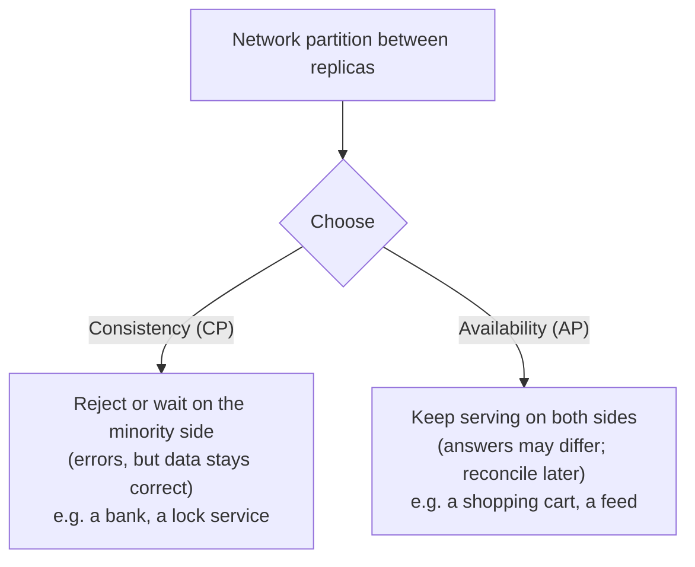

# Consistency, CAP & Distributed Data

> When data lives on several machines, you must decide what readers see after a write, and what to do when the network splits. Choose consistency per feature: strong for money and inventory, eventual for feeds and counters. Know quorums, conflicts and sagas.

Roadmap topic 16 · Stage 4: Choosing & Scaling

**Go deeper:** `05-system-design/23-Consistency-and-CAP` and `26-Service-Boundaries-and-Architecture` (saga, outbox) · `14` Replication · `15` Sharding · `8` Transactions · `9` Concurrency · `09-architecture/09-Data-Architecture`.

**Marks:** 🟢 must know · 🟡 good to know

**How the examples are checked:** quorum and CRDT arithmetic are checked with small Python simulations; distributed-system behaviour is described, not run.

---

#### 1. What Is It?

*What every reader sees, and what happens during failure.*

| 🟢 Must know | 🟡 Good to know |
|---|---|
| strong vs eventual consistency | quorum reads and writes (R + W > N) |
| CAP theorem | causal consistency and read-your-writes |
| which features need strong consistency | distributed transactions: two-phase commit and sagas |
| idempotency and retries across services | PACELC |
| | conflict resolution: last-write-wins, version vectors, CRDTs |
| | BASE as a contrast to ACID |

1. **Strong consistency:** after a write completes, every read sees it.
2. **Eventual consistency:** if writes stop, all replicas eventually agree; reads may be stale meanwhile.
3. **CAP:** during a network partition a system must choose consistency or availability.

**Signals in an interview:** "what is CAP?", "strong vs eventual?", "how do you keep two services consistent?", "what is a saga?", "how do you resolve conflicting edits?".

---

#### 2. How It Works

**Strong vs eventual.**

| | Strong | Eventual |
|---|---|---|
| Reads after a write | always the latest | may be stale for a short time |
| Latency | higher (coordination) | lower |
| Availability under failure | may reject requests | keeps serving |
| Examples | bank balance, seat booking, inventory, unique usernames | likes count, feed, follower count, search index, analytics |

Many systems offer both per operation (read from the leader vs from any replica). **Choose per feature**, not per system.

**CAP theorem.** In a distributed data store, if a network **P**artition happens, you cannot have both **C**onsistency (every read sees the latest write) and **A**vailability (every request gets a non-error response). Partitions are not optional in a real network, so the real choice is C or A *during a partition*:



When there is no partition, you trade **latency vs consistency** (PACELC): even without failures, stronger consistency costs coordination time.

**Which features need strong consistency.** Money movements, inventory/seat counts, uniqueness (usernames, emails), authorisation changes (revoking access), anything where a stale read causes harm. Likely fine with eventual: social counters, recommendations, search results, notifications, analytics, caches.

**Idempotency and retries across services.** A request may be delivered twice (timeouts, retries, at-least-once queues). Make operations idempotent with an idempotency key and unique constraints, and consumers safe to repeat (`SD 22`). Without it, eventual-consistency systems produce duplicates.

🟡 **Quorum reads and writes (`R + W > N`).** With `N` replicas, a write waits for `W` acknowledgements and a read asks `R` replicas. If `R + W > N`, every read overlaps with the latest write's replicas, so it can see it.

| N | R | W | R + W > N? | Meaning |
|---|---|---|---|---|
| 3 | 2 | 2 | yes | strong-ish reads and writes; tolerates 1 node down |
| 3 | 1 | 3 | yes | fast reads, writes need all nodes |
| 3 | 1 | 1 | no | fast, eventually consistent; stale reads possible |
| 5 | 3 | 3 | yes | tolerates 2 nodes down |

🟡 **Causal consistency and read-your-writes.** *Read-your-writes*: you always see your own writes. *Monotonic reads*: you never see older data after newer. *Causal*: if A happened before B (a reply to a message), everyone sees A before B. These "session guarantees" are cheaper than full strong consistency and fix the most visible anomalies.

🟡 **Distributed transactions.** *Two-phase commit (2PC)*: a coordinator asks all participants to prepare, then commit; atomic but blocking if the coordinator fails, and slow; used inside some databases, rarely across services. *Saga*: a sequence of local transactions, each with a compensating action if a later step fails (book, charge, confirm; on failure refund, release). Sagas are eventually consistent and need idempotent steps and compensations (`SD 26`). The **transactional outbox** publishes events reliably from the database (topic 8).

🟡 **PACELC.** "If there's a Partition: Availability or Consistency; Else: Latency or Consistency". It reminds you that consistency costs latency even when nothing is broken.

🟡 **Conflict resolution.**

| Method | How | Trade-off |
|---|---|---|
| Last-write-wins (LWW) | the later timestamp wins | simple; silently loses a concurrent edit; clocks can lie (use server time or hybrid clocks) |
| Version vectors | per-replica counters detect concurrent (conflicting) updates | detects conflicts; the application merges |
| CRDTs | data types that merge automatically (counters, sets, text) | no conflicts; limited types, more metadata |
| Application merge / ask the user | field-level merge or a UI choice | best results; more work |

🟡 **BASE.** Basically Available, Soft state, Eventually consistent: the looser contrast to ACID that many NoSQL stores adopt for scale and availability.

---

#### 3. Naive vs Better Design

| Naive | Better |
|---|---|
| "we need strong consistency everywhere" | strong for money and inventory; eventual elsewhere |
| "eventual is fine" for payments | strong consistency, idempotency and reconciliation |
| reading your own write from a lagging replica | session guarantees (read-your-writes) |
| LWW with client clocks | server-assigned versions, or merge |
| distributed transactions across services | saga + outbox + idempotent steps |
| ignoring duplicates in at-least-once delivery | idempotent consumers and keys |
| CAP as a slogan | name what you do during a partition, per feature |

---

#### 4. SQL & Code

Quorum check:

```kotlin
fun quorumOverlaps(n: Int, r: Int, w: Int) = r + w > n
fun failuresTolerated(n: Int, r: Int, w: Int) = minOf(n - r, n - w)
```

Checks: `quorumOverlaps(3, 2, 2)` → `true`, tolerating `1` failure; `(3, 1, 3)` → `true` but tolerates `0` write failures; `(3, 1, 1)` → `false` (stale reads possible); `(5, 3, 3)` → `true`, tolerating `2`.

Detecting a conflict with version vectors:

```kotlin
typealias VV = Map<String, Int>

fun dominates(a: VV, b: VV) = (a.keys + b.keys).all { (a[it] ?: 0) >= (b[it] ?: 0) }
fun compare(a: VV, b: VV) = when {
    a == b -> "same"
    dominates(a, b) -> "a is newer"
    dominates(b, a) -> "b is newer"
    else -> "conflict"                                      // concurrent edits: merge or ask the user
}
```

Checks: `compare({A:2, B:0}, {A:1, B:1})` → `conflict` (each saw something the other didn't); `compare({A:2, B:1}, {A:1, B:1})` → `a is newer`. Last-write-wins would silently pick one of the conflicting edits.

A CRDT counter (grow-only), merging by taking the maximum per replica:

```kotlin
class GCounter(private val id: String, private val counts: MutableMap<String, Long> = mutableMapOf()) {
    fun increment(by: Long = 1) { counts[id] = (counts[id] ?: 0) + by }
    fun value() = counts.values.sum()
    fun merge(other: GCounter) { other.counts.forEach { (k, v) -> counts[k] = maxOf(counts[k] ?: 0, v) } }
}
```

Checks: replica A counted `A=3, B=1`, replica B counted `A=2, B=4`; after merging, `A=3, B=4`, value `7`; merging again changes nothing (idempotent) and in either order (commutative). Likes, view counters and unread counts fit this model.

A saga with compensations (order → charge → ship), the logic only:

```kotlin
class Step(val name: String, val run: () -> Unit, val undo: () -> Unit)
fun saga(steps: List<Step>, log: MutableList<String>): Boolean {
    val done = ArrayDeque<Step>()
    for (s in steps) { try { s.run(); done.addLast(s); log += "ok ${s.name}" } catch (e: Exception) {
        log += "fail ${s.name}"; while (done.isNotEmpty()) { val d = done.removeLast(); d.undo(); log += "undo ${d.name}" }; return false } }
    return true
}
```

Checks: steps `reserveStock`, `chargeCard`, `createShipment` where `chargeCard` fails → log `[ok reserveStock, fail chargeCard, undo reserveStock]` and the result is `false`. Compensations must be idempotent and may themselves need retries.

Outbox + idempotent consumer (SQL):

```sql
BEGIN; INSERT INTO orders(...) VALUES (...); INSERT INTO outbox(event_id, type, payload) VALUES (:uuid, 'OrderPlaced', :json); COMMIT;
-- consumer: skip events already processed
INSERT INTO processed_events(event_id) VALUES (:uuid) ON CONFLICT DO NOTHING;   -- 0 rows ⇒ duplicate, ignore
```

Read-your-writes for a mobile client (a session token carrying the last write position):

```kotlin
data class SyncToken(val lastSeenVersion: Long)
// the server serves a read only from a replica whose version >= token.lastSeenVersion; otherwise it routes to the leader or waits
```

Mobile offline sync is eventual consistency in miniature: local writes first, push when online, last-write-wins by server version or a field merge, tombstones for deletes (`SD 30`, `MOB 9`).

Choosing consistency per feature (a table you can keep in the design doc):

```text
Feature              Consistency        Read from             Notes
Account balance      strong             leader                idempotency key + reconciliation
Seat booking         strong             leader                atomic conditional update + unique booking
Notes list           read-your-writes   replica after sticky  offline-first on the client
Like count           eventual           cache/replica         CRDT counter or async aggregation
Search results       eventual           search index          lag of seconds, rebuildable
```

---

#### 5. Numbers & Limits

| Item | Rule of thumb |
|---|---|
| Replication lag (async) | ms–seconds; design reads to tolerate it |
| Quorum | `R + W > N`; N = 3 or 5; majority = ⌊N/2⌋ + 1 |
| Saga steps | a handful; each with an idempotent compensation |
| 2PC | blocking on coordinator failure; avoid across services |
| Idempotency window | keys kept 24 h–7 days |
| Clock skew | milliseconds to seconds; don't use wall clocks to order concurrent writes |
| Conflicts | design for them in multi-writer systems; measure the rate |
| CAP choice | per feature and per operation, not per system |

---

#### 6. Common Mistakes & Edge Cases

1. One consistency level for everything.
2. Treating "eventual" as "never wrong".
3. Using timestamps from client clocks for ordering.
4. No idempotency in at-least-once flows.
5. Distributed transactions where a saga would do.
6. Sagas without compensations or with non-idempotent ones.
7. Ignoring the partition case ("the network is reliable").
8. Hiding conflicts instead of detecting them.

Edge cases: a partition that heals with divergent data (reconciliation); a leader that thinks it is still leader (split brain); deletes racing with updates (tombstones); a compensation that fails; reordering of events (version numbers); multi-region writes (conflict handling or a single home region per record).

---

#### 7. Say This in the Interview

1. "Consistency is per feature: money, inventory and uniqueness need strong consistency; feeds, counters and search can be eventual."
2. "CAP says that during a network partition you choose between consistency and availability; the rest of the time the trade is latency against consistency."
3. "With quorums, if `R + W > N` reads overlap the latest write; for N = 3, R = 2 and W = 2 tolerates one failure."
4. "Across services I avoid distributed transactions: a saga with idempotent compensations and a transactional outbox, with idempotent consumers."
5. "Concurrent edits are detected with versions or version vectors and merged, or modelled as CRDTs; last-write-wins is simple but can silently lose edits."

---

#### 8. Quick Check

1. What does CAP force you to choose during a partition?
2. When does `R + W > N` guarantee seeing the latest write?
3. What is a saga?
4. Why avoid client clocks for conflict resolution?

<details>
<summary>Answers</summary>

1. Consistency or availability.
2. When the read set must overlap the write set; at least one replica in the read has the latest write.
3. A series of local transactions with compensating actions to undo earlier steps on failure.
4. Clocks differ and can be wrong, so ordering by them can pick the wrong "latest".

</details>

---

#### 9. Practice

**Interview questions**

1. Explain strong vs eventual consistency with examples.
2. Explain CAP. Which side would you choose for a chat app? For payments?
3. How do you keep an order and a payment consistent across two services?
4. How do you handle two devices editing the same note?
5. What is a quorum?
6. What is a CRDT?

**Hands-on**

1. Write the consistency table for your product's features.
2. Implement the version-vector comparison and the G-counter merge with tests.
3. Implement a saga for "place order" with failure injection at each step.
4. Add an idempotent consumer with a `processed_events` table and replay the same event 5 times.

**Remember:** consistency per feature · CAP: during a partition choose C or A · quorums `R + W > N` · session guarantees fix the visible anomalies · saga + outbox + idempotency instead of distributed transactions · detect conflicts; merge, CRDT or ask.
